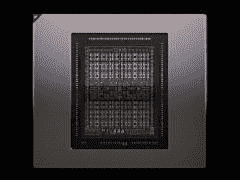
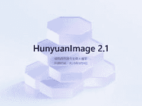
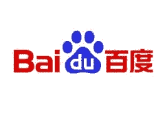

# 09.10-首款专为大规模上下文 AI 设计的 CUDA GPU，英伟达 Rubin CPX 发布

> 来源：[https://agijuejin.feishu.cn/docx/RI2edkxUzoQ42bx35v2cY8HVnwf](https://agijuejin.feishu.cn/docx/RI2edkxUzoQ42bx35v2cY8HVnwf)

# AGI 掘金日报 - AI 新闻推送 (2025 年 09 月 10 日)

> [欢迎加入 AGI 掘金社群](https://applink.larkoffice.com/client/chat/chatter/add_by_link?link_token=890h8ad3-71e6-4140-af64-39dff6b2ba1f)

## ⭐ 今日热点

### 💡 首款专为大规模上下文 AI 设计的 CUDA GPU，英伟达 Rubin CPX 发布

IT之家 | [阅读原文](https://www.ithome.com/0/881/665.htm)

9月10日，英伟达推出专为大规模上下文处理设计的专用GPU——Rubin CPX。它能区分理解提示与生成响应任务，预计作为Vera Rubin平台一部分工作。独立的Rubin CPX含128GB GDDR7显存，有诸多性能优势。黄仁勋将其与RTX比较，称投资1亿美元可产生50亿美元收益。该硬件将获软件栈支持。预计2026年底推出。

## 🌟 技术突破

### 💡 腾讯混元图像模型 2.1 上新开源：原生 2K 生图、中英文输入

IT之家 | [阅读原文](https://www.ithome.com/0/881/662.htm)

9月9日，腾讯宣布混元图像模型 2.1 上新开源 ，支持原生 2K 生图、中英文原生输入，还同步开源“PromptEnhancer 文本改写模型 ”。混元图像模型 2.1 支持复杂语义超长prompt、多主体精确生成，对文字渲染和场景细节把控更稳定，能生成多种风格。其还有双通道文本编码器等亮点，提升模型性能与效率，开源地址：https://github.com/Tencent-Hunyuan/HunyuanImage-2.1 。

### 💡 B站开源自研 IndexTTS-2.0：情感可控、时长可控的零样本语音合成 AI 模型

IT之家 | [阅读原文](https://www.ithome.com/0/881/535.htm)

9月8日，B站开源自研语音生成大模型IndexTTS-2.0，它是首个支持精确时长控制的自回归零样本文本转语音系统。该模型适合视频配音，支持两种生成模式，实现情感与音色解耦。团队引入GPT潜在表示等提升性能，实验表明其在多方面超越先进零样本TTS模型。团队将公开代码和预训练权重，推动学术研究与产业落地，还公布了技术报告、仓库及Demo展示地址。

### 💡 人像图转手办图、渲染文字支持编辑，字节跳动发布 Seedream 4.0 图像创作模型

IT之家 | [阅读原文](https://www.ithome.com/0/881/512.htm)

9月9日，字节跳动发布Seedream 4.0图像创作模型，在豆包App等上线。相比前代，增强逻辑理解能力、提升推理速度。更新要点包括精准编辑，可完成复杂图像任务；灵活参考，能抽取关键信息再造图片；原生集成视觉信号生成能力；具备上下文推理生成能力；支持多图参考与输出；能处理复杂文字排版；生成分辨率达4K，有自适应比例机制。

### 💡 百度发布文心大模型 X1.1 深度思考模型，整体表现超越 DeepSeek R1

IT之家 | [阅读原文](https://www.ithome.com/0/881/471.htm)

9月**9日，百度**首席技术官王海**峰在WAV**E SUMM**IT 深**度学习开发者大会 2025 上，发布文心大模型 X1.1 深度思考模型。该模型基于文心大模型 4.5 训练，采用新训练框架，在多项能力上显著提升，事实性提升34.8%，指令遵循提升12.5%，智能体提升9.6%。其整体表现超越 DeepSeek R1，与 GPT-5 和 Gemini 2.5 Pro 效果持平。此外，百度还发布飞桨核心框架 3.2 版本等，其生态开发者达 2333 万，服务企业 76 万家 。

### 💡 不到10天，国产「香蕉」突袭！一次7图逼真还原，合成大法惊呆歪果仁

新智元 | [阅读原文](https://www.163.com/dy/article/K90U84410511ABV6.html?spss=dy_author)

谷歌「香蕉」爆火10天后，Vidu Q1上线「参考生图」功能。其支持单次最多7张参考图，突破竞品限制，能自由组合图片。在一致性、还原度上表现出色，超越部分同类产品。玩法丰富，能换装、换背景等，创意自由度高。还能应用于电商广告等多行业，提升效率，开启AI视频「生产级应用」新纪元。

### 💡 再也不怕面瘫脸！YouTube黑科技：AI帮你「永久微笑」，连僵尸都咧嘴笑

新智元 | [阅读原文](https://www.163.com/dy/article/K90TSL150511ABV6.html?spss=dy_author)

YouTube在Shorts相机实现AI实时“重绘”人脸特效。其通过知识蒸馏将大模型“瘦身”成移动端小模型，采用迭代蒸馏打磨细节。用PTI解决身份还原问题，以MediaPipe搭建推理管道。目前该技术已铺开，有几十种实时特效，还在测试Veo模型，可从静态图片生成视频，将降低创作门槛，让AI成创作工具。在Pixel 8 Pro上运算一帧只需6毫秒，iPhone 13约10毫秒。

### 💡 中国具备人形机器人从关键芯片到部组件，到整机的全产业链制造能力

IT之家 | [阅读原文](https://www.ithome.com/0/881/461.htm)

9月9日国新办新闻发布会上，工信部部长李乐成称中国具备人形机器人全产业链制造能力，从关键芯片到部组件再到整机均可制造。“十四五”以来，46个城市开展新型技术改造试点，建成众多卓越级智能工厂和5G工厂，工业机器人新增装机量占全球超50%。此外，传统制造业在能耗、产量、品牌等方面也成果显著，去年18家企业入选世界品牌500强 。

## 💫 企业动态

### 💡 狂登热搜，iPhone 17「挤爆牙膏」！5999起价，AirPods变身同声传译

新智元 | [阅读原文](https://www.163.com/dy/article/K92V5MK10511ABV6.html?spss=dy_author)

苹果秋季发布会带来iPhone 17系列、iPhone Air、AirPods Pro 3和Apple Watch等新品。iPhone Air轻薄，有eSIM；iPhone 17有高刷，性价比高；iPhone 17 Pro性能强。A19等四款芯片性能提升。AirPods Pro 3有实时翻译等功能。Apple Watch Series 11新增高血压预警等功能。还公布了各产品预购和发售时间及价格。

### 💡 Hinton预言失灵？掌握AI技能涨薪23%，比读硕士更赚钱

新智元 | [阅读原文](https://www.163.com/dy/article/K924DOPP0511ABV6.html?spss=dy_author)

Hinton曾称AI会让多数人更穷，但掌握AI技能涨薪可观。市场上AI科技岗招聘信息占比达24%创新高。多机构研究显示，标注AI技能职位平均溢价28%，2项以上AI技能溢价43%；实操AI任务能力加薪19% - 23%，认证仅9% - 11%；全球具备AI技能员工最高可高出56%；英国AI技能溢价23%，远超硕士的13%。企业因降本增效，对岗位要求精细化，会用AI者更值钱。

### 💡 中国移动灵犀智能体产品族全面落地荣耀 AI 手机

IT之家 | [阅读原文](https://www.ithome.com/0/881/658.htm)

2025年9月9日，中国移动灵犀深度研究智能体全量上线荣耀X70i AI版手机，其首批五大场景能力已全面适配荣耀智能手机。此前已在出行、娱乐、金融、通信领域上线四大能力，此次更新的“灵犀深度研究智能体”可实现复杂问题系统化研究，报告支持下载。荣耀X70i AI版用户将YOYO更新至指定版本，即可体验该能力。

### 💡 AMD：人工智能仍被低估，AI PC 需基于性能优秀的 PC

IT之家 | [阅读原文](https://www.ithome.com/0/881/646.htm)

9月9日，AMD官方在IFA 2025圆桌会议谈到人工智能。AMD认为AI仍被低估，未来三至五年将大发展，有望成为推动人类进步的重要工具。对于AI PC，AMD觉得需基于高性能PC，首要任务是为“完美PC”提供软硬件。AMD还称NPU不会取代CPU和GPU，将兼顾高能效与强性能。此外，人工智能图形渲染方面，FSR Redstone计划今年内推出。

### 💡 全球首款“边走边讲边演示”人形机器人：魔法原子发布智慧导览解决方案

IT之家 | [阅读原文](https://www.ithome.com/0/881/628.htm)

9月9日，具身智能科技公司魔法原子发布智慧导览解决方案，以全栈自研的人形机器人MagicBot Gen1 为载体。该机器人“小麦”身高1.74米，动作流畅，机械臂灵活。其导览方案响应快，App 可自定义，续航 5 小时，能自主导航、识别访客。支持多语言，知识丰富，全场景适用，已在多个项目成功验证 。

### 💡 OpenAI真正王牌，不是Ilya！刚刚，奥特曼罕见致谢这两人

新智元 | [阅读原文](https://www.163.com/dy/article/K91G86880511ABV6.html?spss=dy_author)

OpenAI的奥特曼罕见致谢Jakub Pachocki和Szymon Sidor。这对波兰高中同窗从Dota AI到GPT-4等核心节点贡献巨大。Jakub是编程天才，现为首席科学家，主导多项关键研究；Szymon经验丰富，负责工程落地与调试。二人优势互补，被赞没有解决不了的问题，是支撑OpenAI科研的黄金搭档 。

### 💡 工信部：推动体育器械与人工智能、虚拟现实等新技术融合创新

IT之家 | [阅读原文](https://www.ithome.com/0/881/579.htm)

2025年9月9日国新办政策吹风会，工信部将落实《关于释放体育消费潜力进一步推进体育产业高质量发展的意见》。具体举措有：推动关键技术研发，满足竞技与大众需求；拓展消费新场景，促进体育器械与新技术融合，开发含中国文化元素的器械；加大优质品牌培育，打造知名品牌与龙头企业；加强国际交流合作，支持企业多方面交流，推进体育器械“走出去”。

### 💡 国内首家支持全形态 AI 编程工具：腾讯发布自研 AI CLI 工具 CodeBuddy Code

IT之家 | [阅读原文](https://www.ithome.com/0/881/526.htm)

9月9日，腾讯发布自研AI CLI工具CodeBuddy Code，且CodeBuddy IDE国际版开启公测。腾讯云成为业内首家同时支持插件、IDE和CLI三种形态AI编程工具的厂商，覆盖全场景需求。用户可免费使用国内版产品，国际版测试期有体验额度。CodeBuddy Code面向专业工程师，优势明显，能无缝融入现有流程、开箱即用且扩展性强，还可自动化复杂任务。

### 💡 中国气象局推动 AI 天气预报模型创新融合应用，伏羲、璞云、风乌、风清、盘古等入选

IT之家 | [阅读原文](https://www.ithome.com/0/881/523.htm)

9月9日中国气象局举行发布会，其2024年6月启动人工智能天气预报模型示范计划，吸引35家高校、企业等报名，14个模型参与实时预报示范。经测试，伏羲、璞云等模型性能较好。后续，对性能优良模型将给予激励支持。9至10月为总结评估期，气象局将组织专家评审，强化模型业务应用，推动AI天气预报模型与气象业务创新融合。

### 💡 ASML 官宣同 Mistral AI 达成战略合作伙伴关系，并向后者投资 13 亿欧元

IT之家 | [阅读原文](https://www.ithome.com/0/881/485.htm)

当地时间9月9日，光刻机巨头ASML与法国人工智能初创企业Mistral AI建立战略合作伙伴关系。Mistral AI完成17亿欧元C轮融资，ASML领投13亿欧元，将持有约11%股份，其首席财务官加入战略委员会。双方将探索在ASML产品及研发中用AI模型，为客户带来效益。ASML总裁称合作能创造效益、研究未来机遇；Mistral AI首席执行官表示合作将强化自身在AI市场地位，携手加速技术进步。

### 💡 定制专属 emoji 形象，小米超级小爱语音助手上线“定制分身小人”

IT之家 | [阅读原文](https://www.ithome.com/0/881/484.htm)

9月9日消息，小米超级小爱语音助手上线“定制分身小人”功能。在小米手机上对超级小爱说“定制分身小人”即可使用，用户上传照片可一键生成emoji效果小人 。实测该功能有专属形象等四个板块，系统自动分析生成图片。不过目前体验用户多，上传图片有时需排队等待；部分用户反馈v7.506.1版本的超级小爱无法使用此功能。

### 💡 微软大手笔锁定 174 亿美元外部 AI GPU 云算力，Nebius 负责供应

IT之家 | [阅读原文](https://www.ithome.com/0/881/469.htm)

当地时间9月8日，新兴AI云服务企业Nebius宣布与微软达成至少价值174亿美元（约合1240.12亿元人民币）的云GPU租赁协议。从今年晚些时候到2026年，Nebius将从新建数据中心为微软提供专用GPU基础设施容量，每期协议5年。截至2031年总合同价值约174亿美元，微软还可追加算力，合同金额将扩至约194亿美元。微软将外购容量作为AI算力储备战略一部分，今年早些时候曾放弃锁定CoreWeave约120亿美元的GPU容量，后被OpenAI购入。

## ✨ 行业观点

### 💡 缔造OpenAI的秘密，竟只有一个词！新智元十年峰会圆桌，七位大咖激辩

新智元 | [阅读原文](https://www.163.com/dy/article/K91T5QFO0511ABV6.html?spss=dy_author)

新智元十周年圆桌论坛上，七位来自多领域的嘉宾探讨AI发展关键问题。他们认为AI发展超预期，语言是智能核心。还谈到游戏推动AI突破；实现ASI关键在能耗；目前芯片和传感器与人脑相比有差距，物理相关领域发展慢；未来社会结构或被颠覆，软件更便宜，编程门槛降低。最后嘉宾们对新智元及读者送上寄语 。