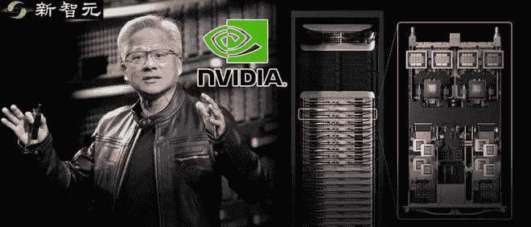
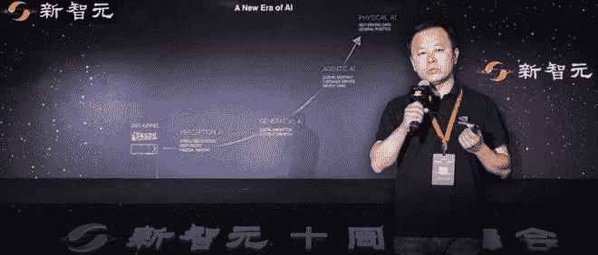

# 09.11-谷歌发布低成本订阅方案“AI Plus”：面向印尼等市场，每月仅需约 4.6 美元

> 来源：[https://agijuejin.feishu.cn/docx/Q6KWdeGd8oj0mtxaiSCcIAhMndf](https://agijuejin.feishu.cn/docx/Q6KWdeGd8oj0mtxaiSCcIAhMndf)

# AGI 掘金日报 - AI 新闻推送 (2025 年 09 月 11 日)

> [欢迎加入 AGI 掘金社群](https://applink.larkoffice.com/client/chat/chatter/add_by_link?link_token=890h8ad3-71e6-4140-af64-39dff6b2ba1f)

## ⭐ 今日热点

### 💡 谷歌发布低成本订阅方案“AI Plus”：面向印尼等市场，每月仅需约 4.6 美元

IT之家 | [阅读·原文](https://www.ithome.com/0/881/932.htm)

9月10日，谷歌推出新订阅服务“AI Plus”，面向印尼等新兴市场，月费约4.6美元。该服务位于免费版和AI Pro之间，订阅者对Gemini 2.5 Pro有更多访问权限，每天提示次数超免费用户。其上下文窗口为128K token。还将集成Veo 3 Fast，提供部分工具访问权，在部分软件能用Gemini侧边栏等，有200GB Google One存储空间 。目前先在印尼上线，其他国家随后推出。

## 🌟 技术突破

### 💡 刚刚，英伟达祭出下一代GPU！狂飙百万token巨兽，投1亿爆赚50亿

新智元 | [阅读原文](https://www.163.com/dy/article/K94AO6O00511ABV6.html?spss=dy_author)

2025年英伟达发布专为海量上下文AI打造的CUDA GPU——Rubin CPX。其性能强劲，是Vera Rubin NVL144平台2倍多，GB300 NVL72系统7.5倍 ，投入产出比高，每1亿美元最高可获50亿美元Token收入。它开创CPX全新处理器类别，解决AI「长上下文」瓶颈。通过解耦式推理创新带来30 - 50倍ROI。预计2026年底可用，将解锁强大能力，重新定义生成式AI应用构建可能。黄仁勋称其推动AI计算前沿。

### 💡 真・博士水平：OpenAI GPT-5 首次给出第四矩定理显式收敛率，数学教授只点拨了一下

IT之家 | [阅读原文](https://www.ithome.com/0/881/891.htm)

OpenAI 的 GPT-5 展现强大数学能力。在数学教授引导下，它首次将定性的第四矩定理扩展为带显式收敛率的定量形式，明确了收敛速率。此前 GPT-5 Pro 曾改进凸优化领域边界值。此次研究中，GPT-5 在教授提示下虽出现推理错误，但能理解错误来源并给出正确结果，还将成果整理成论文格式，并建议推广到非高斯框架，后续在泊松情形研究中经引导也重新表述了定理 。

### 💡 快慢思考不用二选一：华为开源 7B 模型实现自由切，精度不变思维链减近 50%

IT之家 | [阅读原文](https://www.ithome.com/0/881/888.htm)

华为**开源o**penPangu-Embedded-7B-v1.1模型，参数7B。其用渐进式微调策略模拟人类学习，独特快慢思考自适应模式实现自由切换，在多权威评测中精度提升，复杂任务准确率不变，简单任务思维链缩短近50%。团队还推出边缘AI部署的openPangu-Embedded-1B小模型，性能亮眼。该模型填补开源空白，展示国产大模型创新活力，已在GitCode开源。

### 💡 谷歌 Veo 3 已支持生成 1080P 分辨率与竖屏视频，且费用大降

IT之家 | [阅读原文](https://www.ithome.com/0/881/865.htm)

9月10日消息，谷歌为Veo 3 AI视频生成工具新增1080P分辨率与竖屏视频格式支持。开发者在API请求中设参数可启用竖屏功能，1080P目前仅支持16:9比例视频。谷歌称Veo 3与Veo 3 Fast达稳定状态，可规模化生产使用，且大幅降低成本，Veo 3生成费用从每秒0.75美元降至0.40美元，Veo 3 Fast从每秒0.40美元降至0.15美元。未来更多竖屏平台或现大量Veo 3生成内容。

## ✨ 行业观点

### 💡 当智能醒于物理世界，英伟达副总裁: 下一个十年属于物理AI！｜新智元十周年峰会

新智元 | [阅读原文](https://www.163.com/dy/article/K93HIRVN0511ABV6.html?spss=dy_author)

在新智元十周年峰会上，NVIDIA 副总裁赖俊杰称下一个十年属于物理 AI，这是继生成式 AI 和智能体 AI 后的下一波浪潮。他分享了英伟达的物理 AI 战略构想，提到其面临数据采集、测试验证成本高等挑战。为应对这些，英伟达今年初开源 Cosmos 世界基础模型，包含三类模型，可助力物理 AI 发展，未来有望在物理世界取得进步，解放人类生产力 。