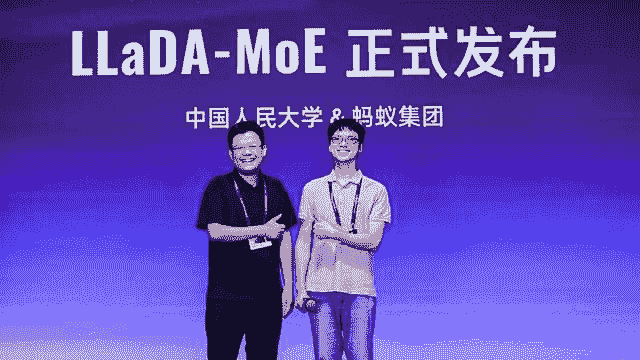
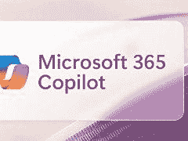
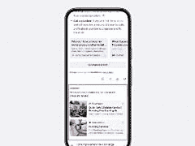
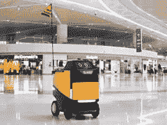

# 09.12-2025外滩大会：蚂蚁、人大发布首个原生MoE扩散语言模型，将于近期开源

> 来源：[https://agijuejin.feishu.cn/docx/IqIvdZOlLoYuW0xua9HcwR3cnFh](https://agijuejin.feishu.cn/docx/IqIvdZOlLoYuW0xua9HcwR3cnFh)

# AGI 掘金日报 - AI 新闻推送 (2025 年 09 月 12 日)

> [欢迎加入 AGI 掘金社群](https://applink.larkoffice.com/client/chat/chatter/add_by_link?link_token=890h8ad3-71e6-4140-af64-39dff6b2ba1f)

## ⭐ 今日热点

### 💡 2025外滩大会：蚂蚁、人大发布首个原生MoE扩散语言模型，将于近期开源

量子位 | [阅读原文](https://www.qbitai.com/2025/09/330639.html)

9月11日，蚂蚁集团与中国人民大学在2025外滩大会联合发布首个原生MoE架构扩散语言模型“LLaDA-MoE”。该模型在约20T数据上从零训练，验证了工业级大规模训练的扩展性等。其性能领先部分扩散模型，比肩等效自回归模型且推理速度快。团队攻关3个月取得突破，模型及推理引擎将开源，后续还将推动AGI新突破。蚂蚁集团蓝振忠等参与发布并分享观点 。

## 🌟 技术突破

### 💡 阿里云发布通义 Qwen3-Next 基础模型架构并开源 80B-A3B 系列：改进混合注意力机制、高稀疏度 MoE 结构

IT之家 | [阅读原文](https://www.ithome.com/0/882/311.htm)

9月12日，阿里云通义团队推出Qwen3-Next基础模型架构，开源Qwen3-Next-80B-A3B系列模型。该架构针对大模型发展趋势设计，相比Qwen3的MoE结构有核心改进。基于此训练的Qwen3-Next-80B-A3B-Base模型，800亿参数仅激活30亿，训练成本低，推理吞吐高，原生支持262K上下文。其在多方面表现出色，模型权重已发布，可通过多框架部署 。

## 💫 企业动态

### 💡 腾讯辟谣“前 OpenAI 姚顺雨上亿薪资入职腾讯”

IT之家 | [阅读原文](https://www.ithome.com/0/882/333.htm)

2025年9月12日，腾讯官方公众号“鹅厂黑板报”辟谣“前OpenAI姚顺雨上亿薪资入职腾讯”的报道为谣言。姚顺雨本科毕业于清华姚班，普林斯顿大学博士，2024年加入OpenAI参与相关产品开发，有诸多研究成果，2025年5月成为《麻省理工科技评论》TR35中国区最年轻入选者 。

### 💡 微软调整 Copilot 定价策略：销售、服务、财务专属功能不再额外收费

IT之家 | [阅读原文](https://www.ithome.com/0/882/301.htm)

9月11日消息，微软致力于让Copilot融入用户生活工作。此前Microsoft 365 Copilot订阅月定价30美元，专属Copilot附加功能月额外收20美元，整套月均50美元，价格过高。自10月中旬起，销售、服务、财务专属Copilot将向所有Microsoft 365 Copilot订阅用户免费开放，用户无需再额外付20美元。微软认为专属Copilot能为“前沿企业”带来价值，三大领域的Copilot解决方案下月将在代理商店上线。

### 💡 跨越语种障碍，YouTube 全面上线视频多语言配音功能

IT之家 | [阅读原文](https://www.ithome.com/0/882/298.htm)

当地时间9月11日周三，YouTube宣布多语言配音功能历经两年试点后正式上线。2023年率先试点，起初创作者借助第三方配音，后YouTube基于谷歌Gemini技术推出AI自动配音工具，可模仿语气情绪。该功能效果明显，非主要语言观众贡献超四分之一观看时长，Jamie Oliver频道播放量增长三倍。此外，YouTube还测试了多语言缩略图功能。

### 💡 微软 Copilot 新增音频表达式功能，莎士比亚腔、体育解说都能整

IT之家 | [阅读原文](https://www.ithome.com/0/882/297.htm)

9月11日，微软为Copilot工具新增“Copilot音频表达式”功能，基于MAI-Voice-1模型。用户可从“有感染力模式”“故事模式”“脚本模式”中选择，每种模式有多种语音类型与风格，如莎士比亚作品朗读、体育解说风格等。新功能已在Copilot Labs上线。微软推出首款大型语言模型MAI-1，还与Anthropic达成协议，显示其致力于减少对OpenAI的依赖。

### 💡 OpenAI 为 ChatGPT 带来“开发者模式”，Plus / Pro 订阅用户可配置接入 MCP 客户端

IT之家 | [阅读原文](https://www.ithome.com/0/882/294.htm)

9月11日，OpenAI 为 ChatGPT 带来“开发者模式”，目前仅网页端上线，且仅限 Plus / Pro 订阅用户使用。用户在设置页面手动启用后，可配置 MCP 客户端，使应用场景更贴近真实开发流程。OpenAI 强调该模式权限高，安全设计谨慎，每次工具调用会显示完整 JSON 输入输出，修改数据需人工确认。同时提醒开发者注意“提示词注入”等风险及写入操作可能的逻辑错误 。

### 💡 谷歌在 AI 生成的搜索答案旁塞入广告，监管已关注

IT之家 | [阅读原文](https://www.ithome.com/0/882/291.htm)

谷歌将广告植入AI生成的搜索答案中，借助AI Max工具拓展情境化、个性化广告投放。超60%购物搜索用对话式语言，凸显AI答案优势。谷歌正转型为“全方位内容发布者”，增强了在数字广告领域的影响力，但损害了外部发布商等利益。谷歌未来或深化广告整合，监管已关注，美国有关部门起诉要求拆分其广告技术部门，谷歌律师称拆分将加速开放网络衰退。

### 💡 腾讯会议联合元宝上线“AI 托管”功能：AI 替你“参会”，还能帮你记录

IT之家 | [阅读原文](https://www.ithome.com/0/882/251.htm)

9月11日，腾讯会议联合元宝推出“AI托管”功能。用户在会议邀请或列表页面点击该功能，元宝能在用户入会前“先听会”并生成AI纪要。开启后用户可再点击入会切换状态，会后还能向元宝发问。此功能支持同时托管多个会议，解决单一账号参会限制，可提前设置参数。腾讯元宝承担语音识别、内容理解、文档生成等核心功能。

### 💡 国内首家：深圳机场联合美团上线智能送餐服务，机器人帮你配送到登机口

IT之家 | [阅读原文](https://www.ithome.com/0/882/242.htm)

9月11日消息，深圳机场携手美团上线国内机场首家智能送餐服务。旅客通过美团App下单，“小黄蜂”智能送餐机器人可将餐品配送到卫星厅任意登机口。这是美团首次将机场场景纳入配送服务范围，也是“小黄蜂”在大型交通场站场景首次应用。目前11家卫星厅门店支持该服务，含星巴克等连锁品牌，后续还将引入更多品牌。

### 💡 美国加州拟立法严管“陪伴型”聊天机器人：“AI 受害者”可起诉服务提供商

IT之家 | [阅读原文](https://www.ithome.com/0/882/193.htm)

当地时间周三，加州州议会通过SB 243法案严管“陪伴型”聊天机器人，已送交州参议院，周五将最终表决。若州长签署，2026年1月1日生效。法案旨在保护未成年人和弱势群体，禁止聊天机器人与用户讨论不良话题，要定期提醒未成年人在与AI对话 。允许受害者起诉，每次违规最高赔偿1000美元。该法案源于少年悲剧及Meta文件泄露事件。早期版本部分要求已删除。

### 💡 微信公众号上线“智能回复”功能：腾讯混元 AI 大模型加持、可自学习用户语言风格

IT之家 | [阅读原文](https://www.ithome.com/0/882/159.htm)

9月11日，微信官方宣布公众号上线“智能回复”功能，在公众号PC端后台“互动管理”内点击“自动回复”即可开启。该功能由腾讯混元AI大模型支持，能自动学习用户历史文章信息、回复语言风格等，可作为“数字分身”回复后台私信。用户还能通过添加知识库、编写提示词等方式调整“数字分身”。

## ✨ 行业观点

### 💡 宇树科技官宣 IPO 后王兴兴首次发声：最后悔以前没有学 AI

IT之家 | [阅读原文](https://www.ithome.com/0/882/111.htm)

宇树科技创始人王兴兴在多个场合表达对未重视AI的后悔。2011年他因AI书籍少转做机器人。如今他指出，虽AI绘画等应用多，但在干活领域少，现在努力仍有机会。他还称低估了AI技术进步，其推动机器人行业进步，宇树科技希望借助AI让机器人解放人类生产力，通过表演等产生商业价值。