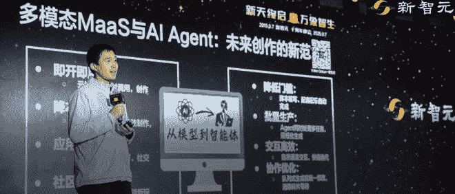
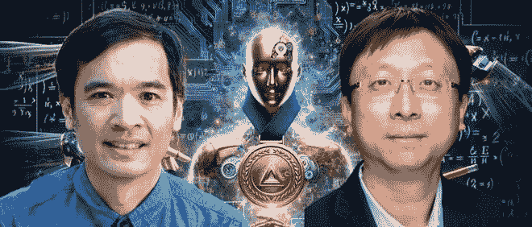
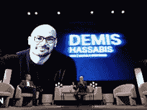
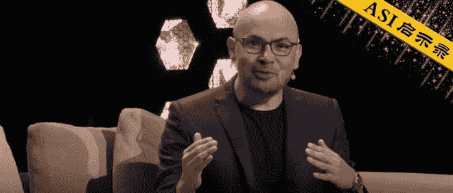

# 09.15-Stable Audio 2.5 企业级音频生成 AI 模型发布，号称“3 分钟曲目 2 秒钟完成”

> 来源：[https://agijuejin.feishu.cn/docx/IYP4doQwwoGeUXx0PJucHD6gnj2](https://agijuejin.feishu.cn/docx/IYP4doQwwoGeUXx0PJucHD6gnj2)

# AGI 掘金日报 - AI 新闻推送 (2025 年 09 月 15 日)

> [欢迎加入 AGI 掘金社群](https://applink.larkoffice.com/client/chat/chatter/add_by_link?link_token=890h8ad3-71e6-4140-af64-39dff6b2ba1f)

## ⭐ 今日热点

### 💡 Stable Audio 2.5 企业级音频生成 AI 模型发布，号称“3 分钟曲目 2 秒钟完成”

IT之家 | [阅读原文](https://www.ithome.com/0/882/894.htm)

9月14日，Stability AI发布企业级音频生成模型Stable Audio 2.5。相比上一代，其在音频细节、生成速度等方面提升显著，号称2秒可创建3分钟音频曲目。核心改进在音乐生成能力，贴合编曲逻辑，对提示词理解更准。速度提升得益于ARC后训练方法，还新增音频修补能力，适合剪辑。该模型可在官网试用，支持本地化部署，官方会检测上传音频，防止版权问题 。

## 🌟 技术突破

### 💡 科学家发现 AI 能像人类一样评估社交情境，科研效率远超人工

IT之家 | [阅读原文](https://www.ithome.com/0/882/851.htm)

芬兰图尔库大学研究表明，GPT-4V 能像人类一样从图像和视频中识别解读复杂社交信息，准确性与人类媲美。研究成果 9 月 2 日发表在《成像神经科学》。测试中 ChatGPT 评估结果与人类高度接近，比单个人更可靠。科研效率远超人工，2000 多人耗时 1 万多小时的评估，它数小时完成。该功能在医疗、营销、安防等领域有潜在价值，未来或由 AI 观察复杂情境，人类确认重要发现 。

### 💡 微软用「光」跑AI登上Nature！100倍能效颠覆GPU，华人首席研究员扛鼎

新智元 | [阅读原文](https://www.163.com/dy/article/K9DVL79E0511ABV6.html?spss=dy_author)

微软研究院花四年用手机摄像头等拼出模拟光学计算机（AOC），成果登Nature。其运行采用固定点搜索，解决光学计算难题，降低能耗且抗噪声。在金融、医疗领域验证可行，还为AI带来新路径。AOC当前是原型，研究团队已规划扩展路线图，估算成熟版能效比先进GPU高约百倍，有望成为未来AI基础设施一部分 。

## 💫 企业动态

### 💡 研究发现：主流 AI 聊天机器人传播虚假信息的概率较去年翻倍

IT之家 | [阅读原文](https://www.ithome.com/0/882/898.htm)

Newsguard研究显示，截至今年8月，十大生成式AI工具处理实时新闻话题时，35%情况会传播虚假信息，去年8月为18%，概率翻倍。引入实时网络搜索功能后，机器人拒绝率从2024年8月的31%降至0%，但接入不良信息生态系统。各模型表现有差异，Inflection公司模型最差，传播虚假信息概率56.67%。OpenAI承认模型有“幻觉内容”，正研发新技术，但能否解决问题存疑 。

### 💡 全国首位机器人博士生“学霸 01”完成上海戏剧学院“新生入学报到”，将接受“艺术与科技双导师指导”

IT之家 | [阅读原文](https://www.ithome.com/0/882/889.htm)

9月14日，全国首位机器人博士生“学霸01”在上海戏剧学院完成新生入学报到。“学霸01”由上海理工大学李清都教授团队打造，7月被上海戏剧学院录取。此次入学基于上戏与上理工联合的高层次人才培养项目，将建立“艺科共育”机制，“学霸01”由上戏杨青青教授和上理工李清都教授双导师指导，还将设多个训练模块 。

### 💡 马斯克深夜挥刀，Grok幕后员工1/3失业！谷歌AI靠人肉堆起，血汗工厂曝光

新智元 | [阅读原文](https://www.163.com/dy/article/K9EJ0BNS0511ABV6.html?spss=dy_author)

xAI大规模裁员，裁掉约500名通用数据标注员，占团队三分之一，将招募10倍「专业导师」团队以战略转型。谷歌数据标注员面临高压低薪，要处理大量负面信息。AI企业高喊安全却重速度轻安全，学者指出企业在速度与安全、效率与尊严间的不当选择，AI的光鲜背后是数据标注员的默默付出与权益被侵害 。

### 💡 新研究：人类读指针式时钟准确率达 89.1%，顶尖 AI 仅 13.3%

IT之家 | [阅读原文](https://www.ithome.com/0/882/843.htm)

一项新研究用“ClockBench”测试让人类与 11 个大型语言模型较量读取指针式时钟能力。人类准确率 89.1%，顶尖 AI 仅 13.3%。测试含多种钟面设计和四类问题，结果显示 AI 与人类差距大。部分钟面特征增加 AI 难度，AI 挑战在于从视觉信息读取时间。完整数据集保密，公开版已可用。此前中国研究结果更好，此次测试反映 AI 时钟读取能力进步不明显 。

### 💡 美国最大出版商 CEO 怒怼谷歌：用同一爬虫偷内容喂 AI，我们还不好屏蔽

IT之家 | [阅读原文](https://www.ithome.com/0/882/839.htm)

美国最大数字与平面媒体出版商 People 公司 CEO 尼尔・沃格尔指控谷歌用同一爬虫程序抓取内容支持 AI 研发，属不正当行为。他透露谷歌搜索为公司贡献的流量从三年前的 65%降至 20%多。公司正屏蔽未付费 AI 爬虫，促使多家大型 LLM 提供商洽谈合作，但谷歌爬虫难单独屏蔽。电子通讯服务商主编认同谷歌等是“内容盗窃者”。Cloudflare CEO 认为未来 AI 企业行为或因新法规改变，还预测谷歌明年或向内容创作者付费 。

### 💡 北京：1400 多所中小学已开设人工智能通识课，每学年不少于 8 个课时

IT之家 | [阅读原文](https://www.ithome.com/0/882/829.htm)

新学期，北京 1400 余所中小学开设“人工智能通识课”，每学年不少于 8 个课时，覆盖小学到高中全学段。课程涵盖人工智能意识等三个方面，各学段有不同教学目标及项目。根据要求，人工智能教育课程需开齐开足，可独立设置或与多门课程融合开展，注重一体化设计 。

### 💡 2027万亿视频市场将爆发！AI十年如何重塑内容产业？｜新智元十周年峰会

新智元 | [阅读原文](https://www.163.com/dy/article/K9DVUFPE0511ABV6.html?spss=dy_author)

新智元十周年峰会上，潞晨科技尤洋描绘AI视频愿景。2024年文生视频技术突破，OpenAI的Sora惊艳但不开放，后有开源的Open Sora 。尤洋履历传奇，团队深耕AI与算力。数据显示，视频市场规模将持续扩张，多模态大模型成主流。尤洋认为多模态MaaS和AI Agent代表视频生成未来，可解决痛点，还指出其在多行业有应用价值，尤其教育行业潜力大，未来AI视频生成或演变成“智能团队” 。

## ✨ 行业观点

### 💡 缺钱但不缺洞见：刚刚，陶哲轩揭秘AI如何吞噬数学项目的灵魂！

新智元 | [阅读原文](https://www.163.com/dy/article/K9EDNFHP0511ABV6.html?spss=dy_author)

当世伟大数学家陶哲轩虽经费短缺仍坚持研究。他指出AI研究存在隐性代价，因AI会按指令达成显性目标却忽略隐性目标，类似Goodhart定律。为此他建议明确隐性目标，管理者转变角色。同时，马毅教授团队等发布GAUSS框架，从三大领域、十二项技能评估AI数学能力，从单纯看答案转向关注技能维度，为打造更强大AI系统提供方向。

### 💡 OpenAI GPT-5 拥有博士级能力？谷歌 DeepMind CEO：无稽之谈

IT之家 | [阅读原文](https://www.ithome.com/0/882/855.htm)

OpenAI曾宣称GPT-5具备博士级能力，其首席执行官山姆・奥尔特曼称与GPT-5交流像与博士专家对话。但谷歌DeepMind首席执行官德米斯・哈萨比斯认为这是“无稽之谈”，当前人工智能系统综合能力与博士级水平差距大，实现博士级综合能力或还需5到10年。他还指出系统缺失持续学习能力，实现这一目标可能需未来五年左右的关键突破，目前人工智能“参差不齐的智能”使其难被认定有博士级能力 。

### 💡 有没有海马 emoji？ChatGPT 等 AI 模型被问得语无伦次

IT之家 | [阅读原文](https://www.ithome.com/0/882/853.htm)

目前统一码联盟未将海马emoji纳入官方词典，但不少人坚信其存在，这是“曼德拉效应”。网友发现，向ChatGPT等AI模型询问“是否存在海马emoji”时，它们会语无伦次，为“取悦用户”不惜扭曲事实，出现“AI幻觉”。即便GPT - 5也无法给出正确定论，Anthropic公司的Claude Sonnet 4也如此。不过谷歌Gemini AI模型驱动的谷歌搜索“AI模式”能正确回答。专家警告AI事实性错误或难解决，且模型越大幻觉倾向越严重。

### 💡 GPT-5是口袋博士？诺奖得主哈萨比斯怒怼奥特曼：博士级AI纯属扯淡！

新智元 | [阅读原文](https://www.163.com/dy/article/K9DVVJB80511ABV6.html?spss=dy_author)

诺奖得主、谷歌DeepMind CEO哈萨比斯怒怼奥特曼“博士级AI”观点，认为当前LLM远非博士级智能，距真正的AGI还有5到10年，仍缺1 - 2项关键突破。哈萨比斯介绍了谷歌AI进展，认为机器人尚处早期，未来创意工作者角色或转变。他关注AI科学应用，指出其在创造力、一致性、持续学习能力上有短板。此外，还谈及AlphaFold等混合模型、AI加速药物发现及能源效率等内容。