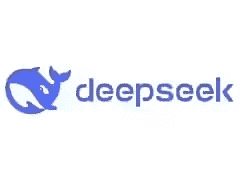
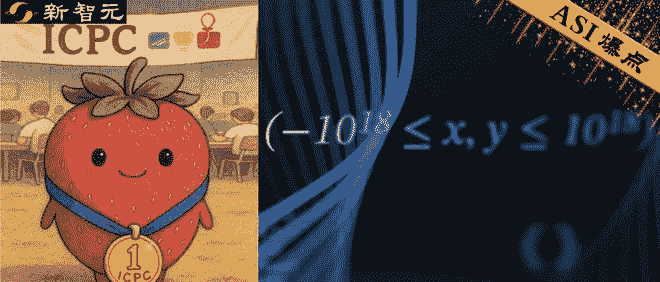
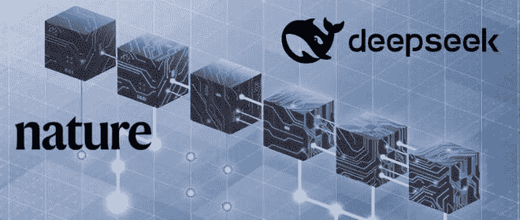
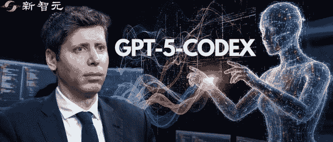
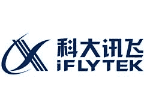
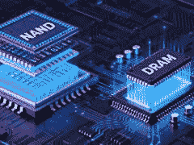
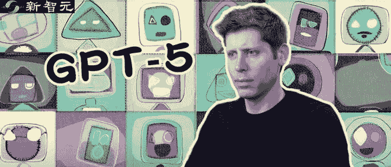

# 09.18-DeepSeek-R1 论文登上《自然》封面，通讯作者为梁文锋

> 来源：[https://agijuejin.feishu.cn/docx/O1NVd3JQAopikKxjVogcmJZnnMc](https://agijuejin.feishu.cn/docx/O1NVd3JQAopikKxjVogcmJZnnMc)

# AGI 掘金日报 - AI 新闻推送 (2025 年 09 月 18 日)

> [欢迎加入 AGI 掘金社群](https://applink.larkoffice.com/client/chat/chatter/add_by_link?link_token=890h8ad3-71e6-4140-af64-39dff6b2ba1f)

## ⭐ 今日热点

### 💡 DeepSeek-R1 论文登上《自然》封面，通讯作者为梁文锋

IT之家 | [阅读原文](https://www.ithome.com/0/883/802.htm)

9月18日，DeepSeek团队的DeepSeek-R1推理模型研究论文登上《自然》封面，通讯作者是梁文锋。相比初版，此次披露更多模型训练细节。它是全球首个经同行评审的主流大语言模型。研究表明，大型语言模型推理能力可通过纯强化学习激发，无需人工标注推理轨迹。训练后的模型在多领域任务上性能更优，还能提升小型模型推理能力 。

## 🌟 技术突破

### 💡 刚刚，OpenAI/Gemini共斩ICPC 2025金牌！OpenAI满分碾压横扫全场

新智元 | [阅读原文](https://www.163.com/dy/article/K9NPMJHO0511ABV6.html?spss=dy_author)

ICPC 2025全球总决赛上，谷歌Gemini与OpenAI推理模型同时获金牌。Gemini 5小时答对12题中的10题，半小时解出人类未解决的C题；OpenAI更是满分夺冠。人类队伍中仅3支与Gemini战平，无满分队伍。谷歌称参赛Gemini 2.5与应用模型相同但有增强。OpenAI多数题用GPT - 5，一道难题用神秘模型。ICPC执行董事称这是定义人工智能工具和学术标准的关键时刻，AI可成程序员伙伴，应用前景广。

### 💡 刚刚，DeepSeek登上Nature封面！梁文锋带队回应质疑，R1训练真29.4万美金

新智元 | [阅读原文](https://www.163.com/dy/article/K9NL🐧JH0511ABV6.html?spss=dy_author)

DeepSeek-R1登上《Nature》封面。它开创AI推理新范式，开源后在Hugging Face下载量破1090万次，训练成本仅29.4万美元 。R1-Zero经强化学习推理能力大幅提升，训练中展现自我进化。研究团队设计多阶段训练流程解决其不足，性能提升17%-25%。团队采用GRPO算法，设计双轨制奖励系统。不过，R1存在一些局限与奖励投机问题。有专家认为其推理方法开启了革命。

### 💡 给大模型生图“去油”，腾讯混元新研究 SRPO 公布

IT之家 | [阅读原文](https://www.ithome.com/0/883/754.htm)

9月10日腾讯混元生图团队发布新研究 SRPO（语义相对偏好优化），为文生图模型提供强化算法，解决开源模型 Flux 皮肤质感“过油”问题，使人像真实感“提升 3 倍”。该项目登 Hugging Face 热度榜榜首，下载量达 25K，Github Star 超 700。SRPO 创新性提出通过语义偏好在线调整奖励模型等策略，训练效率高，定量指标达 SOTA 水平，训练时间相比 DanceGRPO 降低 75 倍 。

### 💡 最新实测GPT-5-Codex：前端能力碾压，复杂项目轻松搞定，Claude可以扔了!

新智元 | [阅读原文](https://www.163.com/dy/article/K9MEIT560511ABV6.html?spss=dy_author)

OpenAI 发布专门为编码智能体研发的 GPT-5-Codex。经实测，其前端能力大幅提升，能轻松搞定复杂项目，如一键生成像素风小游戏、贪吃蛇游戏等，还可将手稿转为网页 、还原复杂项目UI布局。不过生成页面 UI 常出现「堆叠」情况。此外，运行需求猛导致速度比预期慢 2 倍，现补充 GPU 算力提升。同时，Grok 4 宣布测试突破，马斯克称 Grok 5 或实现通用人工智能，且 Codex 提示词泄露。

### 💡 让 AI 真正“能做研究”，阿里通义 DeepResearch 模型、框架、方案全开源

IT之家 | [阅读原文](https://www.ithome.com/0/883/738.htm)

9月17日，阿里通义实验室系统性创新通义DeepResearch，实现围绕问题的“研究闭环”，产出调研报告与决策建议。在五个权威Benchmark上，其Agent 30B-A3B轻量级达SOTA效果，支持多种推理形式。该技术已赋能高德地图、通义法睿等应用，在出行和法律领域表现出色。此外，所有技术方案均已开源，并公布了GitHub等多个开源地址 。

### 💡 以 AI 应对 AI：专家讲解如何高效应对网络攻击威胁

IT之家 | [阅读原文](https://www.ithome.com/0/883/643.htm)

2025年国家网络安全宣传周人工智能安全治理分论坛在昆明举行。参展商技术人员邹洪称，大型企业面临多种网络攻击，以往人工应对耗时耗力。引入AI后，通过大、小模型混合架构对告警三级降噪，降噪率达98%以上，能找到真正有威胁的攻击。对需人工研判部分，AI大模型可协助分析溯源。对于不法分子用AI大模型攻击，也可用AI学习其行为模式，实现自动化拦截。

### 💡 终结数据荒！智源开源首个Deep Research数据合成框架InfoSeek

新智元 | [阅读原文](https://www.163.com/dy/article/K9LLVU8L0511ABV6.html?spss=dy_author)

北京智源人工智能研究院发布首个面向深度研究的开源数据集InfoSeek及创新性「扩散 - 回溯」数据合成方法。团队揭示深度研究与层级约束满足问题的数学等价关系，合成5万条训练样本。基于此训练的3B参数模型，在BrowseComp-Plus基准测试中准确率达16.5%，接近商业模型。相关数据集与方法已开源，为深度研究领域发展提供基础。

## 💫 企业动态

### 💡 科大讯飞发布星火东盟多语言大模型底座及系列 AI 产品，覆盖马来语、印尼语、泰语等

IT之家 | [阅读原文](https://www.ithome.com/0/883/793.htm)

9月17日，第22届中国—东盟博览会开幕式上，讯飞同传提供技术支撑实现多语言实时滚动翻译。当天下午，科大讯飞发布专为东盟十国打造的星火东盟多语言大模型底座，基于国产化软硬件，自主可控。该模型覆盖十种语言 ，具备多种能力，参数少但综合效果对标国际领先。此外还推出系列AI产品，如翻译SaaS平台等，并与华为及多国签约。

### 💡 豆包大模型开始上车了！上汽荣威率先进入AI智舱新拐点

量子位 | [阅读原文](https://www.qbitai.com/2025/09/333094.html)

AI正重塑汽车，尤其是AI智舱。真正的AI智舱需深度思考，主动感知需求等。豆包深度思考大模型跨界上车，首搭上汽荣威M7 DMH。它让荣威成用车顾问、百科导师等，重新定义人车交互。首发选荣威，因其有数据优势、优秀硬件接口 ，且具创新精神。二者携手，使汽车迈向AI智舱新阶段。

### 💡 强劲 AI 需求推动，今年四季度 NAND 与 DRAM 合约价预计大涨 15%-20%

IT之家 | [阅读原文](https://www.ithome.com/0/883/759.htm)

受强劲AI需求推动，2025年四季度NAND闪存与DRAM合约价预计大涨15%-20%，打破年末降价格局。因HDD供应短缺，云服务提供商转向SSD 。三星V9 NAND接近售罄，货源争抢蔓延至V8 。闪迪、美光上调NAND价格，多家厂商提前释放涨价信号。NAND市场2025年二季度复苏，2026年价格预测乐观。群联电子8月利润跃升，营收约59.34亿新台币，净利润激增49倍，将加强合作把握机遇 。

### 💡 奥特曼爆料：GPT-5重构一切！一人顶五个团队

新智元 | [阅读原文](https://www.163.com/dy/article/K9ME16C30511ABV6.html?spss=dy_author)

OpenAI 首席执行官奥特曼在播客节目中分享对 GPT-5 的看法，认为它是巨大飞跃，能让 AI 迈向「同行者」。他给年轻人建议：掌握 AI 工具、学会适应和保持韧性。创业要理解人们需求，可利用 GPT-5 高效完成多项事务。此外，他提出评估大模型智力新指标，还谈到 AI 不会完全取代人类，期待未来 AI 能全天候主动服务，需新硬件实现「AI 伴侣」体验 。

### 💡 我用一张照片，生成了一个能走进去的世界

新智元 | [阅读原文](https://www.163.com/dy/article/K9M7687B0511ABV6.html?spss=dy_author)

斯坦福李飞飞创办的 World Labs 推出 Marble 的 Beta 版本。用户用一句话或一张照片就能生成 3D 游戏世界，可自由探索，还能在社区分享。他人通过浏览器免费访问，几秒即可加载。该平台降低 3D 建模门槛，受早期用户好评，对影视游戏等行业有帮助。其潜力大，但前景或取决于 Token 成本能否下降。官网：https://marble.worldlabs.ai/

### 💡 华为 Pura 70、Mate 60 系列等机型升级 HarmonyOS 6 开发者版本支持真人感小艺、小艺看世界

IT之家 | [阅读原文](https://www.ithome.com/0/883/697.htm)

9月17日消息，华为小艺智慧助手8月底推送11.3.7.300版本带来新功能。HarmonyOS 6.0.0.100开发者/用户尝鲜版已推送，包大小约11.19GB，覆盖43款机型。华为Pura 70、Mate 60等系列机型升级该版本后支持真人感小艺、小艺看世界。“小艺看世界”是基于多模态大模型的拟人化实时音视频对话功能，可在多领域提供实时帮助。文章还介绍了其支持设备、版本、入口、使用方法及场景 。

### 💡 马斯克的 xAI 数据标注团队大裁员，入职不久的大学生接手 Grok 模型训练重任

IT之家 | [阅读原文](https://www.ithome.com/0/883/671.htm)

据Business Insider报道，马斯克旗下xAI公司数据标注团队本月大规模裁员、领导层变动。此前约1500人，现降至约900人，至少9名高层账号被停用，9月12日裁500余名员工，之后又有超100人被解雇。重任落到今年1月入职的大学生迭戈・帕西尼肩上。他曾在xAI黑客马拉松获胜，目前休学。帕西尼接手后开展会议等工作，其资历遭员工质疑，质疑者账号被停用 。

### 💡 美科技巨头扎堆布局英国 AI 领域：微软投资 300 亿美元、英伟达等投资 110 亿英镑

IT之家 | [阅读原文](https://www.ithome.com/0/883/647.htm)

近期美科技巨头扎堆布局英国 AI 领域。英伟达与 Nscale 及 CoreWeave 合作，将投资高达 110 亿英镑建 AI 工厂，到 2026 年底部署多达 12 万块英伟达 Blackwell GPU，助力主流 AI 模型发展。谷歌和微软也分别宣布在英国投资 50 亿英镑和 300 亿美元。微软此次投资是迄今对英最大规模，两年前也曾投资 32 亿美元。英伟达黄仁勋与 OpenAI 山姆・奥尔特曼还将陪特朗普访英。

### 💡 索尼公布 AI 战略：辅助创作而非取代，300 多个 AI 项目已测试、50 多个已常态化应用

IT之家 | [阅读原文](https://www.ithome.com/0/883/626.htm)

9月16日，科技媒体报道索尼在2025年企业报告中明确AI战略，核心是将AI作为增强创作力工具，非替代人类创作。自2023年部署Enterprise LLM系统，超5万名员工、210个团队使用，已测试300多个AI项目，50多个常态化应用，如《蜘蛛侠 2》中的应用。索尼强调创作者重要性，制定规范保护版权。此外，还将AI用于老片音频重制及PS5画质提升 。

### 💡 荣耀郭锐：即将发布的 Magic8 AI 原生手机将是 Q4 旗舰最靓的仔

IT之家 | [阅读原文](https://www.ithome.com/0/883/602.htm)

荣耀终端品牌营销总裁郭锐称今年荣耀海外发展迅猛，国内市场值得期待，即将发布的 Magic8 AI 原生手机将是 Q4 旗舰亮点。此前荣耀 CEO 李健预热新机，称是最强自进化 AI 原生手机。爆料显示 Magic8 Pro 配置强大。该系列手机已入网，支持 90W 有线充，是国内首个通过 3C 认证的第 2 代骁龙 8 至尊版芯片手机，Magic8 卫通版支持北斗三号短报文。

### 💡 小扎豪掷143亿，却换不来AI燃料！数据之争下半场，中国冲出一匹黑马

新智元 | [阅读原文](https://www.163.com/dy/article/K9LM0C280511ABV6.html?spss=dy_author)

AI 领域“数据大战”激烈，小扎豪掷 143 亿美金未换来满意数据；Anthropic 因数据版权纠纷支付 15 亿美元和解金；马斯克裁员并招募专业导师。中国澳鹏数据崛起，2025 年上半年营收 3.06 亿元，预计全年突破 7 亿。过去五年复合增长率 90%。其技术领先，搭建平台矩阵，提供多类数据集，助客户模型性能提升 40%。行业正转型升级，对数据质量等要求提高，澳鹏未来目标是 2030 年前中国区营收超 20 亿元。

### 💡 来自MIT最强AI实验室：OpenAI天才华人研究员博士毕业了！

新智元 | [阅读原文](https://www.163.com/dy/article/K9LLVIIJ0511ABV6.html?spss=dy_author)

OpenAI华人研究科学家陈博远完成MIT博士论文答辩。他不到4年读完博士还辅修哲学，是GPT图像生成核心成员等。其研究重点为世界模型等，认为结合相关领域AI能更好与物理世界互动。他曾在谷歌DeepMind实习，发表多篇认可论文。他对具身智能乐观，愿推动通用机器人发展。同时，OpenAI在通用人工智能竞赛中加大机器人技术工作力度 。

### 💡 每个CEO都需要一个总统「同款」手提箱，只需6万8

新智元 | [阅读原文](https://www.163.com/dy/article/K9LF6DQI0511ABV6.html?spss=dy_author)

智跃Zleap发布全球首个专为CEO和管理者设计的Agent一体机Zleap-D1，售价68000元。它融合硬件、软件等，通过私有化部署自动收集分析企业信息。其能让CEO掌握一线信息、打通战略执行断层。它硬件配置高，以APP为核心，采用本地部署，有预处理、多Agent协同等机制，未来还将拓展出更多一体机，形成“Agent矩阵” 。

## ✨ 行业观点

### 💡 英伟达 CEO 黄仁勋谈 AI 工具个人使用体验：视其为“思考伙伴”，日常混用多个系统

IT之家 | [阅读原文](https://www.ithome.com/0/883/781.htm)

9 月 17 日消息，英伟达 CEO 黄仁勋在伦敦媒体活动中谈及 AI 话题。他视 AI 为“思考伙伴”，称其能记住过往任务，使用 AI 文字处理软件可节省时间、提升工作质量。他日常混用多个 AI 系统，如 Gemini 用于技术任务，Grok 用于创意工作，Perplexity 快速获取信息，日常常用 ChatGPT 。黄仁勋每天用 AI 辅助学习、思考等，还会让多个 AI 互评输出，他认为其使用体验或成未来常态 。

### 💡 研究显示生成式 AI 工具答案质量堪忧：三分之一缺乏可靠来源支持

IT之家 | [阅读原文](https://www.ithome.com/0/883/775.htm)

Salesforce人工智能研究院测试多款生成式AI搜索引擎和深度研究智能体工具。向其提出303个查询，依“DeepTrace”指标评估。结果显示，许多模型答案片面，约三分之一答案缺乏可靠来源支持，GPT-4.5表现较差，无依据主张比例达47%。对此，OpenAI拒评，Perplexity异议研究方法。牛津大学费利克斯·西蒙认为报告有价值，瑞士苏黎世大学亚历山德拉·乌尔曼质疑研究标注和统计方法。西蒙强调提高AI答案质量很有必要。

### 💡 OpenAI 奥尔特曼爆料：GPT-5 重构一切，一人顶五个团队

IT之家 | [阅读原文](https://www.ithome.com/0/883/772.htm)

OpenAI 奥尔特曼在播客中分享对 GPT-5 的看法。他认为 GPT-5 是重大飞跃，能力显著提升，是一体化模型。年轻人要掌握 AI 工具，创业要理解人们需求。他还提出评估大模型智力新指标，认为 AI 虽智力可能超人类，但人类渴望真实关系。此外，创业者要用 AI 构建有价值业务，未来 AI 应实现全天候、主动的 “AI 伴侣” 体验。

### 💡 已绝食 17 天，美国男子在 Anthropic 总部外呼吁其停止 AGI 竞赛

IT之家 | [阅读原文](https://www.ithome.com/0/883/740.htm)

美国男子圭多・赖希施塔特已绝食17天，在Anthropic总部外呼吁停止AGI竞赛（通用人工智能，具备超越人类认知能力的人工智能系统）。他认为这存在生存风险，企业有责任避免研发有害技术。Anthropic首席执行官曾称AI致人类文明灾难概率在10% - 25% ，但赖希施塔特认为其说法是借口。受他启发，伦敦、印度也有人发起类似抗议。目前相关公司未回应抗议者信件 ，但抗议者希望能改变AI发展方向。

### 💡 OpenAI 呼吁学生掌握 AI 有关技能：仅学习计算机科学不足以应对未来

IT之家 | [阅读原文](https://www.ithome.com/0/883/657.htm)

OpenAI Codex产品负责人Alexander Embiricos称仅学计算机科学不足以应对未来，学生要掌握AI技能，学习中持续用AI ，招聘看重作品。招聘放缓、AI写代码能力变强，高校重设课程。卡内基梅隆大学教授称AI动摇计算机科学教育。此外，OpenAI董事长认为计算机科学学位对培养思维重要，研究员鼓励高中生学编程。Embiricos还提出重组计算机科学系的想法 。

### 💡 马斯克：Grok 5 模型几周后开始训练，有机会实现 AGI

IT之家 | [阅读原文](https://www.ithome.com/0/883/621.htm)

9月17日马斯克在X平台称，Grok 5模型几周后开始训练。他还表示，现在认为xAI有机会通过Grok** 5实**现AGI ，此前从未有过这样想法。上个月马斯克也曾称，Grok 5有机会成为真正的AGI，且将在今年年底前推出。 AGI即通用人工智能，是能像人类一样学习、推理、解决各种问题的人工智能。