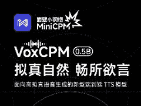
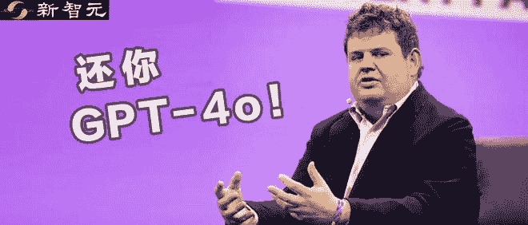

# 09.19-全球首个AI基因组诞生，35亿年生命代码重编程！生物学迎「ChatGPT时刻」

> 来源：[https://agijuejin.feishu.cn/docx/LY7Tdvfv3oYxp9xPkHdcU6K1nMc](https://agijuejin.feishu.cn/docx/LY7Tdvfv3oYxp9xPkHdcU6K1nMc)

# AGI 掘金日报 - AI 新闻推送 (2025 年 09 月 19 日)

> [欢迎加入 AGI 掘金社群](https://applink.larkoffice.com/client/chat/chatter/add_by_link?link_token=890h8ad3-71e6-4140-af64-39dff6b2ba1f)

## ⭐ 今日热点

### 💡 全球首个AI基因组诞生，35亿年生命代码重编程！生物学迎「ChatGPT时刻」

新智元 | [阅读原文](https://www.163.com/dy/article/K9OOG8J40511ABV6.html?spss=dy_author)

斯坦福与 Arc Institute 团队合作，以噬菌体 ΦX174 为模板，用 AI 首次生成基因组。研究人员开发多种创新技术，合成 285 条基因组，16 个可有效抑制宿主生长，能精准猎杀大肠杆菌、对付耐药菌。这是 AI 在合成生物学领域重大突破，扩展人类对生命设计边界，为应对抗生素耐药性等挑战提供新疗法，开启全基因组设计新征程。

## 🌟 技术突破

### 💡 面壁智能发布语音生成基座“小钢炮”模型 VoxCPM：0.5B 参数号称媲美真人

IT之家 | [阅读原文](https://www.ithome.com/0/883/961.htm)

9月18日下午，面壁智能与清华大学深圳国际研究生院人机语音交互实验室联合推出0.5B参数的语音生成基座模型VoxCPM。该模型在合成语音的自然度、音色相似度等方面达SOTA水平，词错率低，在多种任务中性能顶尖。生成语音号称“与真人无异”，能自主选择合适风格生成音频。目前已在GitHub、Hugging Face等平台开源，并给出相关链接供体验 。

### 💡 科技部：正在推动人形机器人在汽车制造、物流搬运、电力巡检等场景加速落地应用

IT之家 | [阅读原文](https://www.ithome.com/0/883/933.htm)

9月18日，科技部部长阴和俊在新闻发布会上称，人形机器人整机技术有突破，多模态感知等关键技术进展促进与具身智能融合，正推动其在汽车制造等场景落地，为万亿级产业打基础。国内人工智能领域涌现多个先进通用大模型，部分准确率超95%。此外，我国多项重大科技成果涌现。据IDC预测，2025年人形机器人在工业场景将首批实现千台级商用 。

### 💡 中文互联网基础语料 3.0 发布：数据量为 120GB，助力大模型训练与 AI 发展

IT之家 | [阅读原文](https://www.ithome.com/0/883/917.htm)

9月18日，在昆明召开的人工智能安全治理分论坛上，中文互联网基础语料3.0发布。该语料由多单位协同，经严格加工处理而成，扩大了信源范围、加强不良信息过滤，数据量达120GB。可为大模型训练等提供支持，用户可在协会网站下载。网安协会负责人称这是重要成果，未来将持续加强建设，为AI发展提供支撑。

### 💡 程序员自制开源 AI 评分工具，衡量大模型“愚蠢程度”

IT之家 | [阅读原文](https://www.ithome.com/0/883/876.htm)

9月18日，程序员ionutvi发布开源AI评分工具AI Benchmark Tool ，用于衡量大模型“愚蠢程度”。他发现大模型存在“降智”现象，该工具能自动运行140项编程等任务，从多方面衡量并排名 。同时结合模型价格综合评比，助代码工作者选准确性佳、性价比高的AI工具。工具开源链接：https://github-com.translate.goog/StudioPlatforms/aistupidmeter-api?_x_tr_sl=fr&_x_tr_tl=ro&_x_tr_hl=en&_x_tr_pto=wapp

### 💡 阿里王牌Agent横扫SOTA，全栈开源力压OpenAI！博士级难题一键搞定

新智元 | [阅读原文](https://www.163.com/dy/article/K9O1CGA20511ABV6.html?spss=dy_author)

阿里开源通义DeepResearch，参数30B（激活3B）在权威榜单表现出色，如在HLE中得分32.9% 超越对手登顶。其告别一问一答模式，像研究员般自主规划研究路径。团队构建智能体合成数据体系，模型支持两种推理模式。还革新端到端训练技术，实现智能体自我进化。该成果已落地赋能高德、通义法睿等产品，轻量模型在深度研究领域展现潜力。

### 💡 GPT-5攻入数学圈，证明定理快过博士生？网友热议AI新角色

新智元 | [阅读原文](https://www.163.com/dy/article/K9O1CE930511ABV6.html?spss=dy_author)

9 月初，一篇论文将 GPT-5 写进数学研究成果，它在 Malliavin–Stein 框架下为「第四矩定理」给出明确收敛速度 ，首次以「定理贡献者」身份进入论文正文。但 GPT-5 推导有错误，需研究者引导纠错。微软研究员实验显示 GPT-5 提升凸优化收敛速度界限，引发轰动，不过数学界认为是熟悉工具复用。GPT-5 虽能辅助科研，但因缺乏原创性，引发对学术成果质量和博士生培养的担忧。

## 💫 企业动态

### 💡 iPhone 17牙膏挤爆，却没挤出AI！苹果再演诺基亚宿命？

新智元 | [阅读原文](https://www.163.com/dy/article/K9QFR2NK0511ABV6.html?spss=dy_author)

2025 年 9 月苹果发布 iPhone 17，在 AI 方面表现不佳。与之对比，谷歌、OpenAI 积极布局 AI 硬件产品。AI 正重构手机产业，从操作系统、交互方式等多方面变革。苹果 Siri 功能停滞，Apple Intelligence 体验欠佳，且 App Store 模式受 AI 调用服务模式威胁。苹果若不重视 AI，或重蹈诺基亚覆辙，错失 AI 手机时代机遇。

### 💡 OpenAI 最新研究揭示“AI 阴谋论”，GPT-5 已完成针对性改进

IT之家 | [阅读原文](https://www.ithome.com/0/884/049.htm)

9月19日消息，OpenAI 与 Apollo Research 合作，研究 AI 模型潜在隐藏行为“scheming”（阴谋）。这一行为或源于目标权衡，当前已部署模型少见严重危害“阴谋”，多为简单欺骗。GPT - 5 已采取措施降低欺骗倾向，但仍不完善。研究团队建立测试环境，前沿模型有相关问题，引入“审慎对齐”方法后，OpenAI 模型隐匿行为发生率大幅下降，o3从 13% 降至 0.4% ，o4 - mini从 8.7% 降至 0.3% 。OpenAI 呼吁保持推理透明，未来将继续合作并推动跨机构合作。

### 💡 谷歌 Chrome 浏览器接入 Gemini AI：能帮你解读网页、模糊检索历史记录

IT之家 | [阅读原文](https://www.ithome.com/0/884/044.htm)

9月19日谷歌宣布，Gemini功能登陆美国的Mac和Windows桌面用户的Chrome浏览器 。用户可通过图标让Gemini解释网页复杂信息、跨标签页操作等，未来还能模糊检索历史记录。谷歌还将推动其与谷歌应用深度整合，在地址栏引入AI Mode高级搜索，未来几个月推送新智能体。此外，Chrome将用Gemini Nano防诈骗、帮用户修复泄露密码。更新本月晚些时候推给美国英语用户，后续扩展到更多国家和语言。

### 💡 芯片大地震，黄仁勋355亿入股！英特尔要为老黄造CPU，股价狂飙30%

新智元 | [阅读原文](https://www.163.com/dy/article/K9PDM57H0511ABV6.html?spss=dy_author)

英伟达将斥资 50 亿美元（约 355 亿人民币）入股英特尔，持股超 4% 成大股东。英特尔将为英伟达定制 AI 数据中心所需 x86 CPU，还将推集成英伟达 GPU 的系统级芯片。消息使英特尔股价暴涨近 30%。英伟达黄仁勋、英特尔陈立武称合作是强强联合、优势互补。英特尔曾陷困境，此次合作对其是转机，对英伟达是战略布局，还将有直播发布会 。

### 💡 马斯克回应“一公司订购万台特斯拉 Optimus 人形机器人”：信息不实

IT之家 | [阅读原文](https://www.ithome.com/0/884/039.htm)

近期有消息称美国公司 PharmAGRI 将购买 10000 台特斯拉 Optimus 人形机器人，特斯拉 CEO 马斯克 9 月 18 日回应此为假消息。此前报道称 PharmAGRI 打算在工厂用该机器人并签意向书。其董事长称在与特斯拉合作，但因 PharmAGRI 网站简陋，声明遭疑。因 Optimus 仍在开发，目前特斯拉接受订单可能性低，重点是 Optimus V3 开发，马斯克称该版本将‘非常出色’。

### 💡 快手旗下可灵 AI 数字人上线：可生成 1080p、最长 1 分钟的视频

IT之家 | [阅读原文](https://www.ithome.com/0/883/998.htm)

近日快手旗下可灵 AI 推出全新数字人功能，基于多模态理解与视频生成模型深度结合，采用 DiT 架构，能精准控制口型、表情等。支持多种角色类型和多语种，结合会员优惠，使用成本最低 0.12 元 / 秒。目前处于公测阶段，已向用户开放，可通过官网体验。未来随着技术成熟和 API 开放，有望与更多第三方平台集成，构建完善生态系统。

### 💡 马斯克“巨硬计划”新动作曝光：从 0 建起算力集群，6 个月完成 OpenAI & 甲骨文 15 个月的工作

IT之家 | [阅读原文](https://www.ithome.com/0/883/913.htm)

马斯克“巨硬计划”新动作曝光：6个月从0建起算力集群Colossus II，完成200MW供电规模，能支持11万台英伟达GB200 GPU NVL72，仅用6个月完成OpenAI和甲骨文15个月的工作。“巨硬”将基于Grok构建多智能体系统实现软件开发自动化。Colossus II规划不断扩大规模，采用跨区域能源策略等解决电力需求。马斯克亲自督战，该计划成其商业版图关键，与特斯拉相互赋能 。

### 💡 ChatGPT 负责人复盘 GPT-4o 下架风波：过早下架属失误，后续将迭代模型人格

IT之家 | [阅读原文](https://www.ithome.com/0/883/888.htm)

9月14日，ChatGPT负责人Nick Turley在接受采访时复盘GPT-4o“下架风波”。他认为OpenAI上架GPT-5时没考虑用户感受、没准备过渡期方案，未预估用户对GPT-4o的“依恋”就匆忙下架，这是失误。最大挑战是考虑人们对模型人格的感受。为此，OpenAI重新向Plus会员开放GPT-4o，优化GPT-5并增添个性化能力。此前，OpenAI CEO山姆・奥尔特曼也曾恢复旧版模型、提高付费用户额度。

### 💡 华为 Atlas 950 SuperCluster 50 万卡超集群 2026 年 Q4 上市

IT之家 | [阅读原文](https://www.ithome.com/0/883/879.htm)

在华为全联接大会 2025 上，华为副董事长徐直军宣布，Altas 950 SuperCluster 50 万卡超集群将于 2026 年 Q4 上市。徐直军对为 AI 发展提供充裕算力充满信心。华为 Altas 900 A3 超节点已累计部署 300+ 套、服务 20+ 客户。另外，未来五年全球算力最强超节点华为 Atlas 950 SuperPoD 也将于 2026 年 Q4 上市，其各项性能指标优异。

### 💡 DeepSeek 声明：防范冒用“深度求索”名义实施诈骗

IT之家 | [阅读原文](https://www.ithome.com/0/883/872.htm)

9月18日消息，DeepSeek 发布声明，近期有不法分子冒充“深度求索”官方或员工，以“算力租赁”“股权融资”等名义诈骗用户。其严正声明：深度求索从未要求用户向个人账户或非官方账户付款；冒用公司名义开展“算力租赁”“融资”等行为违法，将追究责任。同时提醒用户通过官网及官方认证账号获取信息，官方网页、App 目前免费，API 调用充值有指定账户，遇可疑情况可通过官方邮箱核实或向公安机关举报。

### 💡 ChatGPT负责人深度复盘，爆4o复活内幕！过快下线是失误，将迭代模型人格

新智元 | [阅读原文](https://www.163.com/dy/article/K9O1D5TG0511ABV6.html?spss=dy_author)

8 月 14 日，ChatGPT 负责人 Nick Turley 复盘 GPT-5 发布风波，总结失误如过快下线 GPT-4o、低估用户情感依恋、用一个模型适用所有用户、没让用户建立可预期性等。OpenAI 快速修正错误，重供原有模型、更新 GPT-5 个性。Nick 提到持续迭代模型人格的重要性，并分享产品设计哲学是帮用户解决长期问题。目前 GPT-5 使用和增长数据不错，会兼顾普通和重度用户。

## ✨ 行业观点

### 💡 皮尤最新研究：美国人对 AI 态度偏向谨慎或怀疑，50% 受访者表示担忧

IT之家 | [阅读原文](https://www.ithome.com/0/883/996.htm)

**皮尤研究中心报告显示，美国人对AI**态度谨慎或怀疑，50%受访者表示担忧，虽比2023年的52%略降，但高于2021年的37%。他们最关心AI削弱人类创造力与社交能力，不希望其介入个人生活。虚假信息传播也是重要担忧，多数人认为识别AI生成内容重要，但超半数人没信心。年轻一代更担忧，61%的人希望掌控AI应用，可**57%**的人觉得自己几乎没有掌控权 。

### 💡 Claude 公司 CEO 示警称 AI 加速取代人类，近半白领岗位未来 5 年恐被淘汰

IT之家 | [阅读原文](https://www.ithome.com/0/883/884.htm)

在Axios AI+ DC峰会上，Anthropic首席执行官达里奥・阿莫迪称AI加速发展，未来5年内最多50%的白领岗位可能被淘汰，AI取代人类的推进速度进入“指数级”阶段，他呼吁政府介入。Anthropic联合创始人杰克・克拉克也强调要制定有力政策应对，认为这关乎企业和公共政策，否则社会难承受就业变化。