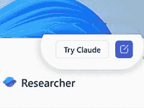
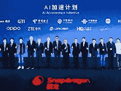
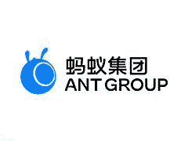
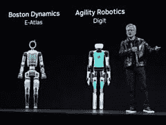

# 09.25-智阿里云栖大会一口气发布千问 3-VL、万相 2.5 等六大模型 + 通义百聆新品牌，覆盖文本、视觉、语音、视频、代码、图像全场景

> 来源：[https://agijuejin.feishu.cn/docx/WV6Pd3LHPoaJzixg5j8caWCznFh](https://agijuejin.feishu.cn/docx/WV6Pd3LHPoaJzixg5j8caWCznFh)

# AGI 掘金日报 - AI 新闻推送 (2025 年 09 月 25 日)

> [欢迎加入 AGI 掘金社群](https://applink.larkoffice.com/client/chat/chatter/add_by_link?link_token=890h8ad3-71e6-4140-af64-39dff6b2ba1f)

## ⭐ 今日热点

### 💡 阿里云栖大会一口气发布千问 3-VL、万相 2.5 等六大模型 + 通义百聆新品牌，覆盖文本、视觉、语音、视频、代码、图像全场景

IT之家 | [阅读原文](https://www.ithome.com/0/885/362.htm)

在 2025 云栖大会上，阿里集团 CEO 吴泳铭称积极推进 3800 亿 AI 基础设施建设，还将追加投入。会上推出 6 款新模型及 1 个新品牌，覆盖多场景。如 Qwen3-VL 视觉理解能力提升，Qwen-Image 图片编辑升级，Qwen3-Coder 代码处理能力增强，Wan2.5-Preview 音画同步能力突出，通义百聆解决企业语音落地难题，Fun-ASR 降低语音识别幻觉率 。

## 🌟 技术突破

### 💡 科研利器：苹果发布轻量 AI 模型 SimpleFold，降低蛋白质预测计算成本

IT之家 | [阅读原文](https://www.ithome.com/0/885/587.htm)

9月24日，苹果研究团队发布轻量级蛋白质折叠预测AI模型SimpleFold。它用流匹配方法替代复杂模块，降低计算成本。流匹配技术源自扩散模型，计算量低、生成快。实验中，多个版本在权威基准测试里，性能稳定优于同类模型ESMFlow ，媲美顶尖模型。如在CAMEO22上达到AlphaFold2等约95%性能。苹果团队称其为起点，望推动构建更多高效模型，加速相关研发探索。

### 💡 英伟达开源 Audio2Face 模型：AI 实时生成面部动画，多语言口型同步

IT之家 | [阅读原文](https://www.ithome.com/0/885/570.htm)

9月24日，英伟达开源生成式AI面部动画模型Audio2Face，含模型、SDK及训练框架。该技术通过分析音频特征实时驱动虚拟角色面部动作，有离线渲染和实时流式处理两种模式，还开源多个核心组件。其已获行业广泛采用，如Survios、Farm 51工作室应用后简化流程、节省时间，Farm 51创新总监称其为“革命性突破” 。

### 💡 秘塔AI放大招！「边想边搜边做」，内置20+智能体，想法一键实现

新智元 | [阅读原文](https://www.163.com/dy/article/KA8LRU430511ABV6.html?spss=dy_author)

秘塔AI推出「Agentic Search」模式，实现「边想边搜边做」。它由多种智能体协作，一次搜索能自主完成5 - 15步工具调用，内置20余种工具，模型参数规模提升10倍。通过多模态理解输入，可美化输出结果，还能借助专业工具精确计算，能完成写文案、做海报、发邮件、制作音频等任务，推动搜索从「给结果」进化为「帮达成」。

### 💡 震撼！AI物理「双修」：亥姆霍兹方程嵌进生成器，伪影当场消失

新智元 | [阅读原文](https://www.163.com/dy/article/KA8LQQJ00511ABV6.html?spss=dy_author)

香港科技大学（广州）等机构发布PhyRMDM框架，将物理约束与生成模型融合，解决传统AI构建无线电地图的失真问题。其核心思想是“物理为体，AI为用”，采用创新架构。实验表明，框架结合的三个损失函数效果最佳，展现高物理一致性、强大生成能力与卓越特征提取能力。成果被ACM MM 2025接收，代码开源，有望应用于更多科学计算领域。

### 💡 一年4次迭代，狂堆GPU成真！微软AI冷液灌芯，散热暴涨3倍

新智元 | [阅读原文](https://www.163.com/dy/article/KA7L4TH40511ABV6.html?spss=dy_author)

微软公布「微流体冷却」黑科技，将冷却液送进芯片体内微小通道，散热效率最高提升三倍，GPU 内部温升下降 65%。一年四轮迭代解决诸多难题，并借助 AI 设计仿生结构。此技术可降低成本、提升性能、减少能耗，还能提升用户体验。微软在芯片、网络、内存方面多线布局，为 AI 基础设施发力，探路行业算力提升。

## 💫 企业动态

### 💡 OpenAI 成 AI 基建狂魔，拟启动 1 万亿美元算力扩张计划

IT之家 | [阅读原文](https://www.ithome.com/0/885/579.htm)

9月24日，华尔街日报报道OpenAI公**布全球计算**基础设施扩张计划，总投资预计达1**万亿美元。其已**从“模型驱动”转向“算力驱动”。此前一天，OpenAI与英伟达达成1000亿美元合作。本周二，OpenAI还宣布与甲骨文、软银在美国新建五个人工智能数据中心。位于得州阿比林的首座计算中心已初建，最终运算能力将达原本13倍以上。此举或重塑全球AI算力格局 。

### 💡 不再“独宠”OpenAI，微软宣布 Microsoft 365 Copilot 引入 Claude 模型

IT之家 | [阅读原文](https://www.ithome.com/0/885/550.htm)

9月24日微软宣布在Microsoft 365 Copilot中引入Anthropic的Claude Sonnet 4和Claude Opus 4.1 AI模型 ，Copilot模型选择不再局限于OpenAI。业务与行业Copilot团队总裁Charles Lamanna称这是引入先进AI技术的重要步骤，模型适合办公和企业需求。在Researcher和Copilot Studio中用户可选择使用，还能混合不同模型，相关功能将向选择加入的用户推出。

### 💡 高通与中国三大运营商及小米、荣耀、vivo、OPPO、中兴等启动“AI 加速计划”

IT之家 | [阅读原文](https://www.ithome.com/0/885/533.htm)

2025 骁龙峰会・中国于 9 月 24 日在北京开幕，高通携手多方启动“AI 加速计划”。高通总裁兼 CEO 安蒙称六大趋势驱动 AI 未来发展，目标是让 AI 无处不在。首席运营官兼首席财务官 Akash Palkhiwala 表示将围绕三大关键支柱与中国伙伴合作。宇树科技王兴兴与高通侯纪磊对谈，王兴兴认为通信创新对人形机器人发展重要，具身智能需产业开放合作与创新 。

### 💡 蚂蚁集团支付宝体验技术部开源智能编程助手 Neovate Code

IT之家 | [阅读原文](https://www.ithome.com/0/885/511.htm)

9月24日，蚂蚁集团支付宝体验技术部开源智能编程助手Neovate Code。该助手能深度理解代码库，精准实现功能等，集成Code Agent核心能力。其功能多样，如对话式开发、支持多模型等。目前以CLI工具形态提供，架构灵活，未来将支持多种客户端形态，像IDE扩展等，以适配更多开发场景。

### 💡 把自己变成“安卓人”，谷歌推出开源 AI 项目 Androidify

IT之家 | [阅读原文](https://www.ithome.com/0/885/508.htm)

9月24日消息，谷歌推出开源AI项目Androidify 。用户在网页端或安卓App上传照片或输入文字提示，借助谷歌AI创建个性化安卓机器人形象，能选颜色、添加配饰，少数人可解锁动画版（通过Veo模型）。此外，该项目开源，开源地址：https://github.com/android/androidify 。

### 💡 刚刚，阿里CEO吴泳铭发布「ASI宣言」：超级智能才是终局！

新智元 | [阅读原文](https://www.163.com/dy/article/KA88Q26Q0511ABV6.html?spss=dy_author)

在 2025 云栖大会上，阿里 CEO 吴泳铭发布「ASI 宣言」，认为 AGI 是智能革命序章，ASI 才是终局。阿里云将走两大战略路径，还公开 ASI 路线图分三个阶段。阿里有两大判断并做战略选择，为迎 ASI，2032 年阿里云能耗将比 2022 年提升 10 倍。此外，阿里发布多个模型，性能表现突出，通义万相 2.5 升级亮点多，在开源社区受欢迎。

### 💡 网易胡志鹏：《逆水寒》手游推出 AI 加持“剧组模式”，已有数百万玩家参与创作

IT之家 | [阅读原文](https://www.ithome.com/0/885/467.htm)

在 2025 云栖大会主论坛上，网易胡志鹏以《逆水寒》手游为例分享游戏 AI 运用成果。AI 全面提升游戏研发与运营效率，美术创作、技术研发提效显著。《逆水寒》手游“剧组模式”让玩家成创作者，数百万玩家参与，生成大量内容。网易多款游戏接入 AI，还将其应用于矿山等传统产业，推出“网易有灵”平台推动技术普惠 。

### 💡 谷歌最新研报：九成软件工程师已在日常工作中使用 AI

IT之家 | [阅读原文](https://www.ithome.com/0/885/455.htm)

谷歌 DORA 研究部门调查全球 5000 名技术专业人士发现，90% 的受访者日常工作中用 AI ，比去年增 14%。谷歌提供多种价位 AI 辅助开发工具。负责谷歌编码工具的 Ryan J. Salva 称谷歌多数团队都在用 AI 。不过，对 AI 生成代码的信任度不一，且部分人认为对代码质量影响有限。目前 AI 处于软件开发第三到四级间。同时，入门级科技人才面临挑战，软件工程职位下降 71% 。Salva 认为 AI 主要简化枯燥重复工作 。

### 💡 中国信通院：2024 年我国人工智能产业规模超 9000 亿元，同比增长 24%

IT之家 | [阅读原文](https://www.ithome.com/0/885/408.htm)

中**国信通****院副总**工程师王爱华在2025人工智能产业大会上发布成果，2024年我国人工智能产业规模超9000亿元，同比增长24%。截至2025年9月，企业超5300家，全球占比达15%，形成完整产业体系。信通院提出产业规模测算方法体系。下一步，信通院将夯实产业监测基础，为政府决策和行业发展提供支撑。

### 💡 阿里巴巴宣布与英伟达开展 Physical AI 合作，推动具身智能应用落地

IT之家 | [阅读原文](https://www.ithome.com/0/885/393.htm)

9月24日，在2025阿里云栖大会上，阿里巴巴宣布与英伟达开展Physical AI（物理人工智能，旨在实现与现实世界交互的AI分支领域）合作，覆盖数据合成处理等多方面。阿里集团CEO吴泳铭称未来大量智能体和机器人将与人类共事，大模型是下一代操作系统，AI云是下一代计算机，全球或仅5、6个云计算平台。阿里正推进3000亿AI基建，还将追加投入。2032年阿里云数据中心能耗规模较2022年将提升10倍 。

### 💡 阿里巴巴 CEO 吴泳铭：正在推进三年 3800 亿的 AI 基础设施建设计划

IT之家 | [阅读原文](https://www.ithome.com/0/885/384.htm)

9月24日云栖大会上，阿里巴巴CEO吴泳铭称实现AGI是起点，终极目标是发展超级人工智能（ASI），阐述通往ASI三阶段演进路线。阿里正推进三年3800亿AI基础设施建设计划，还将追加投入。他认为大模型将成下一代操作系统，AI Cloud将是下一代计算机。阿里在AI领域投入成果显著，2026财年第一季度财报显示，AI相关产品收入连续8个季度三位数同比增长，占阿里云外部商业化收入超20%。

### 💡 谷歌最强生图 AI 模型加持：Mixboard 可视化你的创意，开放画布 + 自然语言编辑

IT之家 | [阅读原文](https://www.ithome.com/0/885/354.htm)

9月23日，科技媒体NeoWin报道谷歌推出实验性AI工具Mixboard。用户能通过输入文本提示或选预制板创作，涵盖多场景。可上传图片或描述生成视觉内容。它支持自然语言编辑，由新模型Nano Banana驱动，还能基于图片生成文字说明、提供“一键再生成”操作，为各类用户提供高效创意探索平台，是谷歌在AI应用方面的新动作 。

## ✨ 行业观点

### 💡 前Meta工程师爆料：17人团队15个H-1B！一夜之间80%对手没了？

新智元 | [阅读原文](https://www.163.com/dy/article/KA8LQUGF0511ABV6.html?spss=dy_author)

美国政府将H-1B申请费用门槛提至10万美元。前Meta工程师称团队17人中有15人持H-1B，按新规费用高昂，或使美国大厂岗美国竞争者80%消失。黄仁勋、奥特曼等赞同新规，也有人警告其或限制美企获取全球人才，打击创业企业。目前美H-1B持有者超70%来自印度，新改革或重塑全球人才格局，英等地区或迎吸纳人才机遇 。