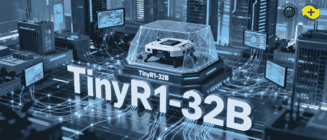
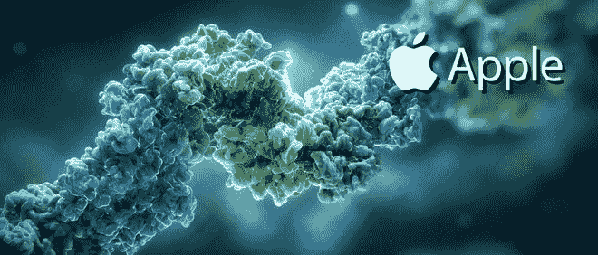
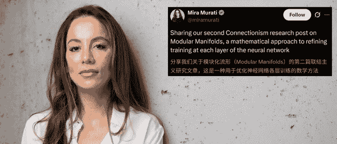
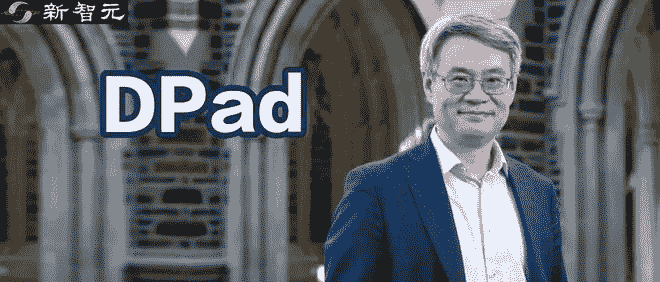
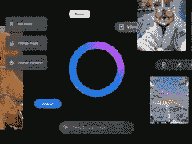
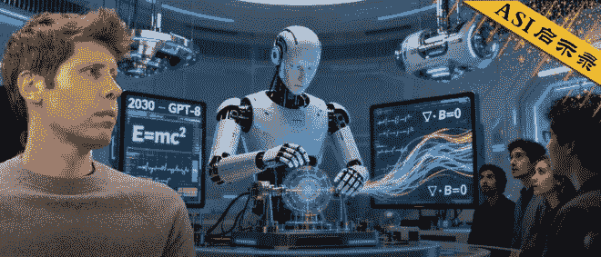
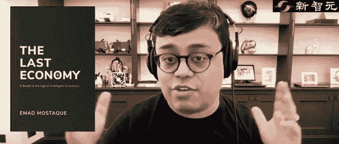

# 09.28-刚刚，北大&360里程碑式突破！32B安全分碾压千亿巨兽

> 来源：[https://agijuejin.feishu.cn/docx/BD70dmMqXo46pXxqrNXcBOrqnVf](https://agijuejin.feishu.cn/docx/BD70dmMqXo46pXxqrNXcBOrqnVf)

# AGI 掘金日报 - AI 新闻推送 (2025 年 09 月 28 日)

> [欢迎加入 AGI 掘金社群](https://applink.larkoffice.com/client/chat/chatter/add_by_link?link_token=890h8ad3-71e6-4140-af64-39dff6b2ba1f)

## ⭐ 今日热点

### 💡 刚刚，北大&360里程碑式突破！32B安全分碾压千亿巨兽

新智元 | [阅读原文](https://www.163.com/dy/article/KAHBCP6H0511ABV6.html?spss=dy_author)

2025年9月23日，「北大-360大模型联合实验室」发布TinyR1-32B模型。该模型以仅20k数据微调，在安全性能上超同等尺寸模型，推理、通用能力出色。还提出Control Token技术破解安全与有用的「跷跷板效应」。实验室同步推出TinyR1-Safety-8B轻量级安全模型。目前TinyR1系列已全面开源，未来将推动形成安全普惠大模型生态 。

## 🌟 技术突破

### 💡 苹果掀桌！扔掉AlphaFold核心模块，开启蛋白折叠「生成式AI」时代

新智元 | [阅读原文](https://www.163.com/dy/article/KAG5DR280511ABV6.html?spss=dy_author)

蛋白质折叠是计算生物学难题。SimpleFold作为首个仅基于通用Transformer模块的蛋白折叠模型，摒弃AlphaFold2传统架构。其架构由三部分组成，在速度与精度间找到平衡。实验显示，SimpleFold在CAMEO、CASP基准测试中性能出色，不靠MSA也能稳健泛化，还具备结构集合生成能力，且模型规模和训练数据规模扩展时，性能持续提升，为通用生成模型在生物领域落地指出可行路径。

### 💡 估值840亿AI实验室再放大招，他们要给大模型戴上「紧箍咒」

新智元 | [阅读原文](https://www.163.com/dy/article/KAFH2SEI0511ABV6.html?spss=dy_author)

OpenAI前CTO创办的Thinking Machines Lab发布《模块流形》。训练大模型要防止数值问题，新思路是统一量级管理。研究提出将权重张量约束在子流形上，变“救火”为“预防”。介绍了流形优化器形态，如在切空间优化、求解最优更新方向等。还提出流形Muon概念，形成优化器。模块流形理论可指导各层合理分配学习率，助于精准把握网络敏感性 。

### 💡 免训练加速61倍！陈怡然团队新作DPad：仅关注「彩票token」

新智元 | [阅读原文](https://www.163.com/dy/article/KAFBRPUU0511ABV6.html?spss=dy_author)

杜克大学陈怡然教授团队研究DPad，揭示对扩散大语言模型主动减少计算量能加速并增强语境学习能力。源于对“中奖彩票”现象的洞察，DPad无需训练找出关键组合。其核心是滑动窗口和距离衰减丢弃策略，实现速度与精度双赢。实验显示，应用DPad后，模型严格匹配率提升，在不同任务中加速比达61 - 97倍，为模型优化开辟新思路 。

## 💫 企业动态

### 💡 和好了？美政府与 xAI 达成协议，马斯克感谢特朗普

IT之家 | [阅读原文](https://www.ithome.com/0/886/322.htm)

北京时间 9 月 26 日，据《金融时报》报道，特朗普政府与马斯克旗下 xAI 签署协议，xAI 将以每个部门 0.42 美元的象征性费用，向联邦机构提供 Grok 聊天机器人，为期 18 个月。马斯克称赞此为双赢。此前两人曾公开决裂，7 月 xAI 获国防部合同，8 月却未被纳入 USAi.gov 平台。日前两人会面握手，特朗普称关系不错 。

### 💡 苹果探索自研多模态 AI 模型 Manzano：兼具理解与生成能力，不弱于 OpenAI GPT-4o 和谷歌 Nano Banana

IT之家 | [阅读原文](https://www.ithome.com/0/886/285.htm)

IT之家 9 月 27 日消息，苹果正在研发多模态 AI 模型 Manzano，兼具图像理解与生成能力。目前未发布，有预印本论文及低分辨率样例。它采用混合图像分词器减少任务冲突，架构含三部分，训练分三阶段，用大量样本。内部测试表现佳，接近前列。苹果认为其是有力替代方案，但苹果基础模型仍落后，未来 Manzano 能否减少外部依赖待验证 。

### 💡 Meta 推出 Vibes 短视频应用，平台所有内容均为 AI 生成

IT之家 | [阅读原文](https://www.ithome.com/0/886/237.htm)

9月27日，Meta推出Vibes短视频平台，所有内容均由AI生成，已在北美、澳大利亚等多地上线。Meta认为与其让现有短视频平台充斥AI内容，不如为AI打造独立舞台。用户能用文字描述生成视频并发布，还能混合他人视频加入自己创意生成新视频。Vibes的推出将进一步扩展Meta人工智能功能边界 。

### 💡 不造机器人只做系统，Meta 的野心是成为“机器人界的安卓”

IT之家 | [阅读原文](https://www.ithome.com/0/886/228.htm)

9月27日消息，Meta首席技术官安德鲁・博斯沃思称，公司将研发人形机器人（代号“Metabot”）提升至与AR同等战略高度，未来将投入数十亿美元。Meta认为机器人发展瓶颈在软件，计划采用开放平台策略，做软件系统授权。新成立的超级智能AI实验室将构建“世界模型”辅助机器人。Meta已招揽强大技术团队，包括马克・惠顿、金相培等。

## ✨ 行业观点

### 💡 刚刚，奥特曼预言：人类「只剩」最后5年！

新智元 | [阅读原文](https://www.163.com/dy/article/KAFBVO2G0511ABV6.html?spss=dy_author)

奥特曼预言到 2030 年 AI 将全面超越人类。他认为当前处于过渡期，2026 年底新模型能力将惊人，2030 年应出现超级智能。还指出未来 30% - 40%的任务将由 AI 执行，人类要掌握元技能。他期望 AI 像慈爱的父母，且认为人类情感有价值。此外，OpenAI 开展大规模算力基建，预计 2029 年年收入达 1250 亿美元 ，奥特曼支持核能发展，还透露将打造 AI 驱动小型设备系列 。

### 💡 Stability AI前CEO惊人预测：人类智力价值归零，只剩1000天！

新智元 | [阅读原文](https://www.163.com/dy/article/KAFBP7PJ0511ABV6.html?spss=dy_author)

Stability AI前CEO Emad Mostaque在播客节目讨论新书时称，未来1000天AI将重塑经济结构，人类劳动力或一文不值甚至为负。他认为现有经济学难以预测经济动态，提出全新「MIND框架」衡量经济健康。Emad指出当下处于智能崛起阶段，AI正剥离人力，人类智能资本贬值。他还提出建立通用基础AI和「人本位」新型货币，以应对社会变革 。

### 💡 李开复：如果十年后回顾 DeepSeek 如何让中国未落后美国，答案是开源

IT之家 | [阅读原文](https://www.ithome.com/0/886/217.htm)

9 月 27 日，零一万物 CEO 李开复在长江 CEO 组织 20 周年返校日庆典上称，DeepSeek 对中国 AI 发展的核心贡献是推动开源生态形成，带来中国大模型开源时代，形成良性竞争局面，有望缩小中美差距。李开复此前也多次力挺大模型开源。此外，他认为随着 Scaling Law 法则转移，AI 将加速爆发，超大预训练模型直接商业价值降低，并给出四个理由，其价值将更多体现在‘教师模型’角色中。