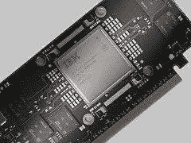
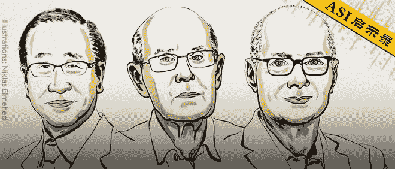
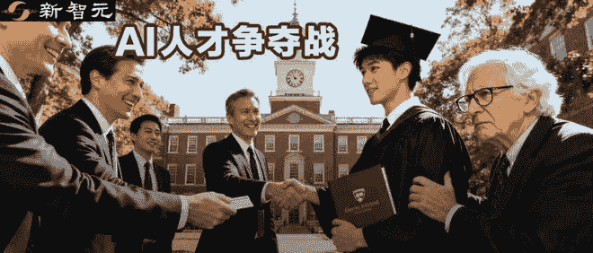
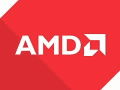
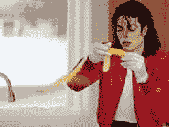
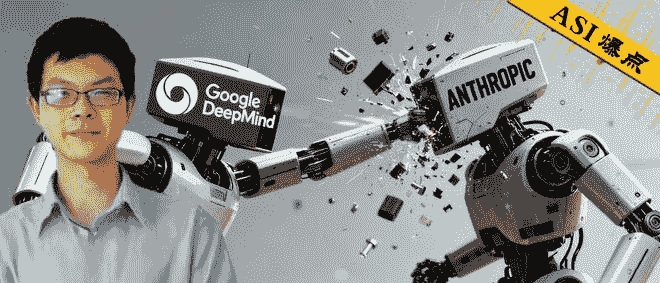

# 10.9-IBM 宣布 AI 推理加速器 Spyre 本季度正式商业可用

> 来源：[https://agijuejin.feishu.cn/docx/MeG8dtuqBo9fEexsWpKcnvOenFd](https://agijuejin.feishu.cn/docx/MeG8dtuqBo9fEexsWpKcnvOenFd)

# AGI 掘金日报 - AI 新闻推送 (2025 年 10 月 9 日)

> [欢迎加入 AGI 掘金社群](https://applink.larkoffice.com/client/chat/chatter/add_by_link?link_token=890h8ad3-71e6-4140-af64-39dff6b2ba1f)

## ⭐ 今日热点

### 💡 IBM 宣布 AI 推理加速器 Spyre 本季度正式商业可用

IT之家 | [阅读原文](https://www.ithome.com/0/888/042.htm)

当地时间10月7日，IBM宣布AI推理加速器Spyre本季度正式商业可用。z17和LinuxONE 5于10月28日支持，Power11在12月初支持。Spyre采用PCIe AIC卡外形，功耗75W，每卡32个核心，5nm工艺，晶体管256亿。z17和LinuxONE 5单机可部署48张，Power11能集成16张。它让企业可在本地部署多模态AI推理负载，兼顾安全与业务加速。

## 🌟 技术突破

### 💡 刚刚，2025年诺贝尔化学奖揭晓！偷溜进图书馆的少年，改变了世界

新智元 | [阅读原文](https://www.163.com/dy/article/KBCDI7MF0511ABV6.html?spss=dy_author)

2025 年诺贝尔化学奖授予北川进、Richard Robson 和 Omar M. Yaghi，表彰他们在金属有机框架（MOF）材料发展方面的贡献。获奖者构建的 MOF 有巨大空腔，用途广泛，如分离污染物、捕获二氧化碳等。诺贝尔化学委员会主席称其潜力大。该研究始于 Robson 的木制分子模型灵感，后 Kitagawa 和 Yaghi 做出突破。如今已开发多种功能强大的 MOF，有望解决诸多挑战 。

## 💫 企业动态

### 💡 哈佛CS博士月入4000，抢GPU搞科研！硅谷百万年薪挖人，学界疯狂逃离

新智元 | [阅读原文](https://www.163.com/dy/article/KBDSKQE10511ABV6.html?spss=dy_author)

AI 人才大战使学术界陷入危机。博士生薪资与硅谷百万年薪差距大，如哈佛博士生月津贴 4205 美元。同时，实验室算力匮乏，与大厂千亿投入差距明显。这导致人才流向产业，影响科研和教学。部分公司推出混合培养模式，而教授招生担忧学生跳槽。学术界面临严峻挑战，未来走向存疑。

### 💡 美国电影协会喊话 OpenAI：必须采取果断行动停止 Sora 2 的侵权行为

IT之家 | [阅读原文](https://www.ithome.com/0/888/089.htm)

当地时间10月9日周一，美国电影协会呼吁OpenAI对新视频生成模型Sora 2 “立即采取果断措施”，因其被用于制作侵权内容。自Sora上周推出，侵权视频增多。OpenAI CEO奥尔特曼称将为版权方提供“更细化控制”，平台改“选择加入”模式。但他也提醒无法完全阻止知识产权滥用。此前迪士尼等也曾起诉其他AI平台侵权，版权问题是生成式AI核心议题。

### 💡 谷歌 AI 试穿功能升级，助你“赛博买鞋”

IT之家 | [阅读原文](https://www.ithome.com/0/888/081.htm)

北京时间10月8日晚，谷歌宣布生成式AI “Try On” 功能支持试穿鞋类。用户在商品页面点击按钮上传全身照即可试穿，该功能能感知服装“形状和深度” ，还可展示最近试穿产品方便对比。不过效果与真实情况可能有偏差。今年早些时候该功能仅在美国上线，现扩展到加拿大、澳大利亚和日本。此外，谷歌还曾推出Doppl应用用于虚拟试穿服装 。

### 💡 OpenAI 视频生成应用 Sora 首周 iOS 下载量超 ChatGPT，日下载峰值近 11 万

IT之家 | [阅读原文](https://www.ithome.com/0/888/065.htm)

据 Appfigures 数据，OpenAI 视频生成应用 Sora 首周 iOS 下载量约 62.7 万次，超 ChatGPT 首周的 60.6 万次。虽 ChatGPT 首周仅在美国上线，Sora 覆盖美加（加拿大下载量约 4.5 万次），仅对比美国市场 Sora 发布规模为 ChatGPT 的 96% 。Sora 上线首日安装约 5.6 万次，迅速登顶美国 App Store 。其日下载峰值近 11 万次，虽近期下载量有所下降，但作为邀请制应用表现可观。不过，Sora 生成深度伪造视频引发伦理争议 。

### 💡 ChatGPT 向你推荐专属新口味音乐，OpenAI 与流媒体音乐平台 Spotify 达成合作

IT之家 | [阅读原文](https://www.ithome.com/0/888/052.htm)

10月8日消息，OpenAI与流媒体音乐平台Spotify达成合作。用户在ChatGPT网页版/移动端提到Spotify，登录账号后，就能让ChatGPT推荐歌曲等，ChatGPT会调用Spotify控件，点击歌曲可打开Spotify应用播放。该功能处于早期，适配英语，在145个地区向各类ChatGPT用户推出，不同Spotify用户权限有别。官方称账号关联自愿，且Spotify不会向OpenAI分享内容用于AI训练 。

### 💡 英伟达垄断AI算力局面或将被颠覆！AMD赌上身家发起决斗，奥特曼窃喜

新智元 | [阅读原文](https://www.163.com/dy/article/KBCDG2680511ABV6.html?spss=dy_author)

OpenAI 与 AMD 达成重大协议，将部署 6GW AMD GPU。消息公布后，AMD 股价大涨近 40%。此次合作含资本绑定机制，对 AMD 是战略拐点。AI 算力供不应求，该合作是“多源供给战略”体现。虽英伟达在 AI 芯片市场领先，但面临挑战。AMD 合作面临诸多风险，合作有乐观、中性、悲观三种结局，此次合作或重塑 AI 硬件领域格局。

### 💡 AMD CEO 苏姿丰确认 Instinct MI450 加速器将采用 2nm 制程工艺

IT之家 | [阅读原文](https://www.ithome.com/0/888/029.htm)

10月8日，AMD首席执行官苏姿丰在与OpenAI达成交易后接受采访时确认，Instinct MI450显卡加速器将采用2nm先进制程 。消息人士进一步解释，它将配备不同制程的多种裸晶。此前AMD已宣布Zen 6 EPYC 'Venice'处理器用台积电2nm工艺，英伟达明年的'Rubin' GPU基于台积电3nm系节点。

### 💡 赚100亿，烧1万亿！OpenAI算力神话：英伟达撒钱、AMD送股、全硅谷陪跑

新智元 | [阅读原文](https://www.163.com/dy/article/KBC5ENFB0511ABV6.html?spss=dy_author)

2025年OpenAI估值达5000亿美元成全球最高独角兽。未来十年将部署20GW算力（约20座核反应堆），投入1万亿美元。英伟达、AMD等企业加入押注，英伟达投资1000亿，AMD给认股权证。为获算力，OpenAI有独特金融运作。奥特曼称盈利非首要问题，押注AI指数级增长。但风险大，若增长放缓，投资热情和股价或消散 。

### 💡 已故名人遭 Sora 2“复活”引争议，OpenAI 称允许生成历史人物

IT之家 | [阅读原文](https://www.ithome.com/0/887/996.htm)

10月8日消息，OpenAI 推出Sora 2 视频生成器时称默认“禁止生成公众人物形象”，但存在允许生成已故公众人物视频的漏洞。社交媒体上这类“复活”已故名人的例子众多，这令其亲属和粉丝不适 。OpenAI 给生成视频加动态水印，活着的用户可选择加入“客串”功能掌控肖像权，但已故名人无法如此。此外，OpenAI 还因版权问题调整了Sora 2处理方式，首席执行官称更多变革将到来。

### 💡 120 亿年收入撬动 1 万亿美元订单：OpenAI 烧钱搞 AI 基建，奥尔特曼称短期内不优先考虑盈利

IT之家 | [阅读原文](https://www.ithome.com/0/887/995.htm)

10月7日消息，OpenAI与英伟达、AMD等签署约1万亿美元AI基础设施合同，欲获超20吉瓦算力（耗电量如20座核反应堆）。其年收入120亿美元，今年或亏100亿美元，采用循环融资。如英伟达投1000亿美元，AMD授予认股权证。首席执行官奥尔特曼称短期内不优先考虑盈利。消息推高相关公司股价，外界担忧其激进扩张策略，有投资者指其行业资本密集且缺成本控制纪律 。

### 💡 刚刚，清华物理传奇Yao Shunyu，跳槽谷歌DeepMind！

新智元 | [阅读原文](https://www.163.com/dy/article/KBBHVG4T0511ABV6.html?spss=dy_author)

清华物理系传奇特奖得主姚顺宇离职Anthropic，加盟谷歌DeepMind。他在Anthropic仅工作一年，约40%的离职原因是反对其将中国列为「adversarial nations」的反华言论。姚顺宇认为现阶段AI研究类似17世纪热力学探索，虽缺完整理论但充满发现契机。他还分享了从物理转向AI的原因，称AI对年轻人机会更多。

### 💡 谷歌将 Gemini AI 引入 Chrome 代码审查流程，提升开发效率与安全性

IT之家 | [阅读原文](https://www.ithome.com/0/887/966.htm)

10月8日消息，谷歌将Gemini AI引入Chrome代码审查流程。此前Gemini在Chrome多以用户可见形式呈现。现在开发人员提交代码补丁时，Gemini会自动扫描并反馈潜在漏洞、安全风险等问题，辅助人工评审，节省审核时间、提升效率，让更新更安全快速可靠。此外，Chrome还可能用Gemini AI检查结账价格信息，新版标签页或新增独立搜索框。

## ✨ 行业观点

### 💡 小心，AI依赖会让你变笨！吴恩达等专家教你如何正确使用AI

新智元 | [阅读原文](https://www.163.com/dy/article/KBCDH1H30511ABV6.html?spss=dy_author)

文章指出人类对AI依赖渐深，探讨其对大脑的影响及正确使用方式。AI处理短期任务有优势，长期任务错误率高，写作缺乏情感深度，还会让人分心、技能退化。吴恩达等专家认为AI无法完全取代人类独立思考，学习基本技能仍是关键。此外，数据工程师、艺术创作等诸多职业，AI无法完全替代，人类应避免让AI全面接管思考。