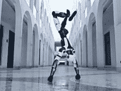
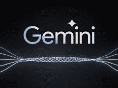
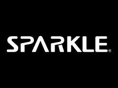
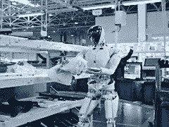
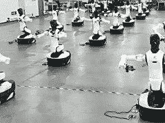

# 10.10-云深处科技发布全球首款行业级全天候人形机器人

> 来源：[https://agijuejin.feishu.cn/docx/RJe2dTStxo2NFtxijdBcwCYWnvd](https://agijuejin.feishu.cn/docx/RJe2dTStxo2NFtxijdBcwCYWnvd)

# AGI 掘金日报 - AI 新闻推送 (2025 年 10 月 10 日)

> [欢迎加入 AGI 掘金社群](https://applink.larkoffice.com/client/chat/chatter/add_by_link?link_token=890h8ad3-71e6-4140-af64-39dff6b2ba1f)

## ⭐ 今日热点

### 💡 云深处科技发布全球首款行业级全天候人形机器人

IT之家 | [阅读原文](https://www.ithome.com/0/888/311.htm)

10月9日，云深处科技发布全球首款行业级全天候人形机器人「DR02」。它支持整机IP66防水防尘，能满足全天候户外作业。行走速度最高4m/s ，可在一定高度楼梯和角度斜坡行走。适配 -20℃~55℃ 工作环境，拥有275TOPS AI算力，配备多种传感器实现融合，满足复杂场景需求。

## 🌟 技术突破

### 💡 全球AI视频大战升级！「中国版Sora」Vidu Q2参考生月底发布，能力对标Sora 2

新智元 | [阅读原文](https://www.163.com/dy/article/KBF4BLIP0511ABV6.html?spss=dy_author)

全球 AI 视频竞争激烈。OpenAI 的 Sora 2 三天登顶美区 App Store ，Cameo 功能引发热潮。而中国版「Sora」Vidu 本月底将更新 Q2 参考生功能，其早在去年 9 月就推出该功能，且在多方面领先 Sora 2 。技术指标对比上，Vidu 在一致性、动态自然度表现更佳，语义理解与 Sora 2 相近。Vidu 功能更新后，创作自由度更高、应用更丰富，有望重塑 AI 视频版图。

### 💡 第二代InfLLM开源，同尺寸快三倍！零参数，可训练稀疏注意力

新智元 | [阅读原文](https://www.163.com/dy/article/KBF41K7L0511ABV6.html?spss=dy_author)

清华、OpenBMB和哈工大提出的InfLLM-V2开源。它是零额外参数、训练高效的原生稀疏注意力框架，低成本训练（仅需5B长文本数据），能短到长无缝切换、效率双优，有高效算子实现。与其他方法对比，在长文本理解和深思考任务上性能优越，推理效率显著提升，如在128K长文本中可实现4 - 9倍算子加速比 。还发布了开源模型MiniCPM4及MiniCPM4.1，未来将持续优化并集成至主流框架，开源相关模型与数据。

## 💫 企业动态

### 💡 全球 10% 成年人都在用：OpenAI、哈佛大学报告称 ChatGPT 月活用户已达 7 亿

IT之家 | [阅读原文](https://www.ithome.com/0/888/363.htm)

据《商业内幕》报道，OpenAI、杜克大学和哈佛大学研究人员论文指出，ChatGPT 7月的月活用户达7亿，占全球成年人口约10%。目前数字可能更高，OpenAI CEO称其周活用户已增至8亿。截至7月，ChatGPT每日处理超25亿条消息。自2023年11月其活跃用户增长700%，远超同类。如xAI的Grok月活6500万，Claude和Perplexity AI月活各3000万。凸显其在人工智能和大语言模型领域的领先地位。

### 💡 宇树双足人形机器人 Unitree R1 入选《时代》杂志 2025 最佳机器人发明榜单

IT之家 | [阅读原文](https://www.ithome.com/0/888/360.htm)

10月9日，《时代》杂志公布2025年度最佳发明榜单，宇树双足人形机器人Unitree R1入选机器人类目。该机器人今年7月上市，起售价3.99万元，面向科研、教育等人员。它重约23公斤，内置AI，能完成复杂动作。《时代》每年评选有影响力的发明等，今年榜单扩至300项。同属机器人分类上榜的还有Figure 03等产品。

### 💡 不到 5 天下载破 100 万次：“AI 版抖音” Sora 蹿红，增速超 OpenAI 现象级产品 ChatGPT

IT之家 | [阅读原文](https://www.ithome.com/0/888/353.htm)

OpenAI的Sora应用发布于9月底，堪称“AI 版抖音”。上线不到5天，在仍处邀请制且仅对美加用户开放时，下载量就突破100万次，超ChatGPT，位列苹果App Store免费应用榜首。其核心功能是用真实视频生成新视频，依托Sora 2视频生成模型，技术强大。产品设计注重社交属性，初衷是朋友间互动创作。

### 💡 AI 界“权力的游戏”：OpenAI 示警欧盟担忧苹果、谷歌等巨头阻碍 AI 创新

IT之家 | [阅读原文](https://www.ithome.com/0/888/349.htm)

10月9日科技媒体报道，2025年9月24日OpenAI向欧盟委员会表达对苹果、微软、谷歌市场地位的担忧，称其“根深蒂固”优势及“用户锁定”效应或阻碍AI初创公司成长，强调监管需行动。但存在矛盾，苹果集成OpenAI的ChatGPT技术，微软是OpenAI长期伙伴及重要股东。

### 💡 英特尔公布 AI 执行路线图：AI GPU 年更，将发布推理优化 GPU

IT之家 | [阅读原文](https://www.ithome.com/0/888/319.htm)

10月9日英特尔在技术之旅活动上公布AI执行路线图。其AI GPU产品将实现年度更新，以提升数据中心AI芯片生态能见度。还计划推出推理优化的AI GPU，主打大内存容量与带宽及企业级推理性能。未来将推新一代推理GPU和“Shores”级产品线，解决带宽瓶颈。首席技术官Sachin Katti称，更多推理GPU信息将在本月中旬的2025 OCP全球峰会上讨论 。

### 💡 H-1B正在筛掉「下一个英伟达」？

新智元 | [阅读原文](https://www.163.com/dy/article/KBF3SJH90511ABV6.html?spss=dy_author)

2025年9月美国出台H-1B签证新规，新申请费用提至10万美元，还修订工资标准。英伟达CEO黄仁勋、OpenAI的山姆·奥特曼等赞成，认为是“正确方向”。但黄仁勋也担忧高额费用或抑制初创企业发展、削弱美国对人才吸引力。该政策使雇主成本上升、人才标准提高、科技人才引进放缓，初创企业受冲击大。此外，也有反对声音，新政策或重塑全球人才格局 。

### 💡 OpenAI×英伟达，可能创造了人类史上最大万亿级泡沫

新智元 | [阅读原文](https://www.163.com/dy/article/KBEPQOC00511ABV6.html?spss=dy_author)

短短两周内，OpenAI、英伟达、AMD等企业间巨额投资与合作不断，如OpenAI与甲骨文签3000亿美元数据中心协议，获英伟达1000亿美元投资，又与AMD合作采购芯片。这形成封闭式循环投资模式，引发争议。产业高管称是“正向循环”，但有研究员将其与互联网泡沫对比，指出支出增速远超营收能力。奥特曼称OpenAI需大量投入且未盈利。这场AI资本盛宴最终需由价值验证。

### 💡 谷歌向反垄断案法官提出申请，希望允许将 Gemini AI 与地图或 YouTube 捆绑

IT之家 | [阅读原文](https://www.ithome.com/0/888/242.htm)

10月8日，谷歌母公司Alphabet律师John Schmidtlein向负责谷歌反垄断案的美国联邦法官Amit Mehta申请，希望保留将Gemini AI服务与Google Maps或YouTube捆绑的权利。此前法官裁决谷歌搜索等业务有垄断行为，美国司法部欲将裁决范围扩至Gemini AI。John Schmidtlein称谷歌在AI市场未获垄断地位，微软也有类似绑定做法。但Amit Mehta法官对此存疑，担心其利用影响力优化AI服务定位 。

### 💡 撼与公布系列英特尔锐炫 Pro B60 显卡 AI 解决方案，至高 16 张双芯卡

IT之家 | [阅读原文](https://www.ithome.com/0/888/225.htm)

10月9日消息，英特尔AIC合作伙伴撼与旗下toB部门SPARKLE Embedded 9月中旬公布基于锐炫Pro B60 24GB显卡的AI解决方案。其中旗舰C741-6U-Dual 16P最亮眼，配备16张双芯锐炫Pro B60 Duo 48GB显卡，总显存768GB。它采用6U机架式设计，基于双路英特尔至强4/5系列处理器，有高速NIC有线网卡插槽，还拥有4+1冗余配置、2700W 80 PLUS钛金转换效率认证电源，整体供电10kW+ 。

### 💡 不再是印度独享：OpenAI 低价 ChatGPT Go 订阅计划扩张至亚洲 16 地，每月不到 5 美元

IT之家 | [阅读原文](https://www.ithome.com/0/888/210.htm)

10月9日，OpenAI加速将每月不到5美元的ChatGPT Go订阅服务扩展到亚洲16个国家和地区。部分国家可用当地货币付款，价格因税收有别。该服务有更高消息上限等优势。此时OpenAI在东南亚周活用户增长四倍，印度付费用户翻倍。此外，OpenAI与谷歌竞争推广低价AI聊天机器人订阅服务，谷歌已在多地推出Google AI Plus计划。

### 💡 小鹏汽车将举行 AI 科技日，消息称宣布在物理 AI 领域取得的“重大突破”

IT之家 | [阅读原文](https://www.ithome.com/0/888/203.htm)

据第一财经报道，小鹏汽车将在今年 AI 科技日宣布物理 AI 领域“重大突破”，其世界基座模型推演能力有“关键进展”。小鹏 AI 团队已投入一年多研发物理世界 AI 基座模型，用最大数据量打造“国内最领先”模型，这是攻克大规模 L4 的关键一步，利好“AI + 出行”生态。目前官方未披露 AI 科技日具体时间，此前已连续五年举办 1024 科技日，2024 年升级为“小鹏 AI 科技日” 。

### 💡 特斯拉被曝停产 Optimus 机器人，手部设计成最大难题

IT之家 | [阅读原文](https://www.ithome.com/0/888/186.htm)

2025年10月8日，科技媒体报道特斯拉原计划今年量产至少5000台人形机器人Optimus，后因工程师反对下调至2000台。现因机器人手部和前臂设计有严重技术难题，工程团队无法实现类人灵活操作，已暂时停产，积压大量无手机体。该难题2024年夏天已现，数轮尝试未突破。马斯克曾称手部精细操作最难，此次未承诺量产恢复时间，不过他依旧乐观 。

### 💡 谷歌杀入诺奖神殿，两年三冠五得主！世界TOP3重现贝尔实验室神话

新智元 | [阅读原文](https://www.163.com/dy/article/KBE85UJI0511ABV6.html?spss=dy_author)

2025年谷歌再成诺奖焦点，继2024年后相关科学家又获物理学奖，两年内共揽三项诺奖、五位得主。这些得主包括2024年化学奖的Demis Hassabis与John Jumper 、物理学奖的Geoffrey Hinton，2025年物理学奖的Michel Devoret与John Martinis 。虽部分成果非谷歌内部产生，与贝尔实验室、IBM相比“仍需努力”，但谷歌在AI与量子研究领域正逐步承袭科研巨擘地位，或成新时代“贝尔实验室” 。

### 💡 中国宇树 G1 人形机器人上架美国沃尔玛，基本款售价 21600 美元

IT之家 | [阅读原文](https://www.ithome.com/0/888/161.htm)

10 月 9 日消息，中国宇树 G1 人形机器人上架美国沃尔玛，基本款售价 21600 美元。知名机器人研究员克里斯・帕克森认为廉价机器人部署能解决核心问题。宇树 G1 已是高校和研究机构常客，宇树科技追求规模化普及化，明年将推更亲民的 R1。此次上架降低采购壁垒，宇树或为 IPO 做准备，这表明机器人技术正走向成熟 。

### 💡 智元机器人获龙旗科技数亿元智元精灵 G2 框架订单，将部署近千台机器人

IT之家 | [阅读原文](https://www.ithome.com/0/888/150.htm)

10月9日消息，智元机器人与龙旗科技达成深度战略合作，龙旗科技下达数亿元的智元精灵 G2 机器人框架订单，将部署近千台。这是国内工业具身智能机器人领域大订单，标志工业级具身智能切入核心场景。G2 凭借柔性优势应用于平板产线，提升产线效率。对龙旗而言推进‘AI + 制造’战略；对智元是‘工业制造场景规模化商用’里程碑，未来双方还将展开更多合作。

## ✨ 行业观点

### 💡 阿里巴巴蔡崇信激辩“白宫 AI 沙皇”：AI 应用中国进展显著，AI 没有赢家通吃

IT之家 | [阅读原文](https://www.ithome.com/0/888/193.htm)

10月9日，在All-In 2025峰会上，阿里巴巴蔡崇信与“白宫AI沙皇”David Sacks激辩AI。蔡崇信认为AI非赢家通吃，美国应重应用普及；中国应用进展显著，约50%企业已应用AI。他还谈及阿里战略聚焦电商与云计算，约30%代码由AI生成，预计AGI约20年到来。此外，蔡崇信分享了运营球队经验及对体育行业的见解，还谈到中美关系、中国监管变化等话题 。

### 💡 英伟达 CEO 黄仁勋：AI 数据中心应建设配套离网发电能力

IT之家 | [阅读原文](https://www.ithome.com/0/888/181.htm)

美国当地时间10月8日，英伟达CEO黄仁勋做客节目时称，AI数据中心应建设配套离网发电能力。他认为AI行业应丰富能源生产投资形式，自建电力基础设施更灵活，不影响居民用电。现阶段离网电力系统可用燃气轮机，未来可能转向核能。此外，他提到中国电力系统是AI竞赛长板，且近六个月全球AI算力需求大增，Blackwell GPU需求高 。

### 💡 英国央行示警：AI 企业估值高企，若预期转冷恐酿重大金融风险

IT之家 | [阅读原文](https://www.ithome.com/0/888/157.htm)

英国央行金融政策委员会（FPC）指出，自今年6月上次会议以来，AI企业代表的股票市场估值过高。一旦AI影响预期转冷，股票市场风险大。标准普尔500指数一年期预期市盈率25倍，处于历史高位，可能重估AI关联企业盈利预期。国际货币基金组织IMF总裁称当前市场估值趋近25年前互联网繁荣水平，急剧调整或拖累世界经济，影响发展中国家 。