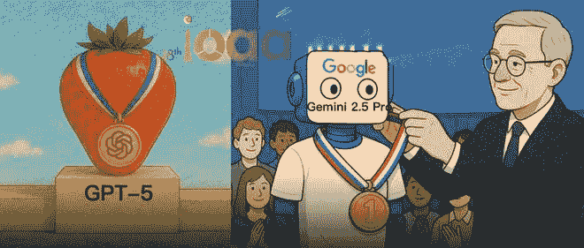

# 10.13-挖走英伟达两员大将：马斯克 xAI 正开发“可用于游戏与机器人领域的世界模型”

> 来源：[https://agijuejin.feishu.cn/docx/OgvHdlQEQo1QG3xkKLoc3x72nlg](https://agijuejin.feishu.cn/docx/OgvHdlQEQo1QG3xkKLoc3x72nlg)

# AGI 掘金日报 - AI 新闻推送 (2025 年 10 月 13 日)

> [欢迎加入 AGI 掘金社群](https://applink.larkoffice.com/client/chat/chatter/add_by_link?link_token=890h8ad3-71e6-4140-af64-39dff6b2ba1f)

## ⭐ 今日热点

### 💡 挖走英伟达两员大将：马斯克 xAI 正开发“可用于游戏与机器人领域的世界模型”

IT之家 | [阅读原文](https://www.ithome.com/0/888/883.htm)

北京时间10月12日，据《金融时报》，马斯克旗下xAI公司正构建“世界模型” 角逐下一代AI系统。它是能理解现实世界动态特征的生成式AI模型。xAI从英伟达挖来专家研发，计划用于游戏和机器人领域。一些公司对其寄予厚望，潜在市场规模大。但世界模型面临数据获取难题，谷歌、Meta等也在研发。此外，xAI推出图像和视频生成模型并免费开放 ，马斯克还重申明年年底前推AI生成游戏目标。

## 🌟 技术突破

### 💡 Bug变奖励：AI的小失误，揭开创造力真相！

新智元 | [阅读原文](https://www.163.com/dy/article/KBMFPKV80511ABV6.html?spss=dy_author)

研究发现，扩散模型虽本应“复刻”，却能创作全新图像。AI的“创造力”是其架构副作用，源于局部性和平移等变性规则，使它无法完全依赖记忆而即兴重组。如ELS方程机与扩散模型输出平均重合度达90%，证明了这一点。此外，AI创造力与生物自组织相似，研究者推测人类创造力或许也如此，创造力可能源于“不完美”。

### 💡 濒死3次，医生判他死刑！宾大教授奇迹自救，誓用AI攻克14000种绝症

新智元 | [阅读原文](https://www.163.com/dy/article/KBMFNGG30511ABV6.html?spss=dy_author)

宾大教授David Fajgenbaum曾患卡斯特曼病，多次濒死。他发现用西罗莫司抑制异常通路治愈自己后，意识到医疗体系盲点。为此创立非营利组织Every Cure，打造AI系统MATRIX，在7500万种药物与疾病组合中挖掘治疗方案。目前已取得不少成果，且MATRIX运算速度大幅提升。他计划公开预测结果，采用「AI + 人类」模式，让AI更好助力医学。

### 💡 告别「解码器饥饿」！中国科学院NeurIPS推SpaceServe，高并发克星

新智元 | [阅读原文](https://www.163.com/dy/article/KBMFNAKC0511ABV6.html?spss=dy_author)

中国科学院计算技术研究所入选NeurIPS 2025的论文提出SpaceServe架构。它将LLM推理的P/D分离扩展至多模态场景，通过EPD三阶解耦与「空分复用」解决MLLM推理的行头阻塞难题。在Qwen2-VL系列模型上，SpaceServe高并发性能超vLLM，比NVIDIA MPS方案提速3.3×。它无需改模型结构，代码开源，为MLLM推理树立新范式，主要优化稳态吞吐 。

### 💡 永别了，人类冠军！AI横扫天文奥赛，GPT-5得分远超金牌选手2.7倍

新智元 | [阅读原文](https://www.163.com/dy/article/KBLUIJL50511ABV6.html?spss=dy_author)

俄亥俄州立大学团队用IOAA评估五大顶尖LLM。在国际天文与天体物理奥赛测试中，GPT-5和Gemini 2.5 Pro完胜人类选手，达到金牌水平，GPT-5平均分超人类金牌得主2.7倍。理论考试中，这两者表现最佳；数据分析考试里，GPT-5表现出色。多数LLM理论考试达金牌线，但在空间和时间推理上有困难，概念性和几何错误占失分主导 。

## 💫 企业动态

### 💡 日本政府要求 OpenAI 不得通过 Sora 2 等实施任何可能侵犯版权的行为

IT之家 | [阅读原文](https://www.ithome.com/0/888/930.htm)

10月10日，日本内阁府特命担当大臣城内实称，已通过事务局要求OpenAI不得通过Sora 2实施侵犯著作权行为。日本文化创意产业重要，动画漫画影响力大，而Sora 2发布博客样片涉及日本动画风格，还能生成动漫人物等，日本政府将采取应对措施。

### 💡 Sora by OpenAI 即将登陆安卓，应用以不可用状态现身 Google Play

IT之家 | [阅读原文](https://www.ithome.com/0/888/919.htm)

10月13日消息，据发现，此前仅在苹果iOS App Store提供的AI视频生成应用Sora by OpenAI现身谷歌Google Play（目前暂不可用），即将登陆安卓平台。和iOS版仅在美国和加拿大可用类似，Google Play上的该应用目前也仅在这两国接受预注册 。

### 💡 向伪造视频开炮，马斯克称 Grok 将具备检测 AI 生成视频的能力

IT之家 | [阅读原文](https://www.ithome.com/0/888/916.htm)

10月13日马斯克宣布，其公司xAI开发的聊天机器人Grok将具备分析互联网视频、检测AI生成痕迹及追溯来源的能力。此前有用户担忧AI伪造视频难辨真假，马斯克回应此功能即将推出。Grok还能识别视频细微AI痕迹，交叉比对元数据等验证视频真实性。自发布后，马斯克用Grok参与竞争，还将其与X合并，在X平台应用，拓展多种功能。

## ✨ 行业观点

### 💡 OpenAI 奥尔特曼：当前可能会被 AI 消灭的岗位也许并不算“真正的工作”

IT之家 | [阅读原文](https://www.ithome.com/0/888/938.htm)

10月12日外媒报道，OpenAI CEO奥尔特曼在OpenAI DevDay大会上称，当下可能被AI取代或改变的工作，某种角度不算“真正的工作”。如农民从事的提供食物的工作才是真正的工作，现代有些工作在农民看来像“玩游戏”。他认为工作会不断变化，人们无需过度担心AI消灭工作，且相信人类动力会引导找到新工作 。

### 💡 美国俄亥俄州议员拟立法阻止 AI 获得法律人格：人与 AI 不能“结婚”

IT之家 | [阅读原文](https://www.ithome.com/0/888/932.htm)

美国俄亥俄州利金县众议员 Thaddeus Claggett 提出法案，拟将 AI 界定为“无意识实体”，禁止其拥有法律人格，不能“结婚”，也不能拥有或控制房地产等，所造成损害由人类所有者或开发者担责。Claggett 称要确保技术由人类掌控。调查显示近三分之一美国成年人与 AI 有“亲密或浪漫”关系，且 AI 聊天机器人存在风险，引发精神科医生担忧。

### 💡 复旦张军平：人类是硅基生命过渡体？

新智元 | [阅读原文](https://www.163.com/dy/article/KBMM0TNS0511ABV6.html?spss=dy_author)

复旦大学张军平教授探讨人类是否为硅基生命过渡体。近年来 AI 技术进展大，学习策略转变，应用广泛，但存在强非线性、高耗能等问题。AI 在围棋、绘画等领域学习能力超越人类，然而受莫拉维克悖论等限制，无法全方位取代人类。未来人类或从事解读 AI 成果等工作，理解二者学习机制，有助于和谐共处 。