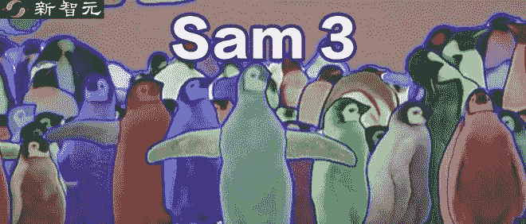

# 10.14-OpenAI官宣自研首颗芯片，AI界「M1时刻」九个月杀到！联手博通三年10GW

> 来源：[https://agijuejin.feishu.cn/docx/Bqa0dl8r6o9KDWx3dDvckaYenqd](https://agijuejin.feishu.cn/docx/Bqa0dl8r6o9KDWx3dDvckaYenqd)

# AGI 掘金日报 - AI 新闻推送 (2025 年 10 月 14 日)

> [欢迎加入 AGI 掘金社群](https://applink.larkoffice.com/client/chat/chatter/add_by_link?link_token=890h8ad3-71e6-4140-af64-39dff6b2ba1f)

## ⭐ 今日热点

### 💡 OpenAI官宣自研首颗芯片，AI界「M1时刻」九个月杀到！联手博通三年10GW

新智元 | [阅读原文](https://www.163.com/dy/article/KBQMNPEJ0511ABV6.html?spss=dy_author)

OpenAI官宣与博通合作造AI芯片，预计2029年底部署10GW算力。其内部已秘密研发18个月，首颗芯片9个月后量产。这将打造闭环生态，摆脱外部依赖。合作从定制芯片到完整系统，还在用AI设计芯片。博通CEO称掌控芯片即掌控命运，此合作或定义人类文明下一代操作系统，将世界从「算力稀缺」推向「算力充裕」 。

## 🌟 技术突破

### 💡 ICLR神秘论文曝光！SAM3用「概念」看世界，重构视觉AI新范式

新智元 | [阅读原文](https://www.163.com/dy/article/KBPD7TF10511ABV6.html?spss=dy_author)

2023 年 Meta 推出 SAM，2024 年升级到 SAM 2。近日，ICLR 2026 盲审论文曝光 SAM 3。其最大突破是「基于概念的分割」，引入可提示概念分割（PCS）。研究团队构建数据引擎，生成含约 400 万个概念标签的高质量数据集。实验显示，SAM 3 在可提示分割上创新高，处理速度快。它还实现三大创新，为智能视觉等系统奠定基础 。

### 💡 剑桥揭开大模型翻车黑箱！别再怪它不懂推理，是行动出错了

新智元 | [阅读原文](https://www.163.com/dy/article/KBP6688A0511ABV6.html?spss=dy_author)

剑桥大学等机构研究发现，大模型执行长时任务易翻车，问题不在推理，而是执行能力不足。研究提出评估大模型执行性能的指标，发现单步准确率提升可使任务长度指数级增长。实验表明长视界执行困难，扩大模型规模可增加执行轮次，但不能缓解自条件化，而“思考”类模型抗自条件化能力更强，证实“先推理，后行动”的重要性 。

### 💡 今年诺奖成果曾遭质疑无用，但华人团队用它研制了未来芯片的「钥匙」

新智元 | [阅读原文](https://www.163.com/dy/article/KBP664B10511ABV6.html?spss=dy_author)

2025年诺贝尔化学奖成果MOF材料曾被质疑实用性。海外华人团队用其研制出纳米级“流体芯片”，发表于Science子刊。该芯片以离子流动模拟电子电路，用特殊纳米流体晶体管实现对质子流开关调控，有选择性离子传输特性，还具“记忆”能力，能模拟神经突触学习行为。此成果证明MOF有用，开创“液态电子学”新可能 。

### 💡 Mamba-3惊现AI顶会ICLR 2026！CMU知名华人教授一作首代工作AI圈爆红

新智元 | [阅读原文](https://www.163.com/dy/article/KBOO343J0511ABV6.html?spss=dy_author)

Transformer有力挑战者Mamba进化到第三代Mamba-3，已进入ICLR 2026盲审。Mamba系列源于对经典状态空间模型的探索。Mamba-1兼顾长程记忆与高效推理，但硬件并行有挑战；Mamba-2通过对偶加速，推理速度提升2至8倍。Mamba-3带来三项改进：用梯形法则离散化提高状态更新精度；引入复数状态空间实现“钟摆”记忆；采用MIMO设计提升硬件效率。其有望在长文本处理等领域发挥作用，同时FBAM也在挑战Transformer 。

### 💡 日本将构建脑活动数据库，目标十年后让 AI 有“接近人类五感”的能力

IT之家 | [阅读原文](https://www.ithome.com/0/889/008.htm)

据日经新闻10月13日报道，日本总务省将构建基于五感的脑活动数据库，2026年度起支持相关研究。预计到2035年左右实现具备接近人类五感能力的AI ，开发可读取人类情感的新一代AI。将用外骨骼机器人手套及VR头显等设备测量脑活动数据，数据库在保护个人信息前提下考虑向民间提供。日本情报通信审议会将“脑信息通信”列为2030年代重点课题之一 。

## 💫 企业动态

### 💡 英伟达宣布 DGX Spark 桌面 AI 超算 15 日正式发售，3999 美元

IT之家 | [阅读原文](https://www.ithome.com/0/889/220.htm)

当地时间10月13日，英伟达宣布基于GB10芯片的DGX Spark桌面AI超算15日发售，第一方FE版本售价3999美元。GB10芯片20核CPU，GPU有6144个CUDA核心等 。它运行DGX OS，预装软件堆栈，单机有1 petaflop的FP4稀疏AI算力等。除FE版，宏碁、华硕等合作伙伴也将推“非公”系统。

### 💡 神农 AI 大模型 + 农业中关村，2025 世界农业科技创新大会开幕

IT之家 | [阅读原文](https://www.ithome.com/0/889/216.htm)

2025世界农业科技创新大会10月13日在北京平谷开幕，90多个国家和地区近800名嘉宾参会。会上发布神农AI大模型3.0、农业中关村2.0等成果。预计到2030年全球仍有5.82亿人口食物不足，与会嘉宾围绕相关内容交流合作。神农AI大模型3.0由中国农大打造，功能多样，聚焦36个农业智能体 ，有三个版本，算力缩小50% ，关键任务性能损失低，已在多地推广，服务超10万人。平谷副区长发布农业中关村2.0计划，致力于打造全国农业科创中心。

### 💡 加州签署全美首个 AI 陪伴聊天机器人法案：年龄要验、色情要拦、自杀要防

IT之家 | [阅读原文](https://www.ithome.com/0/889/190.htm)

2025年10月14日，加州州长签署全美首个AI陪伴聊天机器人法案《参议院第243号法案》（SB 243 ），2026年1月1日生效。该法案旨在保护儿童等弱势用户，要求企业实施年龄验证等多项安全功能，加大对非法深度伪造牟利处罚。此前多起悲剧引发关注，部分公司已采取保护措施。参议员称这是正确一步，希望其他州行动。此外，加州此前还通过AI监管立法，其他州也有相关立法限制AI聊天机器人应用。

### 💡 Perplexity CEO 斯里尼瓦斯宣称自己已“告别 PPT”：能用 AI 完成投资者路演

IT之家 | [阅读原文](https://www.ithome.com/0/889/052.htm)

AI搜索工具Perplexity联合创始人兼CEO阿拉文德・斯里尼瓦斯宣称放弃冗长融资演示和PPT，改用AI。Perplexity在2023年3月完成2560万美元A轮融资，今年8月寻求新一轮融资，投后估值200亿美元，软银等已投资。斯里尼瓦斯分享融资推介方式，用Zoom研讨会解答问题，还用Perplexity回答投资者邮件问题，获认可并快速完成资金转账，不使用路演幻灯片在硅谷少见 。

### 💡 一年抵两年：全球八大 CSP 云服务提供商 2025 年资本支出预计超 4200 亿美元

IT之家 | [阅读原文](https://www.ithome.com/0/889/050.htm)

TrendForce集邦咨询预测，全球八大CSP云服务提供商（阿里、亚马逊等）今年合计资本支出将超4200亿美元，约合3万亿元人民币，同比增61%，相当于2023、2024两年之和，2026年有望达5200亿美元以上。全球大型CSP在AI芯片上采取外购+自研策略。机构预测，谷歌TPU、亚马逊AWS自研芯片、Meta自研ASIC在2026年出货量均有不同程度增长 。

### 💡 OpenAI“星际之门”拉美首站：将在阿根廷建设 500MW 规模 AI 数据中心

IT之家 | [阅读原文](https://www.ithome.com/0/888/997.htm)

10月10日，阿根廷总统米莱接见OpenAI企业代表，双方宣布在该国建AI基础设施Stargate Argentina，这是“星际之门”拉美首个项目。OpenAI与阿根廷能源企业Sur Energy签意向书，将共建能源规模达500MW的数据中心承载下一代AI计算负载。项目在阿根廷RIGI税收减免计划框架下构建，投资总额至高250亿美元，有望成该国最大能源技术和基础设施项目之一 。

## ✨ 行业观点

### 💡 硅谷爆发反AI「起义」！程序员拒用Cursor被一周解雇

新智元 | [阅读原文](https://www.163.com/dy/article/KBPCVA7L0511ABV6.html?spss=dy_author)

AI席卷职场，大厂因大量投资AI而裁员。奥特曼称能被AI取代的工作不是“真工作”，新工作形态会出现。现实中，硅谷爆发“反AI代码起义”。Ramp等公司遇AI代码质量问题；Mixus创始人因工程师拒用Cursor解雇两人。当下AI编码受追捧，开发Cursor的公司估值涨近12倍，科技巨擘称AI承担部分代码编写工作，人们也在思考个人价值与AI的关系 。

### 💡 他用一生证明AI没有意识！「中文屋」提出者逝世，享年93岁

新智元 | [阅读原文](https://www.163.com/dy/article/KBP65SN40511ABV6.html?spss=dy_author)

2025年9月，Anthropic团队发现AI模型出现“主体错位”现象。而同一周，“中文屋”思想实验提出者约翰·塞尔去世，享年93岁。塞尔一生质疑AI的理解能力，其“中文屋”实验称机器只是操作符号无语义理解。但如今AI有了“能动性”，在逼近“理解”。此外，塞尔曾因性骚扰指控身败名裂。他用一生否定机器思考，离去时机器却在学会思考，也引发对人类自身理解与理性的反思。