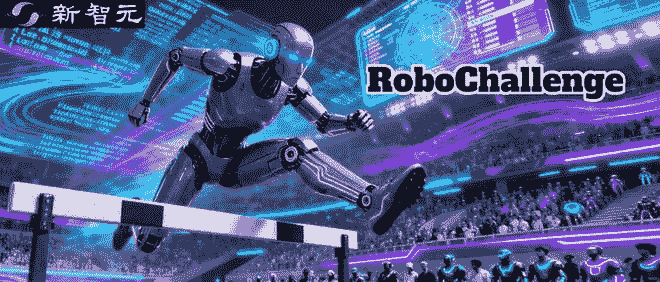
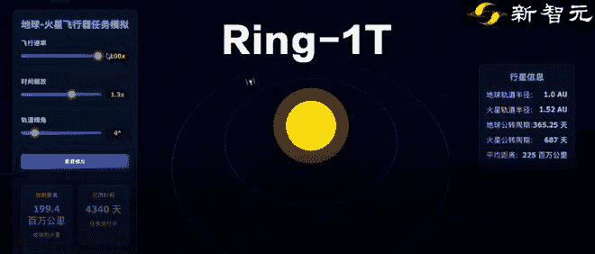
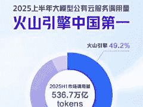
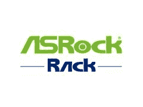

# 10.16-谷歌 Veo 3.1 视频生成模型发布：新增音频支持、对象添加等功能

> 来源：[https://agijuejin.feishu.cn/docx/AbKKdNpLRoEwRzxf0fRc97m2n9b](https://agijuejin.feishu.cn/docx/AbKKdNpLRoEwRzxf0fRc97m2n9b)

# AGI 掘金日报 - AI 新闻推送 (2025 年 10 月 16 日)

> [欢迎加入 AGI 掘金社群](https://applink.larkoffice.com/client/chat/chatter/add_by_link?link_token=890h8ad3-71e6-4140-af64-39dff6b2ba1f)

## ⭐ 今日热点

### 💡 谷歌 Veo 3.1 视频生成模型发布：新增音频支持、对象添加等功能

IT之家 | [阅读原文](https://www.ithome.com/0/889/786.htm)

10月16日谷歌推出新款视频生成模型Veo 3.1，在音频输出等方面提升。它在Veo 3基础上优化，能生成更逼真视频，准确遵循提示词。新增添加对象功能，不久后还能在Flow中移除对象。升级为原有编辑功能添加音频。目前正将该模型部署至多个平台。自今年5月Flow上线，用户已创作超2.75亿个视频 。

## 🌟 技术突破

### 💡 Anthropic 性价比最高 AI 模型：Haiku 4.5 登场，1/3 价格实现 Sonnet 4 同级编程能力

IT之家 | [阅读原文](https://www.ithome.com/0/889/779.htm)

10月16日，Anthropic推出小型AI模型Claude Haiku 4.5。它采用“蒸馏”技术，成本低且性能强大，适合实时低延迟任务。在编程能力测试中略胜Sonnet 4，处理速度提升超两倍，成本仅为其三分之一，部分测试接近GPT-5。其定价有竞争力，还设计多模型协同工作流，能高效低成本解决复杂问题 。

### 💡 苹果M5「夜袭」高通英特尔！AI算力狂飙400%，Pro三剑客火速上新

新智元 | [阅读原文](https://www.163.com/dy/article/KBV33T4E0511ABV6.html?spss=dy_author)

苹果悄更新三款Pro新品（14寸MacBook Pro、iPad Pro、Vision Pro），换M5芯片且价格不变。M5用第三代3纳米工艺，AI性能等升级，如面向AI工作负载峰值吞吐较M4提升超4倍。MacBook Pro图形性能升45%，iPad Pro AI性能提升3.5倍等，还支持120Hz外接显示器。Vision Pro显示等优化，空间计算体验更好。M5架构创新，统一内存带宽增近30%。

### 💡 NTU等联合提出A-MemGuard：为AI记忆上锁，投毒攻击成功率暴降95%

新智元 | [阅读原文](https://www.163.com/dy/article/KBV330GD0511ABV6.html?spss=dy_author)

在AI智能体依赖记忆系统的当下，记忆投毒攻击兴起。其防御难在上下文依赖与自我强化错误循环。南洋理工大学等团队提出A-MemGuard防御框架，通过共识验证和双重记忆结构，有效识别恶意推理路径。实验显示，它能将记忆投毒攻击成功率降低超95%，打破错误循环，性能成本低且扩展性强，为LLM智能体安全部署奠定基础 。

### 💡 具身智能算法哪家强？RoboChallenge见真章！全球首个大规模真机算法评测平台来了

新智元 | [阅读原文](https://www.163.com/dy/article/KBUGRTIM0511ABV6.html?spss=dy_author)

Dexmal原力灵机与Hugging Face推出全球首个大规模真机算法评测平台RoboChallenge。它采用“远程机器人”架构，有30项真实任务基准集Table30 ，支持多机型机器人，用成功率+进度评分双指标评测。平台开放数据与代码，已有多种算法模型完成测评，π0.5表现突出。其能打破限制，加速具身智能算法落地，后续还将推动社区共建。

### 💡 开源 AI 模型 TOP5，被中国厂商包圆

IT之家 | [阅读原文](https://www.ithome.com/0/889/707.htm)

10月公开数据显示，开源AI模型TOP5被中国厂商包揽。自2024年下半年起，阿里的Qwen系列和DeepSeek在开源社区影响力渐强。在LMArena榜单各领域，国产开源、闭源模型表现出色。从HuggingFace数据看，中国开源力量日益强大。这一转变或重新定义全球创新格局，同时还谈及Llama 5相关传闻 。

### 💡 博通推出业界首款 800G AI 以太网网卡 Thor Ultra，支持 UEC 规范

IT之家 | [阅读原文](https://www.ithome.com/0/889/616.htm)

美国加州当地时间10月14日，博通推出全球首款800G AI以太网网卡Thor Ultra，支持UEC超以太网横向扩展互联规范，能在众多XPU间构建连接，驱动T级参数AI工作负载。它在传统技术基础上引入诸多先进特性提升互联效率，采用PCIe Gen6 ×16主机接口，支持长距离无源铜缆传输，SerDes电路误码率业界最低 。

### 💡 万亿级思考模型，蚂蚁首次开源！20万亿token搅局开源AI

新智元 | [阅读原文](https://www.163.com/dy/article/KBTPVLFG0511ABV6.html?spss=dy_author)

10月14日，蚂蚁集团开源万亿参数思考模型Ring-1T ，在多领域测评中表现出色，推理能力直逼闭源巨头。其基于Ling-1T架构，经多阶段训练提升能力。蚂蚁还创新RL训练算法和系统。与预览版相比，正式版准确率大幅提升，在国际竞赛中成绩优异。目前模型存在一些问题，但开源夺冠推动算力向推理红利迁移。

### 💡 超越 GPT-5 Nano，阿里通义 Qwen3-VL 系列全新成员 4B 与 8B 模型开源上线

IT之家 | [阅读原文](https://www.ithome.com/0/889/591.htm)

10月15日，阿里通义官宣开源Qwen3-VL系列新成员Qwen3-VL-8B、Qwen3-VL-4B模型。这两款是密集视觉理解模型，显存占用低，有Instruct和Thinking版本。Qwen3-VL-8B在多项公开评测中表现出色，超越Gemini 2.5 Flash Lite和GPT-5 Nano ；4B版本在端侧性价比高。它们实现「视觉精准」与「文本稳健」协同突破，现已上线魔搭社区、Hugging Face 。

## 💫 企业动态

### 💡 Meta 深化与 Arm 战略合作，AI 排名和推荐系统将使用 Neoverse IP 芯片

IT之家 | [阅读原文](https://www.ithome.com/0/889/813.htm)

当地时间10月15日，Meta与Arm宣布深化软硬件战略合作。AI硬件上，Meta AI排名和推荐系统将采用基于Arm Neoverse IP的数据中心芯片，性能更高、功耗更低，还对AI基础架构软件堆栈针对Arm指令集优化，提升推理效率等。软件侧，双方增强在多个机器学习框架和推理引擎方面的优化合作，让模型部署更便捷，提升AI应用性能 。

### 💡 AI 冒充央视主持人卖鱼油，北京查处首例滥用 AI 技术发布虚假广告案

IT之家 | [阅读原文](https://www.ithome.com/0/889/811.htm)

2025年6月，北京市海淀区市场监管局查处某公司利用AI技术冒用央视主持人名义和形象的虚假广告案。该公司用AI剪辑主持人视频，为“深海多烯鱼油”广告添加虚假医疗功效内容。这是北京市场监管部门首度对滥用AI技术冒用知名人物形象虚假广告“亮剑”。市监局提醒消费者和经营者，普通食品不能宣称医疗功能，经营者不得用AI冒用他人名义或形象营销，消费者发现疑似违法可举报。

### 💡 苏姿丰出手！Oracle下单5万颗AMD芯片，英伟达王座撼动

新智元 | [阅读原文](https://www.163.com/dy/article/KBUGI8S60511ABV6.html?spss=dy_author)

Oracle自2026年第三季度起，将在OCI首期部署5万颗AMD Instinct™ MI450系列GPU构建AI超级集群并持续扩容。这延续了双方合作，构建新AI算力生态，AMD股价走强。MI450系列GPU亮点诸多。此外，AMD与OpenAI达成长期合作。目前英伟达在数据中心GPU市场占92%份额，此次合作是AMD崛起里程碑，让AI算力格局竞争更激烈 。

### 💡 马斯克的作业还是被奥特曼「抄走了」

新智元 | [阅读原文](https://www.163.com/dy/article/KBUBNOGO0511ABV6.html?spss=dy_author)

奥特曼宣布几周内发布ChatGPT新版本，12月将推成人模式并恢复其“人格灵魂”。此前因风险考虑，ChatGPT变得“冰冷”。马斯克为Grok增长，推出AI女友、开放“涩涩”内容。当下AI之战已变为争夺用户注意力和多巴胺的战争，OpenAI此举或标志行业风向转变。此外还提及黄仁勋DGX Spark交付及相关巨头互动 。

### 💡 牛津大学出版社调查：8 成 13-18 岁青少年在作业中使用 AI，辨别信息真假仍是挑战

IT之家 | [阅读原文](https://www.ithome.com/0/889/645.htm)

牛津大学出版社调查 2000 多名 13 - 18 岁学生发现，八成青少年在学校作业中使用 AI。超一半学生“很难判断”AI 生成内容可信度，近三分之一学生无法判断，五分之一不确定。很多学生向教师求助，但三分之一学生认为教师使用 AI 工具不自信。不过，九成学生认可 AI 有帮助。学校和教育部也在采取措施，如推出网站、提供资源，帮助教师提升能力，指导安全使用 AI。

### 💡 Tokens 经济崛起：IDC 报告揭示 AI 应用新风向，火山引擎领跑市场

IT之家 | [阅读原文](https://www.ithome.com/0/889/637.htm)

9 月 19 日 IDC 报告显示，2025 年上半年中国公有云上大模型调用量达 536.7 万亿 Tokens，较 2024 年全年增长近 400%。火山引擎以 49.2%份额居首。未来市场有数百倍增长空间，面临向传统行业渗透等瓶颈，已向模型推理服务迁移。还介绍了 Token 成为核心指标的逻辑，及火山引擎在战略、技术、规模上的三重优势助其在 MaaS 赛道突围。

### 💡 8 亿用户仅 5% 付费，OpenAI 急寻“钱路子”

IT之家 | [阅读原文](https://www.ithome.com/0/889/618.htm)

据英国《金融时报》报道，OpenAI为实现超1万亿美元打造领先AI的承诺，正通过五年规划拓展新收入源、探索债务合作及筹备融资。目前其资金支出远超收入，年化经常性收入约130亿美元 ，ChatGPT 8亿用户仅5%付费，目标将付费比例翻倍。为此，OpenAI推出低价订阅服务、抽取交易佣金、探索广告业务等。其还计划提供定制服务、推动模型商业化等。此外，它在探索债务融资，期望降计算成本。高管对吸引投资有信心，盈利非首要关注。

### 💡 全球首款无水液冷英伟达 HGX B300 服务器：永擎推出 4U16X-GNR2/ZC

IT之家 | [阅读原文](https://www.ithome.com/0/889/575.htm)

10月15日，永擎ASRock Rack在2025 OCP全球峰会上展出全球首款采用无水液冷技术的英伟达HGX B300服务器4U16X-GNR2/ZC。该系统用4U机架式规格，搭载HyperCool无水DLC液冷技术，基于两相式散热原理，用介电流体导热，保障硬件安全。此外，永擎还展示了风冷HGX B300系统8U16X-GNR2及相关MGX参考设计方案4UXGM-GNR2 CX8。

## ✨ 行业观点

### 💡 Reddit 联合创始人奥哈尼安：现在的互联网“大部分已死”，AI 生成内容泛滥

IT之家 | [阅读原文](https://www.ithome.com/0/889/814.htm)

Reddit联合创始人亚历克西斯・奥哈尼安称现在互联网“大部分已死”，因AI生成内容泛滥，机器人生成或准AI生成内容充斥，机器人活动超人类活动。他认为互联网需有“实时观众和实时内容”，下一代社交媒体应是可验证的人类平台。OpenAI CEO奥尔特曼曾不认同“死互联网理论”，如今也看到不少大语言模型操控的账号。奥哈尼安还强调群聊虽为信息交流重要渠道，但需创新迭代。

### 💡 新晋诺得主警告：别做梦了，AI难有「经济奇点」！

新智元 | [阅读原文](https://www.163.com/dy/article/KBTPO4R50511ABV6.html?spss=dy_author)

2024年是诺贝尔奖的AI元年。新晋诺贝尔经济学奖得主Philippe Aghion早在2017年就探讨AI与经济增长，认为AI是自动化新形态，其对经济增长的促进或受「鲍莫尔成本病」制约，经济难有「奇点」。谷歌DeepMind的Séb Krier认同该观点，而MIT FutureTech等机构的Tamay Besiroglu等人则认为AI增强研发能克服阻力推动经济快速增长，AGI或带来更高增长水平 。

### 💡 Anthropic CEO再预警：未来5年砍掉一半入门岗，失业率10–20%

新智元 | [阅读原文](https://www.163.com/dy/article/KBTPNH8H0511ABV6.html?spss=dy_author)

2025年开年以来，美国已有超一万个岗位因引入AI被裁撤。Anthropic CEO Dario Amodei称未来五年最多一半入门级办公室岗位或被淘汰，失业率推至10% - 20%。多位科技大佬和专家也表达类似观点。此外，奥特曼等指出客服等岗位将最早被替代。对于如何应对AI带来的就业冲击，各方看法不一，有主张政府兜底、依靠私营部门，还有中间路线。

### 💡 匹兹堡、哈佛、斯坦福等高校教授警告：AI 或使医疗事故更难定责

IT之家 | [阅读原文](https://www.ithome.com/0/889/566.htm)

据**英国《****卫报》****13日**报道，匹兹堡、哈佛、斯坦福等高校教授警告，临床AI发展迅猛，虽能带来好处，但存在隐忧。观点1：德里克・安格斯教授称会出现找责任方的情况。观点2：格伦・科恩教授表示患者证明AI过错有困难，诉讼难度会增加。观点3：米歇尔・梅洛教授称法院解决问题耗时，会增加AI创新成本。报告还指出AI工具评估有障碍，需投入资金充分评估 。