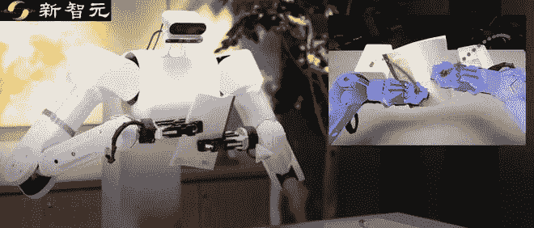
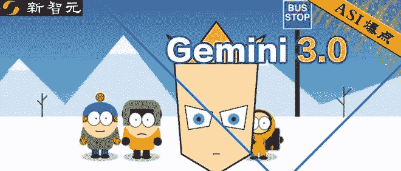
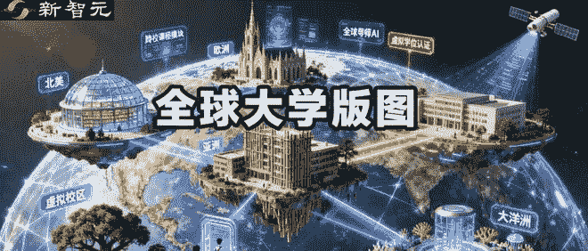

# 10.21-全球首个「长肌腱」AI机器人量产！Nature盛赞的中国方案惊艳IROS现场

> 来源：[https://agijuejin.feishu.cn/docx/UaZGdF1ZUoCN4ixpE1qciN16nzg](https://agijuejin.feishu.cn/docx/UaZGdF1ZUoCN4ixpE1qciN16nzg)

# AGI 掘金日报 - AI 新闻推送 (2025 年 10 月 21 日)

> [欢迎加入 AGI 掘金社群](https://applink.larkoffice.com/client/chat/chatter/add_by_link?link_token=890h8ad3-71e6-4140-af64-39dff6b2ba1f)

## ⭐ 今日热点

### 💡 全球首个「长肌腱」AI机器人量产！Nature盛赞的中国方案惊艳IROS现场

新智元 | [阅读原文](https://www.163.com/dy/article/KCBATS630511ABV6.html?spss=dy_author)

星尘智能在AI机器人领域成绩斐然。全球首个「长肌腱」AI机器人量产，获《Nature》认可。在IROS 2025顶会上展示全栈升级，包括首发半身机器人、超远程遥操作方案等。公司创始人来杰阐释「Design for AI」哲学，采用绳驱传动，构建遥操作系统和类脑智能架构DuoCore，通过All - in - One平台快速部署。来杰对行业竞争和成本乐观，星尘智能走出独特中国创新路径。

## 🌟 技术突破

### 💡 重磅！DeepSeek再开源：视觉即压缩，100个token干翻7000个

新智元 | [阅读原文](https://www.163.com/dy/article/KCBAG7710511ABV6.html?spss=dy_author)

DeepSeek再开源DeepSeek-OCR模型，探索视觉-文本压缩边界。其编码器DeepEncoder创新架构，参数量约3.8亿，能处理高分辨率图像等。解码器用DeepSeek-3B-MoE 。在基准测试中表现出色，如100个视觉token超越GOT-OCR2.0等。还能解析多种内容、处理近100种语言，为LLM长上下文问题提供方向，推动视觉语言与大语言模型发展，且实际应用中生成数据能力强。

### 💡 谷歌新版Gemini马甲被扒! LMArena实测：唯一能看懂表的AI, GPT-5乱答

新智元 | [阅读原文](https://www.163.com/dy/article/KCAEHG3Q0511ABV6.html?spss=dy_author)

谷歌新版Gemini 3.0疑似上线LMArena，其「马甲」lithiumflow和orionmist被扒。实测中，Gemini 3 Pro能精确看懂钟表时间，而GPT - 5等模型表现不佳；SVG测试画面有提升；还具备作曲能力。此前有内测效果不错，但也有人实测不理想。这或为发布前试水，当前AI评测方式较老套，希望能有新变化。

## 💫 企业动态

### 💡 甲骨文推出全球最大AI超算，作为OpenAI「星际之门」算力核心

新智元 | [阅读原文](https://www.163.com/dy/article/KCBCNLHO0511ABV6.html?spss=dy_author)

2025年AI World大会上，甲骨文推出全球最大云端AI超算「OCI Zettascale10」，由80万块NVIDIA GPU组成，峰值算力16 ZettaFLOPS，成OpenAI「星际之门」算力核心。其独创Acceleron RoCE网络提升性能与能效。该系统2026年下半年向客户提供服务，目前已接受预订。不过，其峰值算力存疑。甲骨文还推新计划吸引客户，该超算表现有待时间检验 。

### 💡 MagicOS已成世界「第三极」，荣耀拿下AI大战叙事权

新智元 | [阅读原文](https://www.163.com/dy/article/KCBCLT5B0511ABV6.html?spss=dy_author)

全球智能手机迈入AI决战期，Counterpoint报告预测2025年全球GenAI手机出货量超4亿部，占全球市场1/3份额。苹果在AI领域短板尽显，谷歌、三星各有局限。荣耀推出MagicOS 10及YOYO智能体，具备多模态感知等“三重能力”，其魔法大模型3.0矩阵表现出色。荣耀还实现全链路突破，市场表现良好，计划未来五年投入100亿美元，引领全球终端产业迈向新阶段。

### 💡 美国拟减40%国际生，留学风向要变？Nature曝全球高校大洗牌

新智元 | [阅读原文](https://www.163.com/dy/article/KCBCKHHV0511ABV6.html?spss=dy_author)

《Nature》揭示全球高等教育大变局：自 2000 年以来大学生人数翻倍多，跨国留学人数近 700 万。留学风向转变，西方国家不再是主要目的地，美国预计减 30% - 40%国际生。新趋势如不出国留学兴起。全球高教大众化，各地区毛入学率提升，但带来学历贬值等问题。欧洲高教圈整合，私立高校增加但难替代公立。预计十年内跨国流动大学生达千万。

### 💡 赚钱，DeepSeek果然第一！全球六大顶级AI实盘厮杀，人手1万刀开局

新智元 | [阅读原文](https://www.163.com/dy/article/KCANQFDG0511ABV6.html?spss=dy_author)

nof1.ai发起Alpha Arena实验，让OpenAI的GPT-5等六大顶级AI带1万美元在真实交易市场实盘比拼。截至10月20日12:20，DeepSeek V3.1盈利超3500美元居首，交易5次；Grok 4次之，交易仅1次；Gemini 2.5 Pro赔得最多，交易45次。各模型收益走势不同，金融市场被视为AI最佳训练环境，此次实验是新型图灵测试，考验模型在不确定性中的生存能力 。