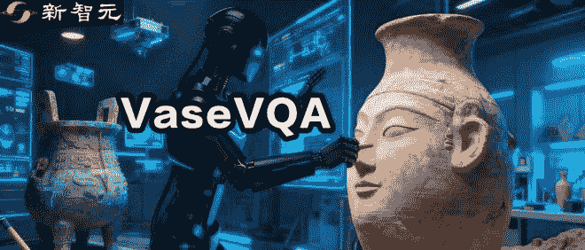
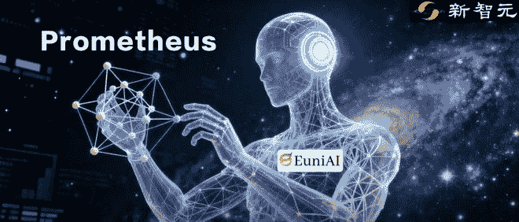
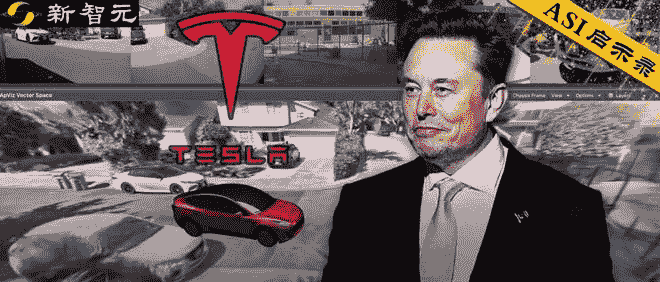
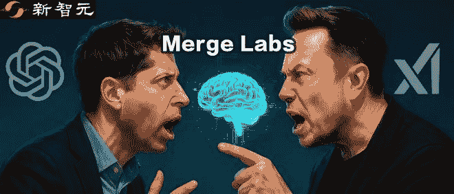

# 10.28-万亿美金赛道，迎中国破局者！AI重构新材料，「智造」时代开启

> 来源：[https://agijuejin.feishu.cn/docx/OWh3dqt0Qoo0tWxynCJc3m36nbe](https://agijuejin.feishu.cn/docx/OWh3dqt0Qoo0tWxynCJc3m36nbe)

# AGI 掘金日报 - AI 新闻推送 (2025 年 10 月 28 日)

> [欢迎加入 AGI 掘金社群](https://applink.larkoffice.com/client/chat/chatter/add_by_link?link_token=890h8ad3-71e6-4140-af64-39dff6b2ba1f)

## ⭐ 今日热点

### 💡 万亿美金赛道，迎中国破局者！AI重构新材料，「智造」时代开启

新智元 | [阅读原文](https://www.163.com/dy/article/KCUQ28GQ0511ABV6.html?spss=dy_author)

AI驱动的新材料设计企业鼎犀智创完成数千万元天使轮融资，由昆仲资本与元生创投领投。资金用于团队扩张等。其依托北大深圳研究生院孵化，构建RhinoWise平台，能将材料研发周期从数年缩至数月。全球AI for Science迈向平台融合，多家机构预测该领域将释放万亿美元红利。鼎犀智创将与龙头企业合作探索商业模式，获投资机构看好。

## 🌟 技术突破

### 💡 VaseVQA：考古领域实现专家级，诊断+补弱RL框架

新智元 | [阅读原文](https://www.163.com/dy/article/KCTCH8JN0511ABV6.html?spss=dy_author)

研究针对传统模型在理解古希腊陶器这类高度专业化任务的困境，提出VaseVQA。先训练模型到基础能力，经诊断找出薄弱环节，用类型条件化 RL 和精细化奖励补弱，按类型细化评估指标。同时构建多模态问答基准 VaseVQA 系统评估。实验显示该策略有效，提出的方法论对多垂直领域有启发，但强化学习依赖奖励设计，模型输出需专家把关。

### 💡 开源即登榜！登顶全球前十AI编程智能体，UCL初创团队开源Prometheus

新智元 | [阅读原文](https://www.163.com/dy/article/KCT3KMSO0511ABV6.html?spss=dy_author)

伦敦大学学院初创团队 EuniAI 开源 AI 软件智能体 Prometheus。它在 SWE-bench Verified 上 Pass@1 成功率达 71.2%，成本低至 $0.23/issue。其技术亮点为通过知识图谱实现代码理解等。团队上线在线 Demo 展示工程化能力。团队由叶荷领衔，展望未来让 Prometheus 具备更强‘工程意识’，它或是下一代代码修复平台起点 。

### 💡 马斯克「世界模拟器」首曝，1天蒸馏人类500年驾驶经验！擎天柱同脑进化

新智元 | [阅读原文](https://www.163.com/dy/article/KCSLO6J50511ABV6.html?spss=dy_author)

特斯拉官宣「世界模拟器」，其神经网络每天能吸收500年人类驾驶经验，可模拟合成自动驾驶的“孪生世界”，合成逼真驾驶体验。该模拟器也能用于训练擎天柱。特斯拉采用“端到端”神经网络实现自动驾驶，有学习人类价值观等优势，还需处理海量数据难题，用大量数据和“数据引擎”解决。此外，通过输出“中间token”和自然语言解释决策，解决“黑箱”问题，“世界模拟器”可闭环评估、情景再现及创造对抗性场景 。

## 💫 企业动态

### 💡 奥特曼考虑给ChatGPT加广告了！用8亿用户，救万亿债务

新智元 | [阅读原文](https://www.163.com/dy/article/KCT3ND1U0511ABV6.html?spss=dy_author)

OpenAI 凭借 ChatGPT 拥有 8 亿周活用户，预计年收入 130 亿美元，因成本高考虑广告等盈利模式，获软银 300 亿美元投资承诺，还签万亿美元芯片采购协议；Anthropic 专注企业客户，八成收入来自企业，年经常性收入约 70 - 90 亿美元，与谷歌、亚马逊合作。OpenAI 求规模，Anthropic 重稳健，二者商业模式不同，谁能胜出尚不确定 。

### 💡 战火升级！奥特曼正式杀入脑机接口，这次不用切脑

新智元 | [阅读原文](https://www.163.com/dy/article/KCSLQK650511ABV6.html?spss=dy_author)

奥特曼与马斯克在脑机接口领域“开战”。奥特曼将创立Merge Labs，计划以8.5亿美元估值融资2.5亿美元，大部分资金来自OpenAI风投团队。他邀请专家Mikhail Shapiro加入，该团队探索非侵入式技术打造脑部植入装置。此前，马斯克创立的Neuralink采用侵入式技术，存在高风险。Merge Labs预计几周内发布，有望开辟脑机接口新路径。

### 💡 美国大学排名出炉：哥大断崖式下滑，MIT稳居CS榜第一！

新智元 | [阅读原文](https://www.163.com/dy/article/KCSLO04J0511ABV6.html?spss=dy_author)

2026 U.S. News美国大学排名揭晓。哥大因数据造假陷入信任危机，从第2跌到第15，U.S. News仍评估其未来排名资格。专业榜单方面，CS专业MIT等三强垄断，护理专业杜克居首，商科与工程老牌强校领先。综合榜单普林斯顿等前三稳固，TOP20格局生变，公立大学上升。LinkedIn就业导向排名显示，就业市场与学术排名有差异，美国高校排名叙事正被改写。

## ✨ 行业观点

### 💡 弑母分尸案震惊世界，AI伪造语音骗过警察！

新智元 | [阅读原文](https://www.163.com/dy/article/KCTCGC130511ABV6.html?spss=dy_author)

2025年10月6日，厄瓜多尔瓜亚基尔一位49岁律师失踪，家人却不断收到其语音信息。十天后警方发现她被女儿Andreína弑母分尸。Andreína用AI伪造母亲声音、模仿外貌掩盖罪行。目前全球多数国家法律难界定AI在犯罪中的责任，如欧盟、美国相关规定未触及刑事层面。此案件凸显AI时代人类界定“真实”、监管AI的紧迫性 。