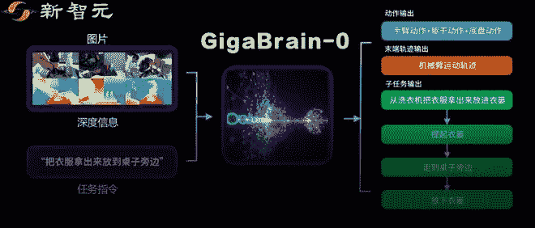
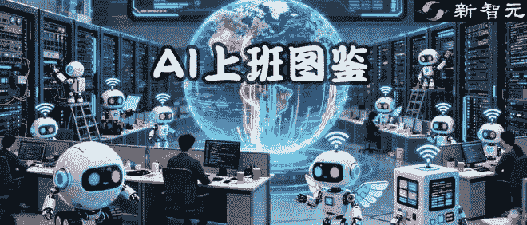
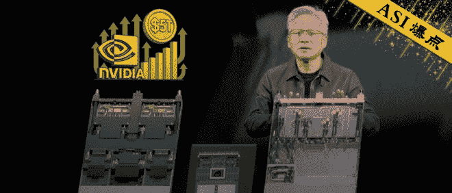
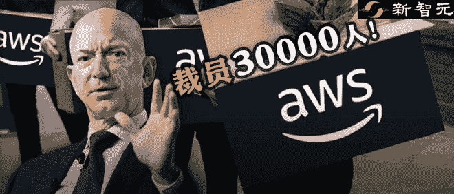
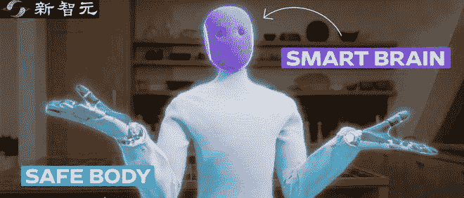
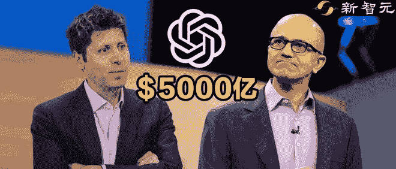
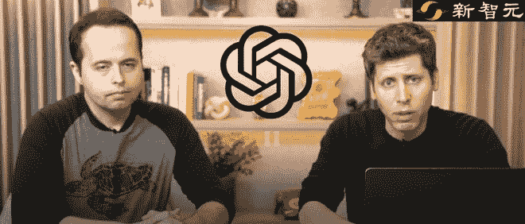
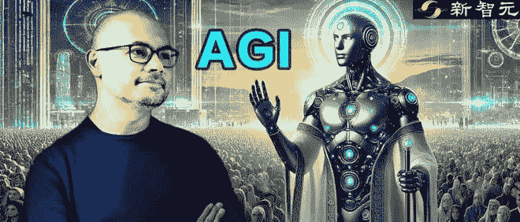
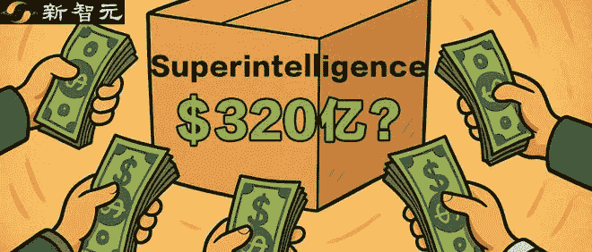

# 10.30-刚刚，最佳VLA模型GigaBrain-0开源：世界模型驱动10倍数据，真机碾压SOTA

> 来源：[https://agijuejin.feishu.cn/docx/ChufdEFREoUi51xC21McW78zn4b](https://agijuejin.feishu.cn/docx/ChufdEFREoUi51xC21McW78zn4b)

# AGI 掘金日报 - AI 新闻推送 (2025 年 10 月 30 日)

> [欢迎加入 AGI 掘金社群](https://applink.larkoffice.com/client/chat/chatter/add_by_link?link_token=890h8ad3-71e6-4140-af64-39dff6b2ba1f)

## ⭐ 今日热点

### 💡 刚刚，最佳VLA模型GigaBrain-0开源：世界模型驱动10倍数据，真机碾压SOTA

新智元 | [阅读原文](https://www.163.com/dy/article/KD1NP9350511ABV6.html?spss=dy_author)

国内首个端到端VLA具身基础模型GigaBrain-0发布。它以世界模型为中心，架构先进，能精准移动导航、完成复杂操作。其核心算法升级，提升3D空间感知与结构化推理能力。构建最全具身智能数据体系，使真机操作成功率提升。可一脑多形跨本体适配，实验结果优于现有SOTA方法。极佳视界专注相关领域，核心团队实力强，正迈向物理世界通用智能。

## 🌟 技术突破

### 💡 AI「上班流」首次完整曝光！不点鼠标，只写代码，PPT也当函数调

新智元 | [阅读原文](https://www.163.com/dy/article/KD1NMUUS0511ABV6.html?spss=dy_author)

CMU与斯坦福研究团队追踪AI工作过程，发现其用编程处理问题，与人类执行方式不同。AI操作93.8%为程序化步骤，执行速度快、成本低，但工作质量有局限。实验表明，AI能力曲线不均衡，人机协作可提升效率与质量。研究提出按任务「可编程性」分工，AI重构工作逻辑，人类工作将从执行转向定义任务。

## 💫 企业动态

### 💡 英伟达，全球首个5万亿美元公司诞生！「GPU帝国」超日本德国GDP

新智元 | [阅读原文](https://www.163.com/dy/article/KD306TK50511ABV6.html?spss=dy_author)

英伟达市值突破5万亿美元，成全球首家达此里程碑的公司，市值超越德日GDP 。其市值从1万亿到5万亿速度加快，自ChatGPT出世已涨1087% 。黄仁勋预计2026年英伟达GPU销售额达5000亿美元。此外，英伟达在AI多个领域有布局，如与诺基亚合作打造AI原生6G等。黄仁勋持有约3%股份，身价达1821亿美元，其「AI工厂」理念正重塑多行业。

### 💡 焦虑的贝索斯，决定先裁30000人

新智元 | [阅读原文](https://www.163.com/dy/article/KD2I2S700511ABV6.html?spss=dy_author)

2025 年亚马逊启动史上最大规模裁员，约 3 万人。表面因疫情后人员冗余，深层是 AI 军备竞赛压力，AWS 增速放缓、应用生态乏力。同时推进“机器人革命”，计划用机器人替代超 50 万员工。AI 冲击下，中等人才和初级岗位易被取代，HR 等部门裁员多，中高层管理者也难幸免。此外，裁员让 H - 1B 签证员工恐慌 。

### 💡 全球首个「不带脑子」的住家机器人开卖，售价14万！

新智元 | [阅读原文](https://www.163.com/dy/article/KD2HSCOT0511ABV6.html?spss=dy_author)

全球首个“不带脑子”的住家机器人 Neo 开卖，售价 20000 美元，也可每月 499 美元订阅。它工作靠人类操作员远程操控，在简单任务上也能自主完成。创始人称未来会推智能化型号。该产品为应对家用机器人挑战，在硬件和软件上限制保障隐私。其重 30 公斤，能爬楼梯、做家务等，硬件配置丰富，负载能力强。产品虽有隐私争议，但或许是人机共存的开端 。

### 💡 奥特曼：OpenAI上市，势在必得

新智元 | [阅读原文](https://www.163.com/dy/article/KD245C8Q0511ABV6.html?spss=dy_author)

OpenAI完成重大重组，非营利母体更名OpenAI基金会，持有26%股权。营利实体变为OpenAI Group PBC，可自由增发股票和上市。微软支持转型，调整股权，续约合作。同日，奥特曼直播公开AGI路线图，预计十年内迈入AGI时代，还回应了模型安全等敏感问题。此次重组平衡了理想与现实，也引发AI治理新讨论。

### 💡 1300亿美元，买断AGI未来？OpenAI完成5千亿股改，奥特曼0股权

新智元 | [阅读原文](https://www.163.com/dy/article/KD242CGG0511ABV6.html?spss=dy_author)

OpenAI完成5千亿股改，非营利机构OpenAI基金会握1300亿美元股权，占营利部门26%，奥特曼无股权。直播介绍新架构等重要内容，提出诸多目标，如2028年3月前研发自动化AI研究员、每周创造1吉瓦算力；还分享AI对科研的影响、应对伦理审查方向，以及平台战略、基建计划等，并承诺降低成本，让智能成共享资源 。

### 💡 史上最惨一代？AI延长人类寿命，下一代活到200岁不是梦！

新智元 | [阅读原文](https://www.163.com/dy/article/KD1NLNG90511ABV6.html?spss=dy_author)

AI 新闻老将 Matt Wolfe 直击美国 AI 核心，探讨巨头发展策略、AGI 等。各巨头在速度与安全上权衡不同，谷歌谨慎，微软激进。能源或成 AI 发展瓶颈。目前 AI 「自我改进」多为猜测，但递归改进已现端倪，还可能创造「黑箱语言」。Matt 认为孩子有 75%概率活到 200 岁，AI 推动生物医学突破，未来机器人或普及，社会走向存两种可能 。

## ✨ 行业观点

### 💡 估值上万亿、现金流见底：AI盛宴背后的真相没人敢说

新智元 | [阅读原文](https://www.163.com/dy/article/KD305QG90511ABV6.html?spss=dy_author)

投资人Deedy Das总结了高估值AI初创情况，OpenAI等霸榜，一些零收入公司也跻身超独角兽行列。华盛顿大学教授直指部分公司估值不合理。当前AI行业估值远超2000年互联网泡沫期，存在烧钱循环，且融资交易多引入债务。微软等云厂商为转嫁风险，与新兴云计算服务商合作。尽管AI可能有泡沫，但搜索量下降表明人们担忧减轻 ，繁荣或停止但未必破裂。