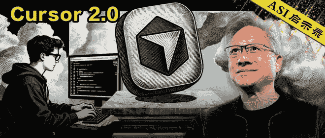

# 10.31-AI是「天才」还是「话术大师」？Anthropic颠覆性实验，终揭答案！

> 来源：[https://agijuejin.feishu.cn/docx/TqRfdVzsioTSrZx7REVcxoYnnmb](https://agijuejin.feishu.cn/docx/TqRfdVzsioTSrZx7REVcxoYnnmb)

# AGI 掘金日报 - AI 新闻推送 (2025 年 10 月 30 日)

> [欢迎加入 AGI 掘金社群](https://applink.larkoffice.com/client/chat/chatter/add_by_link?link_token=890h8ad3-71e6-4140-af64-39dff6b2ba1f)

## ⭐ 今日热点

### 💡 AI是「天才」还是「话术大师」？Anthropic颠覆性实验，终揭答案！

新智元 | [阅读原文](https://www.163.com/dy/article/KD4QG70R0511ABV6.html?spss=dy_author)

Anthropic研究证实Claude模型有一定内省意识，能控制自身内部状态。团队用「概念注入」实验检测，Claude Opus 4.1约20%案例有觉察能力，能力随AI提升或更可靠。模型还能区分「外部强加」与「内部生成」内容，并构建自洽逻辑。不过，研究员警告勿轻信Claude的解释。目前研究为定义AI能力提供基础，问题在于内省意识进化速度及可靠性 。

## 🌟 技术突破

### 💡 老黄亲自站台，英伟达编程神器！Cursor 2.0自研模型狂飙4倍

新智元 | [阅读原文](https://www.163.com/dy/article/KD4BVKN00511ABV6.html?spss=dy_author)

Cursor迎来2.0版本重大升级，发布首款自研编码模型Composer，速度达同等模型4倍，多数任务30秒内完成，速度达200 Tokens/秒。重构交互逻辑，带来多智能体模式，最多并行运行8个智能体，还嵌入浏览器、新增代码审查和语音模式等功能。Composer通过强化学习专项优化，Cursor构建定制化训练设施。实测Composer速度快，但智能程度有看法分歧，AI编程领域竞争激烈。

## 💫 企业动态

### 💡 14000人一夜失业！被裁白领挤爆TikTok，含泪直播失业全程

新智元 | [阅读原文](https://www.163.com/dy/article/KD4QIT620511ABV6.html?spss=dy_author)

本周，亚马逊宣布裁掉1.4万名白领，占其白领员工的4%。消息传出后，社交媒体成「失业直播间」。Reddit用户整理的民间版裁员全景图显示，此次裁员几乎覆盖亚马逊全部业务线，L5与L6职级、技术工程类岗位、任职4 - 10年老员工受影响大。亚马逊此次调整伴随着大规模AI投资，Gartner预测到2026年，全球20%企业将用AI削减至少一半管理层，未来员工或需具备与AI协作能力。

### 💡 OpenAI明年上市，万亿美元估值将成史上最大IPO

新智元 | [阅读原文](https://www.163.com/dy/article/KD4BTCEB0511ABV6.html?spss=dy_author)

路透社称，OpenAI考虑2026年下半年提交上市申请，2027年挂牌，估值或达1万亿美元，拟募资至少600亿美元。其为上市进行架构重组，削减对微软依赖。OpenAI商业增长快但烧钱多，上市为满足资金需求。此外，它从非营利到盈利转变，与微软达成新协议。当前AI资本市场狂热，OpenAI上市或影响产业生态，也面临诸多考验。

## ✨ 行业观点

### 💡 别再迷信大模型！吴恩达亲授AI秘籍：小模型+边缘计算=财富密码

新智元 | [阅读原文](https://www.163.com/dy/article/KD4BR9V20511ABV6.html?spss=dy_author)

吴恩达认为当下 AI 创业不应迷信大模型。智能体时代机遇大，其市场预计 7 年增长约 17 倍，优势在“专业化”。创业者应关注日常问题，用开源小模型。小模型和边缘计算市场前景好，边缘计算有隐私保护等优势。此外，军民两用应用场景潜力大，创业者若依此建议，有望用 AI 创业成功，让信任成竞争优势。