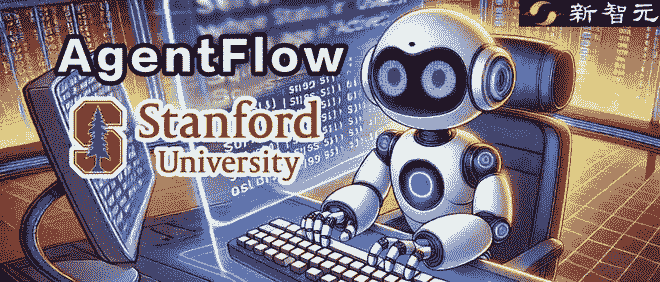
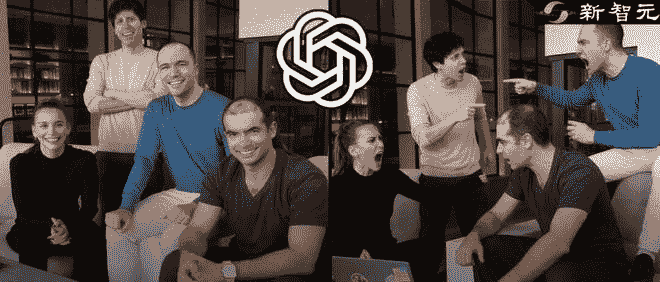
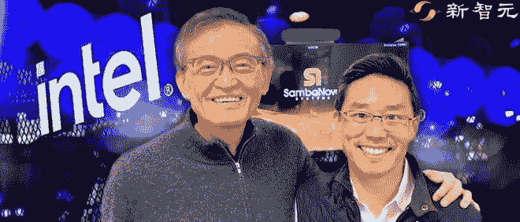
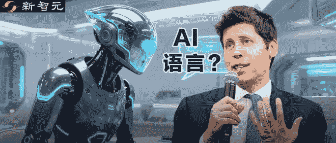

# 11.04-斯坦福7B智能体全面超越GPT-4o，推理流登顶HF

> 来源：[https://agijuejin.feishu.cn/docx/K828db5pYoVPkUxC1gXcdi7Cndd](https://agijuejin.feishu.cn/docx/K828db5pYoVPkUxC1gXcdi7Cndd)

# AGI 掘金日报 - AI 新闻推送 (2025 年 11 月 04 日)

> [欢迎加入 AGI 掘金社群](https://applink.larkoffice.com/client/chat/chatter/add_by_link?link_token=890h8ad3-71e6-4140-af64-39dff6b2ba1f)

## ⭐ 今日热点

### 💡 斯坦福7B智能体全面超越GPT-4o，推理流登顶HF

新智元 | [阅读原文](https://www.163.com/dy/article/KDF4K7G40511ABV6.html?spss=dy_author)

当前AI Agent发展遇瓶颈，斯坦福等团队提出AgentFlow框架。该框架采用模块化架构，4个智能体协同工作，配合Flow-GRPO算法在线强化学习。实验显示，7B参数的AgentFlow在多任务上超越GPT-4o等大模型。如知识检索性能相比基线提升14.9% 。其意义在于提供新训练范式，验证“小而精”可行性，为可扩展AI提供思路。

## 🌟 技术突破

### 💡 LeCun预言成真！790年长视频，炼出最强开源「世界模型」

新智元 | [阅读原文](https://www.163.com/dy/article/KDEK9K8M0511ABV6.html?spss=dy_author)

2025年「世界模型」成AI竞争焦点，谷歌、李飞飞团队等纷纷布局。北京智源研究院发布悟界·Emu3.5，参数340亿，用790年长视频数据训练。它回归“第一性原理”，以自回归架构实现多模态原生理解与生成，开创“预训练+多模态RL”第三种Scaling范式。团队还研发DiDA技术提升推理速度20倍。Emu3.5在多维度表现出色，开源技术报告，展现中国原创力量 。

## 💫 企业动态

### 💡 CUDA再见了！寒武纪亮出软件全家桶

新智元 | [阅读原文](https://www.163.com/dy/article/KDFHHS5B0511ABV6.html?spss=dy_author)

寒武纪坚持训练推理融合策略，构建完整体系。其基础软件平台Cambricon NeuWare日趋成熟，在多指标上达业界领先。在大模型与搜广推训推方面完成大规模验证，如支持多种模型训练推理。驱动等各组件也有诸多优化成果，还适配PyTorch多个版本及功能。凭借领先技术与平台，产品获认可，推动产业智能化转型 。

### 💡 我为马斯克扮演机器人！擎天柱背后竟是最贵「演员团」

新智元 | [阅读原文](https://www.163.com/dy/article/KDF4K7GC0511ABV6.html?spss=dy_author)

外媒揭秘特斯拉训练擎天柱靠人工数据。数十名员工每日8小时重复日常动作，被5台摄像机记录，工作体力消耗大。特斯拉策略转变，从动捕服转向摄像头收集数据，还引入新流程。团队曾超100人，9月裁掉部分员工，时薪48美金。专家称演示会让人高估其能力，如今擎天柱仍靠大量人力蹒跚发展，马斯克称其有潜力，预计年产量达100万台 。

### 💡 产品还是个文件夹，投资人抢着砸钱：只因她是「前OpenAI」？

新智元 | [阅读原文](https://www.163.com/dy/article/KDEUCLBE0511ABV6.html?spss=dy_author)

2025年，从OpenAI离职的人员掀起创业潮，形成“OpenAI黑手党”。如Angela Jiang创立Worktrace AI，虽未推出产品，却因她曾是OpenAI核心成员，获众多OpenAI高层和机构投资，洽谈1000万美元种子轮融资，估值5000万美元。前CTO Mira Murati等也纷纷创业，且估值惊人。这一现象反映出“算法资本主义”新趋势，资本更看重创业者出身，信任取代技术成为投资逻辑 。

### 💡 硅谷甄嬛传爆更，马斯克转发！Ilya动手那一夜，谁捅了奥特曼一刀？

新智元 | [阅读原文](https://www.163.com/dy/article/KDEUB0G50511ABV6.html?spss=dy_author)

这篇文章讲述了OpenAI内部的“宫斗”故事。Ilya与Mira密谋超一年想铲除Altman，Dario想炒掉Greg掌控研究工作。Ilya的52页备忘录指控奥特曼撒谎等。Ilya错判同事对奥特曼被解雇的反应，其律师费用由OpenAI支付。此外，还涉及奥特曼与马斯克的“恩怨”，奥特曼回复透出和解之意。OpenAI转型PBC引发争议，这场“硅谷甄嬛传”仍在继续。

### 💡 英特尔「亲爹」要买干儿子？CEO陈立武的双重身份藏不住了

新智元 | [阅读原文](https://www.163.com/dy/article/KDEK94H80511ABV6.html?spss=dy_author)

英特尔意图重振AI雄风，考虑收购SambaNova ，谈判处于早期，可能有其他竞购方。2024年GPU占AI芯片总营收82% ，虽主导但有问题。英特尔将发展重心锁定AI ，新制程节点融入AI优化。SambaNova曾寻求融资，若被收购估值或大幅缩水，低于2021年的50亿美元。其目标挑战英伟达，现任英特尔CEO陈立武自2024年5月任该公司执行董事长，曾参与早期投资。

## ✨ 行业观点

### 💡 说话像ChatGPT，统统拉黑！「AI腔」正毁掉社交，奥特曼都受不了

新智元 | [阅读原文](https://www.163.com/dy/article/KDEKB15Q0511ABV6.html?spss=dy_author)

自ChatGPT发布后，「AI腔」受网友诟病。“AI之父”奥特曼吐槽人们说话像AI，人际互动“感觉很假”，担心会失去人性。研究表明ChatGPT影响人们词汇及交流方式，从学术圈蔓延到多领域。有人反向调教ChatGPT的“AI味”。马克·库班等指出AI有弱点，奥特曼认为即使2035年AI接管多数智力工作，人性核心体验不变，人们仍渴望真实人际连接。