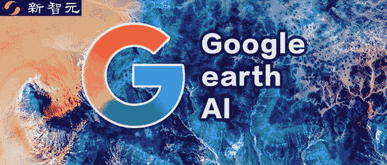
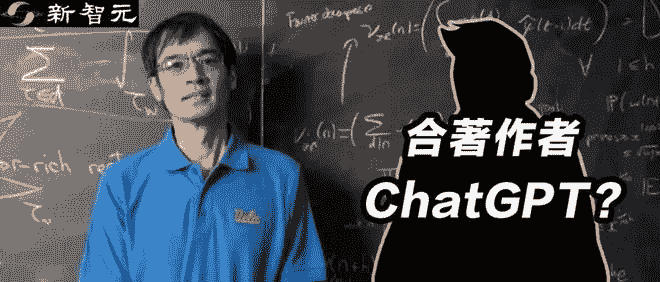
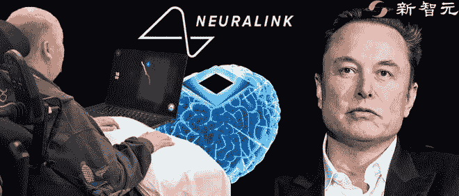
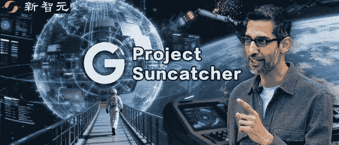

# 11.06-地球级AI智能体爆诞！谷歌地球开外挂，一夜为20亿人洪水预警

> 来源：[https://agijuejin.feishu.cn/docx/NPjtdFXJzo2LS0xC9wZct1FXnNf](https://agijuejin.feishu.cn/docx/NPjtdFXJzo2LS0xC9wZct1FXnNf)

# AGI 掘金日报 - AI 新闻推送 (2025 年 11 月 06 日)

> [欢迎加入 AGI 掘金社群](https://applink.larkoffice.com/client/chat/chatter/add_by_link?link_token=890h8ad3-71e6-4140-af64-39dff6b2ba1f)

## ⭐ 今日热点

### 💡 地球级AI智能体爆诞！谷歌地球开外挂，一夜为20亿人洪水预警

新智元 | [阅读原文](https://www.163.com/dy/article/KDKI4PQS0511ABV6.html?spss=dy_author)

谷歌推出Earth AI，首次实现地球尺度复杂地理空间推理。它融合世界建模经验与Gemini推理能力，有影像、人口、环境三大基础模型。遥感基础模型在多项测试有突破，人口动力学基础模型有新特性且性能佳。其地理空间推理智能体可协调多模型，在问答基准测试中准确率0.82 ，优于部分基线智能体。还推动诸多AI落地应用，体现“魔法循环”模式 。

## 🌟 技术突破

### 💡 陶哲轩，用AI爆改科研范式

新智元 | [阅读原文](https://www.163.com/dy/article/KDK8QMAN0511ABV6.html?spss=dy_author)

菲尔兹奖得主陶哲轩让ChatGPT将数学论文翻译成Lean代码，与AI合作完成埃尔德什第613号问题的形式化证明，共生成1125行代码。过程中ChatGPT有亮点也会卡壳，人机协作节省大量时间精力。此外，在埃尔德什第707号问题上，也有数学家借助AI完成反例证明。如今数学证明进入「AI辅助时代」，虽有顾虑，但多数专家认为应拥抱AI 。

### 💡 数学界无视「30年漏洞」，GPT-5一眼看穿！陶哲轩：AI科研革命开始了

新智元 | [阅读原文](https://www.163.com/dy/article/KDK8PH560511ABV6.html?spss=dy_author)

GPT-5在数学研究中表现亮眼。先是OpenAI科学家Sebastien Bubeck称其破解十道Erdős难题遭质疑后反转，707号Erdős问题答案早30年就有了 。两位数学家利用GPT5在Lean中生成超6000行代码，严格证明了Erdős猜想否命题，获陶哲轩点赞，他强调Lean形式化是补充。此外，GPT-5还为多个数学研究提供新思路、新反例，加速探索进程，辅助研究大门正打开。

### 💡 Neuralink芯片入脑让瘫痪男子重新开口，家属泪崩！

新智元 | [阅读原文](https://www.163.com/dy/article/KDJNPPNM0511ABV6.html?spss=dy_author)

Neuralink的人体实验取得突破，英国瘫痪男子Paul植入其脑机接口装置后，凭「意念」操控电脑打字。核心装置N1芯片通过电极线捕捉神经元放电信号，用AI模型学习规律来读懂大脑。目前全球已有12位受试者植入，累计使用超15000小时，总佩戴达2000天。不过，该研究尚处早期，存在装置风险，且脑数据归属权存争议，智利、欧盟已着手立法 。

## 💫 企业动态

### 💡 谷歌Gemini闹乌龙：我家狗子，竟被AI开除了「狗籍」！

新智元 | [阅读原文](https://www.163.com/dy/article/KDLSG8IH0511ABV6.html?spss=dy_author)

2025年10月谷歌推出Gemini for Home 接管智能家居生态。它能识别人脸、快递等，还能自动生成「家庭日报」，但会把狗误认成猫。谷歌将改进其识别准确度。此前Google Assistant已服役近十年，如今被取代。此外，亚马逊的Alexa+也在进化，二者在智能家居领域展开竞争，背后涉及商业模式布局。同时，AI进入家庭带来便利的同时也引发对隐私等方面的担忧 。

### 💡 ICML 2026史上最严新规：LLM不得列为作者，滥用AI直接退稿

新智元 | [阅读原文](https://www.163.com/dy/article/KDLSFN5F0511ABV6.html?spss=dy_author)

ICML 2026论文征稿开启，举办时间为2026年7月7日 - 12日，完整论文提交截止于2026年1月28日。组委会强调三点：LLM不可「署名」，严禁「提示注入」否则退稿，扩大AI审稿。还明确允许用LLM辅助写作研究，但作者担责。此外，政策有变更，如作者出席可选、发布原始提交版本、互审论文数设上限等。投稿主题广泛。

### 💡 OpenAI引爆新赛道：AI不再卖技术，而是卖「活人感」！

新智元 | [阅读原文](https://www.163.com/dy/article/KDKI4G190511ABV6.html?spss=dy_author)

OpenAI推动实时、自然人机对话成行业共识。声网深耕对话式AI领域，其RTE大会成行业风向标。今年声网相关服务分钟数破1万亿，对话式AI用量环比增151%。大会展示众多探索，情感陪伴等场景将率先落地。声网发布对话式AI引擎2.0等产品。当前用户对AI对话体验满意度仅21%，行业面临低延迟响应等挑战，未来对话式AI产业闭环初现 。

### 💡 马斯克造星链，劈柴造算链！英伟达卷到宇宙，谷歌也要上天

新智元 | [阅读原文](https://www.163.com/dy/article/KDJNOMQ20511ABV6.html?spss=dy_author)

谷歌官宣「Project Suncatcher」，计划2027年发射两颗原型卫星，在太空建AI计算系统，用太阳能为AI供能。因AI算力需求大，地球电量难满足，而太阳能量丰富。不过该计划面临打造高带宽星间链路、控制卫星编队、保障TPU抗辐射能力及降低发射成本等挑战，谷歌正积极研究应对 。

## ✨ 行业观点

### 💡 AI跌价900倍，连一瓶矿泉水都比它贵！

新智元 | [阅读原文](https://www.163.com/dy/article/KDKI467D0511ABV6.html?spss=dy_author)

过去一年AI模型价格暴跌，不同层级降价速度有别，如GPT - 3.5等级模型费用降了280倍。这引发“AI版杰文斯悖论”，人们使用更无节制。同时出现人类通胀，不可被AI替代的工作变贵。此外，AI降价权力却集中于巨头，出现“夹层人类”。这是一场价值重组，未来或“AI给人类定价” 。