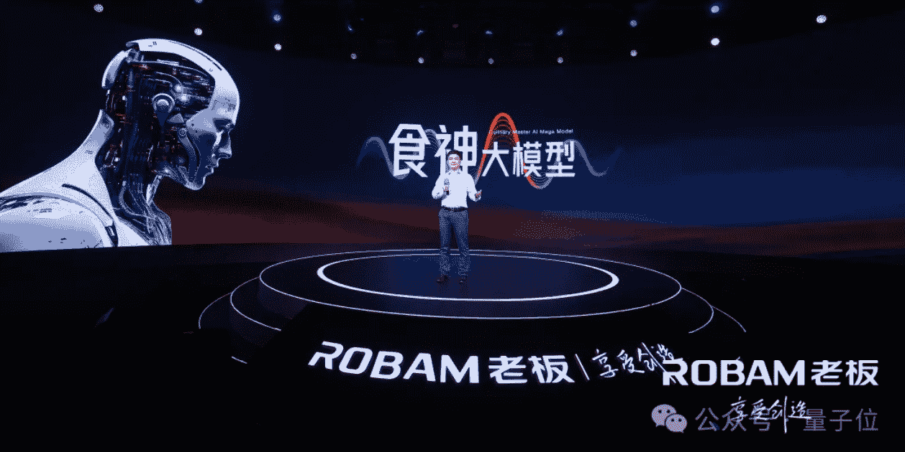
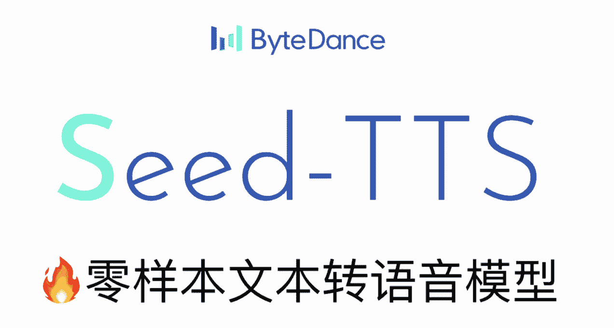
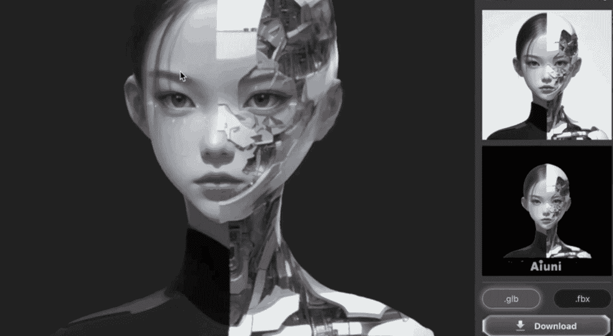
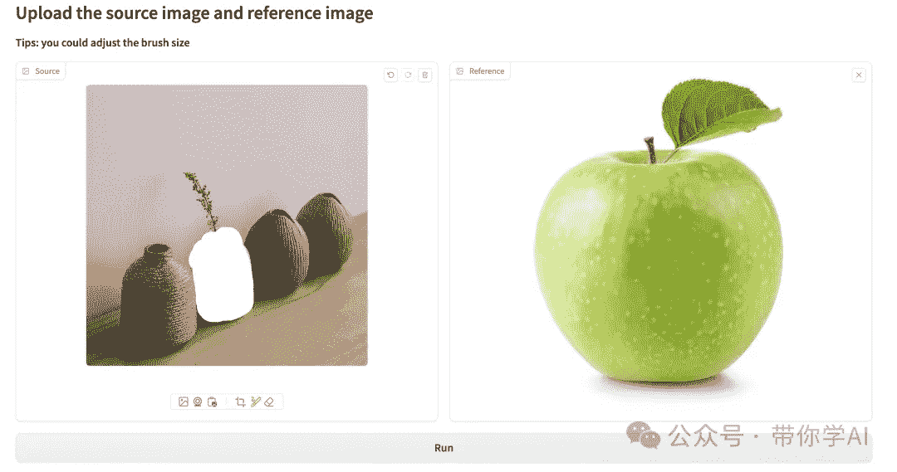
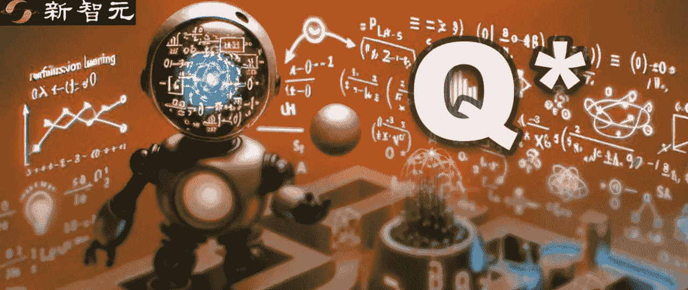
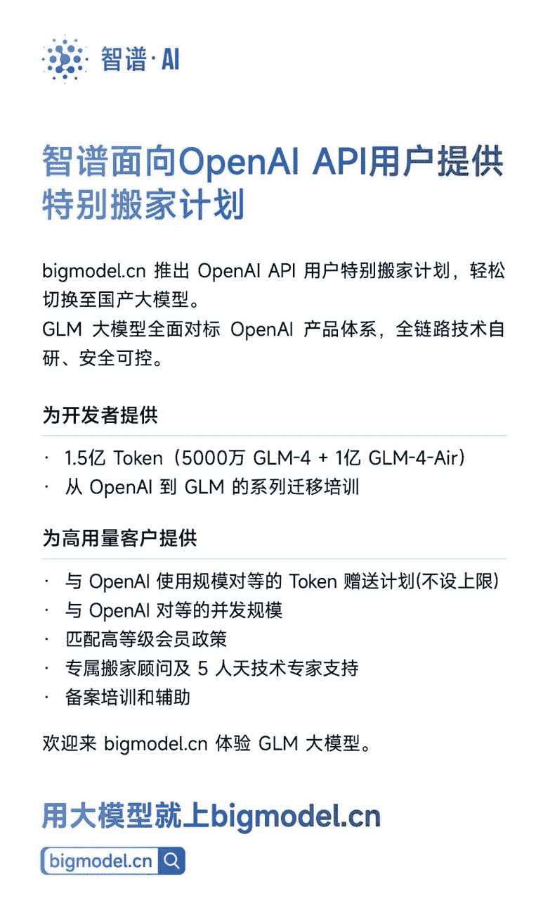
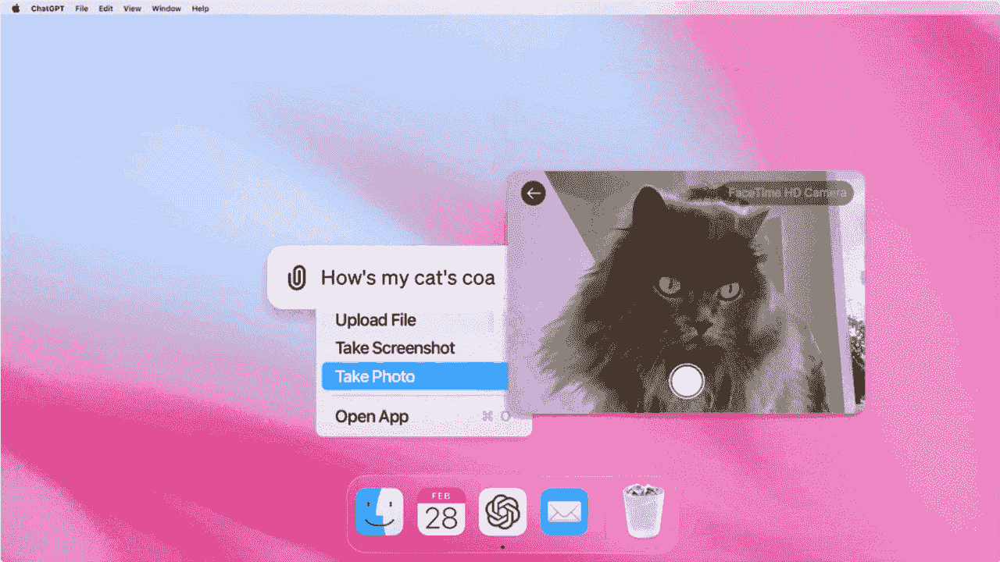
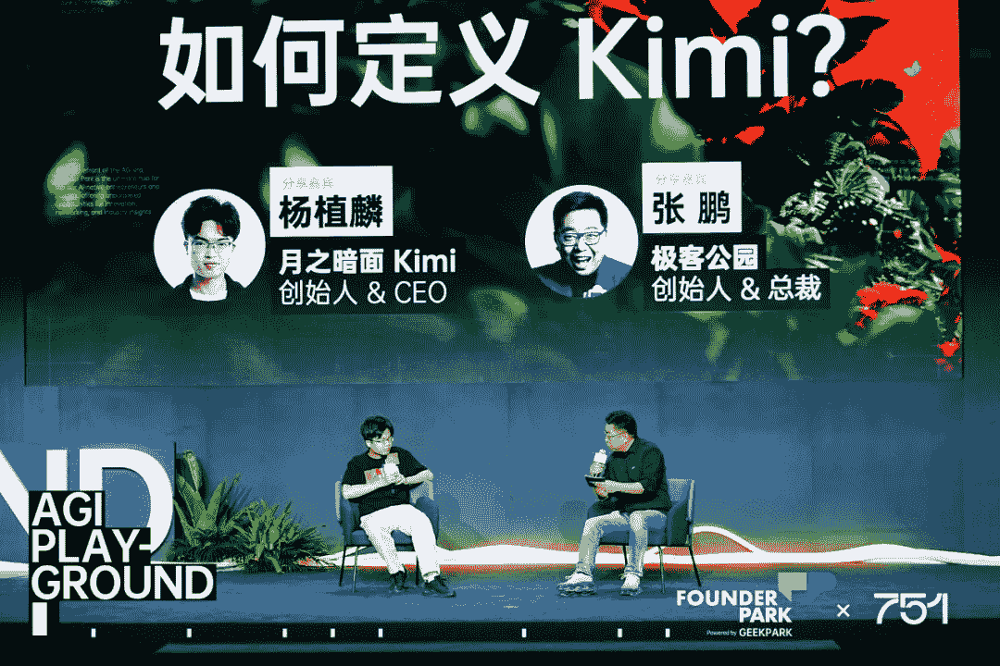
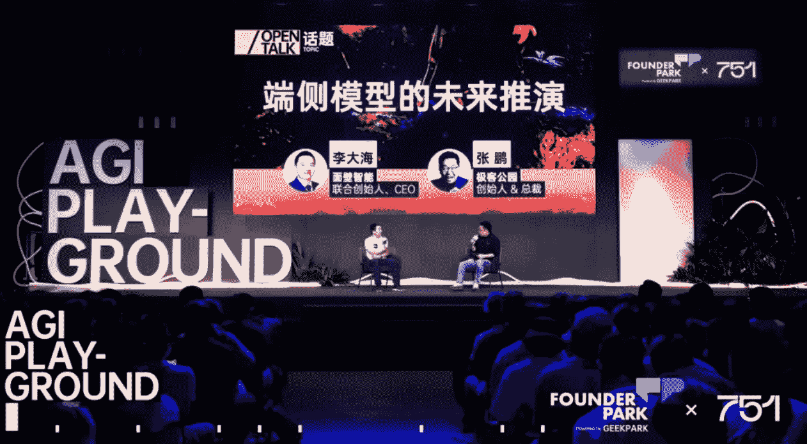
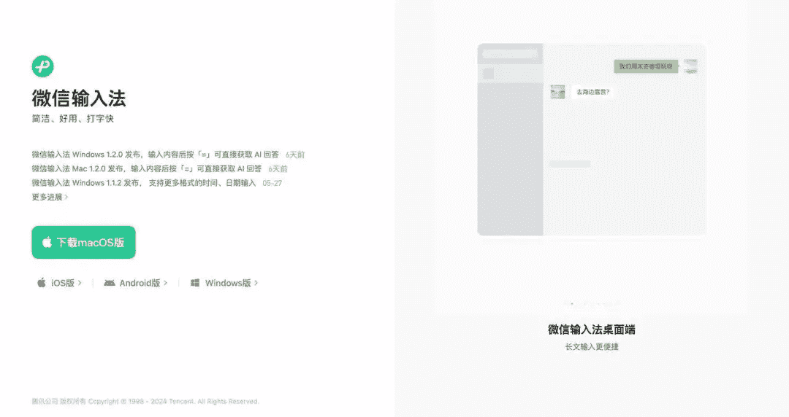

# 6.26 “食神”现世！中国发布全球首个烹饪大模型

> 来源：[https://agijuejin.feishu.cn/docx/Q43bdcAiTo3Rh9xIpIacj7ahnkb](https://agijuejin.feishu.cn/docx/Q43bdcAiTo3Rh9xIpIacj7ahnkb)

> [欢迎加入 AGI 掘金社群](https://applink.feishu.cn/client/chat/chatter/add_by_link?link_token=309p05e6-9ea7-4674-8681-7c1a6f9ac5e2)

# 🌟 技术突破

## 💡 “食神”现世！中国发布全球首个烹饪大模型

量子位｜[阅读原文](https://mp.weixin.qq.com/s/DfgNfAQZvHedHD-GgYCHXA)

老板电器推出的“食神”大模型，利用数十亿级行业数据和数千万级知识图谱，提供个性化烹饪解决方案。该模型不仅能提供多种烹饪方法，还能与厨房设备协同工作，实现从食材选择到烹饪完成的全流程自动化。模型预计 10 月内测，12 月上线，旨在满足用户个性化需求，同时保留烹饪的创造性乐趣。

## 💡 对话 Seed-TTS 团队：如何打破传统 TTS 思路？

豆包大模型团队｜[阅读原文](https://mp.weixin.qq.com/s/SYgR4eJQuDq7NvoIzG-GIg)

字节跳动豆包大模型团队推出的 Seed-TTS 语音生成大模型，以其逼真的语音生成效果和模仿真人发音瑕疵的能力，实现了技术上的突破。该模型不仅能够生成带有原素材声音特征的全新语音，还能进行音色定制，展现不同角色和情绪。Seed-TTS 通过大量数据和先进的模型设计，解决了传统 TTS 系统的局限性，提供了更自然、更稳定的语音生成能力，推动了语音合成技术的发展。

## 💡 清北 00 后团队开源 Unique3D，革新单图 3D 生成技术

量子位｜[阅读原文](https://mp.weixin.qq.com/s/Kq394HFG3UTW-xuAmOn_ww)

Unique3D 是由清北 00 后团队 AVAR AI 开发的开源 3D 生成模型，以其高保真度、高一致性和高效率著称。该模型能在 30 秒内将单张图片高质量转换为 3D 模型，解决了以往模型在优化时间、几何质量和一致性上的不足。Unique3D 采用多视图生成、高分辨率上采样和 3D Mesh 重建的三阶段流程，通过 ISOMER 算法优化 Mesh，实现快速且精确的 3D 重建。团队还计划推出新功能，如一键生成 3D 全景图和视频角色替换，旨在推动 3D 应用场景的创新和艺术性发展。

## 💡 阿里开源图像编辑模型 MimicBrush 革新图像合成

带你学AI｜[阅读原文](https://mp.weixin.qq.com/s/Lw2CxzgEfcST4gkJV6SVMA)

香港大学、阿里巴巴和蚂蚁集团联合研发的 MimicBrush 模型，通过模仿编辑技术，无需手动添加参考区域即可智能编辑图像。该模型支持产品设计、服饰佩戴等场景，通过双 U-Net 结构和数据增强策略提升合成效果。与字节跳动的 Dreamina 相比，MimicBrush 为开源模型，更侧重局部编辑，支持纹理转移和细化处理，有望简化编辑流程，提高工作效率。

## 💡 Q* 算法突破：颜水成团队携手南洋理工大幅提升 AI 推理能力

新智元｜[阅读原文](https://mp.weixin.qq.com/s/5zaE62vFQg-v_gx2o6Dmdg)

中国颜水成教授团队与新加坡南洋理工大学合作，提出了 Q 算法，显著提升了小规模语言模型的推理能力。该算法通过结合 DeepCubeA 设计和 A 搜索，优化了模型在多步推理任务上的表现，降低了计算资源需求。实验结果显示，在 GSM8K、MATH 和 MBPP 数据集上，Q 算法帮助 Llama-2-7b、DeepSeek-Math-7b 和 CodeQwen1.5-7b-Chat 等模型在准确率上超越了 ChatGPT 和 Gemini Ultra 等大型模型。尽管 Q 算法仍处于初级阶段，但已展现出提升国产开源模型性能、推动人工智能技术发展的潜力。

# 💫 企业动态

## 💡 OpenAI 断供，国产大模型无痛搬家服务上线！

量子位｜[阅读原文](https://mp.weixin.qq.com/s/WF32MEhTbSk1fqWX5akAQg)

OpenAI 宣布自 7 月 9 日起将终止对中国等不支持国家的 API 服务。面对这一变故，国内大模型公司迅速推出应对措施。智谱 AI 提供特别搬家计划，包括 Token 赠送、迁移培训及技术专家支持，以帮助用户无缝过渡至国产大模型。硅基流动则宣布旗下顶尖大模型永久免费，以促进国产模型的广泛应用。国产大模型的替代已成趋势，预计将有更多厂商跟进。

## 💡 音乐巨头联合起诉 Suno 和 Udio 侵犯版权

AIGC开放社区｜[阅读原文](https://mp.weixin.qq.com/s/7aFbNgL6ElnXjQFYOgGu0w)

环球音乐集团、索尼音乐娱乐和华纳唱片三大音乐公司，以及美国唱片业协会(RIAA)对 Suno 和 Udio 提起诉讼，指控这两家公司未经授权使用多首知名乐队作品，包括海滩男孩、披头士乐队等，并要求支付高额版权损失费。诉讼中还展示了 AI 生成的音乐与原唱对比，如 Suno 生成的“Deep down in Louisiana close to New Orleans”涉嫌复制查克贝里“Johnny B. Goode”的歌词和风格。

## 💡 亚马逊秘密研发“Metis”挑战 ChatGPT

木木说AI｜[阅读原文](https://mp.weixin.qq.com/s/0FsvbmzrbQeAQjt7eIYtvg)

亚马逊正在秘密开发一款名为"Metis"的人工智能聊天机器人，以挑战 OpenAI 的 ChatGPT。该项目由 CEO 安迪·贾西亲自领导，基于亚马逊的"Olympus"模型，采用"检索增强生成"技术，计划于 2024 年 9 月发布。Metis 将具备智能对话、文本和图像处理、提供建议等功能，旨在为用户提供更智能的对话服务。尽管市场竞争激烈，亚马逊仍希望通过 Metis 在 AI 领域与 ChatGPT 展开直接竞争，拓展其人工智能版图。

## 💡 全球 Mac 用户现可免费下载桌面版 ChatGPT

机器之心｜[阅读原文](https://mp.weixin.qq.com/s/kfadq6guO5bapOXoe1PKrw)

OpenAI 宣布推出适用于 macOS 的 ChatGPT 应用程序，用户可通过官方网站下载。macOS 用户安装后，可通过键盘快捷键快速调用界面，支持文字、文件、截图或拍照输入，并提问。用户还能选择不同版本的 GPT 模型，包括 DALL-E 图像生成器和自定义 GPT。此外，苹果与 OpenAI 达成合作，未来 iOS 和 iPadOS 将集成 ChatGPT，并通过 Siri 访问。尽管微软与 OpenAI 关系密切，但 Windows 版本尚未推出，OpenAI 表示 Mac 用户更多是优先考虑的原因。

## 💡 苹果发布全场景 AI 平台，推动 iPhone 换机潮

新财富｜[阅读原文](https://mp.weixin.qq.com/s/lcsoFJs9N56G6whcs_sFaQ)

苹果在 WWDC 上推出 Apple Intelligence，一个跨设备、支持端侧和云端大模型的 AI 平台，具备跨应用操作和上下文理解能力。该平台将优先搭载于 Mac、iPad 和 iPhone OS，性能超越同类产品，实现端侧和云端的深度整合。随着 iPhone 16 系列预计搭载 A18 芯片，结合全球换机周期，预计苹果将迎来出货量大幅增长。此外，Apple Intelligence 的端云一体架构和隐私保护技术，以及与 OpenAI 等第三方合作，将进一步丰富 iOS 生态和应用场景，推动智能手机交互方式的创新。

# ✨ 行业观点

## 💡 杨植麟：专注打造 Kimi，探索 AI 终极形态

Founder Park｜[阅读原文](https://mp.weixin.qq.com/s/DFUuG0EcLdKe20mfcOFWqA)

月之暗面科技 CEO 杨植麟在对话中分享了公司对 Kimi 产品的专注与愿景。他认为 AI 产品的终极形态是像人一样解决问题和陪伴用户，强调了聚焦单一产品并做到极致的重要性。杨植麟提到，公司选择专注于生产力场景，通过技术迭代优化模型，以提高用户留存和商业价值。他还讨论了长文本处理和多模态能力对实现通用智能的重要性，并强调了组织创新和技术人才招聘在推动公司发展中的关键作用。

## 💡 面壁智能李大海论端侧 AI 模型的未来

极客公园｜[阅读原文](https://mp.weixin.qq.com/s/oemEFwi7tLZBtB_rIm3y0A)

面壁智能 CEO 李大海在对话中提出，端侧 AI 模型因更接近用户而具有巨大潜力。他预测到 2026 年，面壁智能将推出达到 GPT-4 水平的端侧模型，强调了端侧模型在感知、决策和行为上的“三位一体”能力。李大海认为，高质量的数据和算法优化比单纯扩大模型规模更为关键，并通过与华为云等企业的合作，推动大模型在端侧的应用，以实现更智能、更个性化的用户体验。

## 💡 何小鹏眼中的智能驾驶「ChatGPT 时刻」

GeekCar极客汽车｜[阅读原文](https://mp.weixin.qq.com/s/mtZMmDmQYeWQKZViw0HRqg)

何小鹏体验特斯拉 FSD V12.3.6 后，预言 2025 年将迎来智能驾驶的“ChatGPT 时刻”，标志着技术质的飞跃。端到端架构简化了智能驾驶流程，提升了效率和安全性。尽管如此，实现这一技术突破仍需跨越算力、数据质量和训练效果等门槛。业界对端到端架构的商业化应用持期待态度，但也认识到需要持续的资源投入和技术创新。

## 💡 OpenAI 权力斗争与转型揭秘

腾讯科技｜[阅读原文](https://mp.weixin.qq.com/s/gM55KJkpoX5LlISst6vdFg)

OpenAI 自成立初期秉持开源理念，后因安全与战略考量逐步撤回承诺。苏茨克维的前瞻性思维对公司技术创新至关重要。马斯克因内部权力斗争退出，奥特曼上位成为 CEO，引领公司进入新阶段。面对资金与技术发展需求，OpenAI 从非营利组织转变为混合型组织结构，获得微软巨额投资。奥特曼的决策引发伦理和领导力质疑，公司在追求技术突破的同时，也需关注对社会和人类未来的影响。

## 💡 AI 取代工作趋势：写作与翻译受冲击，聊天机器人需求激增

创业邦｜[阅读原文](https://mp.weixin.qq.com/s/ZP9svCoEGRI-NhaNuaT-ug)

自 ChatGPT 发布以来，Upwork 平台上的写作、翻译和客户服务工作需求显著下降，其中翻译工作量和时薪分别下降 19%和超过 20%。与此同时，视频编辑、平面设计和网页设计工作需求上升，时薪也有所提高。AI 发展催生了新的工作机会，尤其是聊天机器人开发工作数量激增 2000%，表明企业更倾向于集成 AI 技术而非自行开发。这一现象反映出 AI 工具在文本生成方面已较为成熟，而在视觉和视频创作上尚需进一步发展。

## 💡 🛰️里的 AI 体验被低估了？

APPSO｜[阅读原文](https://mp.weixin.qq.com/s/FjE54HIrFSq0uHJN0swVgQ)

新版🛰️输入法以其简洁设计和易用功能受到用户青睐。最新版本中，新增的多端复制功能和在线百科全书助手功能展现了其技术实力，提供了超出传统输入法的新体验。尽管问 AI 功能不能取代搜索引擎且准确性有限，但其从用户输入中提取问题的能力，以及支持粘贴内容提问的便利性，都显示了🛰️输入法在 AI 领域的创新和进步。