# 7.22 GPT-4o mini 团队揭秘：华人面孔占半数，清华北大同济校友在列

> 来源：[https://agijuejin.feishu.cn/docx/NUeTd7zXyoDQ9lxYIYlcVr5wnFh](https://agijuejin.feishu.cn/docx/NUeTd7zXyoDQ9lxYIYlcVr5wnFh)

> [欢迎加入 AGI 掘金社群](https://sourl.co/miZUyT)

## 🌟 技术突破

### 💡 GPT-4o mini 团队揭秘：华人面孔占半数，清华北大同济校友在列

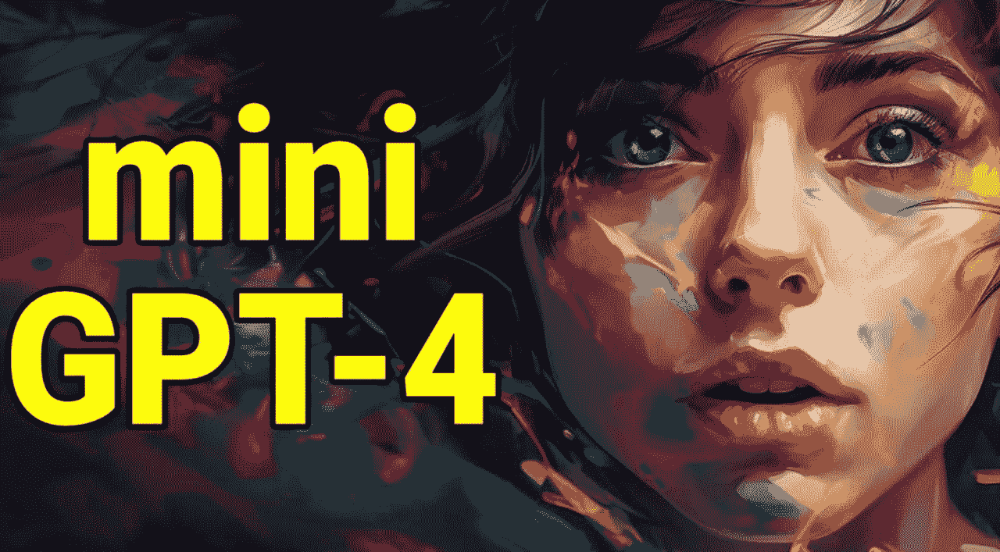

量子位｜[阅读原文](https://sourl.co/deN7bb)

OpenAI 的 GPT-4o mini 模型以其高性价比和快速响应能力引起业界关注。团队中过半成员为华人，包括来自清华、北大、同济等名校的校友。这些成员在大模型训练、强化学习、序列建模等领域具有丰富经验。GPT-4o mini 在长文本生成和成本效益方面表现出色，价格仅为竞品一半，有望推动相关产品走向盈利。尽管面临竞品更新的挑战，GPT-4o mini 的发布无疑为人工智能领域带来新动力。

### 💡 英伟达 Mistral AI 发布 12B 参数小模型 Nemo，性能超越 Gemma 2 和 Llama 3

新智元｜[阅读原文](https://sourl.co/GvBLuv)

Mistral AI 与英伟达合作推出 12B 参数的 AI 小模型 Mistral NeMo，支持 128K 上下文，性能在多轮对话、数学、常识推理等基准测试中超越 Gemma 2 和 Llama 3。该模型在 NVIDIA DGX Cloud AI 平台上完成训练，采用 FP8 数据格式，降低内存需求，加快部署速度，保持准确性。Mistral NeMo 适用于企业级应用，支持多语言任务，优化了模型并行技术和混合精度训练，面向全球多语言用户，展现了 AI 模型在多语言支持和企业应用中的新突破。

### 💡 苹果 DCLM 小模型开源，性能超越 Mistral 7B

新智元｜[阅读原文](https://sourl.co/Tc8tQA)

苹果公司发布了 70 亿参数的 DCLM 小模型，开源包括权重和训练代码，基于开放数据集 DCLM-Baseline。DCLM-7B 模型在性能上接近 Llama 3、Gemma，且在核心、MMLU、扩展三个指标上表现优于其他同等大小的开放数据模型。此外，DCLM-1B 版本在 5-shot MMLU 任务上得分显著高于其他小模型，显示出苹果在小模型领域的技术实力。开源策略和性能优势为 LLM 开源社区带来新活力。

### 💡 陶哲轩在 IMO 上给 AI 团队颁奖！他们要做 AI 数学的 ImageNet

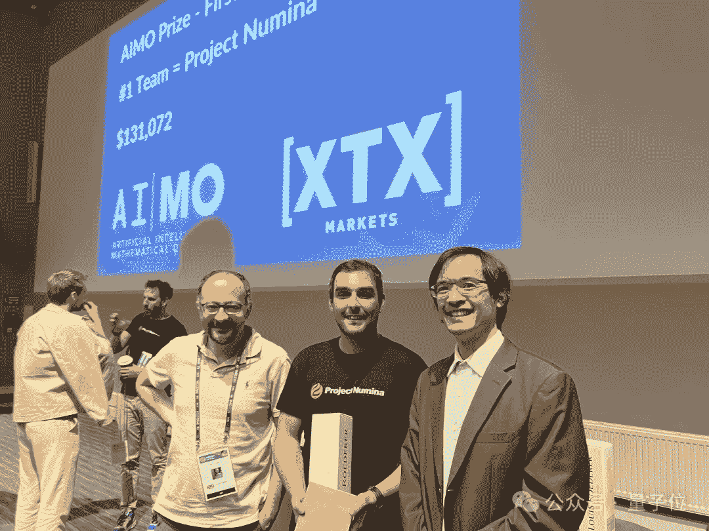

量子位｜[阅读原文](https://sourl.co/dq2gL4)

陶哲轩在国际数学奥赛 IMO 上向 AI 团队 Numina 颁奖，该团队在 AI 数学奥林匹克竞赛（AIMO）中取得显著成绩，成功解决 29 道 IMO 级难题。Numina 团队的 7B 模型 NuminaMath-7B 在数学推理方面表现卓越，并宣布开源模型、数据、代码及训练过程。团队采用 100 万道数学题进行微调，结合自然语言处理和 Python 代码执行反馈，创新性地提高了解题能力。Numina 作为非盈利组织，致力于推动 AI 数学领域的开放研究，目标是创建 AI 数学领域的 ImageNet，促进深度学习在数学领域的应用和发展。

### 💡 机器人版的「斯坦福小镇」来了，GRUtopia 专为具身智能研究打造

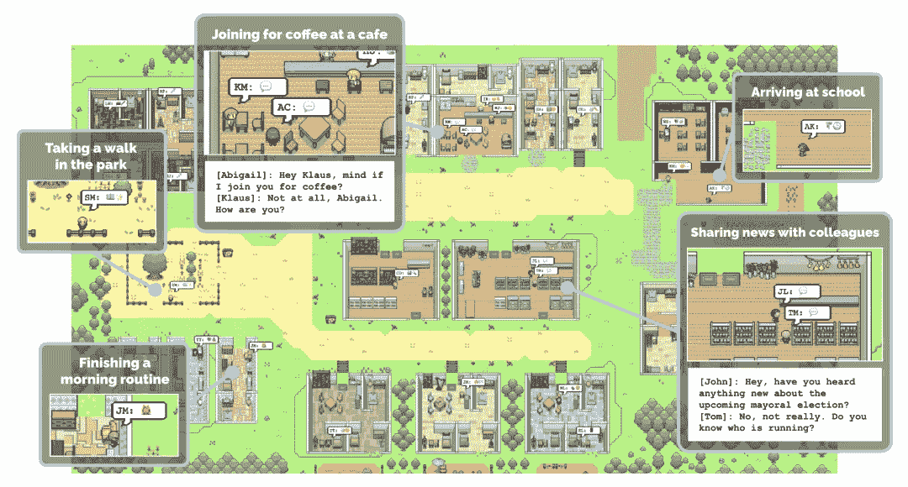

机器之心｜[阅读原文](https://sourl.co/E9TmFA)

上海人工智能实验室 OpenRobotLab 等机构研究者创建了 GRUtopia，这是一个包含 10 万个交互式场景和 89 种场景类别的 3D 社会，专为机器人设计。环境旨在解决具身智能领域数据稀缺问题，支持从仿真到现实（Sim2Real）的学习。GRUtopia 包括场景数据集 GRScenes、语言模型驱动的 NPC 系统 GRResidents 和基准 GRBench，以全面评估具身 AI。实验证明 NPC 能生成对象说明、定位物体并提供导航帮助，展示了 NPC 框架在指代和接地的准确性。GRBench 作为评估工具，针对日常任务能力，包括物体定位导航、社交定位导航和定位操作，优先考虑腿式机器人。研究者通过定量和定性评估展示了智能体框架的优越性和改进空间。

### 💡 谷歌团队用 AI 挖掘临床数据，改善基因发现和疾病预测

ScienceAI｜[阅读原文](https://sourl.co/5cvtaE)

Google Research 团队开发了一种无监督深度学习模型 REGLE，利用高维临床数据发现基因变异与疾病关联。REGLE 通过变分自动编码器学习数据的低维表示，进行基因关联研究和多基因风险评分。该方法在肺功能和心血管功能数据中验证，显著提高了基因位点发现和疾病预测的准确性。

### 💡 AI 助力癌症治疗：免疫细胞精准杀灭癌细胞

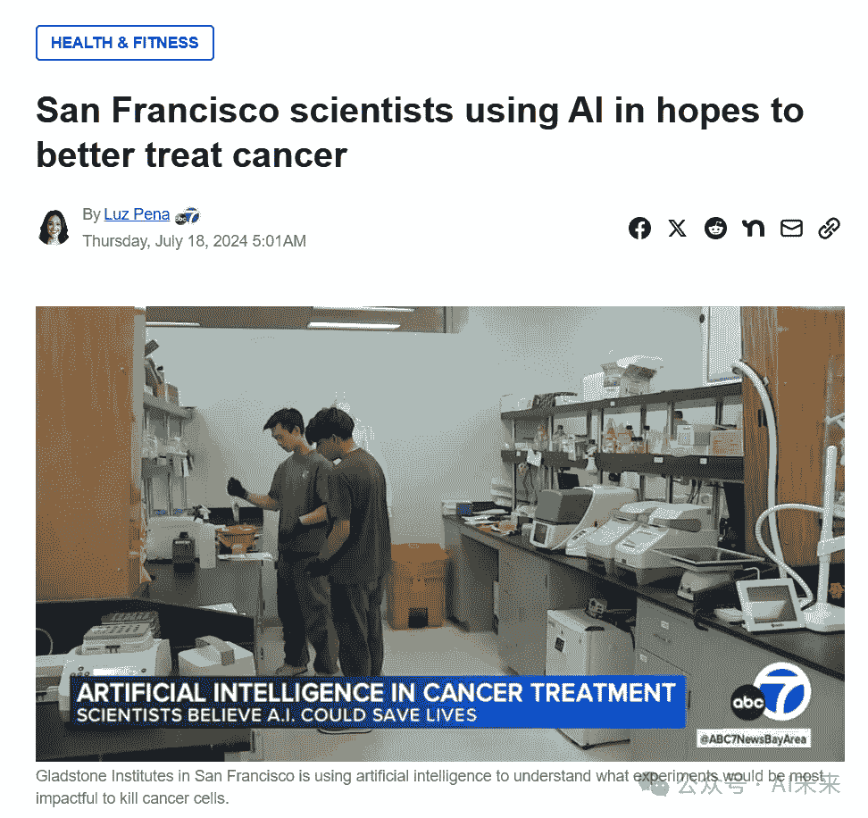

AI未来｜[阅读原文](https://sourl.co/FGkYEn)

美国旧金山格拉德斯通研究所的科学家们正利用人工智能技术探索癌症治疗新方案。迪帕克・斯里瓦斯塔博士及其团队通过 AI 模拟数百万次实验，旨在区分癌细胞的驱动因素与随机错误，以期工程化患者自身的免疫细胞，使其能精准识别并杀死癌细胞。凯蒂・波拉德所长强调，通过机器学习模型识别癌细胞驱动因子，可以更高效地进行实验，缩短从发现到临床试验的时间，为癌症患者带来希望。

### 💡 提升 5.69 倍，高效 RAG 上下文压缩方法 COCOM

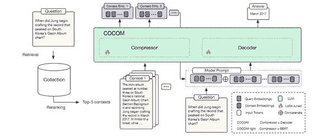

AIGC开放社区｜[阅读原文](https://sourl.co/g92uK4)

COCOM 是一种创新的上下文压缩技术，通过将长文本上下文转换成紧凑的嵌入，减少模型输入大小，提升生成内容质量。它使用自编码和语言建模预训练任务，支持灵活压缩率调节，处理多文档上下文，显著提升解码效率和内存使用效率。

## 💫 企业动态

### 💡 给 iPhone 背面贴个 AI 录音机，生意老好了

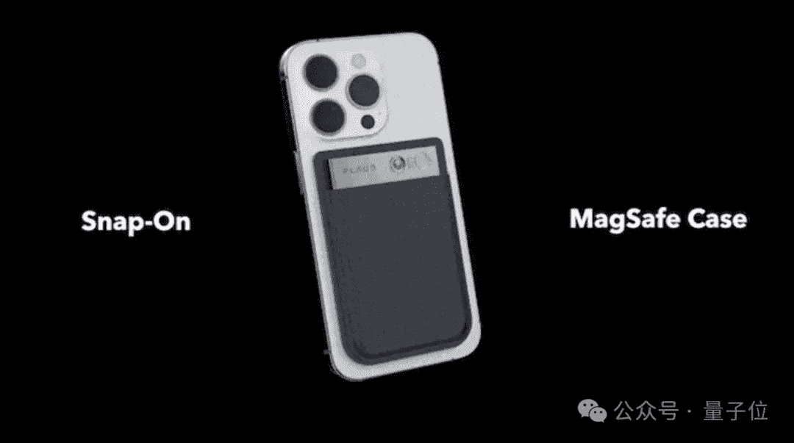

量子位｜[阅读原文](https://sourl.co/S2xpMP)

Plaud Note 是一款专为 iPhone 设计的 AI 录音卡片，以 110 万美元的众筹成绩打破记录，销售额近 600 万美元。这款产品由深圳机智连接科技有限公司研发，无需安装新应用或授权即可实现录音，支持通话录音和环境音采集，具备 AI 降噪和同传功能。Plaud 搭载 GPT-4o，能整理多语言文本成笔记，商业模式为硬件加订阅服务。尽管面临苹果 iOS 18 新增的通话录音功能的竞争，Plaud 以其便携性和创新性在市场上取得了显著成功。

### 💡 AI 导盲眼镜 .lumen 模仿导盲犬的功能改变视障人士生活

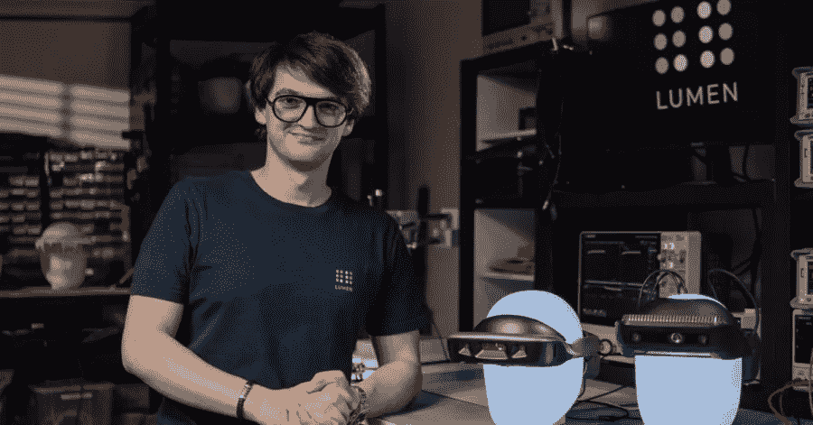

Z Potentials｜[阅读原文](https://sourl.co/hx9JWP)

罗马尼亚医疗科技公司 .lumen 成功融资 500 万欧元，用于推动其 AI 导盲眼镜的商业化。该眼镜利用行人自主驾驶技术，模仿导盲犬功能，为视障人士提供独立性和安全性。公司计划 2024 年第四季度在欧盟推出限量系列，并在 2025 年进入美国市场，目标是到 2026 年底销售 10,000 台。此轮融资由 SeedBlink 领投，欧洲创新委员会和未来基金参与，展现了罗马尼亚在创新技术领域的潜力。

### 💡 AI 炒菜机器人公司橡鹿科技再获京东近 2 亿元战略投资

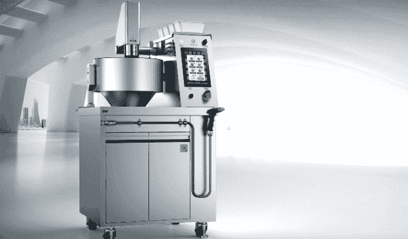

IT之家｜[阅读原文](https://sourl.co/AkzwCZ)

橡鹿科技宣布获得京东近 2 亿元的战略投资，并达成全面战略合作。双方将结合 AI 技术优势，推动机器人产业高质量发展。橡鹿科技计划扩大 AI 炒菜机器人工厂，提高自动化水平，并在长江以北建立第二生产基地以满足市场需求。公司还将持续研发投入，预计于 2025 年推出基于视觉的新一代 AI 炒菜机器人，并加强全国售后运维布局，提升服务质量。此前橡鹿科技已获得京东集团的数千万元融资，资金主要用于技术研发和市场开拓。

### 💡 自动驾驶出租车火了，美国的经验是什么？

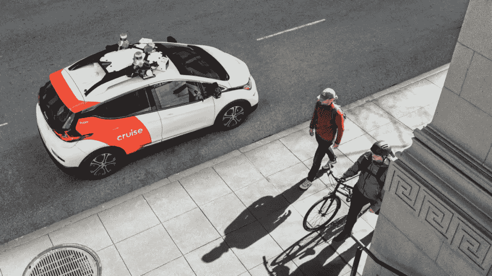

DeepTech深科技｜[阅读原文](https://sourl.co/w3rPnk)

2023 年，美国无人驾驶出租车行业经历了 Cruise 公司旧金山事故的打击，导致服务暂停和裁员。尽管如此，Waymo 和百度等公司仍在中国和美国部分城市提供服务。行业面临的主要挑战包括高成本、技术限制和安全问题。专家认为，自动驾驶出租车需降低成本、提高安全性以与传统交通竞争。尽管有扩张阻力，全球范围内，无人驾驶出租车仍在探索中前进。

### 💡 从短剧到 AI 大模型，新兴行业如何让组织「跟上」业务？

极客公园｜[阅读原文](https://sourl.co/mUxhpd)

新兴行业如短剧、AI 大模型等领域的企业正通过飞书等先进工具实现组织与业务的高效协同。短剧行业的丰行文化利用飞书提升制作效率，而智元机器人和智谱 AI 等公司则通过飞书 People 和项目工具实现人才筛选、知识共享和数字化管理，以适应快速变化的市场和业务需求。这些企业通过工具迭代，快速扩张和变阵，探索新兴行业的无限可能，同时飞书也与这些先进企业共同成长，提供更专业的组织管理解决方案。

### 💡 传 OpenAI 与博通合作开发新 AI 芯片，最早在 2026 年投入生产

有新Newin｜[阅读原文](https://sourl.co/KDKB6q)

OpenAI 正与博通合作开发新型 AI 芯片，以提升计算能力，应对超级智能需求。Richard Ho 领导的团队，曾参与谷歌 TPU 的研发。芯片设计尚未开始，但预计 2026 年生产。Sam Altman 与芯片厂商探讨提高产能，计划建立数据中心，寻求外部投资。Altman 还与三星、SK 海力士讨论 HBM 内存芯片供应，寻求美国商务部批准，可能与中东政府合作。OpenAI 正与各方合作，以确保 AI 技术普及。

### 💡 中共中央推进人工智能安全监管制度

IT之家｜[阅读原文](https://sourl.co/ePgFW7)

中共中央发布决定，强调健全网络综合治理体系，深化网络管理体制改革，完善生成式人工智能发展和管理机制。同时，加强网络安全体制建设，建立人工智能安全监管制度，推动人才发展体制机制改革，培养高水平人才，促进人才区域合理布局。

## ✨ 行业观点

### 💡 SK 集团会长崔泰源：如果不赚钱，AI 的繁荣可能会像淘金热一样消失

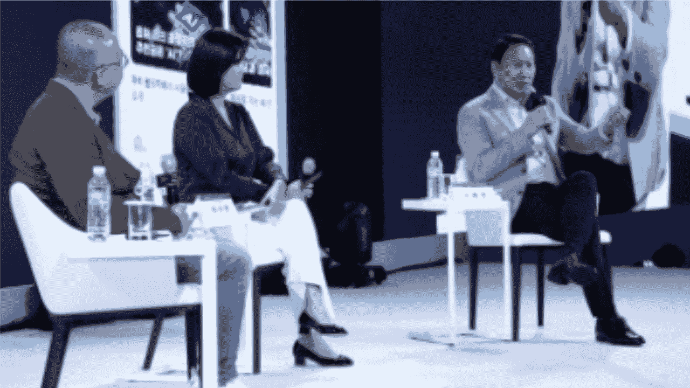

IT之家｜[阅读原文](https://sourl.co/M2PPmd)

韩国 SK 集团会长崔泰源在第 47 届 KCCI 济州论坛上提出，AI 技术行业若不能保证盈利，英伟达可能失去市场主导地位。他将 AI 热潮比作 19 世纪的淘金热，暗示若 AI 不赚钱，其繁荣可能迅速消退。崔泰源还提到，微软、谷歌和亚马逊等公司正在开发自己的芯片，可能减少对英伟达产品的依赖。他警告说，如果竞争对手以更低价格提供高质量芯片，英伟达的商业模式可能崩溃。尽管如此，英伟达目前市值高达 2.9 万亿美元，显示出 AI 领域的投资热情。

### 💡 Ilya Sutskever 离职后首次采访：个人经历，Scaling Laws，AI 幻觉

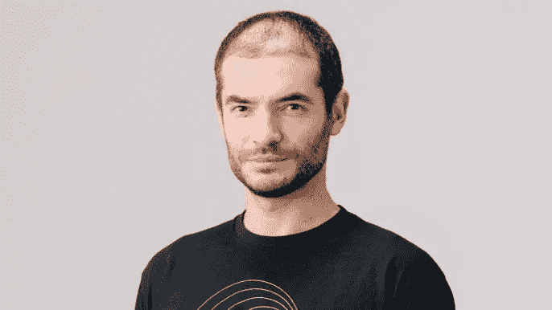

AI寒武纪｜[阅读原文](https://sourl.co/vkHjtE)

Ilya Sutskever 在离职后的首次采访中，回顾了自己与 AI 的早期联系，以及与 Jeff Hinton 的合作经历。他讨论了卷积神经网络在图像识别上的突破，以及 Transformer 模型对 GPT 项目的影响。Sutskever 还深入分析了大规模语言模型的局限性，特别是模型生成的"幻觉"问题，并提出了通过人类反馈来改进模型的研究方向。他同时指出，尽管深度学习取得了巨大进展，但扩展并非万能，需要有针对性地扩展以获得实质性进步。