# 7.23 特斯拉 Optimus 机器人计划 2026 年量产销售

> 来源：[https://agijuejin.feishu.cn/docx/JAM7dMPZ4o56n1xIsFlcydFKnUh](https://agijuejin.feishu.cn/docx/JAM7dMPZ4o56n1xIsFlcydFKnUh)

> [欢迎加入 AGI 掘金社群](https://sourl.co/miZUyT)

## 🌟 技术突破

### 💡 Llama 3.1 泄密：4050 亿参数，超越 GPT-4o 级开源模型！

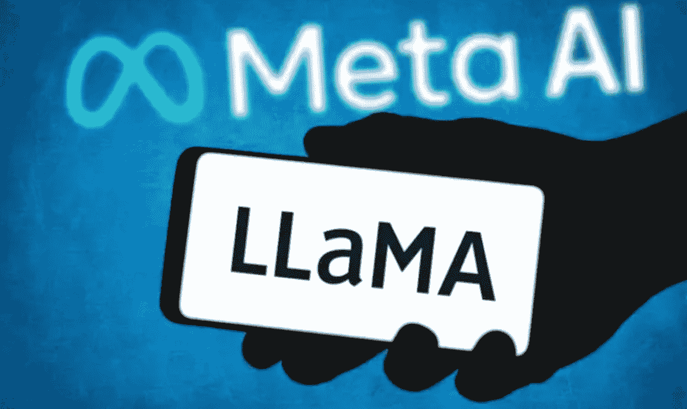

机器之心｜[阅读原文](https://sourl.co/UdQmL9)

Llama 3.1，一款 4050 亿参数的开源大型语言模型，已在 Reddit 上泄露，其性能在多个基准测试中超越了 GPT-4o 等闭源模型。该模型支持八种语言，使用了超过 15 万亿个 token 的数据进行训练，预训练数据截止到 2023 年 12 月。Llama 3.1 采用优化的 Transformer 架构，并通过指令微调提高多语言对话的适用性。尽管泄露的 Github 链接已失效，但有替代下载链接可供使用。模型训练使用了大量计算资源，Meta 公司在训练过程中保持了净零温室气体排放。

### 💡 GPT-4o 发挥关键作用！NuminaMath 7B TIR 赢得第一届 AIMO 进步奖

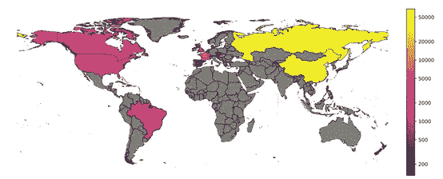

AIGC开放社区｜[阅读原文](https://sourl.co/7WczMD)

NuminaMath 7B TIR 在 AIMO 进步奖中表现卓越，其训练数据集 NuminaMath 已开源。该数据集包含 86 万个数学题目，覆盖从基础到高级难度级别，采用 OCR 技术提取并经 GPT-4o 多模态能力处理，确保了数据的高质量和国际化需求。Numina 还引入 TIR 模块，结合程序执行验证数学推理的正确性，显著提升了模型的数学解题能力。

### 💡 GitHub 狂揽 2.5K 星，开源框架 exo 在家就能跑 400B 大模型

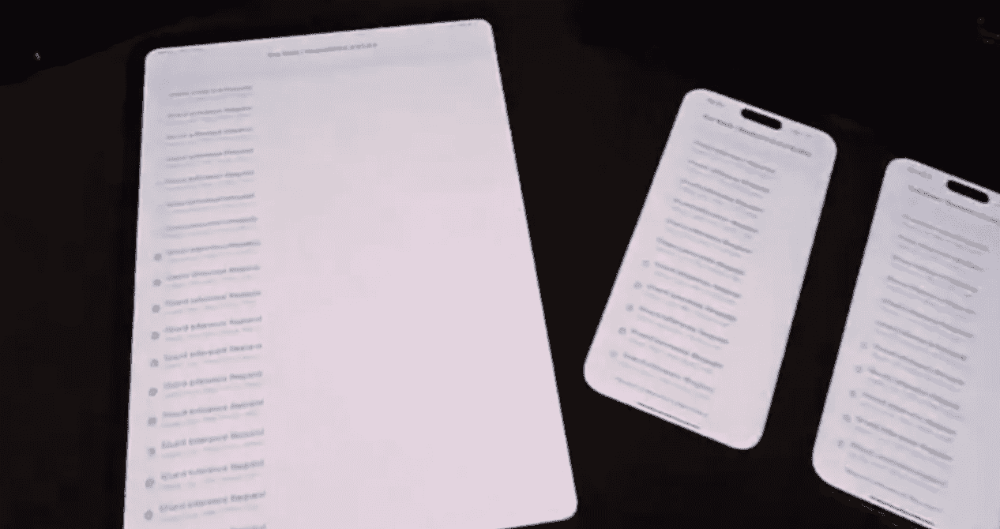

量子位｜[阅读原文](https://sourl.co/sXJdWF)

GitHub 上的 exo 框架通过点对点连接技术，使家用设备如苹果电脑、iPhone、iPad 等能够自动组成 AI 算力集群，运算速度达 110TFLOPS。该框架支持多种设备，包括安卓手机和 4090 显卡，并计划支持即将发布的 Llama3-405B 模型。尽管存在设备算力和网络传输速度的挑战，exo 框架仍展现出巨大的潜力和灵活性。

### 💡 新型 AI 模型预测阿尔茨海默病准确率达 82%

IT之家｜[阅读原文](https://sourl.co/Nq5FKB)

英国剑桥大学科学家开发出一种 AI 工具，能以 82%的准确率预测早期痴呆症患者发展为阿尔茨海默病的可能性。该工具有望减少侵入性和昂贵的诊断测试需求，改善早期治疗效果，并增加干预措施的机会。全球痴呆症患者超 5500 万，其中 60-80%为阿尔茨海默病，每年造成巨大经济损失。早期检测对治疗效果至关重要，但现有诊断方法可能不准确，导致误诊。剑桥团队的机器学习模型基于 400 名患者的数据建立，准确预测病情发展速度，准确率远高于现有临床诊断工具，未来计划扩展至预测其他类型痴呆症。

### 💡 谷歌发布 NeuralGCM 天气预报 AI 模型：运行成本更低、预测更准

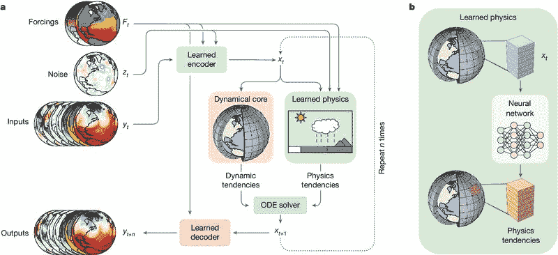

IT之家｜[阅读原文](https://sourl.co/5GJaLN)

谷歌公司发布了名为 NeuralGCM 的 AI 天气预报模型，该模型结合机器学习和传统技术，提供成本更低、1-10 天预报更准确的天气预测。NeuralGCM 模型开源，可快速在笔记本电脑上运行。由谷歌研究院、DeepMind、麻省理工学院、哈佛大学和欧洲中期天气预报中心的科学家共同研发，通过使用物理方程和神经网络训练，结合全球环流模型和人工智能，减少了计算需求，提高了预测速度和质量。其准确度与欧洲中期天气预报中心的 1-15 天预报相当。

### 💡 挑战 Scaling Law，Meta 发布 MobileLLM：350M 小模型性能匹敌 7B LLaMA-v2

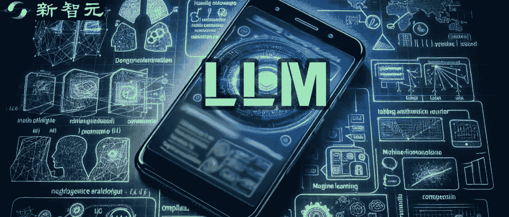

新智元｜[阅读原文](https://sourl.co/LMsPna)

Meta 推出的 MobileLLM 系列小模型，参数量仅为 125M 和 350M，却能与 7B 参数的 LLaMA-v2 相媲美。这标志着 AI 模型正从云数据中心走向个人设备，强调了模型架构的重要性。MobileLLM 通过深度优化，如使用 SwiGLU 网络、编码共享和组查询注意力机制等，实现了在小规模参数下的高性能。该模型在多项基准测试中展现了 SOTA 性能，同时与量化技术兼容，适合在资源受限的移动设备上部署。

### 💡 Google DeepMind 最新研究：搞定这三个任务？人类不行，AI 也不行

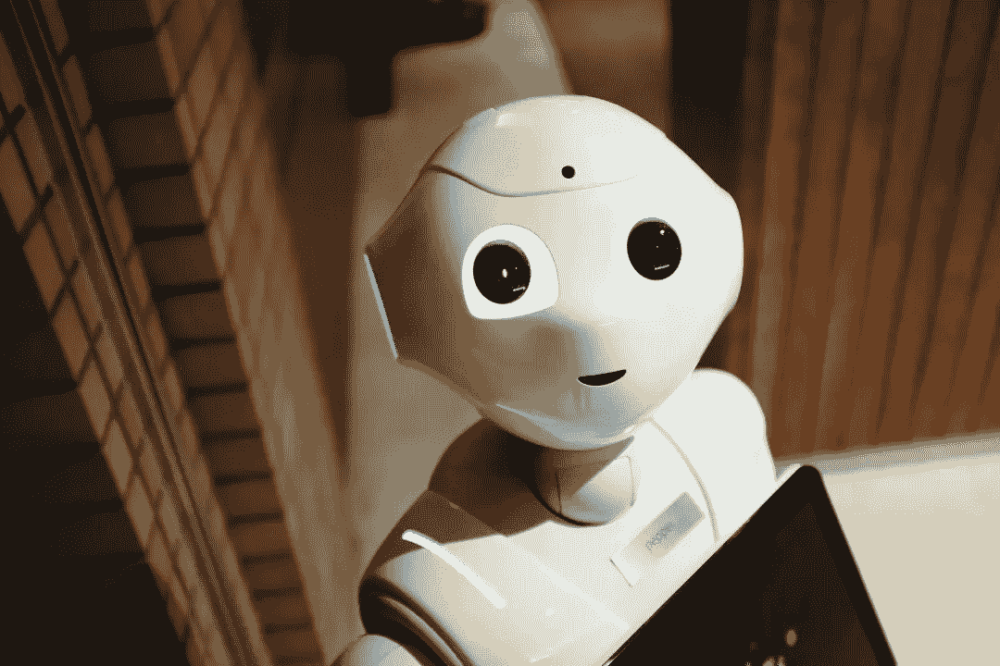

学术头条｜[阅读原文](https://sourl.co/bWfgKK)

Google DeepMind 的最新研究揭示了 AI 与人类在自然语言推理、三段论逻辑有效性判断和 Wason 选择任务中表现出相似的推理错误倾向。研究显示，无论是人类还是大型 Transformer 语言模型，都容易受到内容效应的影响，导致在逻辑推理时出现错误。尽管 AI 在自然语言处理方面表现优异，但在复杂逻辑推理上仍需谨慎。研究结果为改进 AI 推理能力提供了方向，同时指出了需要在更广泛的任务和更接近人类语言数据规模的条件下进一步验证的必要性。

### 💡 快手首部 AI 短剧成爆款，播放量破 5000 万，剧组人数仅传统 1/10

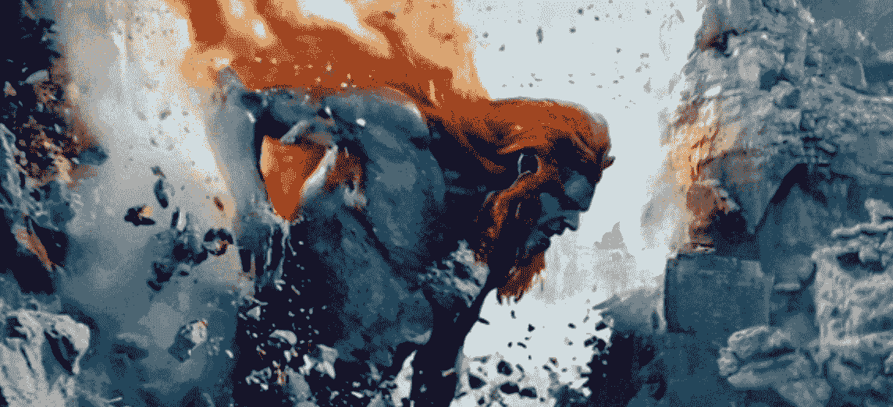

APPSO｜[阅读原文](https://sourl.co/9RANeC)

快手利用 AI 技术制作首部短剧《劈波斩浪》，以传统剧组 1/10 的人力完成制作，播放量已突破 5000 万。该短剧的成功展示了 AI 在内容创作领域的潜力，通过 AI 生成内容（AIGC）技术，大幅降低了制作成本和人力需求，同时提高了效率和创新性。这一突破性尝试不仅为影视行业带来新机遇，也为观众带来了新颖的观看体验，预示着 AI 技术在娱乐产业的广泛应用前景。

## 💫 企业动态

### 💡 马斯克：特斯拉 Optimus 机器人计划 2026 年量产销售

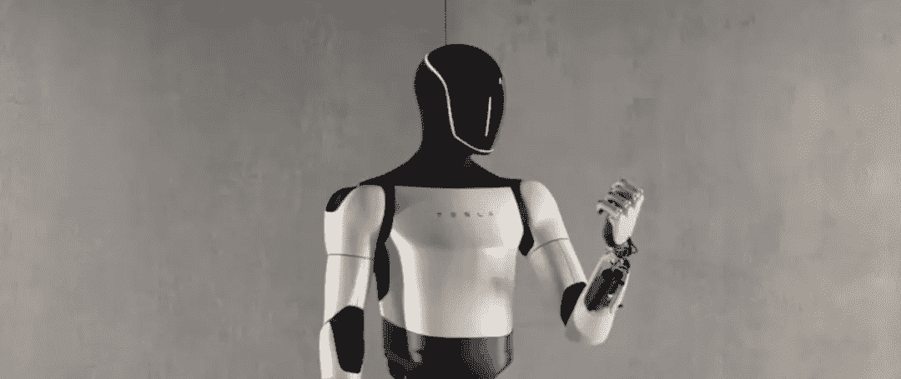

有新Newin｜[阅读原文](https://sourl.co/NxJcFs)

埃隆·马斯克宣布，特斯拉人形机器人 Optimus 计划在 2026 年实现大规模生产并对外销售。Optimus 将首先在特斯拉内部投入使用，目标是小批量生产后迅速扩展至大批量生产。马斯克期望机器人价格低于 20,000 美元，并具备对话能力及安全防护措施。预计 Optimus 将在 2024 年底完成工厂任务，并在 2025 年上市销售，标志着特斯拉在人工智能和机器人技术领域的进一步发展。

### 💡 奥运史上 AI 首秀！谷歌 Gemini 将亮相巴黎，打造 AI 观赛新体验

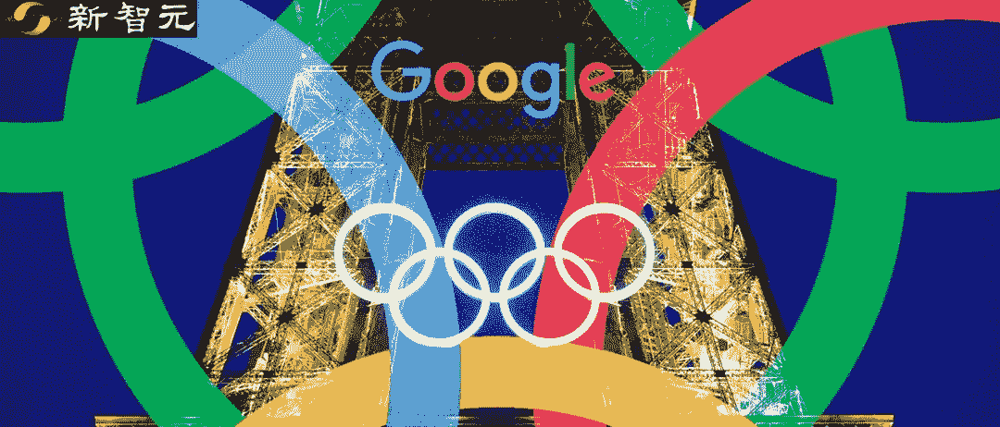

新智元｜[阅读原文](https://sourl.co/H3sdKF)

谷歌携手 NBCUniversal 在巴黎奥运会中首次引入 AI 技术，通过 Gemini 平台为观众提供个性化赛事回顾和解说服务。观众可通过 Peacock 应用定制个人观赛体验，享受由 AI 生成的每日赛事回顾。此外，NBCUniversal 通过 AI 搜索提供赛事解释，增强观众对比赛内容的理解。谷歌地图 3D 实景功能让观众身临其境感受巴黎奥运场馆，而喜剧演员 Leslie Jones 的加入，通过与 Gemini AI 的互动，为观众带来幽默风趣的观赛体验。

### 💡 苹果开源 7B 大模型，训练过程数据集一口气全给了，网友：开放得不像苹果

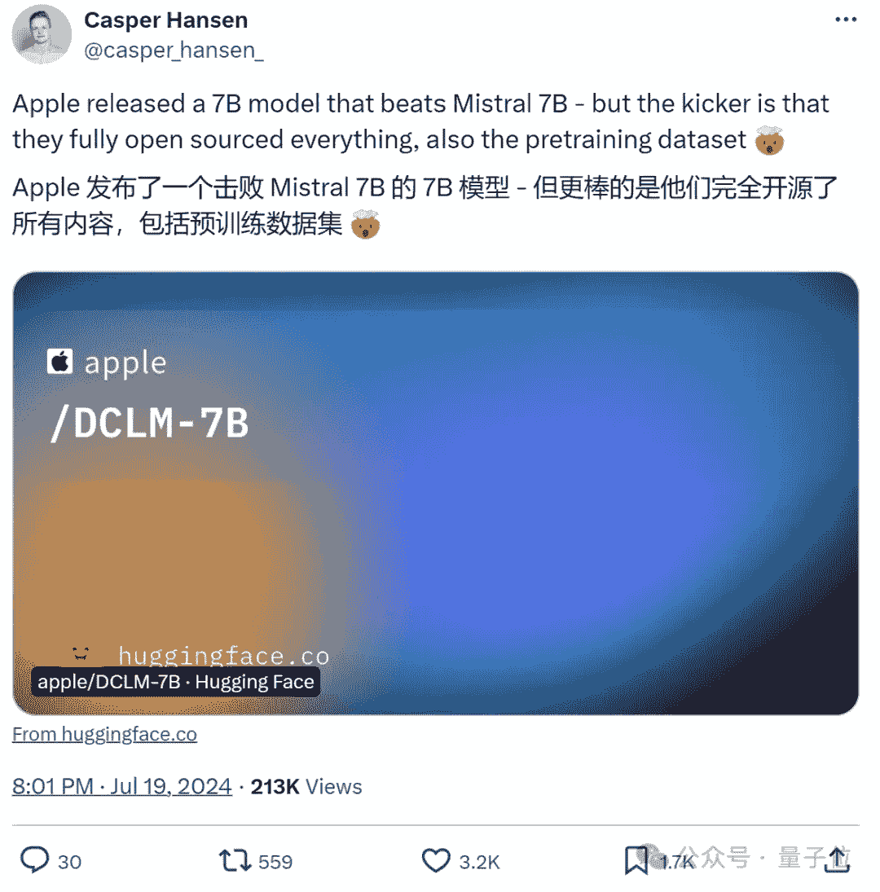

量子位｜[阅读原文](https://sourl.co/JNpqEG)

苹果公司近日开源了其 7B 参数的 AI 模型，包括全部训练过程和资源，这一举措在业界引起广泛关注。该模型性能与 Llama 3 8B 相当，但在多模态领域展现出更优表现。苹果使用 DCLM 基准设计高质量数据集，通过标准化框架实验，显著提升了模型性能。开源行动不仅满足了科学研究的需求，也为 AI 社区提供了宝贵的资源，推动了小模型成为新趋势，同时降低了成本，提高了效率。

### 💡 Oura Ring 4 智能戒指首曝：时隔近三年再度更新，传感器设计平滑

IT之家｜[阅读原文](https://sourl.co/xAf2cQ)

Oura Ring 4 智能戒指在监管机构的认证中曝光，距离上一代产品发布已近三年。新款 Oura Ring 4（型号 OA11）与三星 Galaxy Ring 不同，其内部传感器采用平滑设计，保持了戒指外观的一致性。产品包装确认了 Oura Ring 4 的命名，同时存在型号 OA12。Oura Ring 3 自 2021 年 10 月发布以来，以 299 美元起售，提供 Heritage 与 Horizon 两种设计。新款智能戒指的发布，预示着健康监测设备在设计和功能上的持续进步。

### 💡 5 年 160 亿估值，硅谷「企业 AI」领头羊怎么做到的？

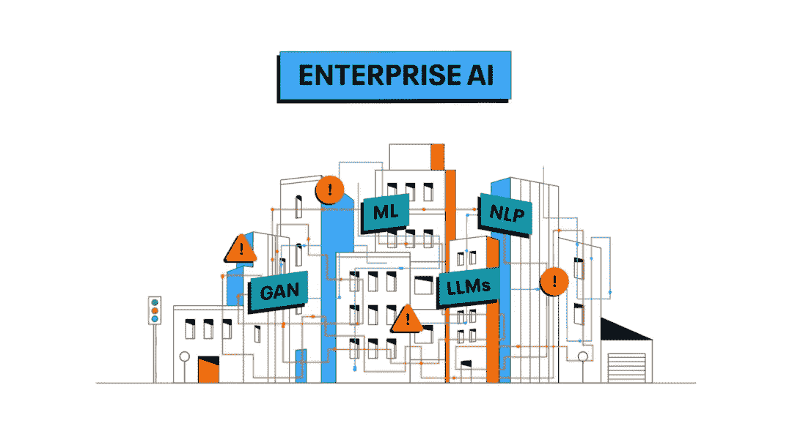

极客公园｜[阅读原文](https://sourl.co/5a2KsN)

硅谷 AI 公司 Glean 通过其企业 AI 搜索产品，在 D 轮融资中获得 2 亿美元，估值飙升至 22 亿美元，成为行业领头羊。Glean 提供集中式 AI 搜索平台，实现跨应用个性化搜索，集成 300+SaaS 产品，并通过可信知识模型确保搜索的准确性和安全性。公司还提供知识管理和工作主页功能，简化企业内部信息管理和知识利用。Glean 的成功得益于其创新的 AI 技术、个性化服务和简化的部署流程。

### 💡 英伟达拟推“特供版”B20 芯片，预计年销售额达 120 亿美元

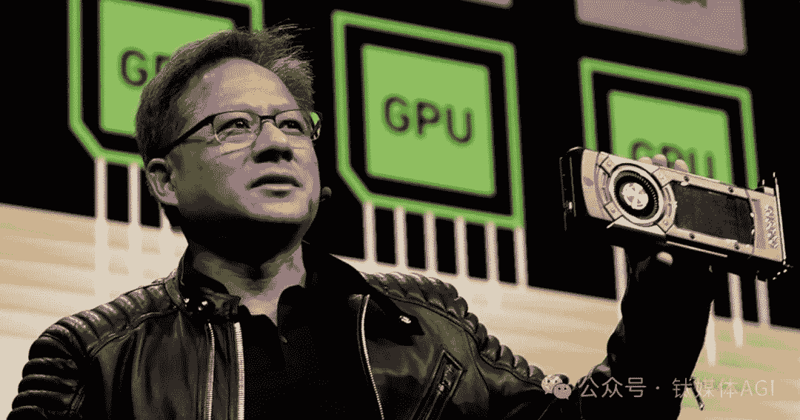

钛媒体AGI｜[阅读原文](https://sourl.co/XhybdU)

面对美国政府对华半导体出口管制，AI 芯片巨头英伟达依旧寻求在中国市场的发展机会。据钛媒体 AGI 报道，英伟达正在开发符合出口管制规定的新款 AI 芯片 B20，以维持其在中国的业务。尽管受美国商务部新规影响，英伟达在中国的数据中心业务收入有所下降，但公司 CEO 黄仁勋表示，将尽最大努力服务中国市场。预计 B20 芯片将带来显著收入，且英伟达有望通过此芯片实现在中国业务的最大化。

## ✨ 行业观点

### 💡 吴恩达：AI 图像处理革命正在到来，数据集中化非常关键

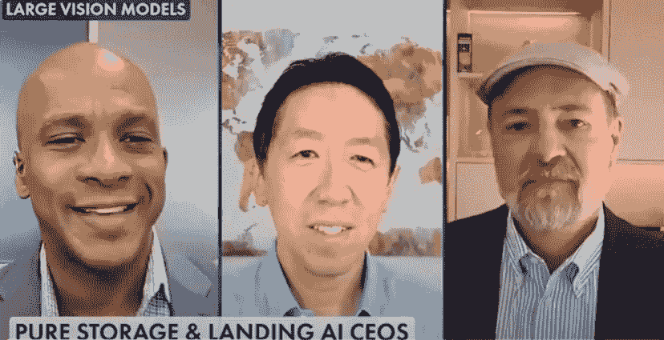

Z Potentials｜[阅读原文](https://sourl.co/a5dwj3)

吴恩达与 Charles Giancarlo 在对话中展望了 AI 图像处理技术的革命性进展，强调了打破数据孤岛、实现数据集中化对 AI 应用的重要性。他们讨论了 AI 在医疗领域的应用潜力，包括癌症筛查和血液检测等。吴恩达指出，尽管图像处理技术发展稍晚于文本处理，但其发展势头强劲，未来几年内将在医疗等行业实现重大突破。同时，他们探讨了企业如何利用现有数据和 AI 技术快速实现价值，以及数据驱动对企业价值提升的影响。

### 💡 AI 模型发展新趋势：大模型时代结束，小模型的崛起？

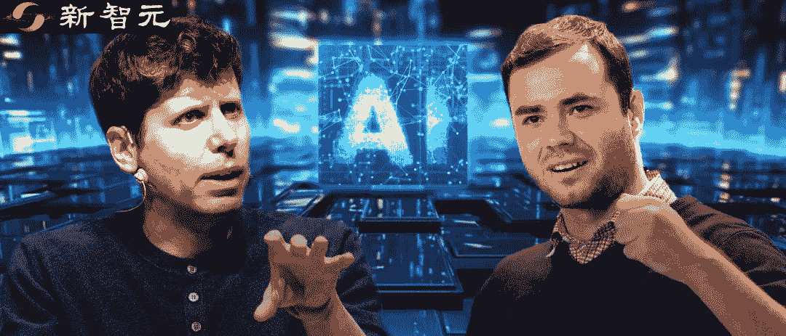

新智元｜[阅读原文](https://sourl.co/C3BSJ4)

随着小模型如 GPT-4o mini 的发布，AI 领域出现了新趋势。前 OpenAI 研究员 Andrej Karpathy 预测，未来 AI 模型将更小型化但智能不减。大模型虽在数据处理和泛化能力上有优势，但面临部署成本高昂等问题。小模型易于部署且功耗低，同时技术成熟后，可提炼大模型知识应用于小模型，实现性能与成本的优化。Karpathy 认为，通过高质量数据集训练，小模型能展现出更强的推理能力，预示着 AI 模型发展的新方向。