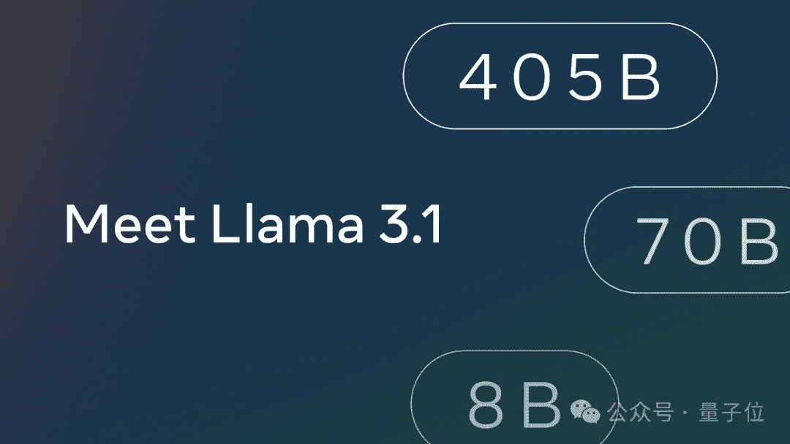
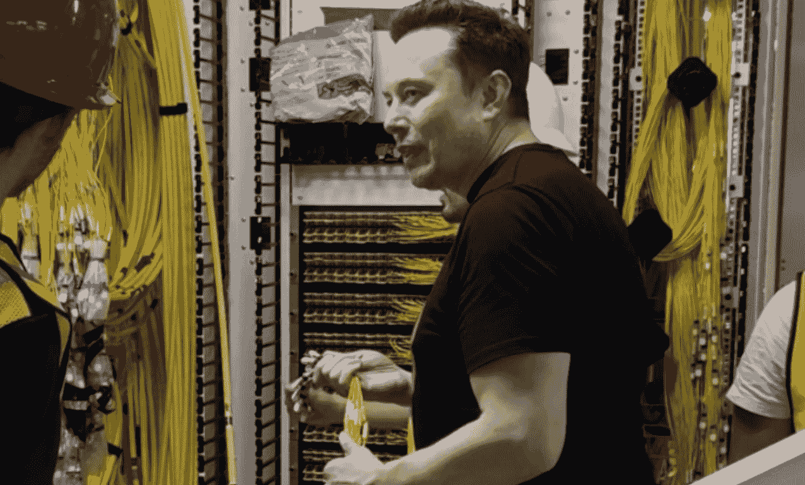
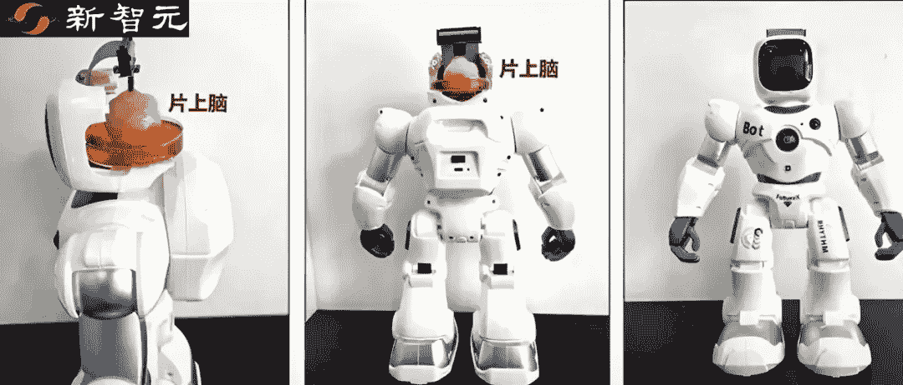
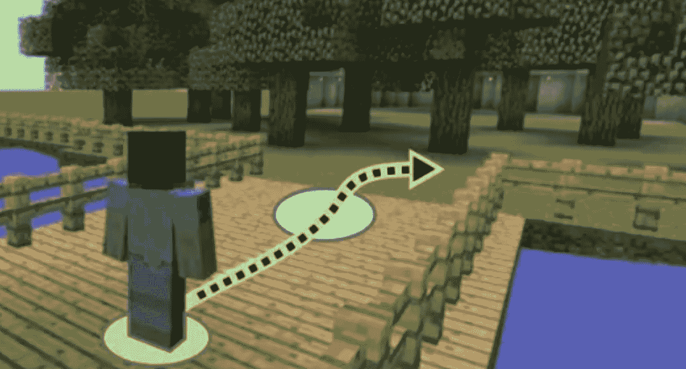
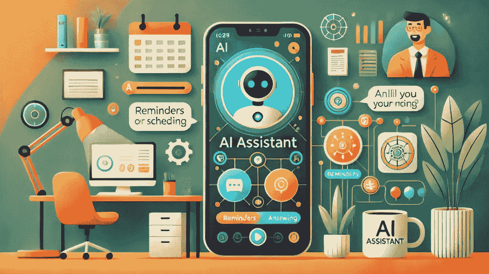
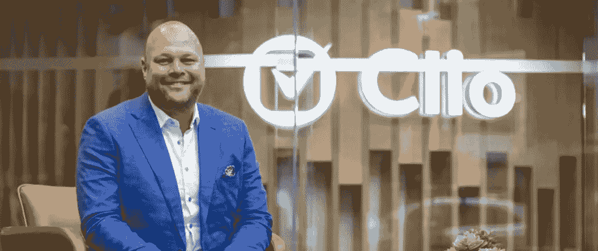
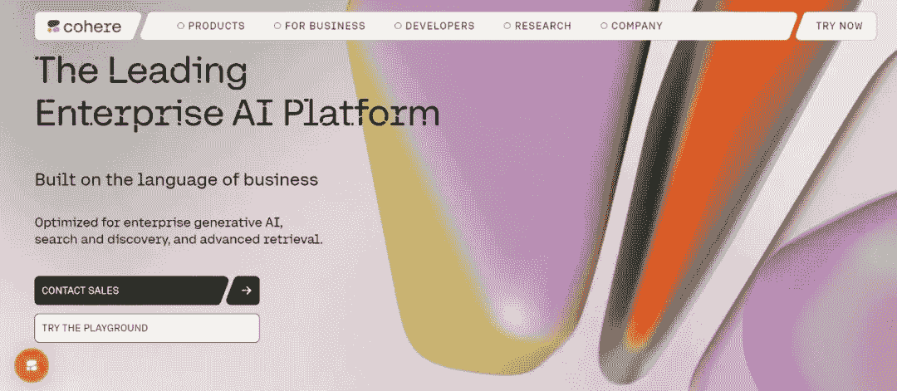
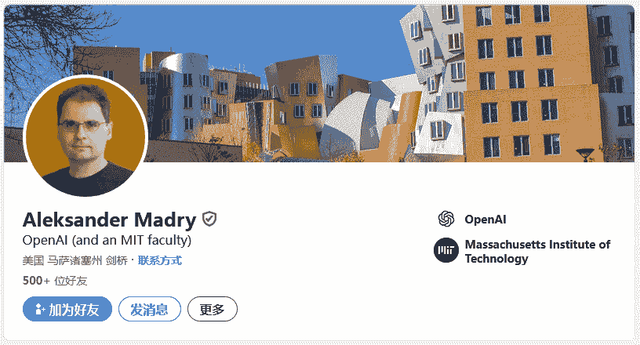
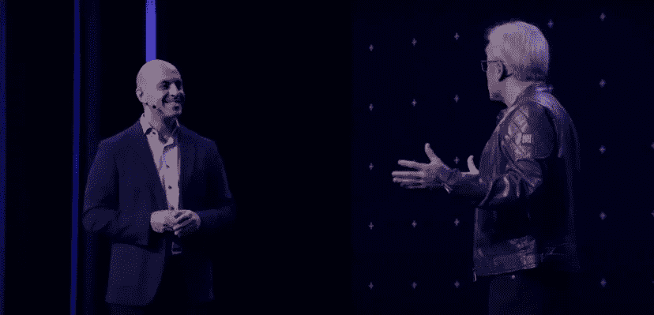

# 7.24 Llama3.1 正式发布！405B 超越闭源 GPT-4o，扎克伯格：分水岭时刻

> 来源：[https://agijuejin.feishu.cn/docx/CO2ydeEV8oV8DQxpqCEcq4UJnmc](https://agijuejin.feishu.cn/docx/CO2ydeEV8oV8DQxpqCEcq4UJnmc)

> [欢迎加入 AGI 掘金社群](https://sourl.co/miZUyT)

## 🌟 技术突破

### 💡 Llama3.1 正式发布！405B 超越闭源 GPT-4o，扎克伯格：分水岭时刻

量子位｜[阅读原文](https://sourl.co/anUZEj)

Llama 3.1，一个 405B 参数的开源 AI 模型，已在多个基准测试中超越现有顶尖闭源模型 GPT-4o 和 Claude 3.5。该模型在官网开放下载，支持八种语言，并在常识、可操纵性、数学等方面表现卓越。Meta AI 的这一成就标志着开源 AI 在性能上的重大突破，有望成为行业新标准。Llama 3.1 的发布，得到了社区的高度评价，并由各大云厂商支持，预示着开源 AI 的广泛应用和深远影响。

### 💡 快手可灵团队开源 LivePortrait，大叔实时变身少女，GitHub 狂揽 7.5K 星

量子位｜[阅读原文](https://sourl.co/B6KcRj)

快手可灵团队开发的 LivePortrait 框架通过隐式关键点技术，实现了从静态图像到动态视频的转换，并能控制人物表情。该技术在 GitHub 上迅速获得 7.5K 星标，支持不同风格和尺寸的图像，甚至能处理宠物图像。LivePortrait 在生成质量和驱动精确度上表现优异，推理效率高，每帧生成速度仅 12.8 毫秒。

### 💡 英伟达推出 AI 代工服务，携手 Llama 3.1 定制“超级模型”

IT之家｜[阅读原文](https://sourl.co/wDYhGS)

英伟达近日宣布推出“NVIDIA AI Foundry”代工服务和“NVIDIA NIM”推理微服务。AI Foundry 允许客户使用 Meta 的 Llama 3.1 AI 模型和英伟达资源定制“超级模型”，支持在 DGX Cloud AI 平台上训练和部署。NIM 推理微服务则使企业能在 NVIDIA GPU 上高效运行 AI 模型，支持行业标准 API 和 Kubernetes 集成。

### 💡 马斯克用 10 万块 H100，搭建全球最强 AI 训练集群！

AIGC开放社区｜[阅读原文](https://sourl.co/CXAA3v)

马斯克宣布在美国孟菲斯搭建了使用 10 万块液冷 H100 GPU 的 AI 训练集群，这可能是目前全球最强大的。该集群预计将显著提升训练 AI 模型的能力，特别是对于 Grok3 模型。马斯克的 xAI 平台刚获得 60 亿美元融资，计划打造超级计算机，以匹敌行业巨头。这一进展可能对 AI 领域产生深远影响，引发对未来 AI 技术应用的广泛期待。

### 💡 PixVerse V2 登场！一口气生成 5 个“Sora”，视频生成赛道“卷”飞了

硅星人Pro｜[阅读原文](https://sourl.co/a3qyDm)

PixVerse V2 以其革命性的运动笔刷功能，允许用户通过简单绘制轨迹控制视频特定区域的运动，大幅提升了视频创作的灵活性和直观性。从动画制作到社交媒体内容，该工具简化了编辑过程，使创作更自由。产品团队通过敏捷的反馈循环和 A/B 测试，快速迭代产品，以用户为中心的创新理念，将 AI 技术转化为实际产品功能，推动技术与产品极限。尽管文本到视频的转化存在局限性，PixVerse V2 的推出为大模型时代所有创作者提供了释放创意潜力的机会。

### 💡 Adobe Illustrator 和 Photoshop 迎来新 AI 功能

IT之家｜[阅读原文](https://sourl.co/KRG62H)

Adobe 公司为其设计软件 Illustrator 和 Photoshop 推出基于人工智能的新功能，以加速创作流程并提供更多控制权。Illustrator 新增功能包括生成式形状填充、模型应用、字体识别和文字转图案。Photoshop 则增加选区画笔工具、调整画笔工具，并集成 Adobe Firefly 以增强 AI 内容生成能力。Adobe 承诺，除非用户同意，否则不会使用其作品进行 AI 训练。

### 💡 天津大学等提出首个「缸中大脑」控制机器人！

新智元｜[阅读原文](https://sourl.co/6gqPi4)

天津大学团队与南方科技大学合作开发 MetaBOC，全球首个开源片上脑智能复合体信息交互系统。通过干细胞技术培养类脑组织，结合电极芯片，实现意念控制机器人。项目突破了细胞培养的三维化和人工智能算法的融合，推动了混合智能和类脑计算的发展。同时，项目也引发了关于意识、伦理和生物智能体维护的深入讨论。

### 💡 神经网络学会在 Minecraft 中创建空间地图

机器之心｜[阅读原文](https://sourl.co/fNBHMa)

加州理工学院的研究人员通过预测编码算法训练神经网络，在 Minecraft 游戏中成功构建了空间地图。这项技术使神经网络能够理解和预测环境中物体的空间关系，并通过内部结构存储这些信息。这一发现标志着人工智能在空间感知能力上的重大突破，为神经网络解决复杂问题提供了新思路，有望推动 AI 向更高层次的智能发展。

### 💡 Mem0：增强 LLM 的记忆功能，提升 AI 个性化体验

小微模型｜[阅读原文](https://sourl.co/FErNAF)

Mem0 是一项创新技术，通过智能内存层让 AI 在多交互中保持上下文，实现个性化互动。其核心功能包括用户会话记忆、自适应个性化、开发者友好 API、平台一致性和托管服务。Mem0 在教育、客户支持、医疗和游戏等领域有广泛应用，并在不断优化以提升用户体验。

## 💫 企业动态

### 💡 Iyo One：独立于手机的音频计算机，想把 iPhone 装进来

极客公园｜[阅读原文](https://sourl.co/UufAts)

Iyo 公司推出的 Iyo One 耳机，被定义为一款独立的"音频计算机"。它内置了 CPU、内存、闪存等计算机组件，支持独立于手机使用，具备降噪、翻译、音频交互界面等功能。Iyo One 旨在解决智能手机无法解决的问题，如在嘈杂环境中提供清晰的听觉体验。然而，续航和价格是其面临的挑战，WiFi 版续航 16 小时，售价 599 美元，蜂窝版续航 1.5 小时，售价 699 美元。尽管如此，Iyo One 代表了 AI 硬件创新的新方向。

### 💡 AI 驱动谷歌云 Q2 营收超百亿，Waymo 获增投

有新Newin｜[阅读原文](https://sourl.co/GHwnEH)

Google 2024 年 Q2 财报显示，营收 847.4 亿美元，净利润 236.2 亿美元，其中广告业务增长放缓，YouTube 和搜索收入分别增长 13%和 14%。Google Cloud 营收同比增长 29%至 103.5 亿美元，营业利润翻三倍。公司计划向 Waymo 投资 50 亿美元，推动自动驾驶技术发展。Waymo 在旧金山和凤凰城提供无人驾驶服务，扩展至洛杉矶和奥斯汀，与极氪汽车合作的新型无人车在旧金山测试。Waymo 第 6 代硬件简化设计，降低成本，适应极端气候测试。

### 💡 法律科技 Clio 完成 9 亿美元 F 轮融资，成功转型 AI 与支付

有新Newin｜[阅读原文](https://sourl.co/NKbxJu)

AI 法律科技公司 Clio 宣布完成 9 亿美元 F 轮融资，估值增至 30 亿美元，较 2021 年翻倍。NEA 领投，高盛等多家机构参与。Clio 致力于简化律所管理，服务 130 多国 15 万法律专业人士。公司年收入超 2 亿美元，连续盈利。2022 年整合支付功能，2023 年引入 AI，计划推出 GA Clio Duo AI 助手，助力律师提高效率。Clio 在支付和 AI 领域展现强劲增长，成为中端市场领导者。

### 💡 Cohere 获 5 亿美元融资，打造下一代准确、注重数据隐私的企业 AI

Z Potentials｜[阅读原文](https://sourl.co/NdCCbV)

生成式人工智能初创公司 Cohere 从思科、AMD、英伟达等投资者处筹集到 5 亿美元，估值达到 55 亿美元。公司计划扩充技术团队，专注于开发注重数据隐私的企业 AI。Cohere 为甲骨文等公司定制 AI 模型，其平台可部署在多种云环境中，最新旗舰模型 Command R+提供高效能低成本解决方案。

### 💡 OpenAI 安全高管 Aleksander Madry 转岗专注 AI 推理

IT之家｜[阅读原文](https://sourl.co/DJhbwb)

OpenAI 首席执行官 Sam Altman 宣布 AI 安全主管 Aleksander Madry 调至新岗位，专注于人工智能推理。Madry 此前负责评估和防范 AI 模型带来的风险。在 AI 安全领域具有重要影响的 Madry，此次转岗预示着 OpenAI 对 AI 推理技术发展的重视。同时，高管 Joaquin Quinonero Candela 和 Lilian Weng 将暂时接管其原团队，继续推进 AI 安全工作。

## ✨ 行业观点

### 💡 哈里斯与 AI 监管：我们要么保护公众，要么推动创新

Z Potentials｜[阅读原文](https://sourl.co/fhh4tt)

随着拜登退出竞选，副总统哈里斯可能成为民主党新提名人。她与科技行业有深厚联系，曾批评科技公司并呼吁加强监管。哈里斯支持拜登总统的人工智能监管政策，认为应制定新标准，保护公众利益，同时推动创新。她对 TikTok 的立场是处理国家安全担忧而非禁止应用。哈里斯在加密货币问题上表态较少，但预计会支持政府的监管措施。

### 💡 英伟达联手 Databricks 提升数据智能

Z Potentials｜[阅读原文](https://sourl.co/EAdRDT)

NVIDIA 与 Databricks 宣布合作，利用加速计算和生成式 AI 技术，致力于提升数据处理效率，为各行业带来变革。双方强调了数据智能平台的重要性，以及开源生态系统在推动 AI 发展中的作用。黄仁勋 CEO 提到，企业拥有的业务数据是金矿，但需从数据中提炼智能。合作旨在通过 GPU 加速数据处理，实现更高效的 AI 模型训练和部署，同时关注 AI 的可持续性，通过优化能源使用降低能耗。此外，生成式 AI 在客户服务、区域天气预测等领域的应用前景广阔，预示着 AI 将深入各行各业，推动新的工业革命。