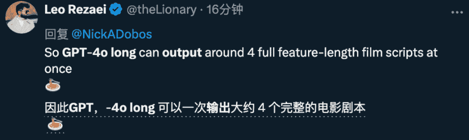
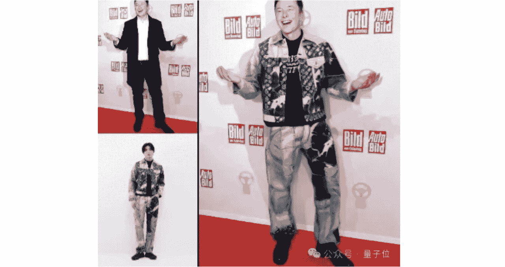
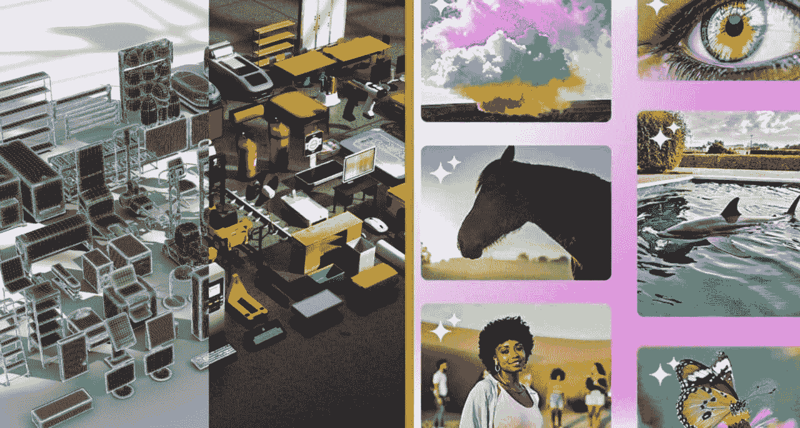
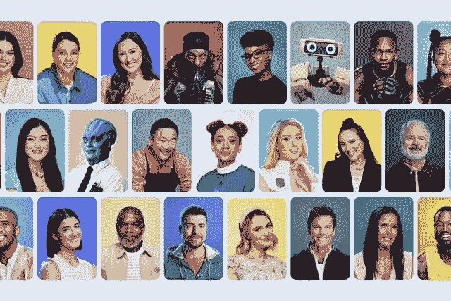
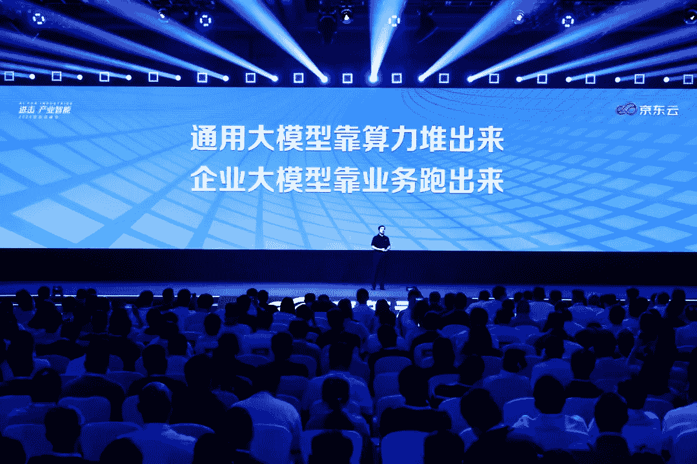
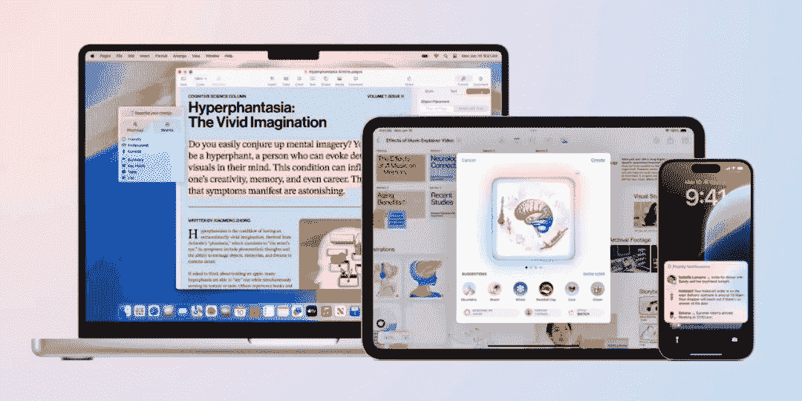
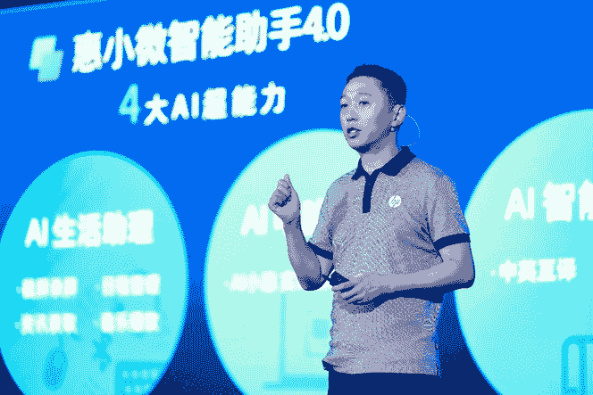
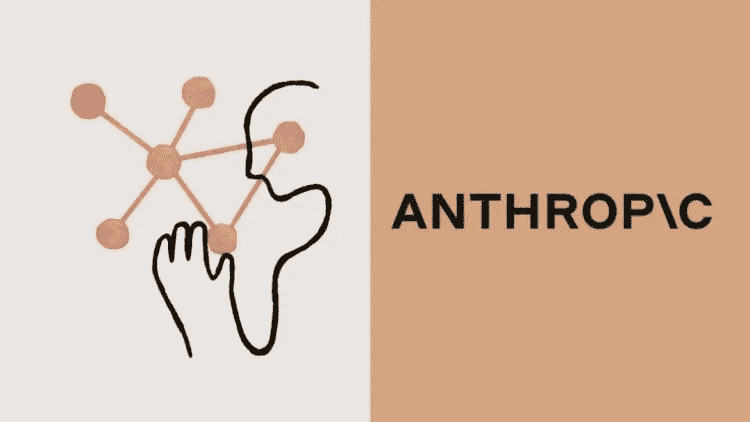
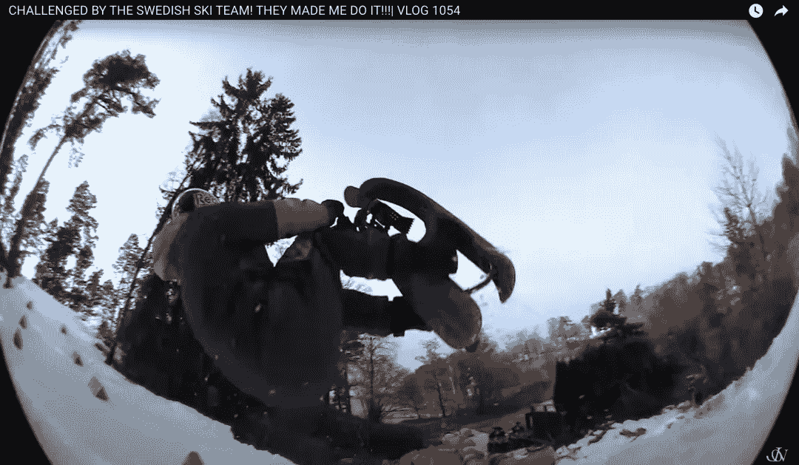
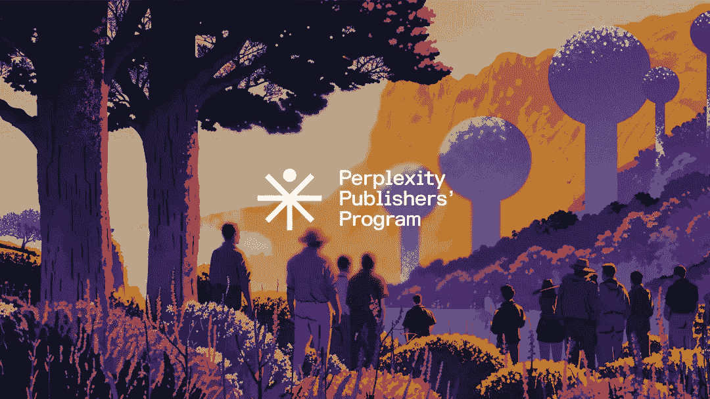

# 7.31 OpenAI 推出 ChatGPT 高级语音模式，Plus 用户已率先体验 GPT-4o 超逼真语音交互

> 来源：[https://agijuejin.feishu.cn/docx/LiuEdyKb2otKvXxsRWqcXHbsnch](https://agijuejin.feishu.cn/docx/LiuEdyKb2otKvXxsRWqcXHbsnch)

> [欢迎加入 AGI 掘金社群](https://sourl.co/miZUyT)

## 🌟 技术突破

### 💡 OpenAI 推出 ChatGPT 高级语音模式，Plus 用户已率先体验 GPT-4o 超逼真语音交互

有新Newin｜[阅读原文](https://sourl.co/2yxkqH)

OpenAI 于 2024 年 7 月 30 日推出 ChatGPT 的高级语音模式，其中 GPT-4o 模型能独立完成语音到文本和文本到语音的转换，大幅降低对话延迟。Alpha 版本首先面向部分 Plus 用户，计划秋季推广至所有 Plus 用户。GPT-4o 能感知情绪语调，但目前预设声音有限，且无法模仿特定声音。OpenAI 已与多语言外部团队合作测试，确保安全性，相关报告将在 8 月初发布。

### 💡 苹果 AI 版 iOS 首日火爆：聊天秒变高情商，大模型成最强嘴替，Siri 华丽变身

APPSO｜[阅读原文](https://sourl.co/w28zsJ)

苹果公司推出新一代 AI 技术，Siri 智能助手得到重大升级，智商提升但仍有待完善。新增功能包括通过自然语言创建幻灯片、搜索照片和视频等。技术报告披露了端侧模型 AFM-on-device 和云端模型 AFM-server，展示了苹果在 AI 领域的创新和实力。AI 写作功能在应用中表现出色，超越了众多现有应用。

### 💡 “真正的 OpenAI”！Meta「分割一切」进化 2.0

量子位｜[阅读原文](https://sourl.co/zdhyHs)

Meta 公司在 SIGGRAPH 上推出了“分割一切 AI”的第二代产品 SAM2，该技术能实时处理任意长度视频，并追踪视频中的未知对象。SAM2 通过引入记忆模块，支持视频分割的实时性和准确性，同时解决了遮挡问题。模型代码、权重和数据集均已开源，遵循 Apache 2.0 和 BSD-3 许可协议。开源数据集包含 51000 个视频和 600000 个时空掩码，规模空前。SAM2 的设计允许处理任意时长视频，对机器人等领域具有潜在影响。尽管存在跟踪丢失和细节缺失等不足，但模型的开源和实时交互模式提供了强大的应用潜力。

### 💡 OpenAI 推出 GPT-4o 长输出模式，支持 64k token，网友：一次写 4 份电影剧本

量子位｜[阅读原文](https://sourl.co/8fywmD)

OpenAI 测试了 GPT-4o 模型的长输出模式，允许 Alpha 测试用户通过特定 API 端点生成高达 64k token 的文本。此举意味着推理成本的增加，因此模型定价相应上调：每百万输入 token 收费 6 美元，每百万输出 token 收费 18 美元。这一更新为用户探索新的应用场景提供了可能，例如一次性生成多份电影剧本，激发了人们对未来应用的无限想象。

### 💡 寡姐带货国风 Polo 衫，马斯克穿牛仔走红毯！CatVTON：30 秒内实现虚拟试衣

量子位｜[阅读原文](https://sourl.co/LujTmk)

中山大学和 Pixocial 联合发布的 CatVTON 模型，基于 Stable Diffusion v1.5 inpaintting，仅需两张图像即可在 30 秒内完成虚拟试衣。该模型支持上衣、裤子、裙子等多品类服装的试穿，且能保持形状和纹理的高一致性。CatVTON 采用轻量化架构，包含 VAE 和 UNet 两个网络模块，总参数量 899.06M，显存占用小于 8G。通过优化去噪 UNet 结构，CatVTON 大幅减少了模型参数量和显存占用，实现了高效逼真的试穿效果，推动了虚拟试衣技术的应用落地。

### 💡 Runway 深夜炸场，Gen-3 Alpha 图生视频上线，11 秒让你脑洞乱飞

机器之心｜[阅读原文](https://sourl.co/Y8i6NY)

Runway Gen 3 Alpha 模型的图生视频功能正式上线，允许用户将任意图片转换为 11 秒视频，支持文本提示辅助生成。这一更新显著提升了视频的艺术控制和一致性。Runway 联合创始人 Cristóbal Valenzuela 通过推特分享了视频示例，引发网友热烈反响。用户试用后反馈积极，认为 Runway 在图生视频领域取得了显著进步。该技术的应用前景广阔，为视频创作者提供了新的工具。

### 💡 一万亿 token！34 亿张图像，扩大 10 倍！史上最大开源多模态数据集 MINT-1T 发布！

夕小瑶科技说｜[阅读原文](https://sourl.co/PgeYVj)

MINT-1T 是一个包含一万亿 token 和 34 亿张图像的多模态预训练数据集，其规模是之前最大开源数据集的 10 倍。数据来源于 HTML、PDF 和 ArXiv，覆盖广泛的学术和专业内容。通过严格的数据过滤、去重和处理，MINT-1T 提供了高度多样化的数据，有助于提升 AI 模型在文本和多模态任务上的性能。其发布标志着开源多模态数据集的重大进步，对 AI 研究和应用具有深远影响。

### 💡 清华团队推出「国产版 Sora」Vidu，视频生成仅需 30 秒

机器之心｜[阅读原文](https://sourl.co/rTJeWt)

由清华大学朱军团队创立的生数科技推出了 Vidu，一款能快速生成视频的产品，挑战了国际知名的 Sora。Vidu 以其高效的推理速度，仅需 30 秒即可生成 4 秒视频，支持多种风格和高动态性，包括动漫风格和角色一致性功能。它基于自研的 U-ViT 架构，提供流畅且逼真的视觉效果，同时具备商业潜力，已获得多家知名投资机构的支持。

### 💡 化学逆合成 SOTA！上海交大团队开发无监督 SMILES 对齐技术，实现高效逆合成预测

ScienceAI｜[阅读原文](https://sourl.co/cBX48s)

上海交通大学人工智能研究院团队在《Journal of Cheminformatics》发表研究，提出一种无监督的 SMILES 序列对齐技术，用于提高单步逆合成预测的准确性和效率。该技术通过图注意力网络替代 Transformer 模型编码器，优化分子结构理解和预测能力。实验显示，UAlign 模型在多个数据集上显著提高预测准确率，具有实际生产应用潜力，为药物合成提供有效解决方案。

### 💡 Getty 携手英伟达升级 AI 文生图服务：6 秒生成 4 张照片、提示词最多 250 个单词

IT之家｜[阅读原文](https://sourl.co/cpwra6)

Getty Images 和英伟达联合推出了基于 Edify 模型架构的 AI 文生图服务，该服务能在 6 秒内生成 4 张高质量图片，速度和质量均领先行业。新模型支持最多 250 个单词的复杂提示，增强了 4K 图像生成的细节和保真度。此外，还引入了 AI 修图功能，允许用户对生成或现有图像进行修改，如添加元素、扩展画布或一键删除背景。AI 修图功能已在 iStock 上线，并将很快扩展至 Getty Images 平台。

## 💫 企业动态

### 💡 Meta 叫停明星 AI 聊天机器人，转向 AI Studio，实现零编程 AI 角色定制

IT之家｜[阅读原文](https://sourl.co/yt6asP)

Meta 公司已停止运营其明星 AI 聊天机器人功能，该功能曾于去年九月的 Meta Connect 大会上亮相。取而代之的是，Meta 推出了 AI Studio，一个允许美国创作者自行打造个性化 AI 聊天机器人的工具。Meta 发言人 Liz Sweeney 表示，公司从开发明星 AI 机器人的过程中学到了很多，现在更倾向于支持用户自主创作 AI。尽管明星 AI 聊天机器人未能达到预期效果，Meta 对 AI 聊天机器人的未来依旧保持乐观态度，其 AI 助手已整合至 Facebook、Instagram、Messenger 和 WhatsApp 等平台。

### 💡 让大模型在产业先跑起来，京东云八大产品全面亮相

京东云｜[阅读原文](https://sourl.co/Cz5ZVZ)

2024 年京东云峰会上，京东云展示了其大模型技术在供应链等领域的应用，并发布了包括企业大模型服务、言犀智能体平台、智能编程助手 JoyCoder、言犀数字人 3.0 等八大产品。这些产品旨在通过一站式服务、智能体开发平台、数字人定制解决方案等，推动大模型技术在各行业的深度融合和应用，提升产业生产力。

### 💡 成立 18 个月获 1900 万用户！Canva 收购 AI 设计工具初创公司 Leonardo.ai

有新Newin｜[阅读原文](https://sourl.co/p🐧FsY)

Canva 完成对 AI 图像设计初创公司 Leonardo.ai 的收购，该公司专注于提供创新设计和生成工具，其产品包括 AI 驱动的设计生成、智能图像编辑、创意灵感和建议、模板资源库、协作共享等功能，支持多平台使用。Leonardo.ai 的加入将增强 Canva 的 Magic Studio 功能，同时保持独立运营，专注于创新研发。此次收购是 Canva 在设计领域进一步扩展其 AI 工具和市场影响力的战略举措。

### 💡 苹果：曾使用谷歌硬件来训练 Apple Intelligence 模型

智维子｜[阅读原文](https://sourl.co/BLKgv9)

苹果公司在其最新发布的 Apple Intelligence 开发者预览版本中，未采用市场主导的英伟达 GPU，而是选择了谷歌的张量处理单元（TPU）来训练人工智能模型。这一决策基于 TPU 在处理大量数据和特定深度学习任务上的优势。苹果使用 2048 个 TPUv5p 芯片和 8192 个 TPUv4 处理器构建 AI 模型，并通过谷歌云平台构建软件，减少对英伟达硬件的依赖。这一选择可能预示着苹果在 AI 领域将探索更多技术和合作伙伴关系，同时可能激发市场对谷歌 TPU 的兴趣。

### 💡 惠普 AI PC 全场景 AI 解决方案发布：惠小微智能助手 4.0 更新，接入百度文心一言和 WPS AI

IT之家｜[阅读原文](https://sourl.co/A8wrDN)

惠普在 AI 生态大会上推出全场景 AI 解决方案和升级版 AI PC 产品，集成四大 AI 能力。惠小微智能助手 4.0 新增 AI 效率工具、智能会议、电脑管家和生活助理功能，支持中英同传、实时翻译、内容总结，以及电脑状态管理。应用商店升级，提供一站式 AI 整合和个性化软件推荐。所有数据处理均基于本地隐私保护完成。

## ✨ 行业观点

### 💡 黄仁勋、扎克伯格巅峰对谈：万字长文揭秘 Meta 的未来 AI 图景

腾讯科技｜[阅读原文](https://sourl.co/kPJRX4)

在 SIGGRAPH 大会上，黄仁勋与扎克伯格深入讨论了 AI 的未来。扎克伯格分享了 Meta 在 AI 领域的进展，包括社交媒体平台的 AI 化、智能体作为 AI 产品新形态，以及开源 AI 模型 Llama 3.1 的推出。他们还探讨了 AI 产业的未来，黄仁勋强调了开源生态系统的重要性，并展望了智能眼镜和混合现实设备作为下一代计算平台的潜力。两位业界领袖的对话揭示了 AI 技术如何塑造未来社会和产业的深刻见解。

### 💡 24 小时抓取百万次，Anthropic AI 公司被指过度抓取网站数据

IT之家｜[阅读原文](https://sourl.co/h3npea)

AI 公司 Anthropic 通过 ClaudeBot 机器人在 24 小时内对网站进行百万次数据抓取，引发过度抓取争议。尽管数据抓取在 AI 行业是常见做法，但 Anthropic 的激进行为受到批评。自由职业者网站 Freelancer 因 ClaudeBot 四小时内访问 350 万次而被迫屏蔽。批评者认为 Anthropic 无视 robots.txt 协议，强行获取数据，与公司宣称的"负责任的 AI"理念相悖。维修团队 iFixit 的 CEO 也表达了对 Anthropic 行为的不满。

### 💡 Runway 组织公司全员，把互联网扒了个干干净净

Founder Park｜[阅读原文](https://sourl.co/ZhiSpU)

视频生成公司 Runway 通过内部文件被揭露，其动员全员搜集了数万条互联网视频资源，包括 YouTube 等平台，用于训练其 Gen-3 视频生成模型。这些资源中不乏盗版网站内容，引发版权和道德争议。Runway 的这一行为遭到 YouTube CEO 的批评，同时暴露了 AI 训练数据来源的不透明问题，引发了对 AI 伦理和版权使用的广泛讨论。

### 💡 Perplexity 出版商计划：AI 与优质内容的共生之路

草稿AI｜[阅读原文](https://sourl.co/CNJCxR)

Perplexity 问答平台推出出版商计划，旨在通过技术合作和收益分成支持媒体和在线创作者。计划包括免费 API 访问、Enterprise Pro 服务以及广告收益共享。首批合作伙伴有 TIME 等，共同推动高质量内容与 AI 技术结合，确保信息可靠，增强用户信任。CEO Aravind Srinivas 强调计划的可持续性，期待未来更多合作形式。