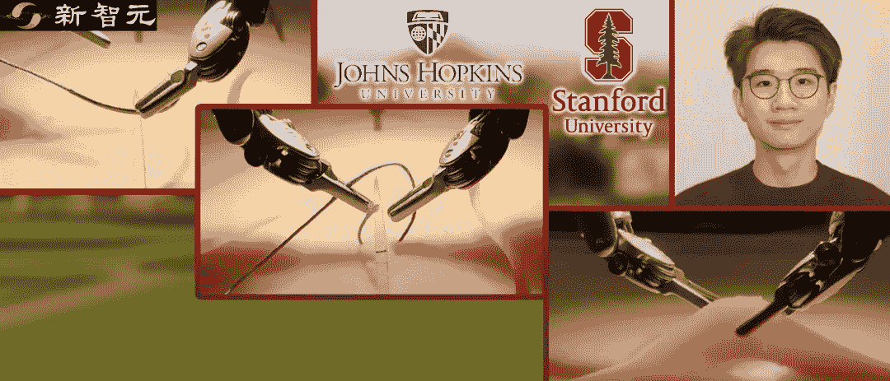
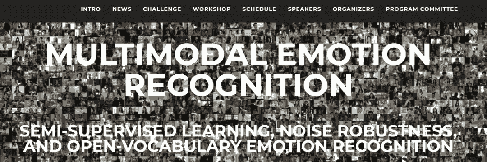
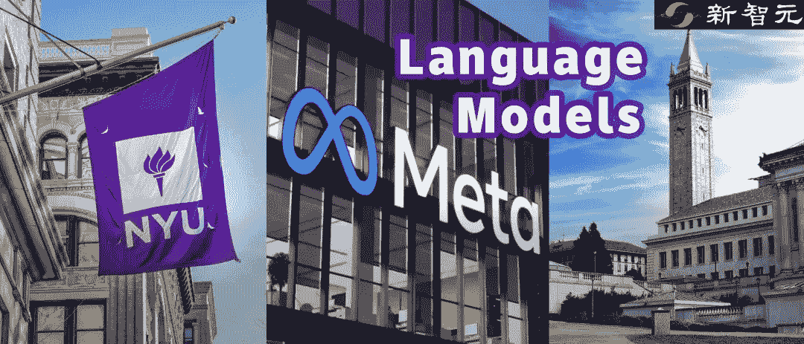
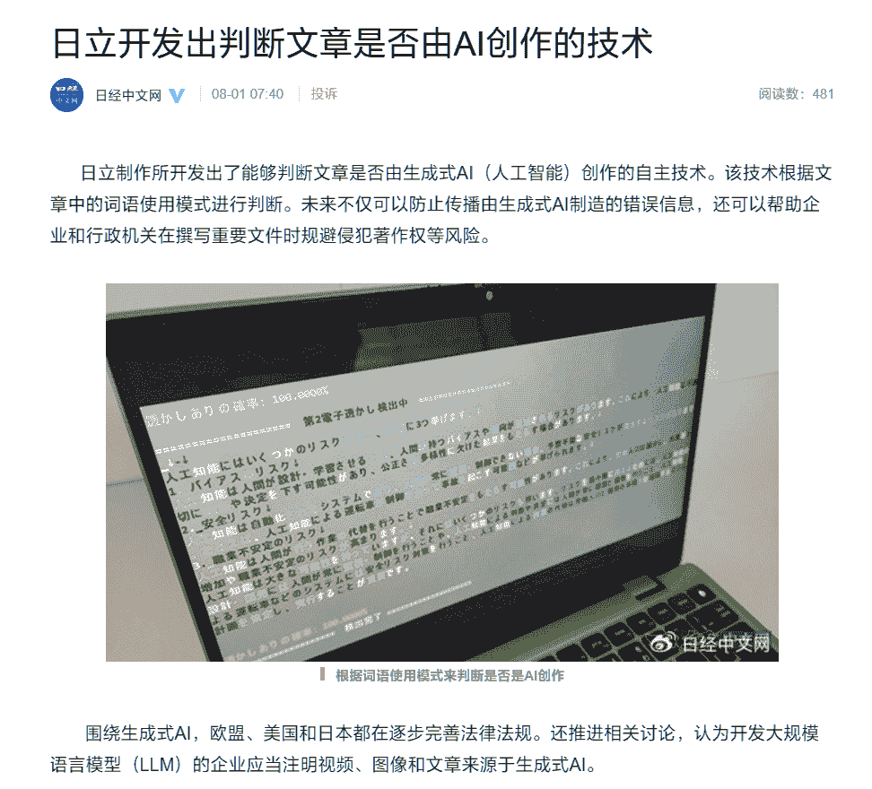
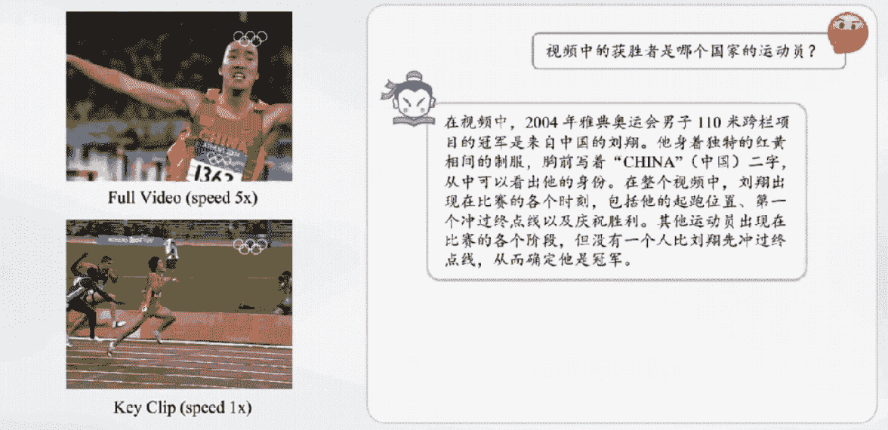
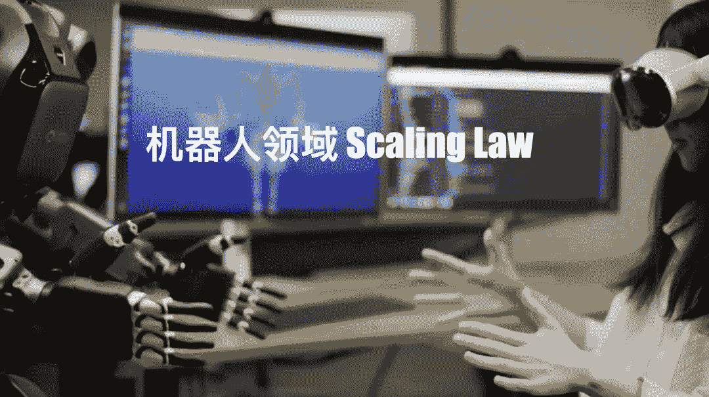
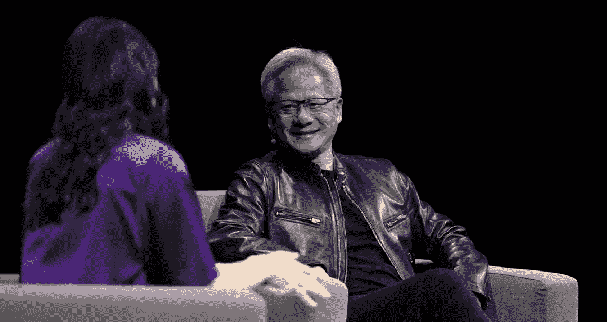

# 8.1 网友已玩疯：Midjourney V6.1 和摄影几乎没区别

> 来源：[https://agijuejin.feishu.cn/docx/Nq14dMSrEo4drexuJC7cNqe0ncg](https://agijuejin.feishu.cn/docx/Nq14dMSrEo4drexuJC7cNqe0ncg)

> [欢迎加入 AGI 掘金社群](https://sourl.co/miZUyT)

## 🌟 技术突破

### 💡 网友已玩疯：Midjourney V6.1 和摄影几乎没区别

AIGC开放社区｜[阅读原文](https://sourl.co/D4egTs)

Midjourney 平台推出 V6.1 版本，重点提升图片生成的细节准确性和连贯性，显著改善了人物特征和场景的真实感。新版本通过减少像素化、增强纹理细节，提升了图片质量。同时，加快了生成效率，增强了文本准确性，并引入个性化模型和本地代码管理功能，允许用户根据偏好定制图像风格。新增的"--q 2"模式提供了更高的图像质量和处理时间选项，而光影、色彩的改进使图像更加吸引人。此外，结合 Gen-3 Alpha 的视频模型，Midjourney V6.1 还能制作专业级视频，拓宽了应用场景。

### 💡 从炒菜到缝针！斯坦福炒虾团队打造自主「AI 达芬奇」，苦练神指当外科医生

新智元｜[阅读原文](https://sourl.co/wJ8SDh)

斯坦福大学与约翰霍普金斯的研究人员合作，使达芬奇机器人通过模仿学习掌握了基本外科手术技能，包括组织操作、针头处理和打结。研究团队利用大规模临床数据，采用相对动作公式克服了达芬奇系统的前向运动学不准确性，实现了手术操作的自主学习。实验显示，该机器人能适应新场景，展示出零样本泛化能力和在环境扰动下的稳定性，有望在未来扩展外科医生的能力。

### 💡 别只盯着 ChatGPT 版「Her」，在多模态 AI 拟人互动上，国内玩家也支棱起来了

机器之心｜[阅读原文](https://sourl.co/gaVwmP)

第二届多模态情感识别挑战赛（MER24）落幕，Soul App 团队在 Semi 赛道夺冠。该团队利用少量有标签和大量无标签数据训练模型，通过改进半监督学习技术，显著提升了情感识别性能。Soul App 在社交领域深耕 AI 技术，通过自研大模型和多模态情感识别能力，实现了人机沉浸式交互的新形态，推动了 AI 在真实人机交互场景中的应用。

### 💡 4 轮暴训，Llama 7B 击败 GPT-4！Meta 等让 LLM「分饰三角」自评自进化

新智元｜[阅读原文](https://sourl.co/5TWnNJ)

Meta、UC 伯克利和 NYU 的研究团队提出了一种新的元奖励语言模型，允许 AI 在训练中自我评价和优化，显著提升了性能。该模型在无需人工标注数据的情况下，通过自我反馈机制实现了对齐和性能提升。Llama-3-8B-Instruct 在经过四轮迭代训练后，在 AlpacaEval 2 和 Arena-Hard 上的表现超越了 GPT-4。研究还引入了长度控制机制，避免了响应过长的问题，并通过自动评估基准验证了元奖励方法的有效性。这项研究为实现无需人类监督的 AI 自我提升提供了有力证据。

### 💡 攻击成功率从 3% 到接近 100%，利用空格键可绕过 Meta AI 模型安全系统

IT之家｜[阅读原文](https://sourl.co/xgdA7p)

Meta 公司发布的 Prompt-Guard-86M 模型旨在检测和响应 AI 提示词注入攻击，但存在漏洞。安全研究员发现，通过在英文字母间添加空格并省略标点符号，可让模型忽略先前指令，从而绕过安全系统。该漏洞使攻击成功率从 3%飙升至接近 100%。此发现已通过 GitHub Issues 报告给 Meta，暴露了 AI 模型安全防护的脆弱性。

### 💡 专治 AI 大模型对错误答案“过于自信”，麻省理工学院提出新型高效低耗校准方法

IT之家｜[阅读原文](https://sourl.co/dgyqwm)

麻省理工学院与 MIT-IBM Watson AI Lab 的研究人员提出了一种名为“温度计”的 AI 校准方法，旨在解决大型语言模型在生成错误答案时过于自信的问题。该方法通过在大模型之上构建辅助模型进行校准，减少了计算需求同时保持准确性。“温度”作为缩放参数，调整模型信心与预测准确性一致。研究人员训练辅助模型预测特定任务的正确“温度”，以实现高效校准。未来计划将“温度计”应用于更复杂的文本生成任务和更大的模型。

### 💡 日立开发可识别文章是否由 AI 创作的技术

IT之家｜[阅读原文](https://sourl.co/6V6rUs)

日立制作所开发了一项新技术，能够通过分析文章中的词语使用模式，判断其是否由 AI 创作。这项技术将帮助预防错误信息的传播，并在撰写重要文件时避免著作权风险。日立还开发了结合多种词语选择规则的技术，以提高判断准确性。随着生成式 AI 生成内容的准确性问题日益凸显，该技术有望降低虚假信息传播风险，对维护信息真实性具有重要意义。

### 💡 国产多模态卷上下文长度：原生支持 24K 图文输入输出，图像视频理解对标 GPT4V

量子位｜[阅读原文](https://sourl.co/spn3cd)

国产多模态大模型书生·浦语灵笔（InternLM-XComposer）发布 2.5 版本，支持 24K 图文上下文输入输出，实现超过 20 轮的图文交互。该模型具备图像视频理解、网页创作、图文写作等能力，性能与 GPT4V 和 Gemini Pro 相当。IXC 2.5 通过训练长序列输出能力，提升了网页创作和文章生成的质量。模型兼容高分辨率图像理解、多轮多图对话和视频内容分析，利用开源数据集优化性能。此外，IXC 2.5 还增强了网页代码编写能力，支持网页截图转代码、语言指令创作网页和个人简历网页制作。社区提供量化、部署和微调代码支持，以及在线 demo 和本地运行代码。

### 💡 英伟达 GR00T 重大突破：利用 Apple Vision Pro 解决机器人领域最痛苦数据扩展难点

AI寒武纪｜[阅读原文](https://sourl.co/M8mS9H)

英伟达 GR00T 项目通过 Apple Vision Pro 技术，实现了人类对机器人的实时第一人称控制，并通过 RoboCasa 和 MimicGen 技术在仿真中扩展数据量，解决了机器人领域数据扩展的难题。该方法通过 GPU 加速仿真，将少量真实世界数据转化为大量训练样本，有效降低了数据采集成本，提高了效率，有望推动机器人学习领域的发展。

## 💫 企业动态

### 💡 周鸿祎突然宣布：360 安全大模型免费！

i黑马｜[阅读原文](https://sourl.co/2MG8df)

周鸿祎在第 12 届互联网安全大会上宣布，360 安全大模型将免费提供，以实现大模型的普及化。此举旨在让每个企业都能负担得起并有效利用大模型技术，推动其在安全产品中的应用。360 全线安全产品已整合大模型能力，对购买标准产品的用户免费提供。这一策略不仅顺应了大模型免费化的趋势，也有助于 360 扩大用户基础和业务增长。此前，360 已通过备案成为国内首家拥有两个大模型的科技企业，展现了其在 AI 领域的领先地位。

### 💡 马斯克否认 xAI 收购 Character.AI 计划

IT之家｜[阅读原文](https://sourl.co/xed8St)

据 The Information 报道，马斯克的人工智能初创公司 xAI 曾考虑收购聊天机器人制造商 Character.AI，以测试 Grok 聊天机器人。但马斯克通过社交媒体否认了这一报道。报道指出，即使交易未达成，小型 AI 初创公司如 Character.AI 在与大公司竞争时，仍面临高昂的模型训练和运行成本。随着 AI 需求增长，科技巨头与 AI 初创公司的合作可能成趋势。Character.AI 由前谷歌员工创立，提供收费和免费版本的聊天机器人服务，特别受 18-24 岁用户欢迎。

### 💡 阿里巴巴将推出人工智能对话式采购引擎，预计 9 月发布

鲲鹏1024｜[阅读原文](https://sourl.co/K9N4gu)

阿里巴巴国际数字商业集团宣布，将于 9 月推出一款人工智能对话式采购引擎，专为 B2B 电商业务设计，以提升中小企业全球采购流程的效率和直观性。该引擎将整合电商平台，通过理解自然语言转化为专业采购请求，并具备预测采购需求和提供建议的能力。此举预计将对人工智能、B2B 电商、电商平台技术等领域产生重大影响。

### 💡 巴西政府豪掷近 41 亿美元投资人工智能，以实现技术自主及高竞争力

IT之家｜[阅读原文](https://sourl.co/J92pLd)

巴西政府宣布将投资约 40.7 亿美元于 2024 至 2028 年间，以推动人工智能技术发展，实现技术自主并提升国际竞争力。该计划将支持公共卫生、农业、环境、商业和教育等多个部门，重点包括 AI 系统的开发和商业创新项目，同时投资 AI 基础设施和人才培养，旨在减少对外国 AI 工具的依赖，促进社会可持续发展。

## ✨ 行业观点

### 💡 英伟达黄仁勋：每个人都将拥有 AI 助手

超擎数智ChaoQing｜[阅读原文](https://sourl.co/NyJYq7)

在 SIGGRAPH 2024 大会上，NVIDIA CEO 黄仁勋与《连线》杂志的 Lauren Goode 探讨了 AI 增强人类生产力的前景，强调加速计算技术在提升能源效率方面的关键作用。黄仁勋预言，未来每个个体和企业都将拥有 AI 助手。NVIDIA 发布了多项创新技术，包括 NIM 微服务和 OpenUSD 新服务，旨在赋能开发者并推动 AI 在各行业的应用。黄仁勋还提到，生成式 AI 将变革机器人和自动驾驶汽车领域，而 Omniverse 系统将成为创造品牌资产的关键技术。

### 💡 相爱相杀：微软将 OpenAI 列为人工智能及搜索领域的竞争对手

IT之家｜[阅读原文](https://sourl.co/RbeZy6)

微软在 SEC 的 10-K 文件中正式将 OpenAI 列为人工智能和搜索领域的竞争对手，尽管微软是 OpenAI 的主要投资者和云服务提供商。OpenAI 最近发布了 SearchGPT 搜索引擎原型，表明两家公司虽有合作关系，但竞争态势已现。微软 CEO 萨蒂亚·纳德拉对 OpenAI CEO 的变动一无所知，微软放弃了 OpenAI 的无投票权董事会席位。微软还聘请了 DeepMind 联合创始人穆斯塔法·苏莱曼领导 AI 部门，显示微软在 AI 领域的战略调整。

### 💡 OpenAI COO：92%的 500 强公司使用 ChatGPT，劳动力市场或有新机会

Z Potentials｜[阅读原文](https://sourl.co/ngCsnX)

OpenAI 首席运营官 Brad Lightcap 在访谈中提到，92%的《财富》500 强公司正在使用 ChatGPT Enterprise，AI 技术正向多模态发展，将极大拓展其应用潜力。他预测劳动力市场将经历正常的更替周期，并随着 AI 的普及出现新的就业机会。同时，OpenAI 正与不同行业合作，推动技术发展和应用，如与 Stack Overflow 的 API 合作，以及在金融和制药行业的应用案例。Lightcap 认为，AI 技术的发展速度将超过企业变革的步伐，企业需要适应快速变化并利用 AI 带来的机遇。

### 💡 Omdia：人形机器人今年迎来突破之年，2027 年全球出货将破万台

半导体产业纵横｜[阅读原文](https://sourl.co/JNrp4A)

根据 Omdia 研究，预计到 2027 年全球人形机器人出货量将超 1 万台，2030 年达 38,000 台，年复合增长率 83%。2024 年标志着人形机器人技术的重大突破，仿生生成式人工智能推动下，关键技术如伺服电机和传感器进步，人工智能软件集成，使得人形机器人在汽车制造等领域应用潜力巨大。上海市政府发布方案，促进人工智能与制造业融合，创建人形机器人制造业创新中心，推动产业升级。尽管技术处于早期阶段，但人形机器人的发展前景广阔，与全球自动化需求增长相契合。

### 💡 《层峦叠嶂》AI 合成争议作品被取消获奖资格

AI未来｜[阅读原文](https://sourl.co/LQb7my)

四川省摄影家协会网季赛“寻觅‘绿色’”中，一幅名为《层峦叠嶂》的作品因被疑为 AI 合成而引发争议。组织方经调查后取消了该作品的三等奖获奖资格，并在官方微信公众号上撤下了该作品。此前，该作品因“太过工整”而受到质疑，赛事组委会对此表示重视，并承诺将优化评审流程，以确保赛事的公正性。