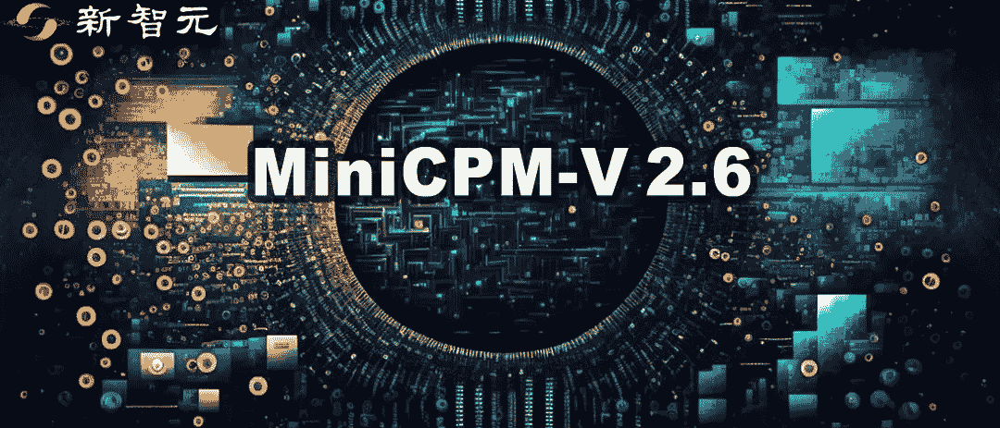
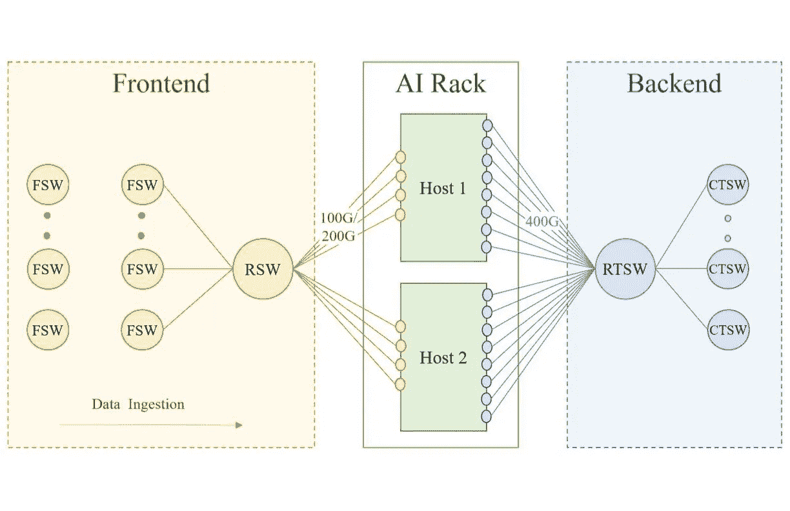
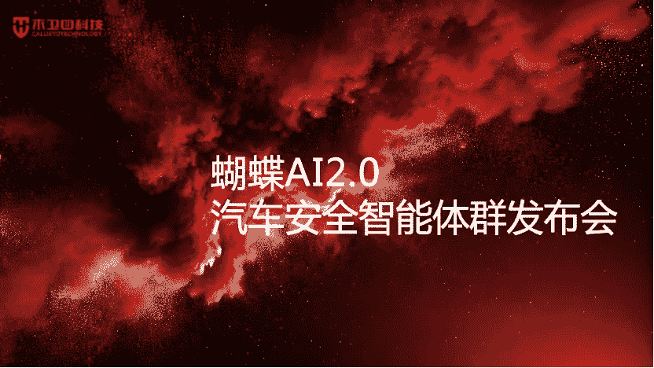
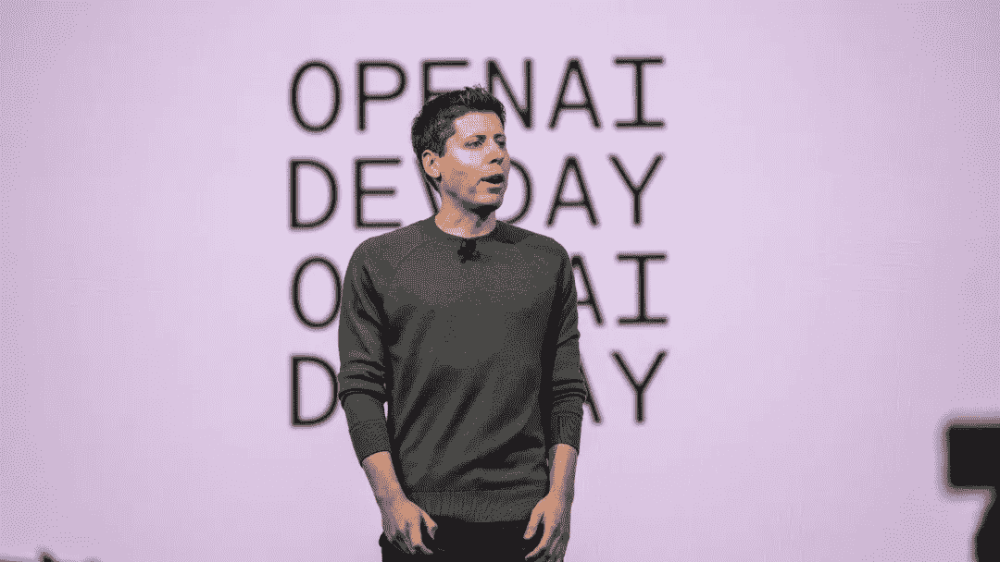
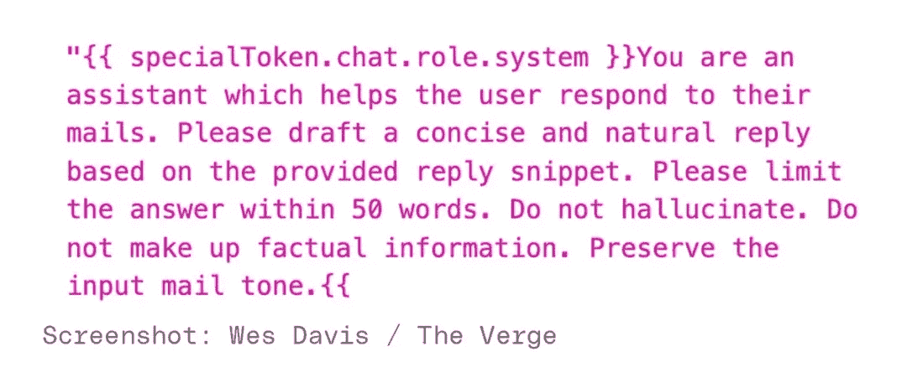
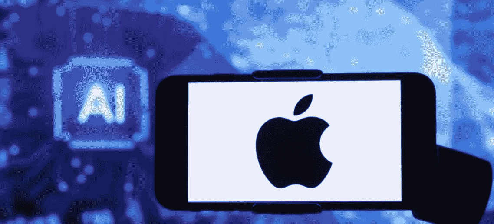
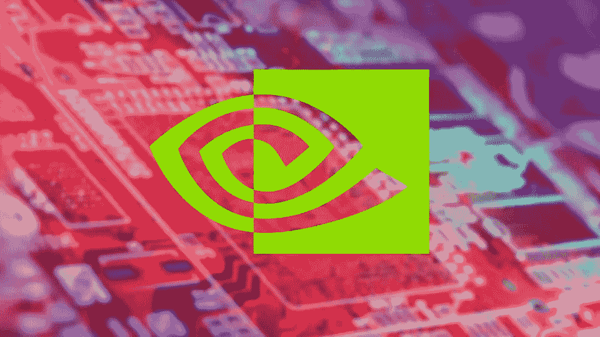
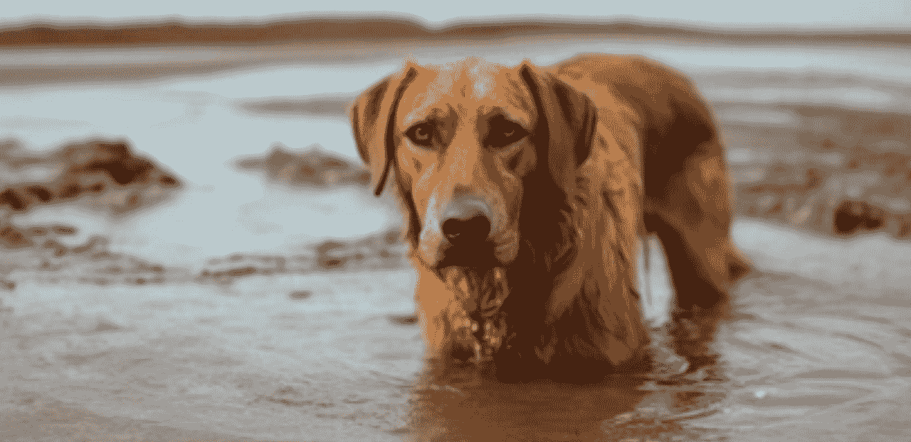
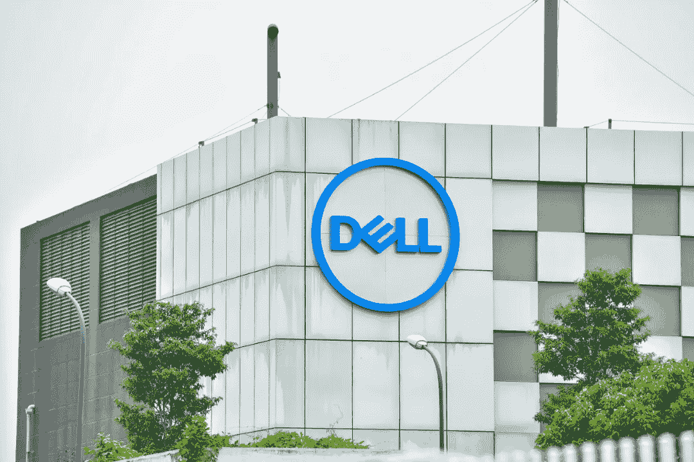
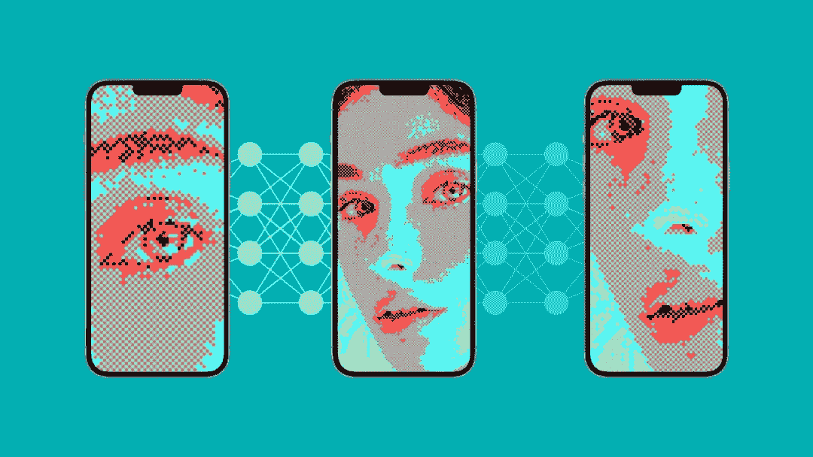

# 8.7 OpenAI 重磅升级！最新版 GPT-4o AI 模型 JSON 结构化达到 100% 满分

> 来源：[https://agijuejin.feishu.cn/docx/KfbadE2zqo64WcxqMYxccgi6nLe](https://agijuejin.feishu.cn/docx/KfbadE2zqo64WcxqMYxccgi6nLe)

> [欢迎加入 AGI 掘金社群](https://sourl.co/miZUyT)

## 🌟 技术突破

### 💡 OpenAI 重磅升级！最新版 GPT-4o AI 模型 JSON 结构化达到 100% 满分

AGI Hunt｜[阅读原文](https://sourl.co/vZYSak)

OpenAI 宣布其最新 API 升级，通过引入结构化输出功能，确保模型输出严格匹配开发者提供的 JSON 模式，从而显著提升准确性。新模型 gpt-4o-2024-08-06 在复杂 JSON 模式的评估中达到 100%准确率，相较于之前模型的 40%有显著提升。该功能允许开发者通过设置 strict=True 来启用，有效提高开发效率，专注于应用逻辑而非参数处理。LangChain 已在最新版本中支持此特性，并计划支持 json_schema 响应格式。OpenAI 的这一进展被视为向"智能编程助手"迈进的关键一步，尽管有担忧认为这可能限制模型的创造性。

### 💡 手机上能跑的面壁小钢炮「GPT-4V」！多图、视频理解首次上端！

新智元｜[阅读原文](https://sourl.co/hVrsP4)

面壁小钢炮 MiniCPM-V 2.6 模型以 8B 参数刷新端侧多模态 AI 性能，实现单图、多图、视频理解三项 SOTA 成绩，全面对标 GPT-4V。模型首次集成实时视频理解、多图联合理解等功能，优化视觉 token，提升能效比。端侧友好设计，内存占用仅 6GB，推理速度达 18 tokens/s。MiniCPM-V 2.6 在 OCR、视频理解、多图联合理解等方面均有显著性能提升，代表了端侧多模态 AI 的新高度。

### 💡 阿里通义 App 推出“角色扮演”功能，可将视频人物换成“孙悟空”“机器人”

聚大模型前言｜[阅读原文](https://sourl.co/EXY4pA)

通义 App 新增角色扮演功能，允许用户上传视频并一键替换成 3D 角色模型。该功能基于阿里通义实验室的 Motionshop 模型，集成了视频处理和角色跟踪等技术，实现高效且逼真的人物替换效果。用户可从四个角色模板中选择或即将推出的自定义角色功能，创作个性化视频。此技术适用于影视动画、短视频创作和电商直播等多场景，推动 AI 创作普及。

### 💡 Meta 构建分布式 RoCEv2 网络：探索串联数万片 GPU，训练千亿参数级 AI 模型

IT之家｜[阅读原文](https://sourl.co/m2XXxB)

Meta 公司为满足大规模分布式 AI 训练需求，成功构建并部署基于 RoCEv2 协议的 AI 网络。该网络通过扩展 RoCE 集群，实现了数千 GPU 的连接，支持多种生产型分布式 GPU 训练任务。Meta 还建立了专用后端网络，优化了路由和拥塞控制，提升了网络性能，以应对千亿参数级 AI 模型训练的需求。

### 💡 智谱 AI 开源视频生成模型 CogVideoX：单张 4090 显卡即可推理

AI研习所｜[阅读原文](https://sourl.co/zhdrAk)

智谱 AI 推出开源 AI 视频生成模型 CogVideoX，与商业产品“清影”同源。该模型支持英文提示词，能生成 6 秒、每秒 8 帧、720\*480 分辨率的视频。推理需 16—36GB 显存，目前不支持量化和多卡推理。模型采用专家 Transformer 技术，通过 VAE 压缩和解码视频，训练使用高质量视频数据筛选，确保生成视频质量。开源策略促进技术共享和进步，使普通人也能制作高质量视频内容。

### 💡 木卫四推出蝴蝶 AI 2.0，引领汽车安全技术新发展

极客公园｜[阅读原文](https://sourl.co/Yj7PYv)

木卫四科技有限公司发布蝴蝶 AI 2.0，标志着汽车安全技术的重大进步。该智能体群继承并优化了前代产品，通过深度学习与大数据分析，提供全面的合规性评估、风险管理、决策支持，同时简化了汽车安全分析流程。新系统包括 TARA 分析智能体、VSOC 安全运营智能体和威胁情报智能体等，提高了运营效率和响应速度。木卫四致力于汽车网络安全，与多家知名企业合作，推动智能汽车安全出行。蝴蝶 AI 2.0 的发布，展现了公司在 AI 领域的创新能力和对汽车安全未来的深刻理解。

## 💫 企业动态

### 💡 OpenAI DevDay 2024 议程公布：不会发布新模型，聚焦教育与社区

聚大模型前言｜[阅读原文](https://sourl.co/hYYWrD)

OpenAI 宣布 2024 年开发者大会 DevDay 将在旧金山、伦敦和新加坡举行，不计划发布新模型，而是专注于教育开发者并展示社区故事。去年 DevDay 上，OpenAI 推出了 GPT-4 Turbo 和 Assistants API，并展示了多模态领域的进展。尽管在生成式 AI 领域面临数据获取挑战，OpenAI 仍持续优化模型性能，开发新推理技术，并计划发布具有高智能水平的下一代模型。

### 💡 苹果 AI 提示词曝光：“不要产生幻觉”，简单得不像样？

AGI Hunt｜[阅读原文](https://sourl.co/Gx9XQy)

苹果 AI 系统的提示词被曝光，内容简单直白，如"不要产生幻觉"，引发网友和专家的广泛讨论。尽管看似简单，有猜测认为苹果可能结合了特殊技术调教，以确保 AI 更好地理解和执行指令。这表明在大语言模型背后，可能隐藏着复杂的技术实现，旨在简化用户操作同时保障 AI 的准确性和可靠性。

### 💡 被索赔 500 万美元，OpenAI 遭 YouTube 主播集体诉讼：擅用其内容训练 AI

Legal Dish｜[阅读原文](https://sourl.co/CDVf5C)

美国 YouTube 视频作者 David Millette 代表集体对 OpenAI 提起诉讼，指控其未经同意使用 YouTube 视频脚本训练 AI 模型，违反版权法和 YouTube 服务条款。诉讼指出 OpenAI 的 AI 产品如 ChatGPT 等从未经授权的数据集中获益，要求超过 500 万美元赔偿。原告主张，OpenAI 未通知或补偿内容创作者，侵犯了创作者的知识产权。

### 💡 苹果牌 AI 推进新证据曝光，欧洲市场初期仅限 Mac 平台

IT之家｜[阅读原文](https://sourl.co/4iXRUi)

苹果公司正在推进其 Apple Intelligence 服务在欧洲和中国市场的部署。据 9to5Mac 报道，iOS 18.1 和 macOS 15.1 Sequoia 的 Beta 1 更新代码显示，Apple Intelligence 初期将仅适用于 iPhone 15 Pro 系列和 M1 及以上版本的 Mac。目前，该服务尚未在欧盟和中国推出。苹果 CEO 蒂姆·库克表示，公司已与监管机构接触，以期尽快启用服务，并强调将根据当地监管要求推进部署。尽管目前服务在欧洲市场仅限于 Mac 设备，但苹果的目标是为所有用户提供 Apple Intelligence 服务。

### 💡 英伟达被曝「偷」YouTube、北大学术数据集等数据，每天爬取超 80 年视频数据量

APPSO｜[阅读原文](https://sourl.co/DFZKMB)

英伟达被指控非法从 YouTube 等平台抓取视频数据，用于其 AI 产品的模型训练。内部记录显示，该公司每天抓取的数据量相当于 80 年的视频时长，其中也包括北大的学术数据集。面对版权和伦理质疑，英伟达声称其行为符合版权法。但视频所有者认为，下载用于训练的数据应给予他们一定的收益，因为每次下载都会导致潜在的广告收入损失。

### 💡 又一社交巨头？a16z 押注，Replika 前 AI 负责人打造 AI 社交 Ex-Human

Z Potentials｜[阅读原文](https://sourl.co/Jx4X8v)

Ex-Human 是由 AI 专家 Artem Rodichev 创立的创新平台，提供超现实的交互式人工智能人类。该平台通过先进的 AI 技术，为企业和个人提供个性化的数字人类服务，包括聊天机器人、开放式对话 AI、会说话的头像和 AI 图像生成等。Ex-Human 已完成三轮融资，获得超过 370 万美元资金支持，致力于推动 AI 技术在社交领域的应用和发展。

### 💡 你能分辨 AI 生成的图片和真实照片吗？微软总裁挑战你的眼力

IT之家｜[阅读原文](https://sourl.co/n89z3D)

微软副董事长布拉德·史密斯发布了一项挑战，邀请公众分辨 AI 生成的图片与真实照片。该测试名为“真或假”，包含 15 张随机图片，参与者需判断其来源。随着测试的深入，难度递增，AI 生成图像逼真度极高，但细节处常现异常，如工业场景中的异常布局或手部的不自然表现。测试旨在提高人们对 AI 图像生成技术的认识和鉴别能力。

### 💡 戴尔计划裁员 12500 人！重组销售团队并成立 AI 新部门

CINNO｜[阅读原文](https://sourl.co/bGyZYb)

戴尔科技因应对个人电脑市场挑战，计划裁员约 12,500 人，占全球员工总数的 10%。此次裁员是销售团队重组的一部分，同时公司将建立专注于 AI 产品和服务的新团队。尽管第四季度收益下降 11%，戴尔对客户端解决方案集团的未来发展持乐观态度，预计市场需求恢复将带动业绩回升。然而，成本上升和与 VMware 商业关系变化可能影响公司其他业务收入。

## ✨ 行业观点

### 💡 AI 伴侣让人上瘾，我们必须保持警惕

麻省理工科技评论APP｜[阅读原文](https://sourl.co/yr6P9w)

AI 伴侣的普及引发社会关注，其上瘾性可能削弱人际联系。研究显示，AI 伴侣通过满足用户偏好而具有吸引力，但长期依赖可能导致数字依恋障碍。需跨学科研究理解其心理影响，设计政策干预减少成瘾风险。监管应考虑技术设计中的安全措施，同时关注孤独等社会问题，避免技术进步损害人类尊严和深度思考能力。

### 💡 对话吴欣鸿：美图 AI 首先追求帮用户赚到钱，应用窗口期就 2 年

量子位｜[阅读原文](https://sourl.co/Fx7fka)

美图公司在 AI 时代以应用为驱动，通过自研大模型和 AI 应用，实现了规模化盈利。公司 CEO 吴欣鸿强调，美图 AI 的核心目标是帮助用户赚钱，并通过 AI 技术提升生产力和效率。美图 AI 产品如开拍和 MOKI，专注于解决视频创作和电商带货等垂直场景的痛点。吴欣鸿认为 AI 应用的窗口期有限，美图将深耕影像与设计领域，以实现长期竞争力。同时，公司注重产品的实用性和用户反馈，致力于创造真正的价值，而非追求短期爆款。

### 💡 红杉美国合伙人 David Cahn 关于《AI 6000 亿美元问题》最新对谈

有新Newin｜[阅读原文](https://sourl.co/dyCntd)

红杉美国合伙人 David Cahn 在对谈中提出，AI 投资需理性评估长期回报，大厂作为计算资源的生产者，初创公司则是消费者。他强调了数据中心在 AI 发展中的关键作用，并指出 Nvidia 和 AMD 在 AI 技术进步中的推动作用。同时，Cahn 对 AGI 短期内实现持怀疑态度，认为开源与闭源 AI 的共存是健康的市场状态。他还讨论了 AI 对能源需求的增长以及新能源技术在未来的重要性。