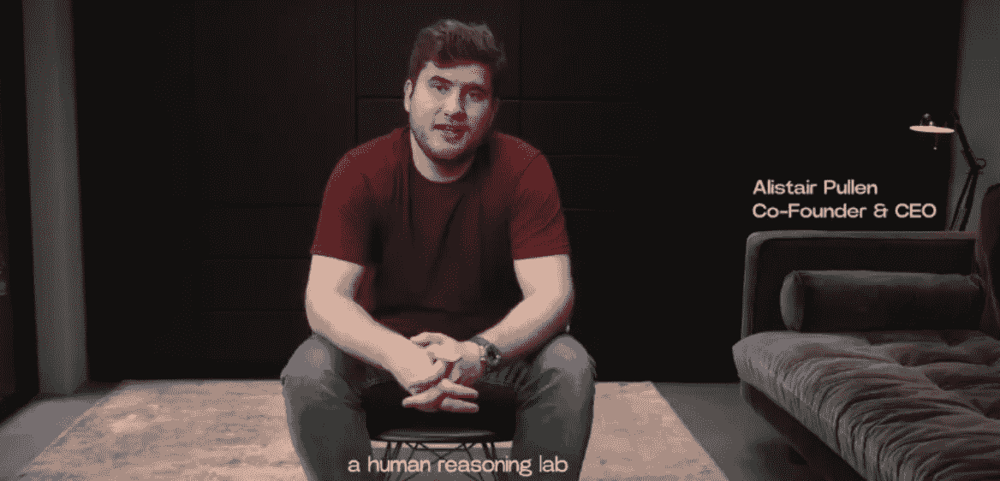
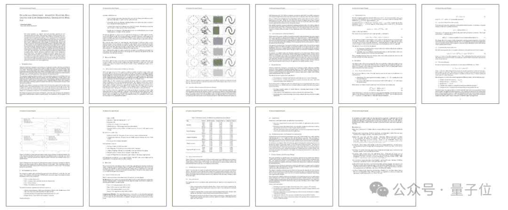
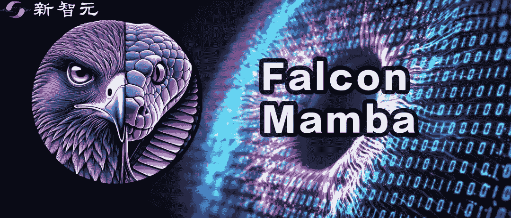
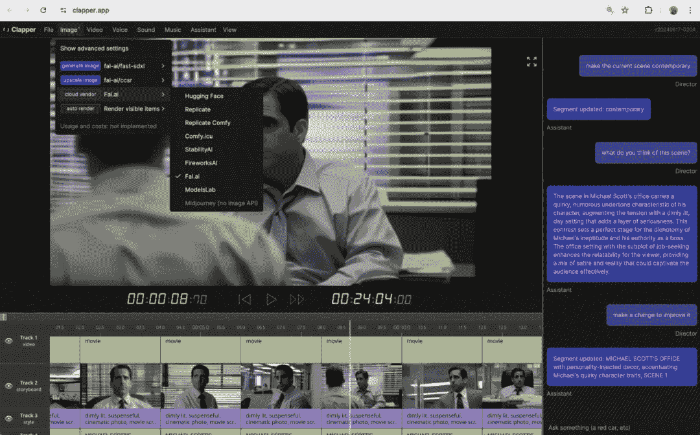
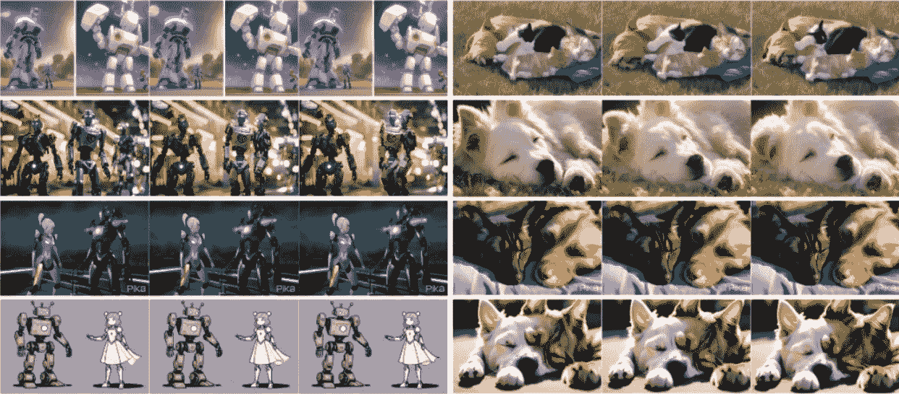
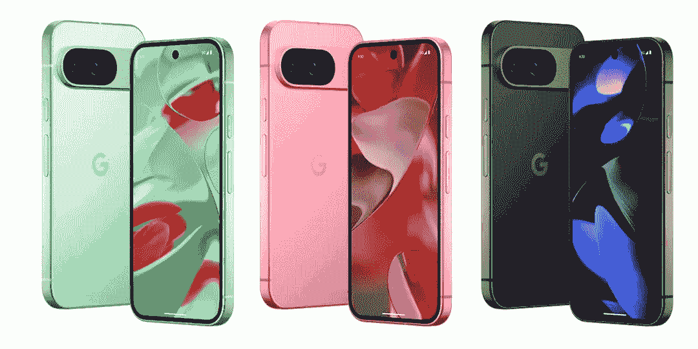
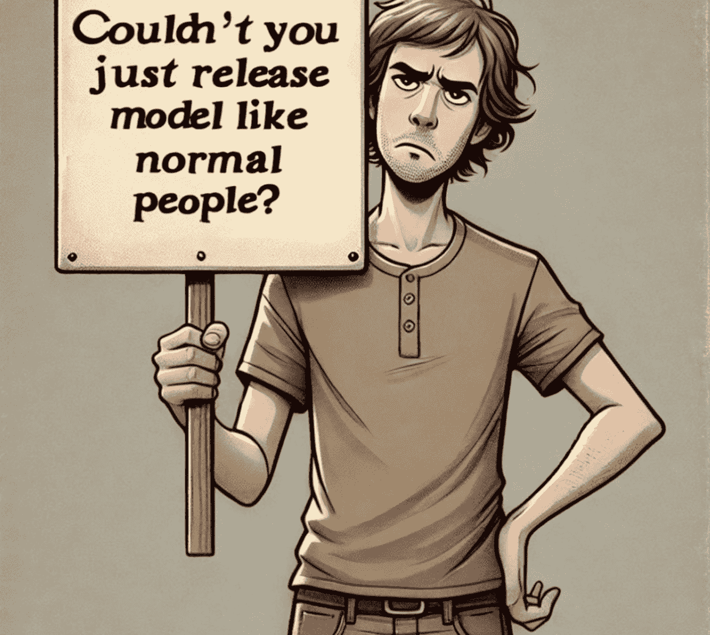
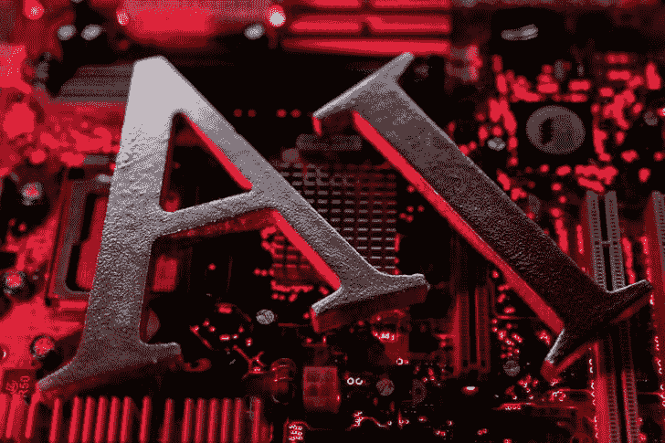
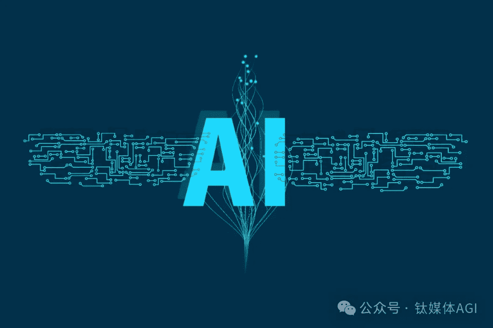

# 8.14 谷歌版 iPhone 要来了？AI 能力超苹果 2 年

> 来源：[https://agijuejin.feishu.cn/docx/QpS7d7oOCoYe8yxp5qwcauvdnKg](https://agijuejin.feishu.cn/docx/QpS7d7oOCoYe8yxp5qwcauvdnKg)

> [欢迎加入 AGI 掘金社群](https://sourl.co/miZUyT)

## 🌟 技术突破

### 💡 最强 AI 程序员砸饭碗：84 秒跑通代码，像人一样思考！团队仅 5 人

量子位｜[阅读原文](https://sourl.co/32vWR4)

Genie 是一款 AI 软件工程师，能在 84 秒内解决编程问题，其性能在 SWE-Bench 榜单中以 30.07%的解决率领先。Genie 通过模仿人类程序员的思考过程，使用专有数据集训练，实现了高效问题解决能力。背后的 Cosine 团队仅有 5 人，他们利用大模型支持和自我改进机制，使 Genie 在多数情况下能直接给出正确答案。Genie 的诞生标志着 AI 在编程领域的重大突破。

### 💡 首位 AI 科学家问世！已独立生成 10 篇学术论文，还顺手搞了 AI 审稿人

量子位｜[阅读原文](https://sourl.co/Cp9u5b)

Sakana AI 公司开发的 AI 科学家系统，能够自动完成从研究想法到论文撰写的全过程，已独立生成十篇学术论文，涵盖扩散模型、语言模型、Transformer 与强化学习结合等多个研究方向。每篇论文成本约 15 美元，AI 审稿人提供反馈以持续优化。尽管存在视觉能力不足、图表可读性差等挑战，该项目被视为加速科学进步的有前景工具。

### 💡 Mamba 再次挑战霸主 Transformer！首个通用 Mamba 架构大模型一鸣惊人

新智元｜[阅读原文](https://sourl.co/FDpJvd)

技术创新研究所(TII)开源了 Falcon Mamba 7B，这是首个通用的 Mamba 架构大模型，性能与 Transformer 匹敌，尤其在处理长文本方面显示出内存效率优势。该模型采用 SSLM 架构，无需额外内存即可生成大量文本，解决了 Transformer 在长文本处理上的难题。Falcon Mamba 7B 在多个基准测试中表现优异，超越了同尺寸的 Llama 3.1 8B 和 Mistral 7B 模型。它将通过 TII Falcon License 2.0 发布，支持企业级应用，如机器翻译和文本摘要等。

### 💡 开源 AI 视频工具，你只需要当导演，HuggingFace 工程师打造

机器之心｜[阅读原文](https://sourl.co/fuSTaG)

Clapper 是一款由 HuggingFace 工程师 Julian Bilcke 开发的开源 AI 视频编辑工具，旨在简化视频制作流程。用户无需视频编辑或 AI 工程技能，通过调整角色、场景等高级概念，利用 AI Agent 迭代故事。内置大模型如 GPT-4o 和 Claude 3.5，实现从文本到视频的自动转换。Clapper 提供了导演模式，允许用户通过命令控制 AI 制作电影。尽管功能强大，但视频效果仍有改进空间，如动作不自然和配乐质量。Clapper 在 GitHub 上获得 1100+ Star，为传统视频编辑软件提供了 AI 集成的新思路。

### 💡 我国科学家突破硅基闪存器件尺寸极限！

科技日报｜[阅读原文](https://sourl.co/AQf9Dv)

我国科学家在硅基闪存技术领域取得重大进展，首次实现 1Kb 纳秒超快闪存阵列集成验证，证明其超快特性可延伸至亚 10 纳米。该技术在 1Kb 存储规模下，非易失编程速度达到纳秒级，良率高达 98%，超出国际半导体技术标准。器件沟道最短达到 15 纳米，具备 20 纳秒超快编程能力、10 年数据保持和 10 万次循环寿命，推动了超快闪存技术的产业化发展。成果已在《自然·电子学》上发表。

### 💡 Waymo 扩展旧金山自动驾驶出租车服务至高速公路，并称能自主出入匝道口

DeepTech深科技｜[阅读原文](https://sourl.co/aWRKdZ)

Alphabet 子公司 Waymo 宣布将其自动驾驶出租车服务扩展至旧金山高速公路，允许员工乘坐无人驾驶汽车。这一举措不仅标志着 Waymo 在旧金山湾区服务范围的扩大，也为未来长距离无人驾驶服务打下基础。Waymo 在凤凰城高速公路上成功测试后，加州监管机构已允许其在高速公路上运营。尽管无人驾驶技术面临技术、监管和公众接受度挑战，Waymo 的这一进展显示了自动驾驶技术在复杂交通环境中的潜力和未来广泛应用的可能性。

### 💡 香港大学发布组合性文生视频基准，7 大类 20 项指标，让 20 个大模型一决雌雄

夕小瑶科技说｜[阅读原文](https://sourl.co/RwwuKy)

香港大学推出 T2V-CompBench，一个全新的文生视频大模型评估基准，包含 7 大类 20 项指标，对 20 个主流视频生成模型进行全面测评。该基准测试首次引入“组合性”概念，通过 700 个文本提示覆盖不同视频生成挑战，旨在优化模型在复杂动态场景下的表现。研究显示，尽管技术进步显著，商业模型整体优于开源模型，但所有模型在动态属性绑定和生成数字等任务上仍面临挑战。T2V-CompBench 的发布为文生视频技术的发展和优化提供了重要参考。

## 💫 企业动态

### 💡 谷歌版 iPhone 要来了？AI 能力超苹果 2 年

少数派｜[阅读原文](https://sourl.co/KW57ky)

谷歌提前两个月发布 Pixel 9 系列，北京时间 8 月 14 日凌晨亮相。新系列包括 Pixel 9、9 Pro、9 Pro XL 和 9 Pro Fold 四款机型，均搭载 Tensor G4 芯片，性能提升有限。设计上，Pixel 9 系列采用四面等宽屏幕边框，提供绿、粉、黑等配色。相机硬件升级，采用索尼 IMX858 传感器，前置摄像头达到 4200 万像素。Pixel 9 Pro Fold 折叠屏设备瘦身减重，内外屏尺寸分别为 6.3 英寸和 8 英寸。AI 功能方面，Pixel Screenshot 和 Add Me 功能提供智能截图和合照解决方案。同时，Pixel Buds Pro 2 和 Pixel Watch 3 等周边硬件也有所更新。

### 💡 尴尬！ChatGPT 官宣 GPT-4o 新模型，评论区翻车了…

量子位｜[阅读原文](https://sourl.co/YqK2mH)

ChatGPT 官方宣布最新版本 GPT-4o 模型上线，但用户普遍未察觉明显变化，评论区反响平平。新模型在特定问题下表现有所提升，但整体改进细微，主要在语气上更加人性化。安全防护有所加强，但 AI 越狱大师 Pliny 发现仍可破解。同时，OpenAI 内部围绕下一代模型"草莓 Q* 的行为艺术引起外界关注，但公众对此类行为艺术兴趣不高。

### 💡 AMD 6.65 亿美元收购欧洲最大私人 AI 实验室 Silo AI

IT之家｜[阅读原文](https://sourl.co/4UmQSP)

AMD 近日宣布以 6.65 亿美元全现金完成对欧洲最大私人 AI 实验室 Silo AI 的收购。这次收购是 AMD 在 AI 领域战略布局的关键一步，旨在加强其在 AI 及相关技术领域的领导地位。Silo AI 的加入将为 AMD 带来丰富的 AI 模型开发和集成经验，尤其是在大型语言模型方面，有助于提升客户在 AMD 平台上构建高性能 AI 解决方案的能力。Silo AI 的客户包括安联保险、飞利浦等，此次收购将推动 AMD 在开源生成式 AI 训练和应用软件开发上的进步。

### 💡 快手推出“飞船”App：基于“快意”AI 模型，主打虚拟陪伴

IT之家｜[阅读原文](https://sourl.co/J37vw5)

快手最新发布了基于自研"快意"AI 模型的"飞船"App，主打个性化虚拟陪伴。用户可以与 AI 助手进行自然语言对话，解答疑问，获取娱乐和创作灵感。App 支持创建和定制专属 AI 角色，提供内容创作辅助和高度定制化功能，同时具备语音交互能力，旨在提升用户的生活质量和工作效率。

### 💡 Profound 希望为品牌方提供 AI 搜索优化！目前已拿到 350 万美元种子轮投资

有新Newin｜[阅读原文](https://sourl.co/zSRFqi)

Profound 是一家专注于 AI 搜索优化的初创公司，旨在帮助品牌适应消费者使用 AI 聊天机器人进行搜索的新趋势。通过追踪品牌搜索查询，提供定制化的数据仪表盘，品牌能够了解 AI 系统如何对产品和品牌进行排名和推荐。公司由 James Cadwallader 和 Dylan Babbs 创立，已获得 350 万美元种子轮融资，计划用于招聘和技术开发。随着 AI 搜索的兴起，Profound 有望成为品牌在 AI 时代展示自身的重要工具。

## ✨ 行业观点

### 💡 马斯克和特朗普在 X 上的连线讲了啥？

励志二叔｜[阅读原文](https://sourl.co/kTevND)

特朗普和马斯克在 X 平台上的连线讨论了美国经济、政治和能源政策。特朗普计划重返政治舞台，承诺解决经济困境和通胀问题，提出激励企业在美国建厂创造就业。马斯克表示愿意帮助削减联邦支出，同时强调石油和天然气行业的重要性。两位还讨论了特斯拉的成就、高铁项目前景、人工智能发展以及教育政策变革，展望了美国在多个领域的未来发展。

### 💡 集体诉讼已受理：艺术家指控 Stability AI、Midjourney 等公司侵犯版权

IT之家｜[阅读原文](https://sourl.co/NCPVLp)

美国地方法院已批准多名艺术家对 Stability AI、Midjourney 等 AI 公司的集体诉讼继续进行，原告指控这些公司非法使用他们的版权作品来训练 AI。法官威廉·奥里克批准了对 Stability AI 的诱导性版权侵权索赔，同时受理了对 DeviantArt 和 Runway AI 的版权索赔，以及对 Midjourney 的版权和商标侵权索赔。不过，法官驳回了关于 AI 生成器违反《数字千年版权法》和 DeviantArt 违反服务条款的指控。涉及 4700 名艺术家的 Midjourney 案件中，原告认为公司存在误导内容，未经同意使用其作品。

### 💡 「AI 数据荒」雪上加霜！MIT：网页数据的公开共享正走向衰落

新智元｜[阅读原文](https://sourl.co/67AFAp)

MIT 研究发现，随着网页数据共享政策收紧，开源数据集如 C4、RefineWeb 和 Dolma 所依赖的网站越来越多地限制数据获取。这不仅对商用 AI 模型训练产生影响，也阻碍了学术和非营利研究。研究指出，数据共享空间的限制激增，许可协议的不对称性和不一致性问题显著，同时网络数据与 AI 模型训练用途存在不匹配问题。预测显示，开放网络数据的限制趋势将持续，对 AI 领域造成长远影响。

### 💡 AI+Companion：30 亿潜在用户市场，a16z 合伙人的三个投资逻辑

有新Newin｜[阅读原文](https://sourl.co/fxVkqS)

AI+陪伴领域用户增长迅猛，超越社交与游戏。a16z 看好其投资价值，基于三个逻辑：差异化、新的交互方式和个性化发展。AI 伴侣产品需提供独特体验，超越通用聊天，并通过多样化交互形式和个性化服务深化用户关系。市场潜力巨大，预计到 2030 年用户数将达 30 亿。

### 💡 ChatGPT 狂飙 600 多天后，中国有近 8 万家 AI 公司消失

钛媒体AGI｜[阅读原文](https://sourl.co/Aa5am5)

自 ChatGPT 发布以来，中国 AI 领域经历了企业数量的激增，但随之而来的是大量企业的注销或吊销。据统计，近 8 万家 AI 公司已消失，占新注册企业总量的 8.9%。这一现象背后是算力成本高、研发投入大、盈利能力不足等挑战。同时，市场融资遇冷，中美大模型技术差距及应用优化问题也成为行业关注的焦点。尽管如此，行业领袖认为这是新事物发展过程中的正常现象，未来 AI 市场将更加繁荣，但尾部企业将退出竞争。