# 8.15 OpenAI 找回场子：chatgpt-4o-latest AI 模型力压谷歌 Gemini 1.5 Pro，多项跑分重夺第一

> 来源：[https://agijuejin.feishu.cn/docx/Vh69dfFlRoEe2UxiEnWcPWgpnhd](https://agijuejin.feishu.cn/docx/Vh69dfFlRoEe2UxiEnWcPWgpnhd)

> [欢迎加入 AGI 掘金社群](https://sourl.co/miZUyT)

## 🌟 技术突破

### 💡 OpenAI 找回场子：chatgpt-4o-latest AI 模型多项跑分力压谷歌 Gemini 1.5 Pro

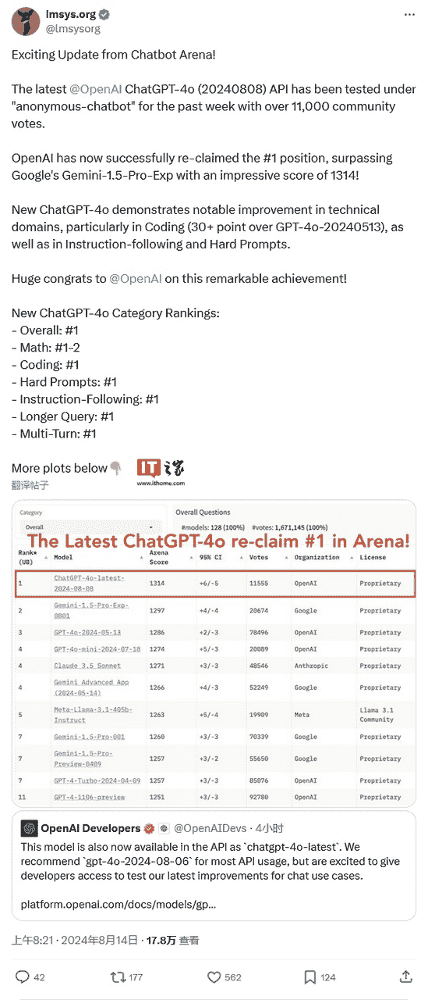

IT之家｜[阅读原文](https://sourl.co/FN2zY5)

OpenAI 公司最新发布的 chatgpt-4o-latest AI 模型，在 LMSYS 的聊天机器人竞技场中以 1314 分的成绩超越谷歌的 Gemini 1.5 Pro 模型，重夺第一名。该模型支持高达 128000 个词元的输入和 16384 个词元的输出，显著提升了编码、指令遵循和硬提示方面的表现。这一成绩标志着 OpenAI 在 AI 领域的技术领先地位得到进一步巩固。

### 💡 全球首个 AI 流媒体音乐 App 来了！中国公司昆仑万维推出 Melodio

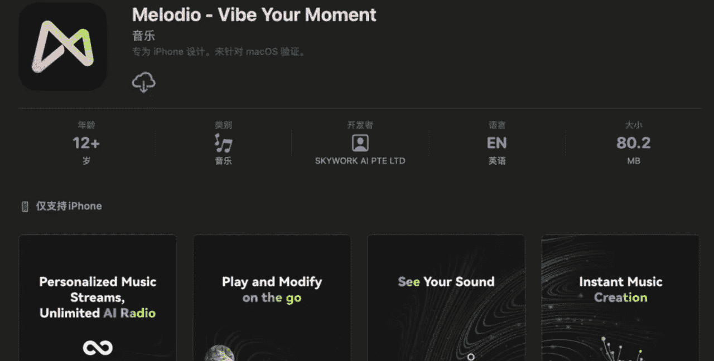

量子位｜[阅读原文](https://sourl.co/fBKZGe)

昆仑万维开发的 Melodio 是全球首个 AI 流媒体音乐 App，支持无限流式音乐生成，用户可通过 Prompt 定制音乐风格。App 界面简洁，提供歌曲参考模式和歌词查询功能。此外，昆仑万维还推出了 AI 音乐创作平台 Mureka，简化音乐创作流程，支持音乐二次创作和销售，具有创作证明。两款产品均基于昆仑万维的 Sora 架构，实现行业领先的音质和自然度。昆仑万维凭借 16 年出海经验，其 AI 音乐产品迅速打入海外市场，推动音乐创作民主化，为音乐爱好者和专业人士提供创作灵感和便利。

### 💡 世界最强智能体 Agent Q 发布：较 LLama 3 性能提升了 340%

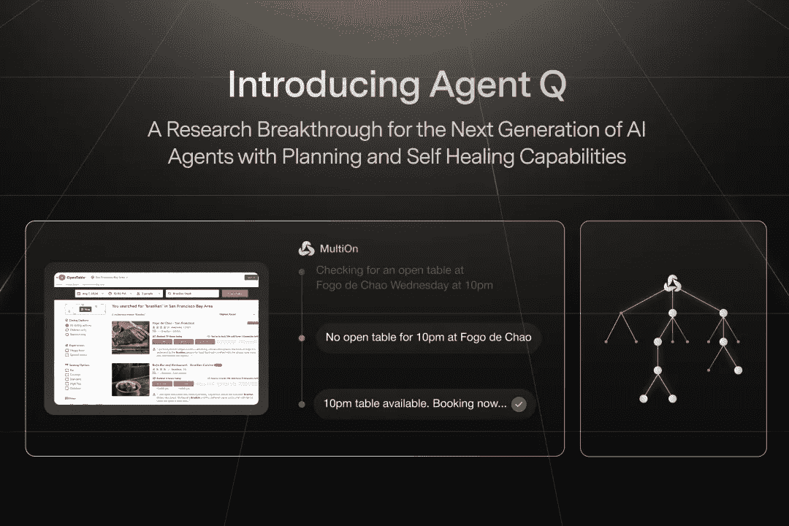

AI寒武纪｜[阅读原文](https://sourl.co/Zx72cg)

MultiOn AI 公司推出 Agent Q，一款性能超越 LLama 3 的下一代 AI 代理。Agent Q 具备自我监督和自我修复能力，通过自我对弈和互联网强化学习实现自我提升。它利用树搜索和评价模型优化行动策略，使用零样本视觉语言模型进行结果验证。Agent Q 在模拟和现实应用中表现出色，尤其在在线预订任务中，零样本性能显著提升，显示出其在复杂环境中的卓越能力。研究还探讨了模型微调和搜索方法的改进，以及安全性和用户参与的重要性。

### 💡 苹果大模型新成果：GPT-4o 扮演用户，考察大模型工具调用，网友：Siri 也要努力

量子位｜[阅读原文](https://sourl.co/NS2xg3)

苹果团队发布 ToolSandbox，一套评估大模型工具调用能力的开源 Benchmark。该测试通过场景化和交互式方法，模拟真实环境，引入对话交互和状态依赖等关键场景。GPT-4o 在测试中表现突出，整体得分最高，尤其在鲁棒性方面。研究可能为 Siri 等智能助手提供研发方向。ToolSandbox 关注模型在多工具调用、多轮对话和状态依赖任务上的表现，发现大模型在应对复杂交互场景时仍面临挑战。

### 💡 没有等来 OpenAI 开源 GPT-4o，等来了开源版 VITA

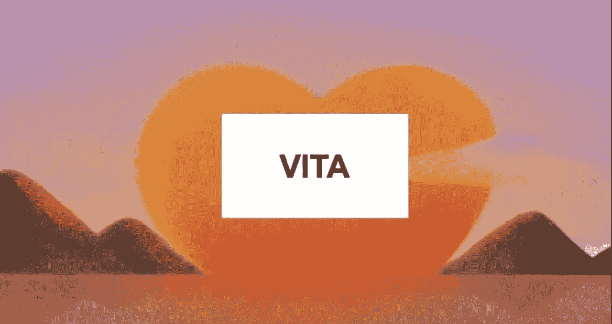

机器之心｜[阅读原文](https://sourl.co/akZRUy)

腾讯优图实验室等机构研究者推出首个开源多模态大语言模型 VITA，能处理视频、图像、文本和音频。基于 Mixtral 8×7B，扩展汉语词汇量并进行双语微调，通过多任务学习赋予视觉和音频能力。VITA 在多语言、视觉和音频理解上表现卓越，提升了自然多模态人机交互体验，采用复式部署，实现环境输入跟踪和用户查询响应，为开源社区在多模态理解和交互领域提供重要贡献。

### 💡 苹果新专利探索智能戒指生态：无缝串联 iPhone、Mac 等设备

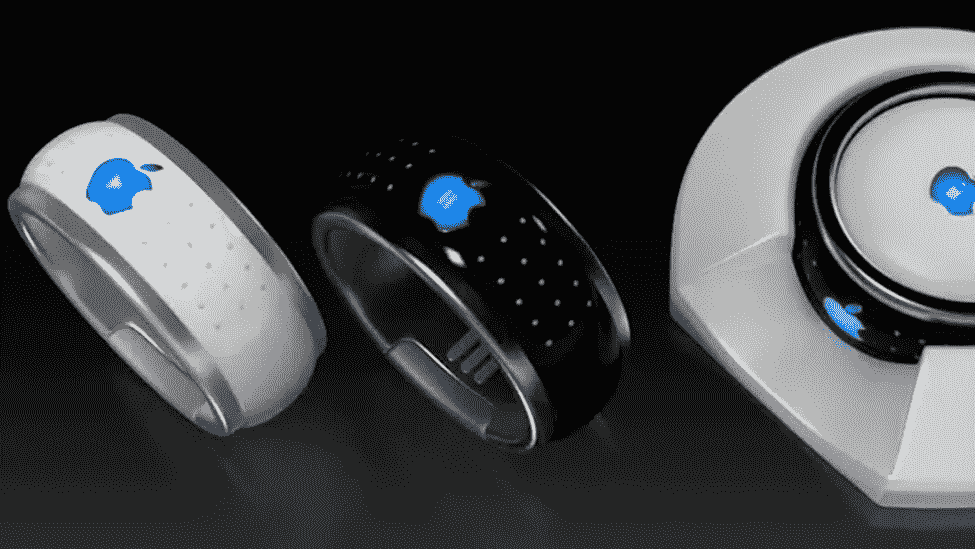

甬江知道｜[阅读原文](https://sourl.co/MP7Saj)

苹果公司获得一项新专利，该智能戒指不仅能监测用户健康状况，还能与 Mac、电视、智能眼镜等设备协同工作。专利号 12061680 的系统允许设备间通过无线通信电路相互控制和信息传递。戒指设备可独立操作，执行健康监测，并通过传感器收集环境和用户输入数据。此外，戒指能跟踪手指移动，提供交互信息，用于控制其他设备，展示苹果在可穿戴设备领域的创新和拓展。

### 💡 古尔曼：苹果计划最早于 2026 年推出桌面机器人，定价约 1000 美元

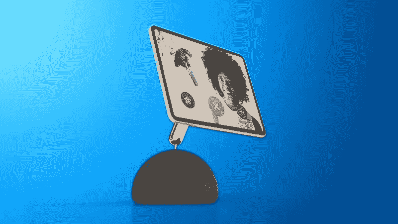

IT之家｜[阅读原文](https://sourl.co/jziJb5)

据彭博社记者马克·古尔曼报道，苹果正积极研发桌面机器人，预计 2026 或 2027 年推出。这款设备将配备 iPad 式大屏幕和机械臂，支持智能家居控制、视频会议和安全监控。搭载 Siri 和 Apple Intelligence 技术，能响应语音指令并识别声音，自动调整屏幕方向。项目由技术副总裁凯文·林奇领导，目标售价约 1000 美元，具体计划可能根据研发进展调整。

## 💫 企业动态

### 💡 马斯克突发新版大模型，牺牲特斯拉资源叫板 OpenAI，Grok-2 一手实测来了

量子位｜[阅读原文](https://sourl.co/2BCZjt)

Elon Musk 的 xAI 公司推出了 Grok-2 大模型，其测试版 Grok-2 mini 已在 𝕏 平台上线。Grok-2 在多个领域表现出色，尤其在视觉数学推理方面达到 SOTA 水平。该模型能访问实时数据，进行新闻总结和趣味吐槽，还能接入 AI 生图模型 Flux.1。尽管 Grok-2 性能显著，马斯克从特斯拉转移资源至 xAI 引发股东不满，目前相关案件正在审理中。

### 💡 谷歌版 Her 大翻车：试了 3 次且换手机才成功…网友：我手动只需 10 秒

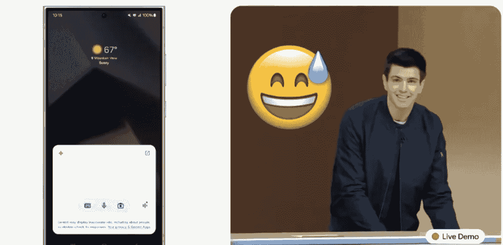

量子位｜[阅读原文](https://sourl.co/mcfsUw)

谷歌推出的智能助手 Gemini Live 在发布演示中遭遇失败，需三次尝试并更换手机才成功。该产品功能与 OpenAI 的 GPT-4o 相似，包括拍照问答和实时对话等，但现场演示的尴尬表现引发网友和媒体的广泛讨论。尽管 Gemini Live 在某些操作中表现出色，如快速解决汽车音频系统问题，但其交互方式和云端运行模式仍受质疑。谷歌在大模型时代似乎难以跟上 OpenAI 的步伐，业界对其技术发展和市场表现持续关注。

### 💡 超级 AI 即将诞生？史上最强超算 9 月上线，英伟达最强芯片加持

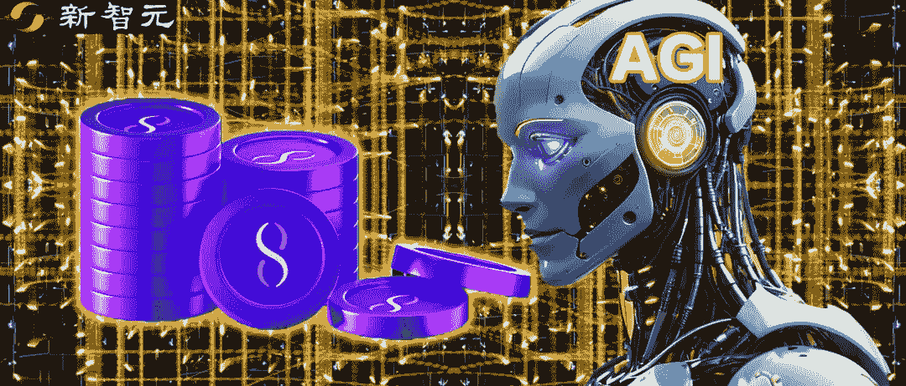

新智元｜[阅读原文](https://sourl.co/f75pyb)

SingularityNET 公司即将在 9 月启动一台具有历史意义的超级计算机，旨在加速人类级别人工智能的发展。这台超算将搭载英伟达最强 GPU 和 AMD 处理器，构建多层次认知计算网，支持深度神经网络和 AI 系统训练。它将推动 AI 从大数据学习向更高级的非模仿性机器思维转变，实现持续学习、无缝泛化和自我改进。预计到 2027 年，AI 将达到或超越人类智能水平。

### 💡 图森未来将打造《三体》系列动画长篇电影及视频游戏：正式进军生成式 AI 应用领域

IT之家｜[阅读原文](https://sourl.co/TNTVRi)

自动驾驶公司图森未来宣布与上海三体动漫合作，开发《三体》系列动画电影和视频游戏。同时，图森未来成立新业务部门，正式进入生成式 AI 应用领域，利用自动驾驶技术积累，专注于媒体和游戏领域的 AI 应用。公司总裁吕程表示，这将推动新技术商业化，放大人类创造力，缩短内容开发周期。图森未来将继续推动自动驾驶技术商业化，重视亚太地区和全球市场。

### 💡 Keep 推出运动手表，能否挑战 Garmin 和 Apple Watch

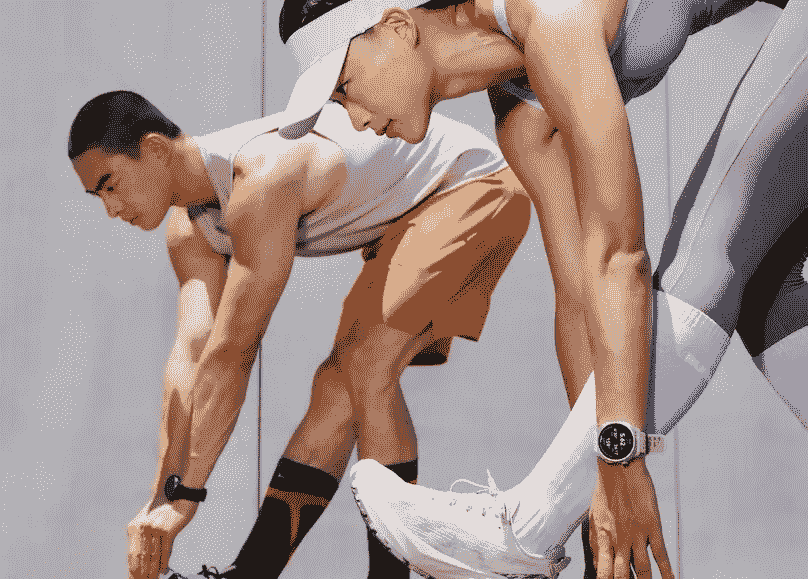

极客公园｜[阅读原文](https://sourl.co/FfvT5s)

Keep 推出智能手表，旨在利用其在运动健康领域的专业性，满足用户对运动表现提升的需求。与 Garmin 和 Apple Watch 等品牌竞争，Keep 手表专注于运动数据分析和专业运动功能，如精准定位和心率监测，以期在智能手表市场开辟新的增长点。Keep Watch Pilot 1 的推出，是 Keep 服务用户核心需求，深化业务的一步，也标志着公司从全民健身到专业运动领域的战略转型。

## ✨ 行业观点

### 💡 OpenAI 首席战略官 Jason Kwon：不会一夜之间突然发布一个“包罗万象”的 AI

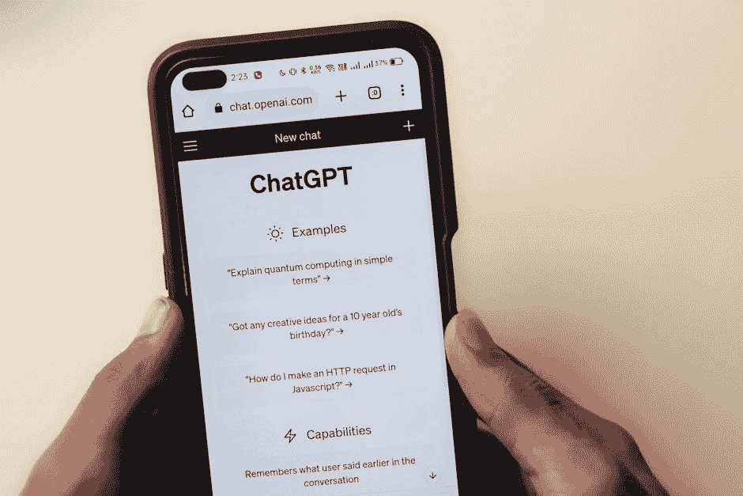

IT之家｜[阅读原文](https://sourl.co/BMVTGq)

OpenAI 首席战略官 Jason Kwon 在接受采访时表示，通用人工智能（AGI）可能在几年内实现，但不会突然全面推出以避免社会冲击。他强调，尽管技术进步迅速，但需要谨慎管理以防止负面后果。Kwon 认为企业应准备应对 AGI 的潜在威胁，并主张 AI 应受到监管。他负责提供关于 AGI 影响的见解，为法律制定提供建议，并指导与全球政府的合作。

### 💡 大模型开闭源之争，争的是什么？

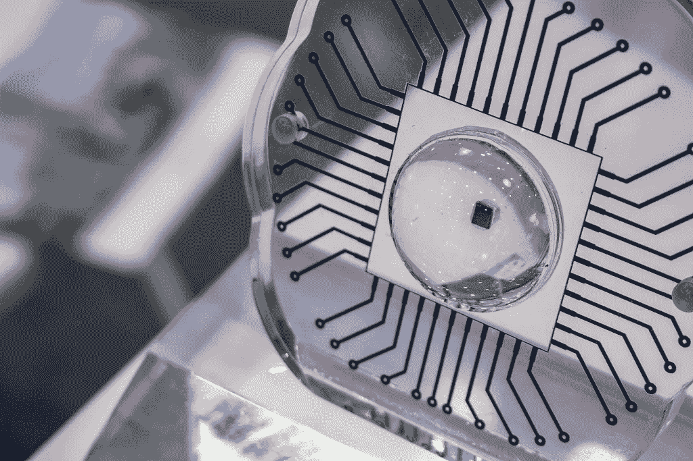

财经杂志｜[阅读原文](https://sourl.co/9v97Ew)

中美 AI 产业围绕大模型开源与闭源的争论激烈。开源模型以社区贡献促进技术迭代，而闭源模型则以商业化和性能优势为卖点。企业如百度、OpenAI 倾向于闭源以快速商业化，而阿里云、Meta 选择开源以扩大市场。开源与闭源各有市场定位，长期共存。开源模型虽免费但需自行调整，闭源模型提供成熟服务但需付费。性能是成本的决定因素，闭源模型长期看可能更具成本效益。企业客户更关注效果、性能、价格和安全，而非单一的开源或闭源属性。未来市场将见证开源与闭源模型的持续竞争与共存。

### 💡 前谷歌 CEO：谷歌落后 OpenAI，因为员工一周只来公司一天

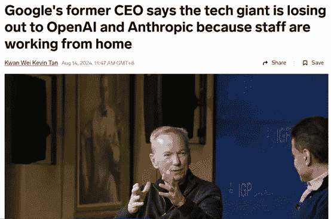

AIGC开放社区｜[阅读原文](https://sourl.co/PXbGwk)

前谷歌 CEO Eric Schmidt 认为，谷歌在生成式 AI 领域落后于 OpenAI，部分原因是员工一周只来公司一天的远程工作模式。Schmidt 在斯坦福大学演讲中指出，这种工作方式导致员工更重视家庭而非工作成就。他还提到，谷歌的领导层对技术创新失去兴趣，而 OpenAI 团队即使采用远程工作，也未失去创新动力。这一观点在科技圈引发热议，有支持也有反对的声音。Schmidt 曾对谷歌早期发展做出重大贡献，推动公司从搜索引擎向多个领域的扩展，包括开发 Android、收购 YouTube 等。

### 💡 陶哲轩：AI 将催生出一个大数学时代

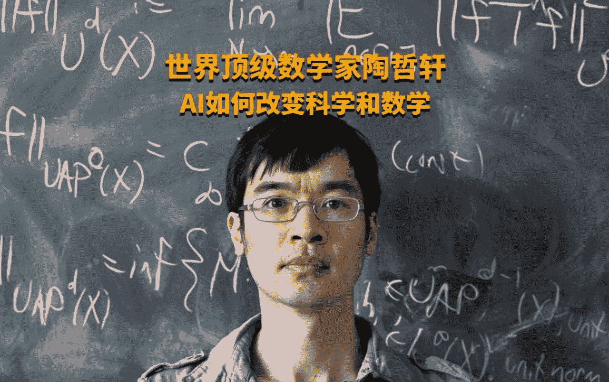

学术头条｜[阅读原文](https://sourl.co/ChDd5V)

菲尔兹奖得主陶哲轩在牛津数学公开讲座中展望了人工智能在数学领域的革命性影响。他指出 AI 作为猜测机器，在数学证明和计算中具有巨大潜力，尽管当前存在准确性和可靠性问题。陶哲轩认为 AI 将推动大型数学项目的发展，与数学产生协同效应，催生大数学时代。同时，他强调安全性和独立验证的重要性，特别是在医疗和财务决策等高风险领域。AI 在科学领域的应用前景广阔，特别是在药物设计和材料科学中，有望减少试验成本和加速科学发现。

### 💡 楼天城谈 Robotaxi：“L2 越厉害，就离 L4 越远”

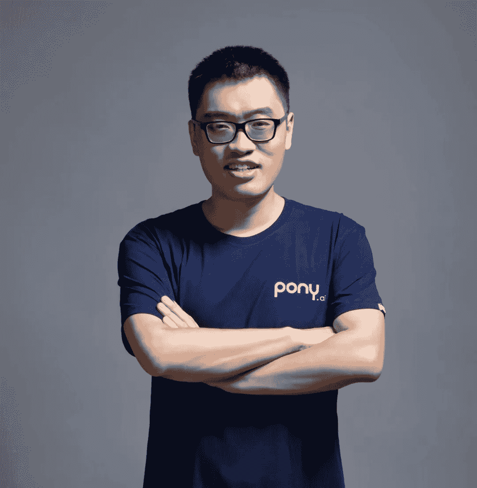

腾讯汽车｜[阅读原文](https://sourl.co/NSuHRh)

小马智行 CTO 楼天城在访谈中分享了对 Robotaxi 和自动驾驶发展的深刻见解。他指出 L2 级辅助驾驶的强化实际上可能远离 L4 级全自动驾驶的目标，因为两者技术路线和目标有本质区别。楼天城认为，实现 L4 级自动驾驶需要车辆在长时间内无需人工干预，而 L2 级更注重辅助功能。他还提到，自动驾驶技术的发展不仅仅是技术突破，还涉及到成本、数据量和车辆智能化程度的考量。楼天城预测，Robotaxi 在未来三到五年内将在多个城市实现大规模运营。