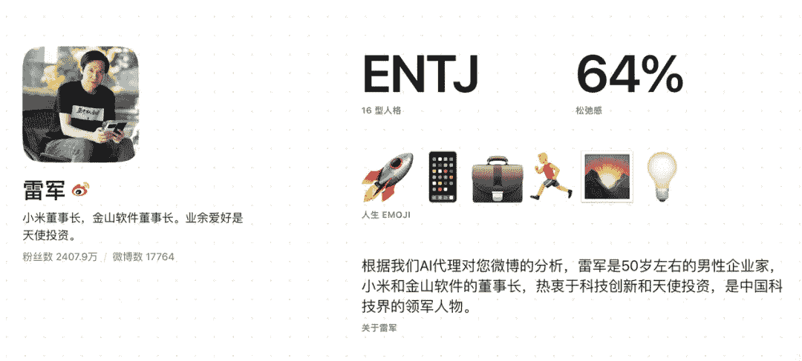
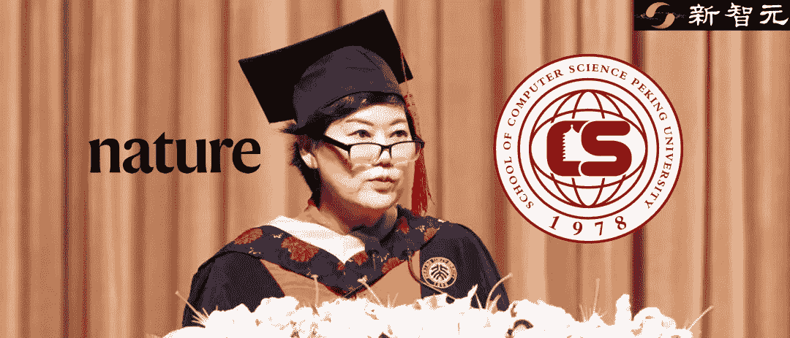
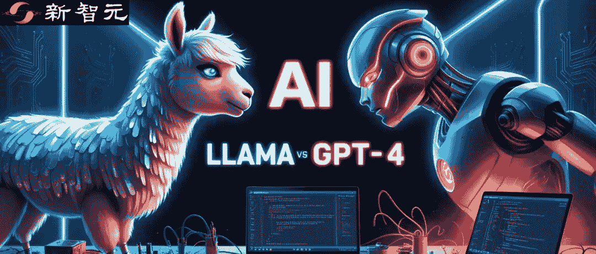
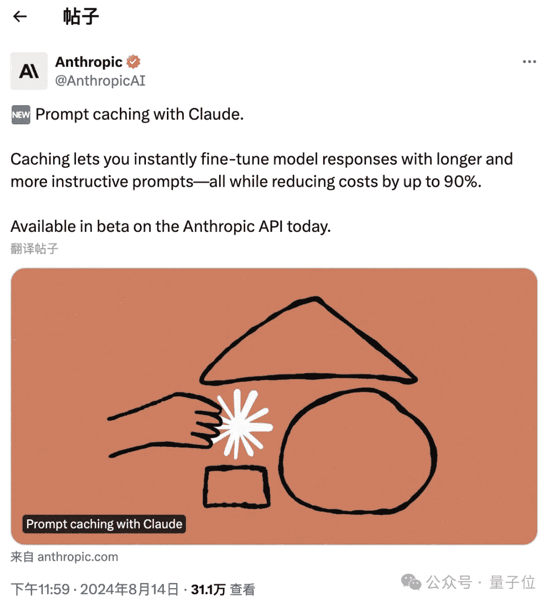
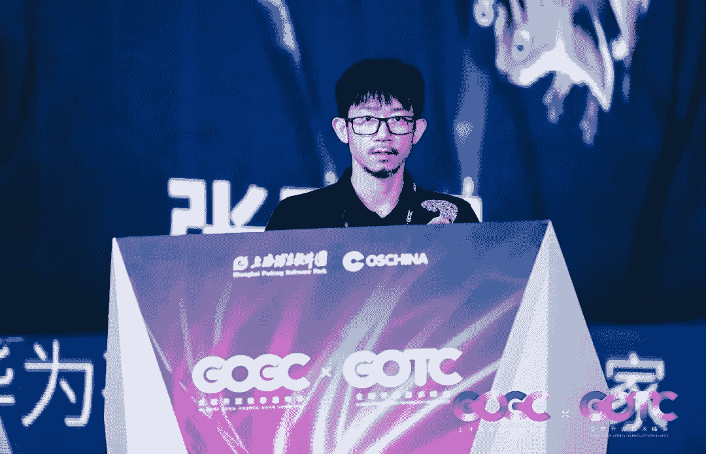
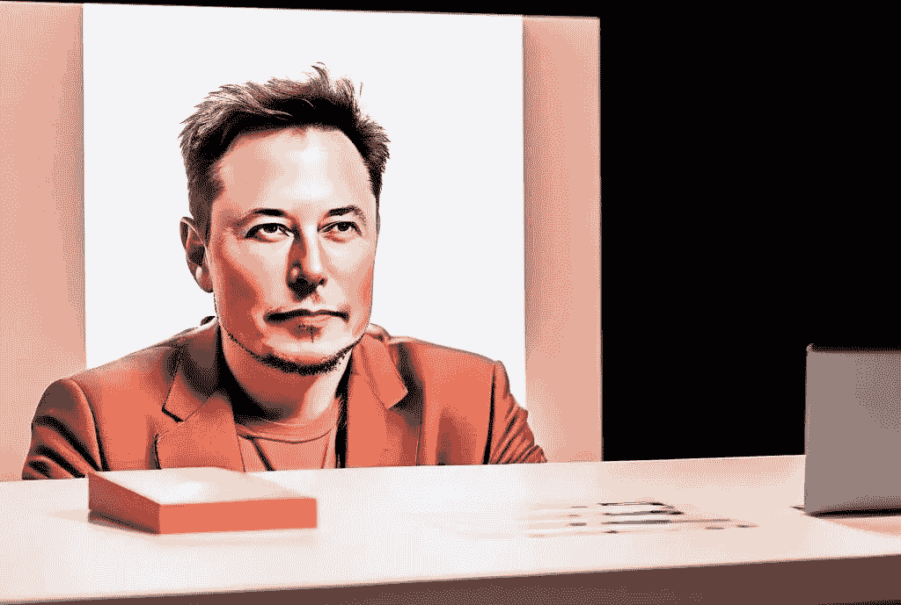
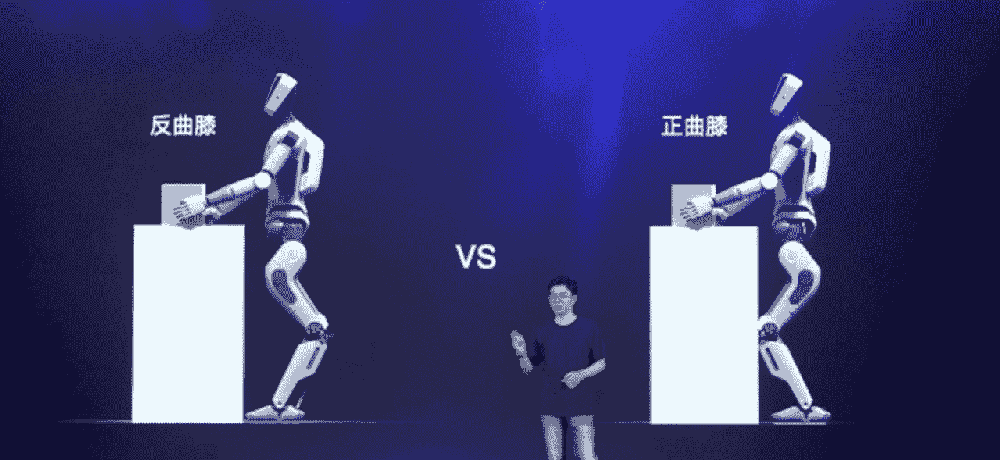
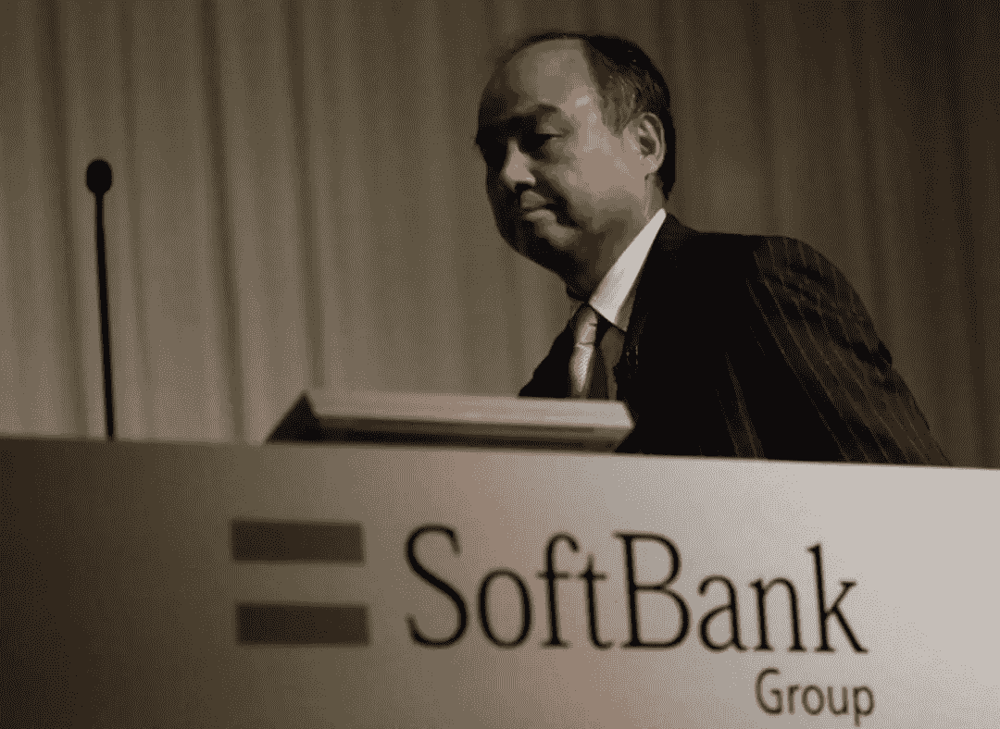
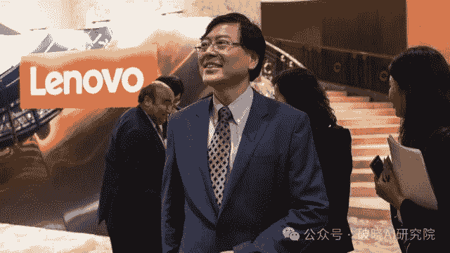

# 8.16 笑死！马斯克成 Grok2 最大受害者，恶搞图满天飞

> 来源：[https://agijuejin.feishu.cn/docx/VFFRdnj5zoep5LxQiF1c0Cv7nYf](https://agijuejin.feishu.cn/docx/VFFRdnj5zoep5LxQiF1c0Cv7nYf)

> [欢迎加入 AGI 掘金社群](https://sourl.co/miZUyT)

## 🌟 技术突破

### 💡 笑死！马斯克成 Grok2 最大受害者，恶搞图满天飞

量子位｜[阅读原文](https://sourl.co/xJCLbr)

Grok 2.0 AI 模型上线引发网络恶搞热潮，马斯克成为焦点。用户通过模型生成了各种荒诞不经的马斯克形象，包括与名人互动的虚构场景。Grok 2.0 的逼真 AI 生图功能由 Flux.1 提供支持，与 Stable Diffusion 同源。模型虽设安全限制，但版权和敏感内容问题仍存。科技媒体和网友对 Grok 未来表示担忧，同时对其性价比和会员功能表示认可。

### 💡 OpenAI 推出 SWE-bench Verified，更精准评估 AI 的代码能力

封闭式AI｜[阅读原文](https://sourl.co/brSWUP)

OpenAI 推出了 SWE-bench Verified，这是对现有 SWE-bench 软件工程评估套件的改进。新版本通过人工验证解决了原始套件中的一些问题，如单元测试过于具体和问题描述不明确，提高了评估 AI 模型解决现实世界软件问题能力的可靠性。SWE-bench Verified 包含 500 个经人工筛选的样本，使用容器化 Docker 环境简化评估过程。改进后的评估显示，AI 模型性能显著提升，更准确地反映了模型的代码能力。

### 💡 ACL 2024 大奖揭晓！全华人团队用 AI 破解 3000 年前甲骨文密码

新智元｜[阅读原文](https://sourl.co/khnCSD)

在第 26 届国际计算语言学年会（ACL 2024）上，华中科技大学等机构的全华人团队凭借"Deciphering Oracle Bone Language with Diffusion Models"论文荣获最佳论文奖。该研究利用扩散模型，开发了"Oracle Bone Script Decipher"（OBSD）系统，为破译甲骨文提供了重要线索，并通过实验验证了其有效性，为 AI 辅助分析古代语言开辟了新途径。

### 💡 国产版毒舌 AI 上线！雷军意外躺枪，体验后我破防了

APPSO｜[阅读原文](https://sourl.co/FujQBw)

一款国产毒舌 AI 上线，以其犀利的言辞在微博引发广泛关注。AI 不仅对微博大 V 进行疯狂 diss，连雷军也意外成为其调侃对象。该 AI 能够全面分析人的优点和缺点，甚至涉及情感和事业，其幽默且尖锐的评论让人破防。体验地址已提供，用户可亲自感受这款 AI 的独特魅力。

### 💡 我国研发具备共情能力导诊大模型：有望用于术前谈话，减少医患冲突

IT之家｜[阅读原文](https://sourl.co/PaHYHZ)

中国医学科学院基础医学研究所团队研发的导诊大模型“特定场景提示增强对话机器人”通过临床试验，该模型结合真实医患对话构建，具备专业性和共情能力。在前瞻性随机对照试验中，该模型在事实性、安全性、共情能力上均优于人类，能降低重复沟通和医患冲突比例。研究成果已在《自然医学》发表，标志着 AI 在医疗领域的应用迈出重要一步。

### 💡 北大张铭团队开发 ActFound 模型，160 万数据训练，加速癌症药物研发

新智元｜[阅读原文](https://sourl.co/LtQy8X)

北京大学计算机学院张铭教授团队与华盛顿大学等合作，开发了生物活性基础模型 ActFound。该模型利用 160 万数据训练，采用成对学习和元学习技术，有效解决了生物活性预测中的兼容性和泛化问题。ActFound 在多个生物活性评测基准数据集上表现出色，可作为自由能微扰计算工具的替代方案。实验显示，ActFound 在先导小分子优化和癌症药物反应预测方面具有显著优势，大幅提高预测效率，为药物研发带来新动力。

### 💡 Llama 8B 通过搜索提升性能，超越 GPT-4o！新「Scaling Law」诞生？

新智元｜[阅读原文](https://sourl.co/XqG4vj)

最新研究表明，通过搜索技术，参数量仅 8B 的 Llama 3.1 模型在 Python 代码生成任务上实现了对 GPT-4o 性能的追赶甚至超越。这项发现基于强化学习先驱 Rich Sutton 的 Scaling Law 理念，强调了学习和搜索在 AI 发展中的重要性。实验通过 100 次搜索，Llama 3.1 在 HumanEval 基准测试中的 pass@k 分数显著提升，特别是在 k 为 1000 时，性能优于 GPT-4o。这表明，在推理阶段通过搜索方法增强，即使是较小的模型也能以可预测的方式胜过大型模型。搜索方法的强大之处在于其可随着计算量的增加进行透明扩展，有助于实现资源的进一步平衡。

### 💡 成本降低 90%！Claude 上新 Gemini 同款提示词缓存，一次性记住整个代码库

量子位｜[阅读原文](https://sourl.co/pJVmBa)

Claude 新功能允许 API 一次性记忆整本书或代码库，显著降低处理长文本的延时和成本。该技术通过提示词缓存，减少重复输入，提高效率。谷歌 Gemini 和国内 Kimi、DeepSeek 团队已先行采用。缓存有效期限五分钟，但可重置。应用场景包括对话、代码助理、文档处理等，成本节约高达 90%。定价策略中，写入和读取价格独立，随缓存使用次数增加，成本优势更明显。此更新对开发者是重大利好，预示着大模型厂商可能的新标配。

### 💡 清华唐杰团队新作：一口气生成 2 万字，大模型开卷长输出

量子位｜[阅读原文](https://sourl.co/xucXPb)

清华大学唐杰团队和智谱 AI 的最新研究，成功提升了 GLM-4 和 Llama-3.1 模型的文本生成长度，从 1800 字增加至 7800 字，提升了四倍。研究团队通过分析限制因素、提出 AgentWrite 方法和扩展 LLM 输出窗口，解决了大模型在长文本生成上的难题。通过改变监督式微调阶段的数据集最大输出长度，引入 AgentWrite 的 pipline，以及使用 GPT-4o 生成的长输出 SFT 数据集 LongWriter-6k，显著提升了模型的输出能力。这项技术不仅提高了内容创作的全面性和创造性，还为未来模型输出长度和质量的进一步扩展打下了基础。

### 💡 业界首个、开箱即用，华为 AI 训推全流程工具链 ModelEngine 亮相

IT之家｜[阅读原文](https://sourl.co/zEkBtg)

华为在 2024 全球开源技术峰会上展示了 ModelEngine，这是业界首个开箱即用的 AI 训推全流程工具链。ModelEngine 集成了 AI 流式编程框架，为数据处理工程师、模型工程师和应用开发者提供一站式 AI 开发体验。它支持开放的数据处理算子、主流模型和应用算子，大幅缩短了语料生成时间，帮助开发者快速构建 AI 应用，并支持 LangChain、LlamaIndex 等插件，保护现有 AI 资产。

## 💫 企业动态

### 💡 OpenAI 投的代码神器“叛变”了：Cursor 默认切换至 Claude，引发程序员热烈追捧

量子位｜[阅读原文](https://sourl.co/Lknf2H)

OpenAI 投资的代码工具 Cursor 将其默认模型更新为 Claude，尽管价格是 GitHub Copilot 的两倍，但因其强大的功能和便利性，如光标位置预测和多行编辑，以及跨文件编辑能力，获得了程序员的广泛好评。这一变化标志着 OpenAI 在代码生成领域的暂时失利，同时暗示了 Claude 在该领域的统治力。此外，Replit 等其他平台也开始集成 Claude，进一步证明了其影响力。

### 💡 「不做人」了！这就是今年最糟糕的 AI 广告

APPSO｜[阅读原文](https://sourl.co/iRYgCf)

Google 在奥运会期间推出的 Gemini AI 电视广告因不当展示其写作能力而备受批评。广告中 AI 的"不做人"宣传语被认为具有误导性，引发公众对 AI 技术应用的担忧和讨论。这起事件凸显了 AI 技术发展中需要遵循的伦理和规范问题，也反映出社会对 AI 的期待与担忧并存。

### 💡 Apple Intelligence 存重大安全缺陷，几行代码即可攻破！Karpathy 发文提醒

新智元｜[阅读原文](https://sourl.co/vaswYX)

Apple Intelligence 在 Beta 测试中被发现存在重大安全缺陷，开发人员 Evan Zhou 通过提示注入攻击成功操纵了 AI 系统，绕过了预期指令。这种攻击方式可导致数据泄露、生成恶意内容。技术安全专家 Bruce Schneier 指出，问题源于数据和控制路径未分离。Andrej Karpathy 也指出了类似 SQL 注入的漏洞，建议通过编程显式添加特殊 token 以增强安全性。

### 💡 警惕！AI 生成的假马斯克成网络诈骗新宠

AI因赛特｜[阅读原文](https://sourl.co/Z6hbDb)

随着 AI 技术发展，深度伪造技术被用于网络诈骗，尤其是伪造埃隆·马斯克的视频，误导投资者造成重大损失。82 岁退休老人史蒂夫·比彻姆因观看伪造视频损失 69 万美元。社交媒体成为传播重灾区，监管难度加大。用户需提高警惕，核实信息真实性，避免成为诈骗目标。平台加强监管，用户提高自我保护意识，共同抵御诈骗威胁。

### 💡 “远征 A2”来了！人形机器人独角兽「智元机器人」发布会如约而至

Robot猎场备忘录｜[阅读原文](https://sourl.co/6k8kLz)

智元机器人宣布 8 月 18 日将召开新品发布会，届时将首次公开展示新款人形机器人“远征 A2”。自 2023 年发布远征 A1 后，公司未有进一步产品迭代或公开亮相。智元机器人获得北汽等产业投资，股东包括三大主机厂，成为国内人形机器人企业的佼佼者。市场期待此次发布会能透露更多关于远征 A2 的技术迭代和商业化进展，以及智元机器人在人形机器人领域的新突破。

### 💡 软银与英特尔合作失败！

国芯网｜[阅读原文](https://sourl.co/dv7C6i)

软银原计划与英特尔合作开发 AI 芯片以挑战英伟达，但因英特尔未能满足产量和速度要求，合作失败。孙正义原计划投资数十亿美元，推动软银成为 AI 领域的中心。尽管合作未果，软银仍寻求其他合作伙伴，并继续向谷歌、Meta 等科技巨头推销其 AI 项目。英特尔近期宣布重大成本削减措施，包括裁员约 15000 人，占员工总数 15%，以实现 2025 年节约 100 亿美元的目标。

## ✨ 行业观点

### 💡 联想杨元庆：AI 绝不是泡沫，不要千军万马走一个独木桥

破晓AI研究院｜[阅读原文](https://sourl.co/ggH2PJ)

联想集团董事长杨元庆坚信 AI 技术非泡沫，看好其在各行业的应用前景。联想通过发展混合智能，结合公共与私有 AI，实现业务增长。2024/25 财年首季营收和净利润均大幅增长，AI PC 市场潜力巨大，智能手机业务在亚太、欧洲-中东-非洲地区增长强劲。联想在云基础设施领域也取得显著进展，积极推动 AI 在企业级应用中的落地。尽管面临研发和库存挑战，联想保持技术领先，杨元庆对 AI 未来充满期待，预言个人用户将拥有"AI 代理"或"AI 双胞胎"。

### 💡 硅谷知名投资人 Elad Gil 最新洞察：开源若追上闭源，将显著改变 AI 寡头垄断格局

有新Newin｜[阅读原文](https://sourl.co/PY2bb3)

硅谷知名科技投资人 Elad Gil 预测，未来几年 AI 领域将形成由几家巨头公司主导的寡头垄断局面。然而，开源模型如 Meta 的 LlaMA 若能迎头赶上，可能会引发行业变革，经济价值将由闭源提供商转移至云服务商。Gil 认为，随着大型语言模型的迭代，AI 能力将大幅提升，为医疗、教育等领域带来新的市场机会。同时，他探讨了社会进步、创新加速以及 AI 对人类社会的深远影响。

### 💡 Nature 曝惊人内幕：论文被天价卖出喂 AI！出版商狂赚上亿，作者 0 收入

新智元｜[阅读原文](https://sourl.co/udcjUv)

Nature 杂志披露，学术出版商如 Taylor & Francis 和 Wiley 通过向科技公司出售论文数据赚取巨额利润，而论文作者却未获任何回报。学术论文成为训练 AI 模型的宝贵数据源，但版权争议和作者权益问题随之浮现。尽管存在技术手段尝试识别论文是否被用于 AI 训练，但证明难度极高。同时，多模态数据集的构建，如利用 arXiv 论文中的图文，为 AI 模型提供了新的训练资源，提升了模型在特定领域的能力。