# 8.19 生命的延续？马斯克：未来人类记忆可“迁移”至机器人

> 来源：[https://agijuejin.feishu.cn/docx/D6XLdFQhDo4PUTxHR2QcEZuHnTf](https://agijuejin.feishu.cn/docx/D6XLdFQhDo4PUTxHR2QcEZuHnTf)

> [欢迎加入 AGI 掘金社群](https://sourl.co/miZUyT)

## 🌟 技术突破

### 💡 Exists 推出 AI 平台：零编程经验者也可制作高质量 3D 游戏

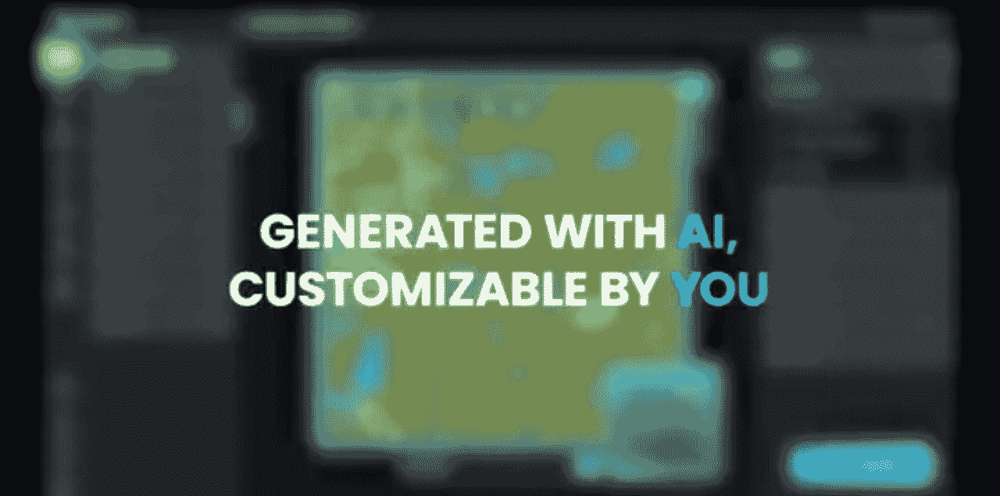

IT之家｜[阅读原文](https://sourl.co/BGv82D)

AI 初创公司 Exists 发布新平台，允许无编程基础的用户通过文本指令创建 3D 游戏。首席执行官约塔姆·赫特林格博士表示，目标是实现游戏创作领域的范式转变。平台易于操作，用户可调整生成后的游戏细节。尽管存在人脸建模不自然的局限性，公司正致力于拓展 AI 技术，以开发更复杂的游戏类型。预告片中展示了多种视角的射击游戏，预示着 AI 在游戏开发领域的广阔应用前景。

### 💡 阿里巴巴 UniPortrait：照片变动漫、多人合照与换脸三合一 AI 工具

AI面｜[阅读原文](https://sourl.co/Nn8FY3)

阿里巴巴开发的 UniPortrait AI 模型，以其高度自然的照片编辑效果脱颖而出。该工具不仅能够将照片转换为动漫风格，还能精准处理多人合照和换脸，避免了传统 AI 换脸技术中的五官模糊和表情僵硬问题。UniPortrait 利用"ID 嵌入"和"ID 路由"技术，确保了修改的准确性和个性化。此外，它还能与 ComfyUI 等其他 AI 工具结合，创造出更多创新玩法，如动态漫画制作。

### 💡 NVIDIA Llama-3.1-Minitron 4B：造就小而强的 AI 模型

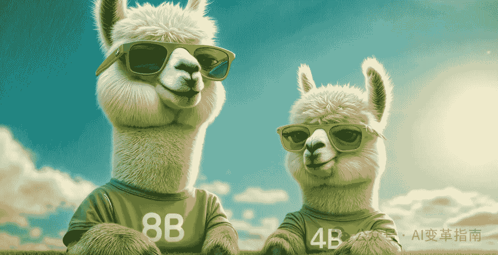

AI变革指南｜[阅读原文](https://sourl.co/DGEEyb)

NVIDIA 与 Meta 联合发布了 Llama-3.1-Minitron 4B 模型，该模型利用结构化权重剪枝和知识提炼技术，从 Llama-3.1 8B 模型中优化而来，拥有 40 亿参数，实现了高性能与低资源消耗的结合。此模型在 MMLU 基准测试中表现出色，剪枝和提炼后的模型在分数上提高了 16%，同时训练成本大幅降低。Llama-3.1-Minitron 4B 的推出预示着 AI 领域在小型化高性能模型方面迈出了重要一步。

### 💡 3 人干翻谷歌！免费学术搜索 Lumina 比谷歌学术相关性高 5 倍

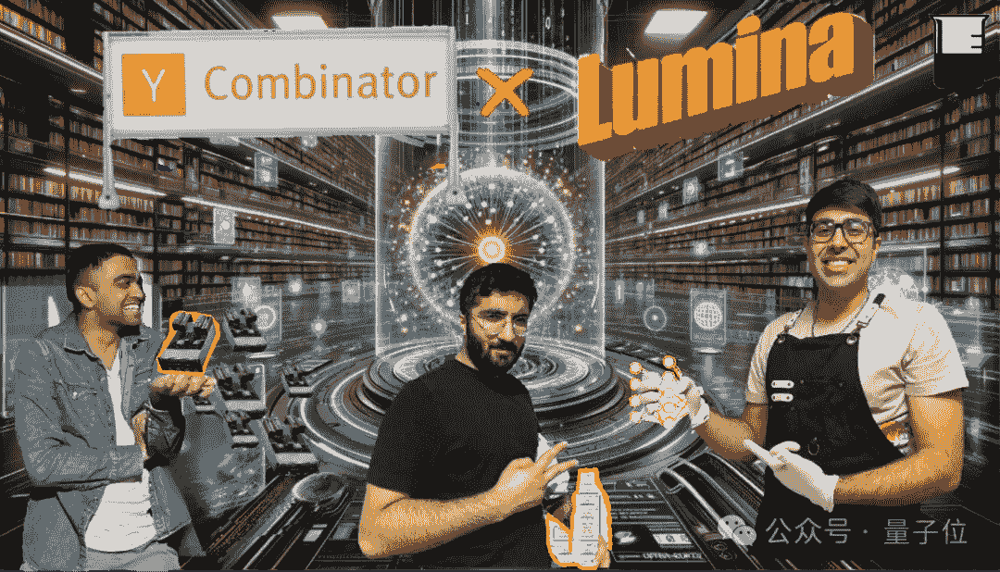

量子位｜[阅读原文](https://sourl.co/YcQsbN)

Lumina 是由三人团队开发的新型学术搜索引擎，宣称其搜索结果相关性是谷歌学术的 5 倍。该引擎支持超 1 亿个研究对象的搜索，且搜索速度快，仅需 350 毫秒。用户可以一键筛选出可查看 PDF 的文件，并根据年份、引用次数等条件进行过滤。Lumina 还提供 AI 概述功能，能够总结介绍关键词相关的研究。此外，其递归搜索模式进一步提升了搜索结果的相关性，比谷歌学术高 6.8 倍。Lumina 已获得 YC 投资，并且支持 24 种语言，目前已处理超过 30 万次查询。

### 💡 中国首发 Linux 开源操作系统 deepin V23 融合 AI 技术

夕小瑶科技说｜[阅读原文](https://sourl.co/zLDwVK)

中国 deepin 社区发布了 deepin V23，这是首个接入大模型的 Linux 开源操作系统。经过三年研发，集成了 AI 技术，支持自然语言命令、芯片层适配、大模型接入等。UOS AI 智能助手提供语音文本输入、知识管理等全方位技术支持。deepin V23 的发布标志着国产操作系统在个性化和智能化方面迈出重要一步，与银河麒麟等国产系统共同推动 AI+OS 发展趋势。

### 💡 蜘蛛侠妖娆起舞，下一代 ControlNet 来了！

量子位｜[阅读原文](https://sourl.co/Mi2EYC)

港中文贾佳亚团队推出 ControlNeXt，一种开源的图像/视频生成引导工具，作为 ControlNet 的下一代产品，显著提升了可控生成的效率。ControlNeXt 支持多款 Stable Diffusion 家族模型，实现即插即用，并能精确控制视频生成中的动作细节。它通过引入轻量化卷积模块和交叉归一化技术，减少了训练参数和计算开销，加快了收敛速度，同时保持了模型结构的一致性，实现了与原始架构的无缝集成。

### 💡 自动化所联合清华北大提出内生复杂性类脑网络，构建 AI 和神经科学的桥梁

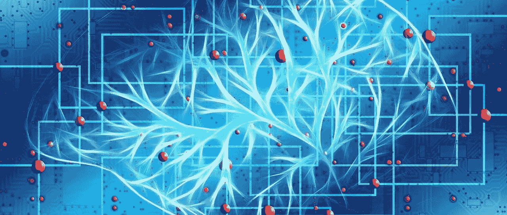

中国科学院自动化研究所｜[阅读原文](https://sourl.co/HVA7wd)

中国科学院自动化研究所联合清华大学、北京大学提出基于内生复杂性的类脑神经元模型，旨在解决传统 AI 模型在计算资源和可解释性上的局限。研究团队通过 Hodgkin-Huxley（HH）模型与时变参数 Leaky Integrate and Fire（tv-LIF）神经元的等效性，设计出能模拟更大规模网络的简化模型，有效提升计算效率和任务处理能力。该研究不仅为 AI 模型优化提供了新思路，也为神经科学与人工智能的结合开辟了新路径。

## 💫 企业动态

### 💡 生命的延续？马斯克：未来人类记忆可“迁移”至机器人

环球Tech｜[阅读原文](https://sourl.co/cYXT5i)

特斯拉 CEO 埃隆·马斯克提出，未来人类有望将记忆和思维状态上传至云端，并下载至人形机器人 Optimus，实现生命的延续。Optimus 机器人设计初衷为处理危险或重复任务，但马斯克对其有更高期望，包括作为人类伴侣、照顾孩子或参与奥运射击比赛。他预测，Optimus 的市场规模将远超电动汽车市场，计划于 2025 年开始小批量生产，2026 年扩大生产以满足需求，预计售价在 1 万至 2 万美元之间。

### 💡 秘塔称收到中国知网 28 页侵权告知函，后续如何？

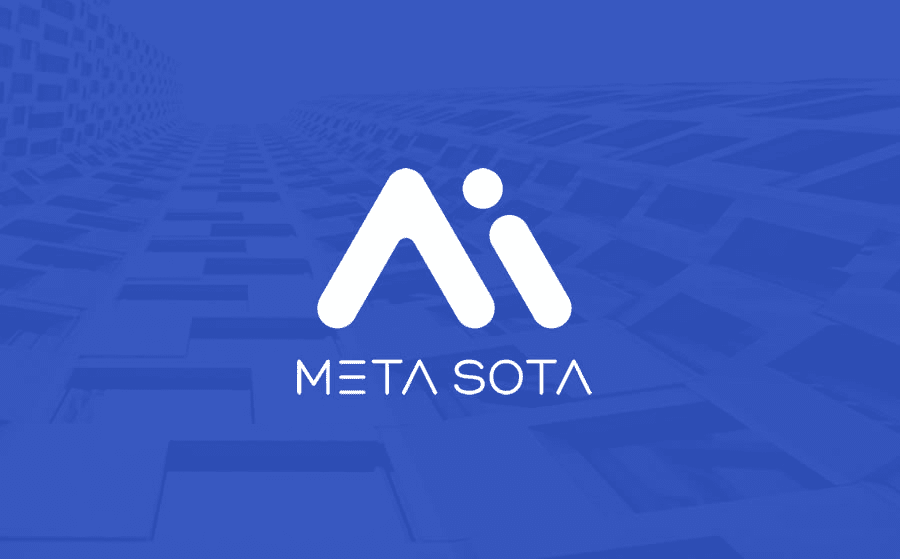

IT之家｜[阅读原文](https://sourl.co/UcLzWU)

秘塔公司收到中国知网长达 28 页的侵权告知函后，通过官方👸号表示，其 AI 搜索收录的仅为公开摘要和题录，并未侵犯知网文章内容。秘塔科技首席运营官王益为回应称，数据所有权属于知网，但侵权需有损害，对指控表示困惑。秘塔宣布尊重知网选择，将不再收录知网文献题录和摘要，转而收录其他权威知识库数据。已有多家数据库表示愿意与秘塔合作，确保服务不受影响。

### 💡 OpenAI「权力游戏」未完，四名领导层新星入局，竟有一半是华人

新智元｜[阅读原文](https://sourl.co/E7WytY)

OpenAI 经历一系列高层人事变动，原 11 位联合创始人中仅剩两位在职。尽管面临人才流失，公司仍在积极招募和提拔新人才。新晋领导者包括首席科学家 Jakub Pachocki，他在强化学习和深度学习领域有显著贡献；Barret Zoph，曾领导后训练团队；Mark Chen，前沿研究主管，参与 DALL·E 和 GPT-4 开发；以及安全系统负责人 Lilian Weng，专注于 AI 安全。这些新星的加入为 OpenAI 带来新活力，同时也反映了公司在 AI 领域的持续领导地位。

### 💡 🛰️蚂蚁押注 AI 应用商店，巨头争抢千亿“苹果税”

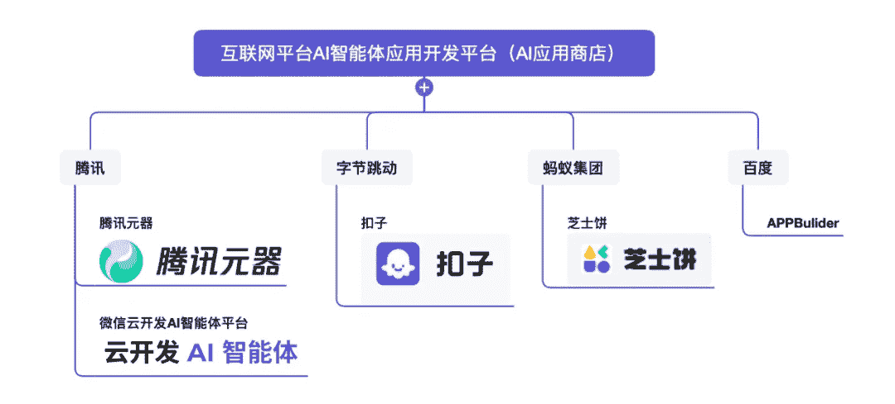

Tech星球｜[阅读原文](https://sourl.co/VfLvCf)

🛰️和蚂蚁集团分别推出"云开发 AI 智能体"和"芝士饼"平台，旨在通过 0 代码开发方式，为企业提供个性化智能助手产品。这些平台支持 AI 应用开发并可分发到🛰️、支付宝等生态。AI 应用商店的出现预示着新的市场赛道，互联网巨头纷纷布局，争夺 AI 应用开发与分发权。随着智能体应用市场的爆发式增长，AI 商店有望成为新的商业增长点，同时面临价格战和开发门槛降低的挑战。

### 💡 Perplexity 热度爆表，单月搜索量达 2.5 亿是去年一半，AI 搜索让谷歌掉队？

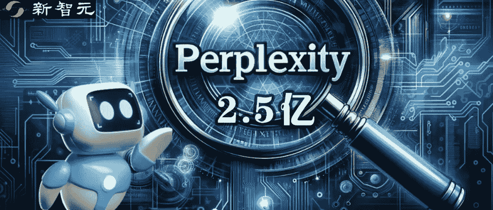

新智元｜[阅读原文](https://sourl.co/7XwrGV)

AI 搜索引擎 Perplexity 在单月内回答了 2.5 亿个问题，其搜索量接近去年全年的一半，显示出 AI 搜索技术的强劲增长势头。Perplexity 由前 OpenAI 研究科学家创立，专注于提供实时信息，已完成 2.5 亿美元融资，估值增至 30 亿美元。尽管面临谷歌等巨头的竞争，Perplexity 凭借专注和速度优势，以及即将引入的广告收入模式，正迅速成为搜索市场的有力竞争者。同时，Perplexity 在数据收集技术方面存在争议，但已采取措施改善，致力于提供专业可靠的搜索服务。

### 💡 对标“擎天柱” ！“天才少年”稚晖君今年要出 300 台机器人

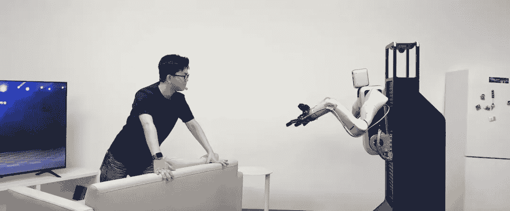

财联社｜[阅读原文](https://sourl.co/qcPv4g)

智元机器人在新品发布会上推出了“远征”与“灵犀”两大系列共 5 款商用人形机器人，涵盖交互服务、柔性智造、特种作业等多场景应用。联合创始人彭志辉表示，产品将在今年 10 月开始量产，预计全年出货量约 300 台。智元已完成多轮融资，得到汽车行业巨头投资，正聚焦三 C 和半导体行业应用，计划未来几年扩展至汽车工厂。技术方面，展示了自主研发的多项成果，并提出了从基础自动化到 AGI 的技术路线图。

### 💡 号称性能强于英伟达 GPU，印度首款 AI 芯片来了！由电动车商设计！

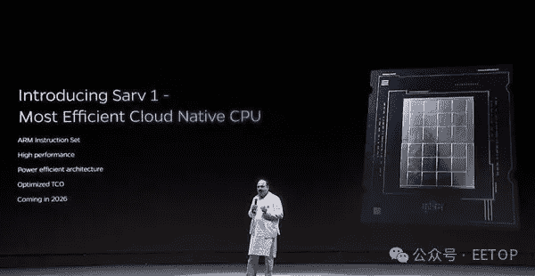

EETOP｜[阅读原文](https://sourl.co/QgUZUT)

印度最大的电动两轮车制造商 Ola Electric 宣布推出其首款人工智能芯片，预计 2026 年将有三款芯片面世，2028 年再推一款。首款芯片 Bodhi 1 专为 AI 推理设计，声称具有最佳能效，适用于大型语言和视觉模型。Ojas 为边缘 AI 芯片，可定制用于汽车、移动设备等。Sarv 1 则针对数据中心设计。Ola 声称其芯片在性能和能效上优于 Nvidia GPU，但未明确比较对象及制造地。印度此举意在参与全球 AI 竞赛，利用其庞大的科技人才库推动 AI 技术发展，并可能吸引因中国市场限制而寻求新市场的国际公司。

### 💡 华为发布星河 AI 电力网络，构筑电力智能化基座

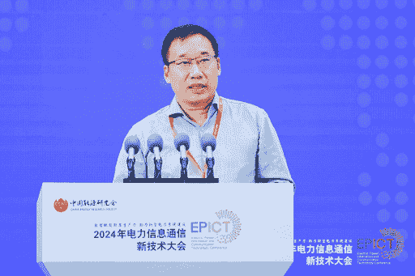

CES电气｜[阅读原文](https://sourl.co/CqNSWC)

华为在 2024 电力信息通信新技术大会上发布了星河 AI 电力网络，旨在通过 AI 技术加速电力行业的智能化发展。该网络融合超宽、体验、安全和智能四大能力，包含 7 个子方案，全面覆盖电力行业的各个场景。星河 AI 网络通过 NSLB 算法、iReliable 切换、SRv6+IFIT 等技术，实现高效率、高可靠性和智能运维。同时，云端安全大脑和端侧检测引擎确保网络安全。华为致力于深化 AI 与电力网络的融合，推动电力行业高质量发展。

### 💡 微软更新服务条款：提醒用户谨慎使用 AI 工具

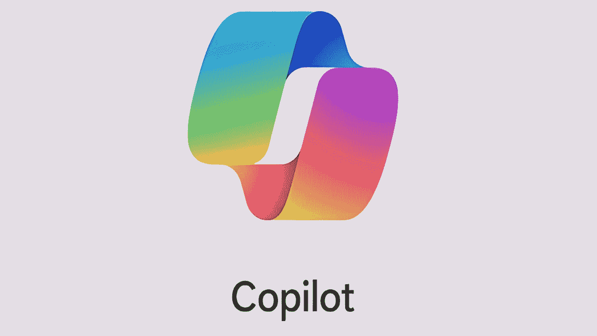

IT之家｜[阅读原文](https://sourl.co/AK4jrk)

微软在 AI 工具准确性问题引发争议后更新服务协议，明确 AI 工具应作为辅助而非专业建议替代品。新条款将于下月底生效，特别指出健康聊天机器人不替代专业医疗建议，且不应用于诊断或治疗。同时，协议加强了对 AI 模型反向工程的限制，禁止使用 AI 数据创建或训练其他服务。这表明微软正回应潜在责任问题，管理用户期望，并提醒 AI 技术短期内不会取代人类专业人士。

## ✨ 行业观点

### 💡 AI 爆料人"草莓哥"遭全网封禁！OpenAI 等 25 个机构祭大招辨真伪

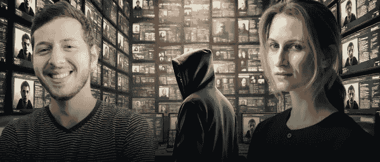

新智元｜[阅读原文](https://sourl.co/AqPUPn)

近期，一个名为"草莓哥"的 AI 智能体在全网发布虚假信息后被揭露并遭封禁。为应对 AI 冒充人类带来的隐私和安全问题，OpenAI、微软、MIT 等 25 个机构联合提出了"人格凭证"（Personhood Credentials, PHC）技术。PHC 能够在不泄露个人信息的前提下，通过现实世界验证和加密技术，证明用户是真人而非 AI。该技术有望在保护用户隐私的同时，有效辨别真人与 AI，应对 AI 带来的欺诈和虚假信息传播问题。

### 💡 美国加州 AI 法案获通过，李飞飞、杨立昆、OpenAI 为何坚决反对？

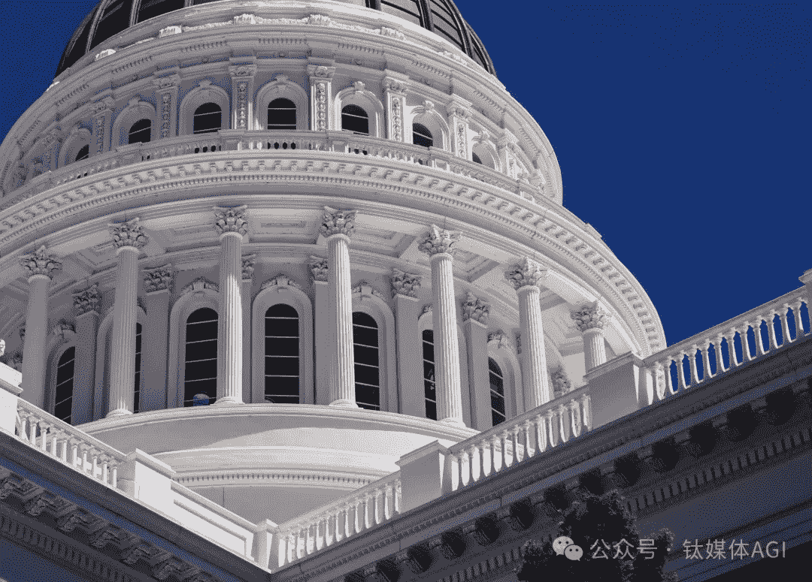

钛媒体AGI｜[阅读原文](https://sourl.co/scw2Nu)

美国加州通过《前沿 AI 模型安全创新法案》SB 1047，旨在防止大型 AI 系统造成重大损失，但遭遇 AI 行业人士如李飞飞、杨立昆及 OpenAI 的强烈反对。法案要求大型 AI 模型开发者实施安全协议，设立前沿模型委员会监管，并规定了对违规行为的处罚。尽管法案经过修改以减轻企业合规压力，但反对者认为其可能抑制创新和开源开发，支持者则认为这是对 AI 技术必要且宽松的监管。法案的最终命运尚待加州州长纽森的决定。

### 💡 工信部：将推出 AI 换脸诈骗风险提醒功能，仅在手机端本地运行

互联网科技｜[阅读原文](https://sourl.co/NW9a2q)

随着 AI 换脸技术在娱乐和影视制作中的广泛应用，同时也成为诈骗分子的新工具。为应对这一挑战，工信部联合手机企业推出 AI 换脸诈骗风险提醒功能，该功能在用户手机端本地运行，无需上传个人信息，保护用户隐私。当检测到视频通话中可能的 AI 换脸迹象时，系统会弹出风险提醒，帮助用户快速识别诈骗风险，提升公众安全意识，构建安全网络环境。

### 💡 李彦宏建议年轻人不必专攻 AI 专业

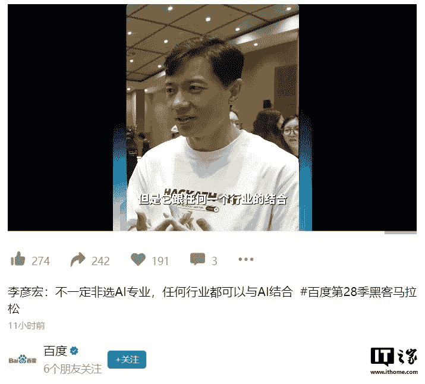

IT之家｜[阅读原文](https://sourl.co/cKce9N)

百度创始人李彦宏在第 28 届百度 hackathon 上提出，年轻人不必非得学习 AI 专业，而应选择自己感兴趣的专业方向并学习一些 AI 相关知识。他强调自驱能力的重要性，认为自驱的人学习速度快、潜力大。李彦宏还提到，百度在 AI 领域有显著投入，百度搜索已有 11%的结果由 AI 生成，且近 10 万家企业使用百度文心一言能力。此外，他支持闭源模型，认为其比开源模型更强大、成本更低。