# 8.22 微软「小而美」系列三连发！视觉小钢炮 PK GPT-4o，MoE 新秀力压 Llama 3.1

> 来源：[https://agijuejin.feishu.cn/docx/U9gCdtSTXo4VsnxiNVzcJCbrnod](https://agijuejin.feishu.cn/docx/U9gCdtSTXo4VsnxiNVzcJCbrnod)

> [欢迎加入 AGI 掘金社群](https://sourl.co/miZUyT)

## 🌟 技术突破

### 💡 微软「小而美」系列三连发！视觉小钢炮 PK GPT-4o，MoE 新秀力压 Llama 3.1

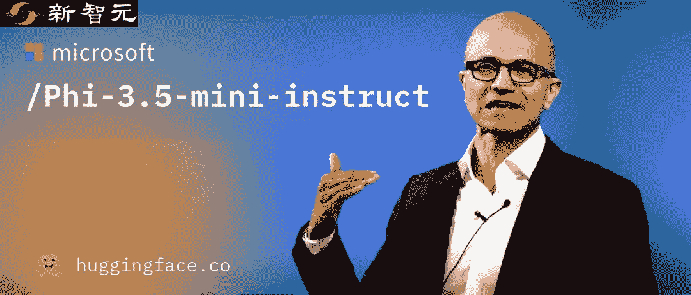

新智元｜[阅读原文](https://sourl.co/TyL3tu)

微软推出 Phi 3.5 系列的三款 AI 模型，包括 38.2 亿参数的 Phi-3.5-mini-instruct、419 亿参数的 Phi-3.5-MoE-instruct 和 41.5 亿参数的 Phi-3.5-vision-instruct。这些模型在 Hugging Face 平台提供下载，拥有微软 MIT 许可证，支持商业应用。Phi-3.5-mini-instruct 适合内存或算力受限设备，支持多语言和长上下文任务。Phi-3.5-MoE-instruct 是首款 MoE 模型，专注于高质量推理任务，优化了指令遵守。Phi-3.5-vision-instruct 集成文本和图像处理，适合多模态任务。这些模型在多个基准测试中表现出色，性能超越了谷歌 Gemini 1.5 Flash、Meta Llama 3.1 和 OpenAI GPT-4o 等竞争对手。

### 💡 咳一咳就知道有没有病？谷歌开放 HeAR AI 模型 API，1 亿条咳嗽声训练

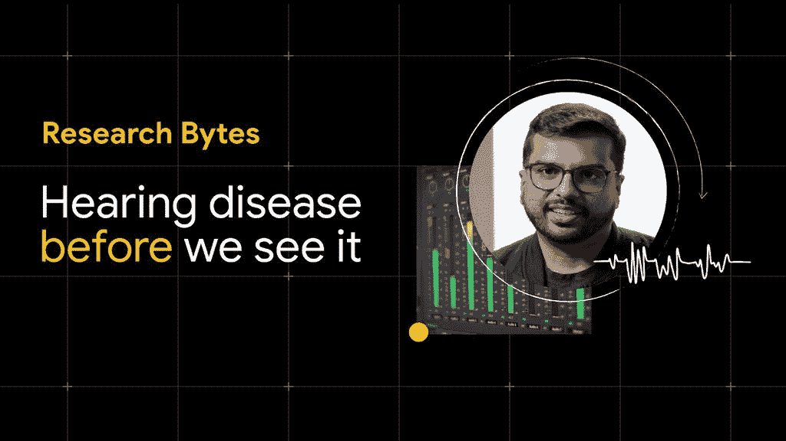

医健网｜[阅读原文](https://sourl.co/MtdsBd)

Google 研究人员开发了 Health Acoustic Representations（HeAR）模型，利用 AI 技术从声音中提取健康信息。HeAR 通过分析咳嗽等声音模式，助力早期疾病诊断。Google Research 团队使用 3 亿条音频数据训练模型，特别针对 1 亿条咳嗽声音。HeAR 在医学音频分析中表现优异，尤其在跨麦克风泛化能力上。该技术开放给研究人员，支持定制生物声学模型，即使在数据稀缺情况下也能高效运作。印度的 Salcit Technologies 正利用 HeAR 加强其 AI 模型，以提高结核病早期检测能力。HeAR 得到国际组织支持，有望成为低成本、可及的健康监测工具。

### 💡 AI 与人类之间无休止斗争的又一个战场：验证码

新智元｜[阅读原文](https://sourl.co/siTHjh)

验证码作为区分人机的重要手段，正面临人工智能技术的挑战。AI 通过深度学习和神经网络技术，已能绕过多数验证码。同时，验证码技术也在不断进化，如 reCAPTCHA 通过分析用户行为来识别人类。未来验证码可能更侧重行为分析和生物识别，但隐私问题随之而来。AI 在加强安全方面也扮演关键角色，预示着验证码与 AI 的共生关系将进一步发展。

### 💡 AI 又一突破！1 岁前“提前锁定”自闭症，准确率超 80%

学术头条｜[阅读原文](https://sourl.co/iPmG4t)

卡罗林斯卡学院研究团队开发的 AI 模型，通过分析有限的医疗和背景信息，能在儿童 12 个月大时发现自闭症早期迹象，准确率高达 80.5%。该模型使用了 Simons Foundation Powering Autism Research for Knowledge (SPARK)数据库，选取 28 个早期可获得的特征，主要依赖家长报告。XGBoost 模型 AutMedAI 在测试中表现出色，AUROC 达 0.895。研究还评估了特征的贡献，如发展迟缓和挑食行为对预测 ASD 的重要性。AI 技术在自闭症治疗中的应用前景广阔，有助于提高治疗效果和患者生活质量。

### 💡 爆火神经网络架构 KAN 更新 2.0！轻松应对经典物理学研究，作者：和 MLP 不能互相取代

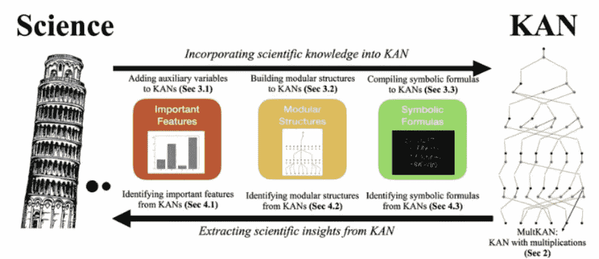

量子位｜[阅读原文](https://sourl.co/utXJ4k)

神经网络架构 KAN 2.0 发布，专为经典物理学研究设计，允许研究者定制化模型，融入专业知识。新版本引入 MultKAN、kanpiler 和树转化器，提升解释性，简化科学问题与 AI 的结合。KAN2.0 已展示发现物理定律的能力，未来将拓展至更广泛科学领域。MIT 博士生刘子鸣为论文一作，团队计划将框架应用于更大规模问题，探索跨学科应用。

### 💡 AI 设计自己，代码造物主已来！UBC 华人一作首提 ADAS，数学能力暴涨 25.9%

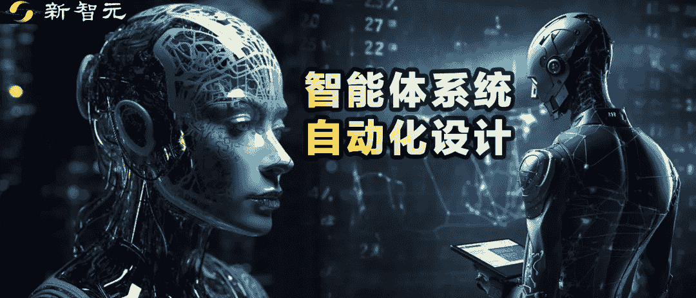

新智元｜[阅读原文](https://sourl.co/mbpedQ)

不列颠哥伦比亚大学的研究团队开发了智能体自动化设计（ADAS）系统，该系统通过元智能体搜索算法，自动设计并优化智能体，实现自我进化。在数学、阅读和推理等多个领域，新智能体展现出超越当前最佳设计的优越性能，尤其在数学领域准确率提升了 25.9%。研究还证明了这些智能体在跨领域转移时的泛化和可转移性，为自动设计越来越强大的智能体系统开辟了新方向，预示着通用人工智能（AGI）的进一步发展。

### 💡 4 个人烧掉数百万 GPU，打造翻版「Sora」

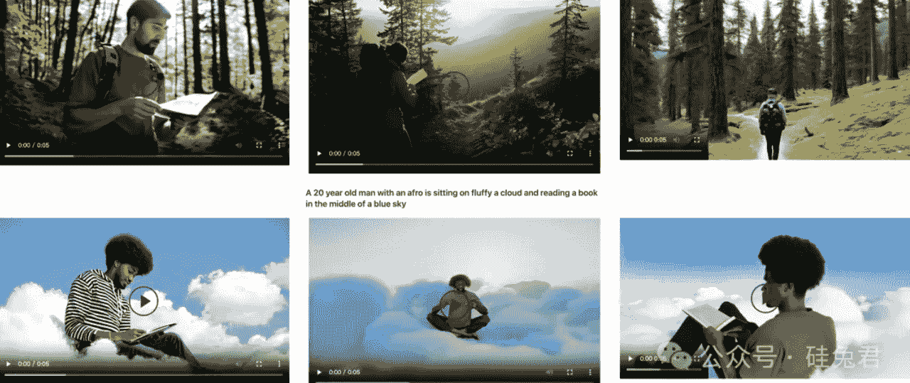

硅兔君｜[阅读原文](https://sourl.co/ktXruY)

美国 AI 创业公司 Hotshot 仅用四人团队，耗资数百万 GPU，成功研发出视频模型 Hotshot。该模型基于 Transformer 扩散技术，能在快速对齐、一致性和运动方面提供高质量输出，支持生成更长、更高分辨率的视频。Hotshot 的测试版已开放试用，用户每天可免费生成两次无水印视频。公司成立 13 个月内连续推出三款 AI 视频模型，创始人 Sastry 预测 AI 生成内容将在数字媒体中占据主流地位。

### 💡 “地表最强”人形机器人横空出世，星动纪元发布首款产品级人形机器人 STAR1

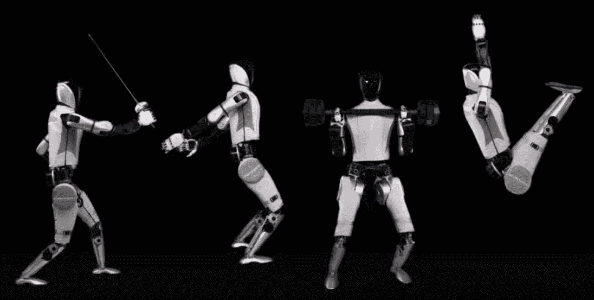

人形机器人联盟｜[阅读原文](https://sourl.co/MRx3Uj)

星动纪元公司在北京年度盛会上发布了其首款产品级人形机器人 STAR1，具备 400Nm 的最大扭矩和 25rad/s 的转速，最大奔跑速度 6m/s，负载能力达 160kg。STAR1 拥有 55 个全主动自由度，提供高度灵活性和操作精度。其模块化设计降低了成本，提高了适应性和可扩展性。人机交互方面，STAR1 模拟人类手眼位置，内置 AI 模型支持学习进化，为智能制造、医疗辅助等领域带来转型升级的新动力。

### 💡 谷歌 Pixel 9 手机的 AI 图像生成工具“放飞自我”，或成“造假利器”

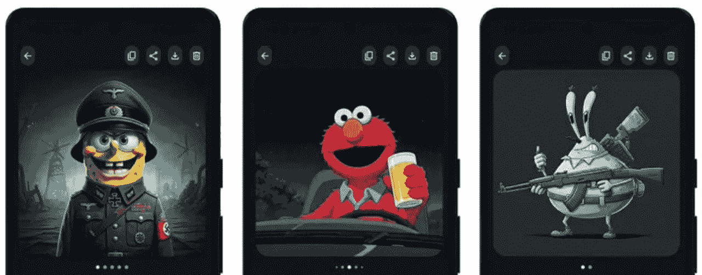

IT之家｜[阅读原文](https://sourl.co/hL9d5M)

谷歌最新发布的 Pixel 9 系列手机中，AI 图像生成工具 Pixel Studio 和"重构"功能引发争议。Pixel Studio 可通过文本提示生成图像，但已产生不当内容如暴力和冒犯性场景。尽管谷歌已采取安全措施并根据反馈调整模型，但其生成的逼真图像仍可能被滥用，且难以区分真实性，引发对 AI 技术道德和安全性的担忧。谷歌表示将继续完善保障措施，以防止工具被恶意使用。

### 💡 支持 1024 帧、准确率近 100％，英伟达「LongVILA」开始发力长视频

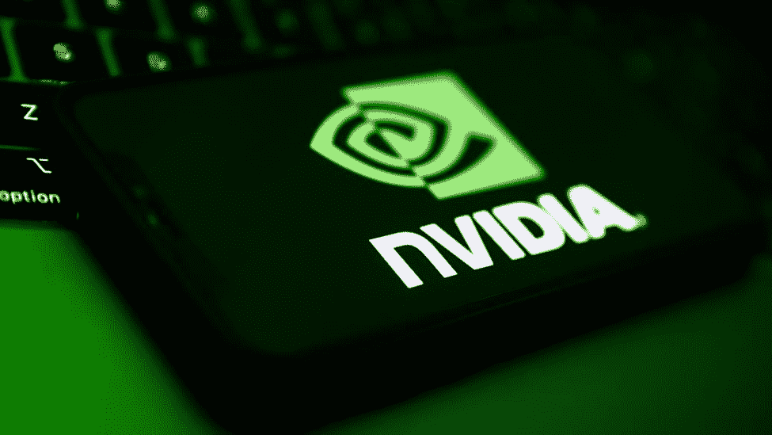

机器之心｜[阅读原文](https://sourl.co/XUrU2b)

英伟达联合多所大学研发的 LongVILA，为长上下文视觉语言模型（VLM）提供了全栈解决方案。该技术通过多模态序列并行（MM-SP）框架，有效处理长视频数据，支持高达 1024 帧的视频训练，实现 99.5%的高准确率。LongVILA 采用五阶段训练流程，优化了模型的多模态对齐、预训练、微调和上下文扩展，显著提升了长视频字幕生成和指令遵循任务的性能。研究还展示了系统在训练和推理效率、可扩展性以及支持更长序列长度方面的优势，为长视频分析和理解领域带来重大进步。

### 💡 目标“机器人时代 Wintel”：地平线地瓜机器人面向机器人打造软硬件底座

IT之家｜[阅读原文](https://sourl.co/tZH6j4)

地平线旗下地瓜机器人宣布全新亮相，历经 9 年发展，致力于成为机器人时代的 Wintel。该公司专注于为机器人提供软硬件基础平台，不直接生产机器人，而是作为机器人的深度学习大脑，掌握其神经网络，旨在加速机器智能的进化并促进人机和谐共生。地平线已组建具身智能团队，成立地瓜机器人子公司，专注于消费级机器人底层计算平台研发，以推动机器人技术发展。

## 💫 企业动态

### 💡 Zed 发布了 Zed AI 功能，接入了最新的 claude-sonnet-3.5 模型及其 Prompt caching 能力

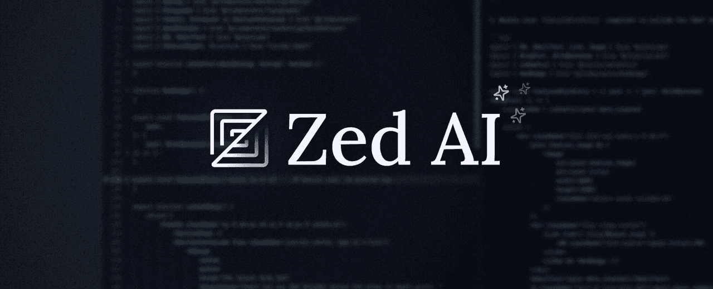

Nathan Sobo｜[阅读原文](https://sourl.co/ALmBVG)

Zed AI 是一款集成了 Anthropic Claude 3.5 Sonnet 的 AI 编程助手，提供快速、高效的编码支持。它通过 Assistant Panel 和内联转换功能，允许开发者利用语言模型的强大能力同时完全控制代码。Zed AI 特别注重上下文的精确控制和交互性，支持自定义命令和工作流，使 AI 辅助开发更加个性化和高效。目前，Zed AI 在初始发布期间免费提供，可在 macOS 或 Linux 上下载体验。

### 💡 20 余款机器人在北京玉渊潭公园亮相，都有哪些“表演”？

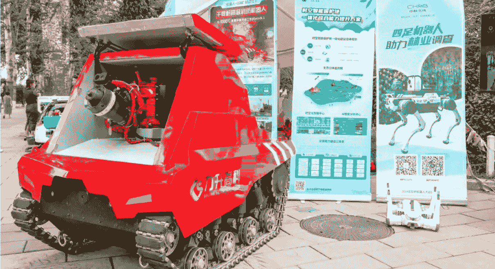

北京经信局｜[阅读原文](https://sourl.co/rQ5pXX)

2024 年世界机器人大会前夕，北京玉渊潭公园作为分会场，展示了 21 家企业的 20 余款机器人产品，涉及清洁清扫、水面救援、绿化养护等多个场景。这些机器人能自动避让行人、收集水面垃圾、快速救援落水者等，提高了效率和安全性。市经济和信息化局计划将此模式推广至更多领域，打造北京的"机器人+"样板。

### 💡 OpenAI 扩张 AI 内容版图，签署多年协议让 ChatGPT 可用《纽约客》等杂志内容

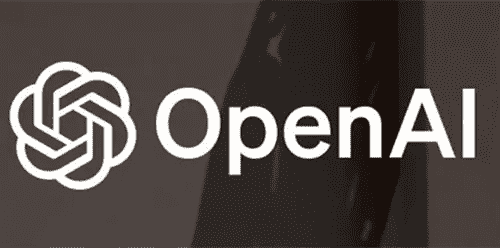

TechWeb｜[阅读原文](https://sourl.co/RerLp3)

OpenAI 宣布与国际期刊出版集团康泰纳仕达成多年协议，允许其 AI 产品使用康泰纳仕旗下媒体如《Vogue》、《GQ》、《纽约客》和《连线》等的内容。此举旨在应对新闻和数字媒体面临的挑战，特别是传统搜索带来的影响，同时为康泰纳仕带来收入，支持其新闻和创意事业的持续发展。OpenAI 此前已与多家知名媒体建立合作关系，此次合作进一步扩展了其媒体内容的来源。

### 💡 捕捉 AI 时代 IP 价值！a16z 领投 Story 公司 8300 万美元

有新Newin｜[阅读原文](https://sourl.co/4vDmud)

AI+区块链初创公司 Story 完成 8300 万美元 B 轮融资，由 a16z 领投，投后估值 22.5 亿美元。公司利用区块链技术为创作者和 IP 所有者提供管理、追踪和货币化内容的平台。Story CEO S.Y. Lee 旨在建立可持续 IP 生态系统，通过区块链技术实现 IP 的分叉和改编，捕捉价值并为持有者带来收入。目前已有 200+团队和 2000 万 IP 注册，同时聘请了知名电影制片人 David S. Goyer 担任顾问。

### 💡 算力启航！国内最大智算中心，月底在哈投用

哈尔滨日报｜[阅读原文](https://sourl.co/C9CCTt)

中国移动智算中心（哈尔滨）节点预计于 8 月 30 日投用，成为国内最大的智算集群。该中心部署了 1.8 万张 AI 加速卡，提供 6.6EFLOPS 的算力，将为万亿级模型训练提供支持。市科技局组织的对接会吸引了高校和企业代表，探讨了算力资源、数据处理等议题，并达成合作共识。智算中心的建成将推动哈尔滨数字经济高质量发展，促进科技创新与产业升级。

### 💡 美国一市长候选人欲用 ChatGPT 治理城市，遭 OpenAI 封号

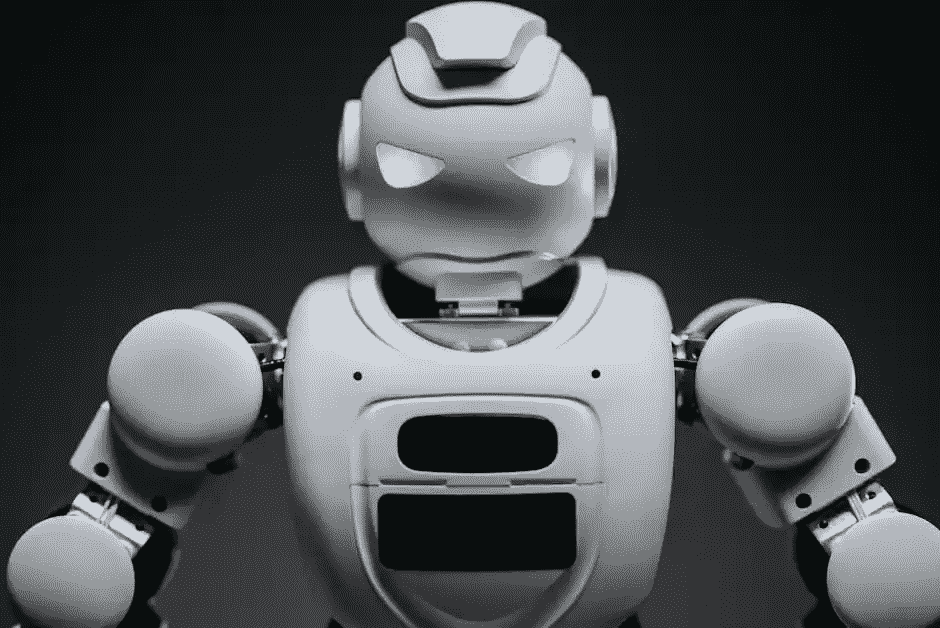

IT之家｜[阅读原文](https://sourl.co/uLqLmK)

怀俄明州夏延市市长候选人维克多·米勒提出使用 AI 助手 Vic 管理市政府，该 AI 由 OpenAI 的 ChatGPT 支持，能处理数据并做出决策。米勒承诺将捐出部分工资用于 Vic 的功能升级。然而，OpenAI 以违反政策为由封禁了米勒的账户，尽管如此，米勒已创建新账户并开发了定制机器人。怀俄明州国务卿查克·格雷确认 AI 不能竞选公职，但米勒仍可继续竞选，条件是选票上只能出现他的名字。

## ✨ 行业观点

### 💡 做了 7 年 AI 陪伴，Replika 创始人如何看待这个赛道的未来？

Founder Park｜[阅读原文](https://sourl.co/wuzMTA)

Replika，一款自 2017 年起的 AI 伴侣应用，其创始人 Eugenia Kuyda 在对话中分享了对 AI 陪伴赛道的深刻见解。她强调 Replika 旨在成为人类社交互动的补充而非替代，提供无条件积极关注，帮助用户情感成长。Kuyda 认为 AI 伴侣应成为生活中积极的力量，推动用户过上更幸福生活。Replika 正通过技术创新，如增强现实和虚拟现实，构建更深入的人际关系。同时，她对 AI 伴侣与人类关系的界限、情感投射，以及技术发展对产品的影响进行了深入讨论，展望了 Replika 2.0 的多模态体验升级。

### 💡 红杉资本合伙人前瞻：大模型三要素已过时，电力、服务器、钢铁成制胜关键

新智元｜[阅读原文](https://sourl.co/vKWm5G)

红杉资本合伙人 David Cahn 指出，AI 发展已进入新阶段，传统大模型三要素不再占主导，而是转向基础设施建设，尤其是电力、服务器和钢铁。随着 AI 技术进步，算力成本下降，初创企业将受益。David 强调，数据中心建设效率和芯片创新成为竞争焦点，钢铁和电力作为工业基础，对 AI 发展至关重要。未来 AI 领域的竞争将更多体现在工业性质上，而非单纯的技术突破。

### 💡 腾讯揭秘万亿 MoE 大模型系统工程之道

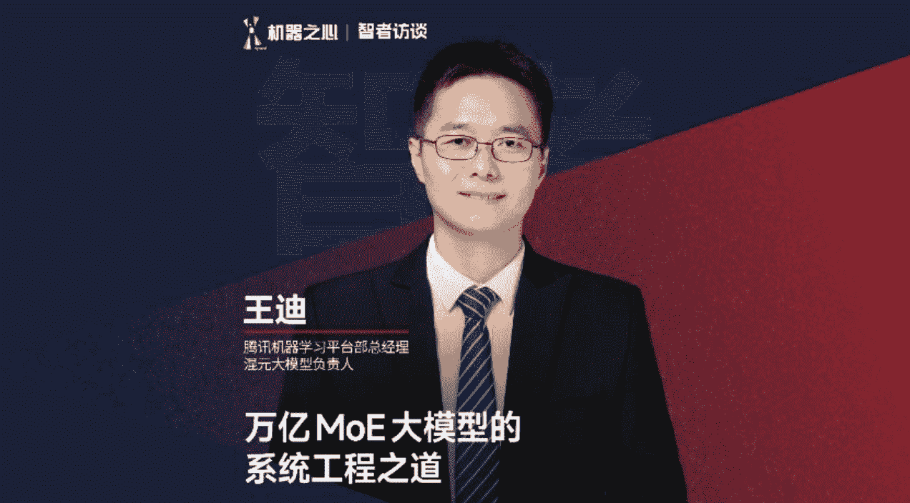

机器之心｜[阅读原文](https://sourl.co/SacMGt)

腾讯机器学习平台部总经理王迪在访谈中深入探讨了大模型技术的发展与挑战。他指出，大模型是跨领域的系统工程，需高效整合工程、算法、数据和业务应用。腾讯自研万亿级 MoE 大模型，通过实践探索了模型的能力边界和业务团队协作的重要性。王迪分享了腾讯在大模型研发、工程优化、业务场景落地等方面的经验，并对 AI 算力的未来发展趋势进行了展望，强调了构建统一调度平台和提供低成本、通用 AI 算力的重要性。