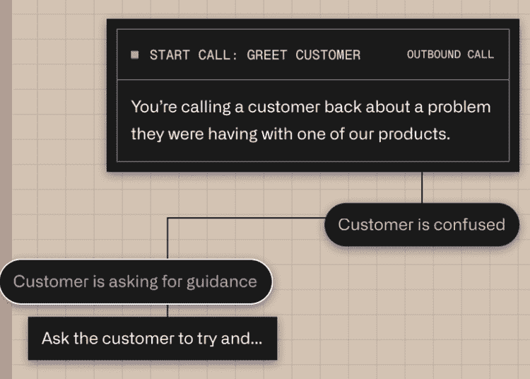
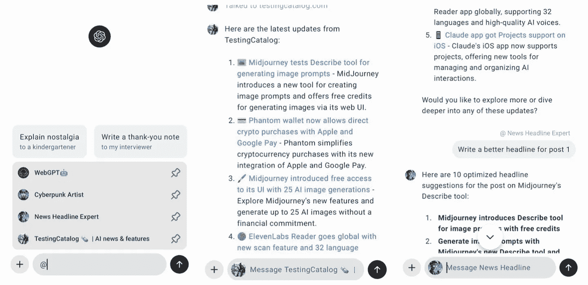
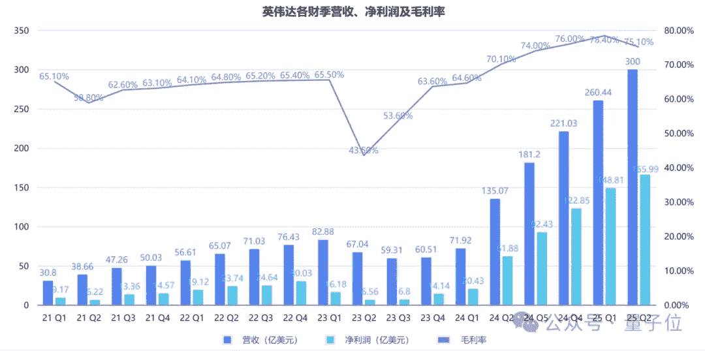
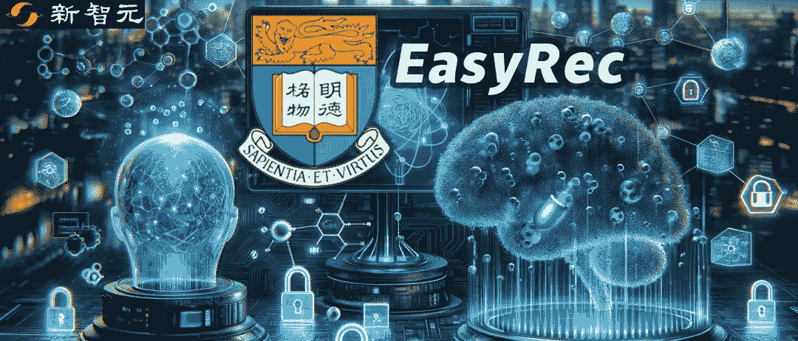
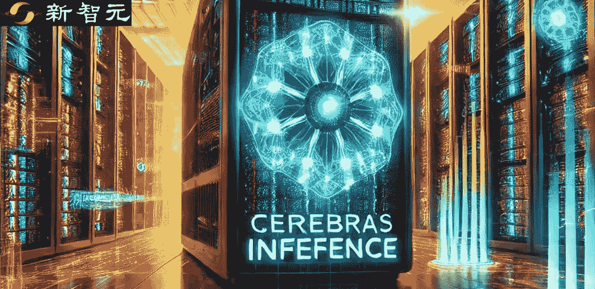
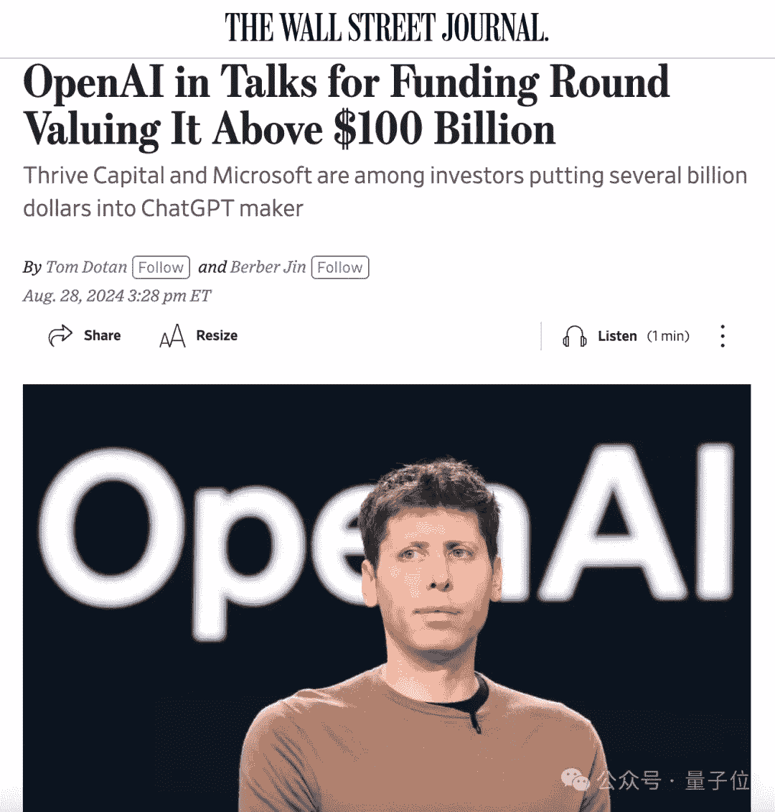
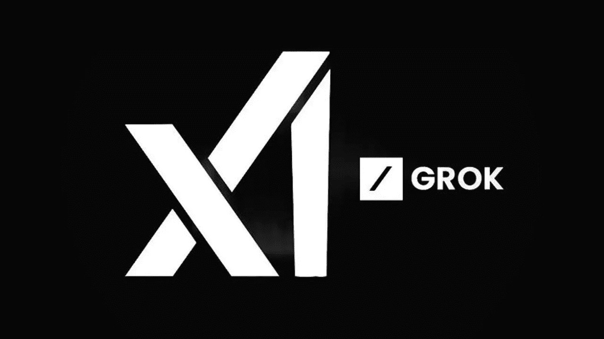

# 8.29  硬件领域挤进新巨头！AI 图像生成公司 Midjourney 携手苹果前高管有大动作

> 来源：[https://agijuejin.feishu.cn/docx/QbdWd8jMEoAw1SxOqebcIxptnbe](https://agijuejin.feishu.cn/docx/QbdWd8jMEoAw1SxOqebcIxptnbe)

## 🌟 技术突破

### 💡 330亿参数！中国石油联合中国移动、华为、科大讯飞推出昆仑AI大模型

IT之家｜[阅读原文](https://sourl.co/66tHth)

由中国石油与中国移动、华为和科大讯飞牵头合作，即将发布330亿参数的昆仑大模型。这是中国能源化工行业首个通过国家备案的AI大模型。该模型采用创新四层架构，支持专业领域数据建模，具备统筹管理、建设标准制定及开放共享能力，推动智能化发展。模型包括不同参数规模的语言、视觉和专业大模型，满足多样化业务需求，如知识问答、概念理解、视觉理解等，助力行业数字化转型。

### 💡 智能 AI 电话客服 Bland AI 宣布获得1600 万美元 A 轮融资，可自动接打客户电话

XIAOHU.AI｜[阅读原文](https://sourl.co/xWtZiv)

Bland AI 是一家人工智能电话客服平台，专注于为企业创建和管理智能电话代理，以自动化处理客户支持、销售和预约等任务。该公司最近宣布获得1600万美元A轮融资，由Scale Venture Partners领投，总融资额达2200万美元。Bland AI 的平台支持定制化设置，能够与任何系统集成，并提供详细的呼叫分析和工具定制服务。其技术亮点包括自主开发的Conversational Pathways编程语言和语音技术，以及全面的可观察性和分析能力。该平台旨在提高企业效率，降低运营成本，同时改善客户体验。

### 💡 ChatGPT应用更新：支持“@”功能，实现模型无缝切换

IT之家｜[阅读原文](https://sourl.co/2VBBRU)

科技媒体testingcatalog报道，安卓版和macOS版的ChatGPT AI应用新增了Mentions功能，用户可通过输入"@"字符来选择并调用不同的定制GPT模型，实现在对话中的无缝切换。这一功能使得用户能够在保持聊天上下文的同时，与多个专门的AI模型互动，每个模型提供独特的功能以丰富对话内容。目前，iOS平台的ChatGPT尚未支持此功能。

### 💡 日赚13亿的英伟达市值一夜蒸发10000亿

量子位｜[阅读原文](https://sourl.co/pBZPr7)

英伟达在2025年第二财季实现了显著的营收和利润增长，营收达300亿美元，同比增长122%，净利润同比增长168%，均超市场预期。数据中心业务营收263亿美元，同比增长154%，成为主要收入来源。游戏业务也同比增长16%。尽管业绩强劲，股价在财报公布后却下跌超过8%，可能因市场对第三财季营收增长放缓的担忧。英伟达宣布500亿美元的股票回购计划以稳定股价。公司数据中心芯片需求激增，新一代AI芯片Blackwell性能大幅提升，尽管面临生产挑战，但预计第四财季将有重大硬件出货。英伟达的芯片广泛应用于生成式AI，如ChatGPT，其技术在AI基准测试中表现卓越。

### 💡 港大EasyRec推荐系统：零样本文本推荐性能超越OpenAI、Bert

新智元｜[阅读原文](https://sourl.co/P42ZTU)

香港大学研发的EasyRec推荐系统通过结合语言模型的语义理解和协同过滤技术，在零样本学习场景下显著提升了推荐性能。该系统不依赖用户和商品的ID，而是利用用户和商品的文本描述生成语义嵌入，实现个性化推荐。EasyRec采用多层双向Transformer架构，通过自注意力机制全面理解上下文，生成高质量的文本嵌入。模型训练采用对比学习方法，优化编码特征空间，并通过文本掩码-重构损失提高语义理解能力。EasyRec在多数据集上表现出色，不仅在零样本推荐能力上超越了BERT、RoBERTa等通用语言模型，还能快速适应用户偏好的动态变化，展现了在推荐系统领域的强大潜力和应用前景。

### 💡 世界最大芯片助力，Cerebras Inference推理速度狂飙20倍，英伟达H100被超越

新智元｜[阅读原文](https://sourl.co/mHgm4C)

Cerebras Systems推出了全球最快的AI推理架构Cerebras Inference，其速度是英伟达H100 GPU的20倍，运行Llama3.1 8B模型时速率可达1800 token/s。这一突破得益于Cerebras自研的第三代芯片WSE-3，拥有44GB SRAM和21PB/s的内存带宽，解决了内存带宽限制。Cerebras Inference不仅速度快，还保持了16位权重的高精度，同时提供极具竞争力的价格，Llama 3.1 8B每百万token仅10美分。此外，Cerebras Inference支持大规模部署，未来将支持更大参数模型，并为开发者提供免费token体验。尽管上下文长度为8K，低于其他平台，但其速度和性价比为AI推理领域带来显著变革。

## 💫 企业动态

### 💡 硬件领域挤进新巨头！AI 图像生成公司 Midjourney 携手苹果前高管有大动作

IT之家｜[阅读原文](https://sourl.co/KvFzLi)

AI 图像生成公司 Midjourney 宣布拓展至硬件领域，并已邀请苹果前硬件经理 Ahmad Abbas 加盟，担任硬件部门负责人。尽管具体产品细节尚未公布，但公司表示有多个项目正在进行，暗示未来将有多样化的硬件形态。Midjourney 创始人 David Holz 拥有丰富的硬件背景，此次进军硬件领域备受业界期待。

### 💡 OpenAI估值超1000亿美元，新一轮融资在即

量子位｜[阅读原文](https://sourl.co/LNhz4K)

OpenAI的估值飙升至1000亿美元以上，成为全球估值最高的AI初创公司。尽管公司内部经历了动荡，包括高层离职和财务亏损，但新一轮的融资谈判正在进行中，兴盛资本可能领投10亿美元，微软也可能参与。OpenAI的年化收入超过34亿美元，但预计年底将面临50亿美元的亏损。公司在AI模型训练和人员配备上已投入85亿美元。此外，OpenAI的神秘项目Converge 2旨在支持AI领域的创业公司，一些初创公司已经获得了资助。随着新模型“草莓”和“猎户座”预计在秋季发布，OpenAI的估值和市场地位有望进一步巩固。

### 💡 马斯克AI公司xAI被指未经许可使用燃气涡轮机，污染空气质量

IT之家｜[阅读原文](https://sourl.co/52n983)

马斯克的 AI 初创公司 xAI 因在田纳西州孟菲斯市的数据中心使用燃气涡轮机而受到环保和健康倡导者的批评。该公司被指控在未获得必要的空气许可证的情况下使用近 20 台燃气涡轮机，总容量约 100 兆瓦，这些涡轮机的运行可能加剧了当地的空气污染问题。南方环境法律中心已向相关部门发信，要求核实情况并采取执法行动。马斯克此前宣称该数据中心为“世界上最强大的 AI 训练集群”，并计划在年底前训练出世界上最强大的 AI。xAI 初创公司由马斯克创立，目前估值超过 240 亿美元，是 OpenAI、谷歌和 Anthropic 的竞争对手，并已推出 Grok 2 系列语言模型。

## ✨ 行业观点

### 💡 GenAI投资带来显著回报：谷歌调查显示企业平均收入增长6%

新智元｜[阅读原文](https://sourl.co/VRzFux)

根据Google Cloud与National Research Group的联合调查，86%的企业在使用生成式人工智能（GenAI）后实现了至少6%的收入增长。这项技术不仅被视为一项新技术，更是业务转型的关键驱动力。调查显示，74%的企业在一年内获得了投资回报，其中生产力提升45%，63%的企业认为GenAI推动了业务增长。用户体验和企业安全也因GenAI得到显著改善。然而，Upwork的研究表明，员工层面对人工智能的适应存在挑战，许多员工感到压力和倦怠，因为他们没有得到足够的培训来利用这些工具。谷歌建议企业领导层应提供全面战略，重视员工培训和参与，以平衡人工智能带来的效益和员工的实际需求。