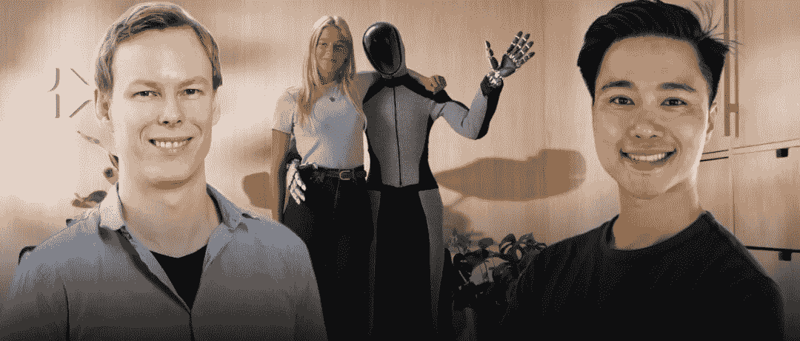
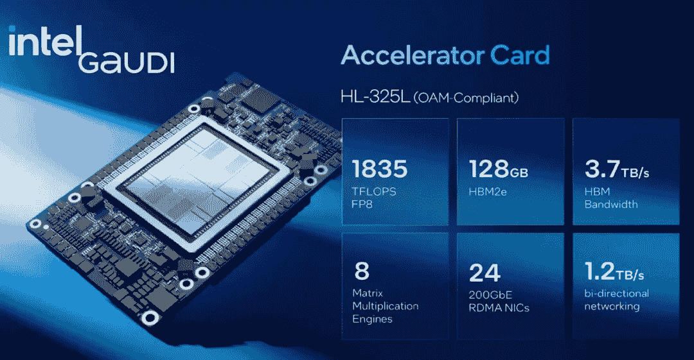
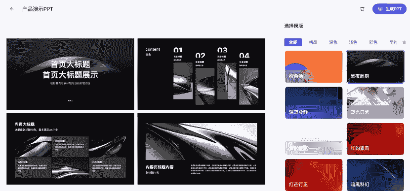
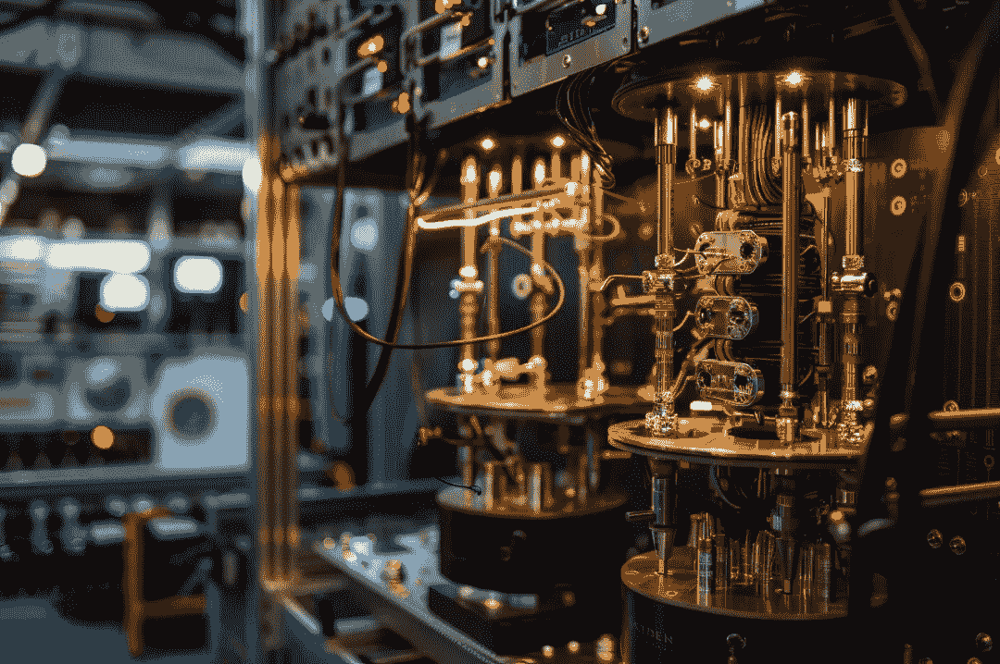
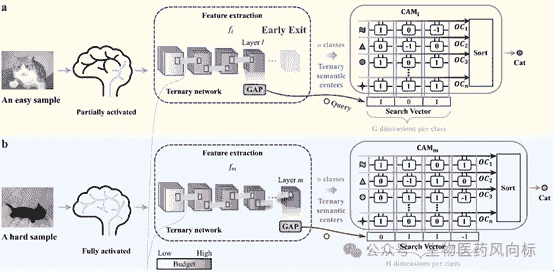
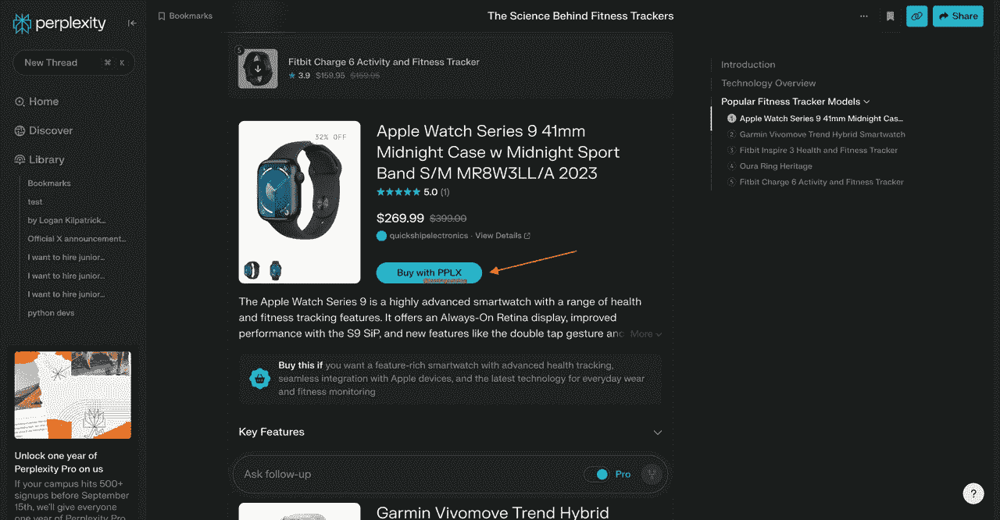
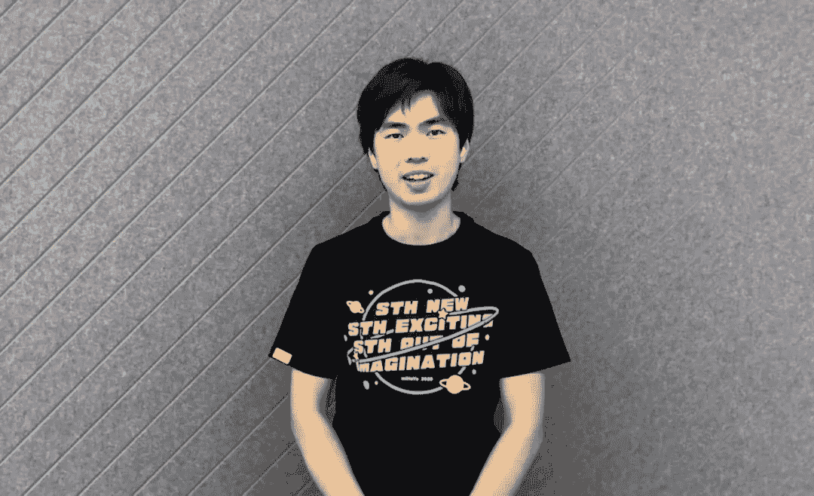
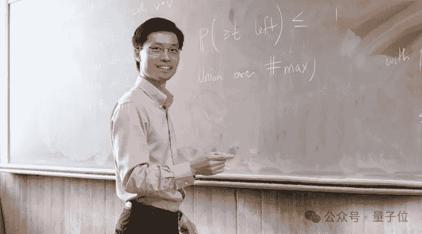

# 9.2 穿着西装的「人」却专做家务？OpenAI 家庭机器人 NEO 登场，动作丝滑逼近人类！

> 来源：[https://agijuejin.feishu.cn/docx/ELuZdc2GRo0YeVxXcXGcspzbn7g](https://agijuejin.feishu.cn/docx/ELuZdc2GRo0YeVxXcXGcspzbn7g)

> [欢迎加入 AGI 掘金社群](https://sourl.co/miZUyT)

## 🌟 技术突破

### 💡 穿着西装的「人」却专做家务？OpenAI 家庭机器人 NEO 登场，动作丝滑逼近人类！

新智元｜[阅读原文](https://sourl.co/cPHG8j)

1X Technologies 公司推出了最新的家用机器人 NEO，该机器人外形自然拟人，动作流畅，能够执行多种家务任务。NEO 身高 1.67 米，体重 30 公斤，拥有 20 个自由度的手部，能举起 70 公斤的重量。它采用轻量化设计，动作自然，能与人类进行交互，如打招呼和拥抱。NEO 的机载电机产生的力量接近人体肌肉力密度的 80%，且运行时非常安静。目前，NEO 处于 Beta 测试阶段，公司计划在挪威工厂大规模生产。NEO 的设计注重安全性，能够在家庭环境中安全操作，预计将在未来几年内成为家务机器人的主流。

### 💡 英特尔 Gaudi 3 AI 加速器找到了第一个云客户：IBM Cloud

聚大模型前言｜[阅读原文](https://sourl.co/aw36W6)

英特尔与 IBM Cloud 宣布合作，IBM Cloud 将于 2025 年初推出基于英特尔 Gaudi 3 AI 加速器的云服务。Gaudi 3 采用 5nm 制程技术，具备 64 个 TPC 和 8 个 MME，支持高达 3.7TB/s 的内存带宽，并集成 24 个 200Gb 以太网端口。英特尔宣称 Gaudi 3 在推理能效和性能上均优于英伟达 H100。IBM Cloud 将利用 Gaudi 3 为客户提供优化的 AI 解决方案，同时计划在 watsonx 平台启用 Gaudi 3，以增强 AI 基础设施资源。此次合作旨在通过开放和协作的生态系统，推动经济实惠且创新的 AI 计算解决方案的发展。

### 💡 世界首个 1 亿 token 神级上下文模型诞生，前 OpenAI 大佬加盟获 4.65 亿融资！

新智元｜[阅读原文](https://sourl.co/G8p4S6)

Magic 公司开发的 LTM-2-mini AI 模型，上下文窗口达到 1 亿 token，相当于 1000 万行代码，远超现有技术。该模型采用序列维度算法，计算效率比 Llama 3.1 405B 的注意力机制高出约 1000 倍，大幅减少计算和内存需求。团队创新 HashHop 评估体系，提高上下文长度和可靠性。Magic 已获得包括 Eric Schmidt 和红杉资本在内的 4.65 亿美元融资，致力于实现编码和研究的全自动化，推动 AGI 发展。

### 💡 谷歌打磨 Gemini AI 技能：扩充支持文件类型、提高文档洞察力

思维引擎AI+｜[阅读原文](https://sourl.co/Q8SEZn)

谷歌 GeminiAl AI 进行了重大升级，新增对电子表格、演示文稿、图像、音频和视频等文件类型的支持。用户可以上传电子表格以获得数据分析和趋势洞察，演示文稿可以提取关键信息和视觉元素。图像识别功能可以提取文本和识别对象，音频文件可转录并识别发言者，视频内容解析则能提取对话和关键场景，为教育和内容索引提供便利。这些升级显著增强了 GeminiAl 的文件处理和分析能力。

### 💡 阿里通义上新 PPT 创作！PC 端“效率”功能三合一，听读写一站搞定

量子位｜[阅读原文](https://sourl.co/6r7wQr)

阿里通义新推出的 PC 端“效率”功能集实时记录、阅读助手和 PPT 创作于一体，旨在提升工作效率。PPT 创作支持一句话主题生成和文件上传，提供丰富模板和智能编排，实现快速制作。实时记录功能支持多语言转文字和智能总结，而阅读助手则能速读多种格式文档并提供全文翻译。这些功能基于通义千问大模型 2.5，优化了理解、逻辑推理和指令遵循能力，支持长文档和多模态输入，为用户提供一站式的信息整理、阅读和创作解决方案。

### 💡 讯飞版「Her」横空出世全民开放！百变人设逼真丝滑，情绪价值逆天

新智元｜[阅读原文](https://sourl.co/qDV3Sm)

科大讯飞推出星火版「Her」AI 助手，支持极速响应和自由打断，具备高情绪价值和逼真的人设表现。该技术通过端到端建模，实现语音到语音的直接转换，减少响应延迟，保留语音中的情感和环境信息。AI 助手能够识别和响应数十种情绪，支持多种方言和风格，提供丰富的交互体验。讯飞的这一创新预示着语音交互技术的突破，将推动智能语音市场的发展，为用户带来更自然、更智能的交流方式。

### 💡 用数学方法证明量子纠缠会突然消失！MIT 计算机科学家“无心插柳”提供关键论证

量子位｜[阅读原文](https://sourl.co/RtcAX2)

MIT 计算机科学家团队通过数学方法发现，在一定温度值以上，量子纠缠会完全消失，导致基于纠缠的量子计算和通信协议失效。这一发现意味着量子计算机在高温下可能失去其计算优势。此前，学界虽观察到量子纠缠随温度升高而减弱，但缺乏直接证据。该团队的研究提供了全面严谨的数学证明，揭示了量子纠缠“突然死亡”的现象，并指出这一现象与系统中原子间的相互作用有关，而非原子总数。研究结果为量子物理学和量子计算机理论提供了新的视角和理解。

### 💡 城市智慧脉络构建者：揭秘高效能 OpenCity 大模型的城市交通新玩法

这个宇宙｜[阅读原文](https://sourl.co/cS3e2R)

OpenCity 大模型是城市智慧脉络构建者，通过高效能技术革新城市交通。该模型利用先进的数据处理和分析能力，优化交通流量，减少拥堵，提升出行效率。它通过实时监控和预测交通模式，为城市管理者提供决策支持，同时为市民提供更便捷的出行选择。OpenCity 模型的实施，预示着城市交通管理向智能化、自动化迈进，为城市居民带来更高效、更绿色的出行体验。

### 💡 中国科学院开发出基于语义记忆的动态神经网络：相比静态最高减少 48.1% 计算量

生物医药风向标｜[阅读原文](https://sourl.co/g5cwuM)

中国科学院微电子研究所刘明院士团队联合香港大学和复旦大学的研究人员，开发了一种新型动态神经网络，该网络模仿大脑的动态可重构性，通过关联新旧信息实现动态连接。与静态网络相比，这种网络能根据资源需求调整计算效率和准确性，显著减少计算量和能耗。研究团队利用 TaN/TaOx/Ta/TiN 阻变存储器阵列验证了其设计的有效性，该网络在 ResNet 和 PointNet++框架上表现出色，已在《科学进展》发表，为开发高效人工智能系统提供了新思路。

## 💫 企业动态

### 💡 GPT-4o mini 排名雪崩，大模型竞技场规则更新，奥特曼刷分小技巧无效了

量子位｜[阅读原文](https://sourl.co/miHeFa)

大模型竞技场更新规则，导致 GPT-4o mini 排名急剧下降。新规则对回答长度和风格进行降权，以更真实反映模型解决问题的能力。奥特曼的 GPT-4o mini 和马斯克的 Grok-2 系列受影响较大，而 Claude 系列和 Llama-3.1-405b 大模型分数上升。Lmsys 通过公开数据和新算法控制风格影响，使榜单更符合实际性能。调整后的榜单更贴近用户主观印象，促进了 AI 领域的整体进步。

### 💡 8 秒生成犯罪现场报告，美警使用 AI 工具写文书，竟比人脑回忆还准

新智元｜[阅读原文](https://sourl.co/2nHjjA)

美国警察采用 AI 工具 Draft One 辅助撰写犯罪报告，显著提升文书工作效率。该工具由 GPT-4 支持，能迅速将执法记录仪音频转录成报告，减少 82%的撰写时间。尽管受到警务人员欢迎，但存在准确性和偏见问题。AI 报告可能包含错误信息，且种族偏见问题引起关注。Axon 公司通过测试确保不同种族间报告无显著差异，并建议仅用于轻罪报告。技术仍在测试阶段，以确保其在警务工作中的可靠性。

### 💡 Perplexity AI 搜索测试 PPLX 支付系统：网购仅需点 2 下

IT之家｜[阅读原文](https://sourl.co/Pg4XVf)

Perplexity AI 正在测试其内部支付系统 PPLX，该系统在 Discover 信息流中展示产品卡，提供产品摘要和“通过 PPLX 购买”选项。用户可以通过点击两次按钮轻松完成购物，无需跳转至第三方支付页面。这种模式类似于联盟营销，Perplexity 通过引导用户购买产品赚取佣金。用户首次点击购买按钮时需填写支付信息，之后便可快速完成交易。Perplexity 成立于 2022 年 8 月，获得了 OpenAI、Meta 等投资，专注于利用 AI 技术打造无广告搜索体验。

### 💡 白领的噩梦？这家瑞典支付巨头计划裁员一半：靠 AI 便可维系

AI数字经济｜[阅读原文](https://sourl.co/jDKCKM)

瑞典支付公司 Klarna 宣布，为提高效率，计划将员工人数从 3800 人减少至 2000 人，通过采用人工智能技术来完成客户服务和营销等任务。公司首席执行官 Sebastian Siemiatkowski 认为，AI 技术将使公司能够用更少的资源完成更多的工作，同时提高员工收入水平。尽管裁员可能带来失业率上升，但 Siemiatkowski 表示，这是政府而非企业需要关注的问题。Klarna 的这一战略转型可能是其即将进行的 IPO 的关键卖点，公司目前正筹备上市，预计估值在 150 亿至 200 亿美元之间。

### 💡 红杉美国对话 Sierra 联合创始人 Clay Bavor：B2B AI Agent 如何做到 PMF 以及客户满意？

有新Newin｜[阅读原文](https://sourl.co/cgzwNB)

Sierra 是一家专注于企业解决方案的 AI 初创公司，由 OpenAI 现任董事会主席 Bret Taylor 和 Clay Bavor 共同创立。Clay Bavor 曾在谷歌工作 18 年，负责 AR/VR 项目等。Sierra 采用基于结果的定价模式，即客户仅在问题解决后支付费用，确保公司与客户利益一致。Clay Bavor 在对话中分享了 AI 技术的最新动态，讨论了 AI Agent 在客户服务中的潜力，以及如何通过模拟经验丰富的员工来提升服务质量和效率。他还预测了未来五年 AI 技术的发展趋势，包括全自动化的电影制作和创意实现过程的加速。Sierra 的 Agent OS 提供了一个工具包和运行时环境，用于构建工业级别的 AI Agent，通过集成不同的模型和工具，提高 AI 在实际应用中的可靠性和安全性。

## ✨ 行业观点

### 💡 米哈游蔡浩宇发布爆款言论，新 AI 公司曝光：挖 Llama 3 科学家坐镇大模型

土著哥的浮想联翩｜[阅读原文](https://sourl.co/YRsh2K)

米哈游创始人蔡浩宇认为 AIGC 将彻底改变游戏开发，未来游戏创造将只属于顶尖团队和业余爱好者。他参与创建的 AI 公司 Anuttacon 汇集了多位行业大牛，包括计算机图形学专家童欣和大模型研究负责人吴箫剑。Anuttacon 旨在利用 AI 技术为游戏玩家创造前所未有的体验，突破互动娱乐的界限。蔡浩宇的言论和 Anuttacon 的成立预示着 AI 技术在游戏行业的深远影响。

### 💡 AI 行业风光背后：80% 项目会失败，5 大原因导致

IT之家｜[阅读原文](https://sourl.co/QWJRPA)

美国 RAND Corporation 的报告指出，AI 行业 80%的项目以失败告终，造成数十亿美元损失。报告通过访谈 65 位 AI/ML 模型构建者，揭示了五大失败原因：投资错位、数据不足、盲目追新、算力缺乏以及 AI 产品定位不切实际。这些因素共同作用，导致项目无法解决实际问题，最终难以实现预期目标。

### 💡 Anthropic 创始人 Dario Amodei：关于护城河与风险，AI 大多数情况很难直接替代人

有新Newin｜[阅读原文](https://sourl.co/yUm9eZ)

Anthropic 创始人 Dario Amodei 与科技投资人 Erik Torenberg 对话，讨论 AI 安全性、全球竞争和行业监管。Amodei 认为 AI 系统可控性高，强调监管应避免过度，支持威慑机制管理 AI 风险。他指出 AI 可能加剧经济不平等，但通过政策和监管可实现技术红利普惠。Amodei 还讨论了 AI 公司护城河问题，提出在 AI 模型规模扩大的情况下，可能形成寡头垄断市场。他预测 AI 将改变工作方式，但人类与 AI 的比较优势将持续存在。最后，他强调了 AI 技术在国家安全中的重要性，以及中美在 AI 领域的竞争态势。

### 💡 执教 10 年 46 枚美国 IMO 金牌！罗博深：不看好 AI 教育，不建议 AI 辅助学数学

量子位｜[阅读原文](https://sourl.co/JWsNFV)

前美国奥数总教练罗博深认为，AI 教育并非数学学习的必要工具。他强调，教育应注重培养独立思考和解决问题的能力，而非依赖 AI。罗博深提倡传统教育方法，鼓励学生通过创造性方式解决问题。他通过 LIVE 项目，让高中生为小学生授课，同时接受表演训练，旨在提高学生的表达和共情能力。该项目不仅提升学生的数学兴趣，还培养了他们的领导力和影响力，为未来的学术和职业生涯打下基础。罗博深的目标是培养关心人类、能对社会产生积极影响的人才。

### 💡 晋江文学城痛批“部分博主偷取多部知名小说喂 AI”：无耻嚣张的侵权行为

IT之家｜[阅读原文](https://sourl.co/QM6cCW)

晋江文学城官方微博发文，强烈谴责部分博主使用平台小说训练 AI 生成文字内容的行为。这些博主在小红书平台宣传 AI 制作文字的方法，分解作品内容生成 AI 文字，严重侵犯了作者权益。晋江文学城法务已向小红书发函维权，要求删除侵权内容，并将持续关注和对抗此类侵权行为。同时，晋江文学城也表达了对 AI 拼凑文字内容行为的坚决抵制态度，强调将维护作者权益，反对窃取智慧成果的行为。