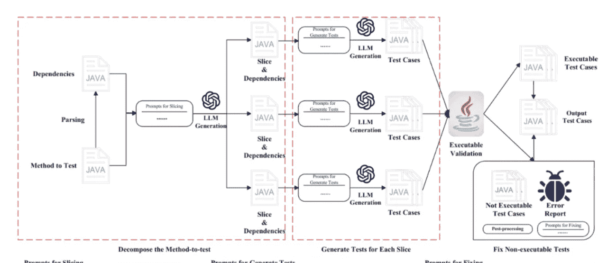
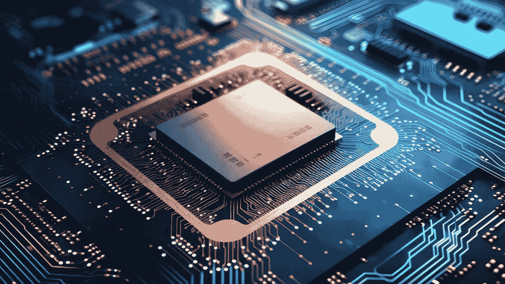
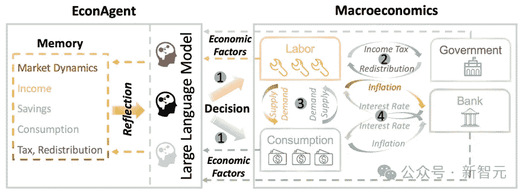
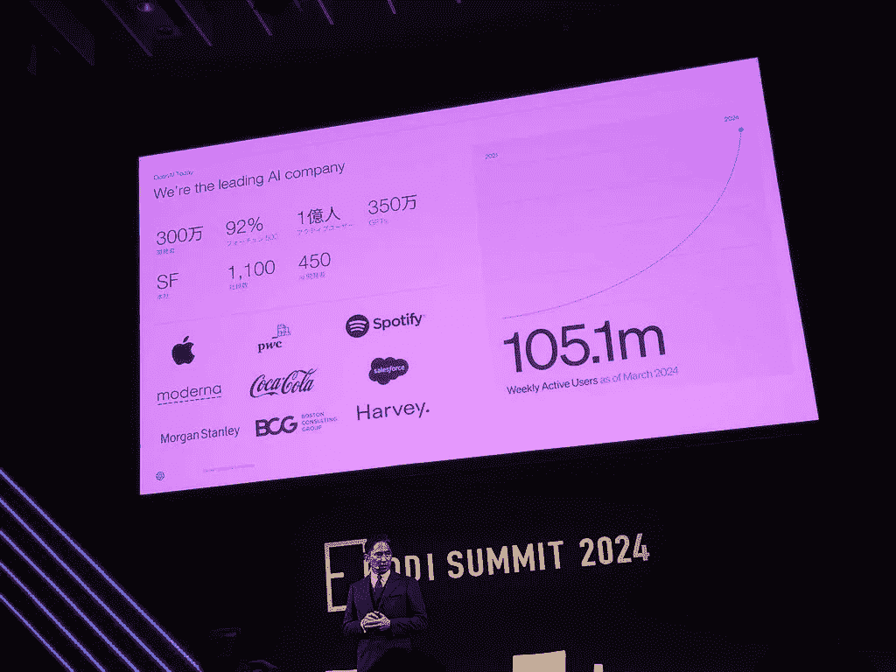
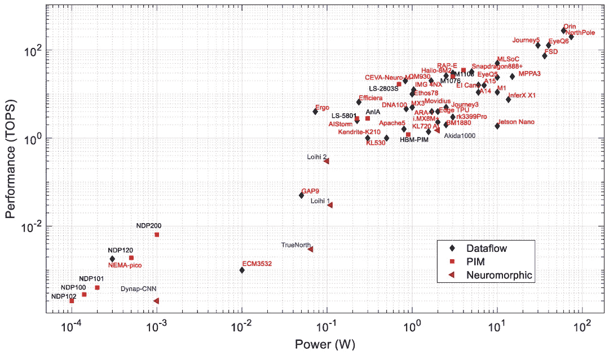
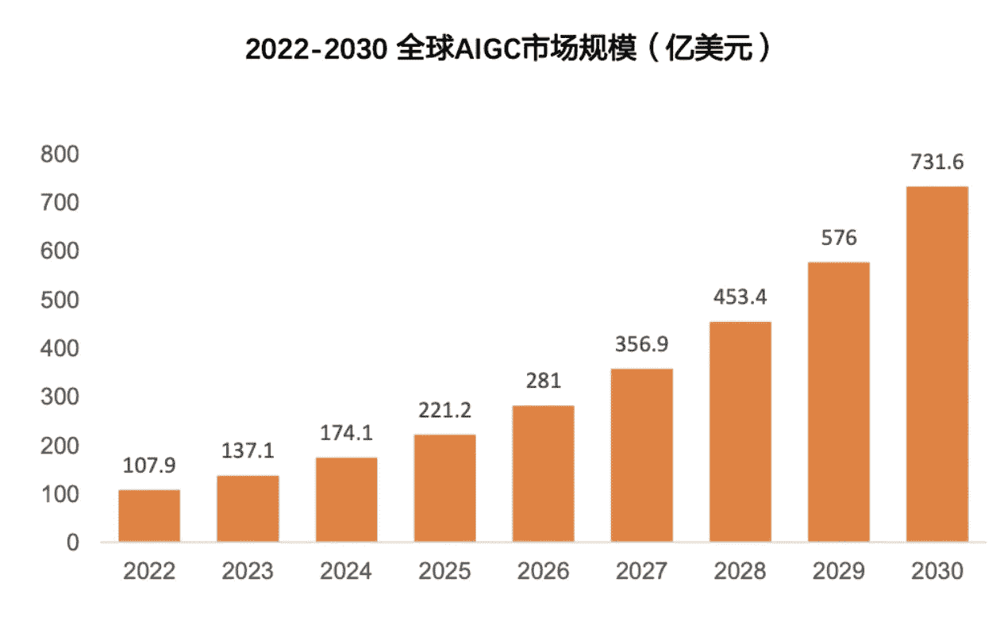

# 9.5 千亿AI妖股连年亏损近55亿，AI的赚钱能力为何还不及“黑神话: 悟空”游戏？

> 来源：[https://agijuejin.feishu.cn/docx/ZDLtdhJVAonPx1xt9Qac52OCngb](https://agijuejin.feishu.cn/docx/ZDLtdhJVAonPx1xt9Qac52OCngb)

> [欢迎加入 AGI 掘金社群](https://sourl.co/miZUyT)

## 🌟 技术突破

### 💡 迈向「多面手」医疗大模型，上交大团队发布大规模指令微调数据、开源模型与全面基准测试

ScienceAI 丨 [阅读原文](https://sourl.co/w6WkNY)

上海交通大学联合上海AI Lab和中国移动等机构的研究团队，在arXiv预印平台发布了一篇关于医疗大语言模型（LLM）的全面研究。文章《Towards Evaluating and Building Versatile Large Language Models for Medicine》从数据、评测、模型等多个角度分析了临床医学大语言模型的应用。研究团队发布了大规模指令微调数据集MedS-Ins、开源模型MMedIns-Llama 3，并提出了全面基准测试MedS-Bench，以推动医学语言模型的发展和临床实践中的应用。

### 💡 北大李戈团队提出大模型单测生成新方法，显著提升代码测试覆盖率

机器之心 丨 [阅读原文](https://sourl.co/v2g5Sk)

北京大学李戈教授团队提出了一种新的单元测试生成方法HITS，通过程序分片技术显著提升了大模型在复杂函数测试样例生成中的覆盖率。该方法利用大模型的自然语言处理能力，将复杂函数拆分为简单片段，并为每个片段生成测试样例，有效降低了分析难度并提高了测试效率。HITS在ASE 2024顶会上被接受，并在实验中显示出优于现有方法的性能。

### 💡 OpenAI首颗芯片曝光：台积电1.6nm，为Sora定制

量子位 丨 [阅读原文](https://sourl.co/h3UAGr)

OpenAI的首款自研芯片采用台积电1.6纳米先进工艺，专为AI视频生成工具Sora定制。此举表明OpenAI在减少对外部AI芯片依赖上迈出重要一步。芯片将采用台积电最新A16工艺，提升性能并降低功耗。同时，OpenAI与苹果的合作可能使Sora集成至Apple Intelligence。台积电A16工艺的先进性和与英特尔18A节点的竞争也成为焦点。

### 💡 大模型应用新战场：揭秘终端侧AI竞争关键

量子位 丨 [阅读原文](https://sourl.co/XmL8xC)

2024年，大模型技术在终端侧AI应用中取得显著进展。高通等公司通过量化技术、编译优化和硬件加速等手段，提高了AI模型在手机等算力有限设备上的运行效率和性能。这些技术不仅提升了用户体验，还推动了AI应用的普及和行业创新。

### 💡 清华EconAgent获ACL 2024杰出论文：大模型智能体革新计算经济学研究范式

新智元 丨 [阅读原文](https://sourl.co/Ju2LzK)

清华大学电子系城市科学与计算研究中心的研究论文《EconAgent: Large Language Model-Empowered Agents for Simulating Macroeconomic Activities》荣获ACL 2024杰出论文奖。该研究利用大语言模型（LLM）构建EconAgent，模拟宏观经济系统中个体的工作与消费行为，与传统基于代理的建模（ABM）相比，展现出更稳定、真实的宏观经济现象。研究通过模拟验证了EconAgent在宏观经济指标和规律上的合理性和稳定性，为计算经济学研究提供了新的范式。

## 💫 企业动态

### 💡 突发！“ChatGPT之父” Ilya Sutskever新公司成立仅3个月融资10亿美元，估值已超350亿

钛媒体AGI 丨 [阅读原文](https://sourl.co/AHhdsr)

ChatGPT之父，前 OpenAI联合创始人、首席科学家Ilya创立的新公司Safe Superintelligence (SSI) 在成立三个月后完成了10亿美元的融资，估值达到50亿美元。SSI旨在开发超越人类能力的AI系统，投资方包括a16z、红杉资本、DST Global和SV Angel等。资金将用于人才招募和技术投入，公司计划与云服务和芯片公司合作以满足其计算需求。

### 💡 Anthropic 推出 企业版Claude 500K上下文 可以将 GitHub 仓库与 Claude 集成

程序人生 丨 [阅读原文](https://sourl.co/hLbAgb)

Anthropic 公司推出了 Claude Enterprise 计划，旨在帮助企业安全地整合内部知识与 AI 技术。该计划提供 50万字上下文窗口、更大的使用容量和 GitHub 集成，以及安全特性如单点登录和基于角色的访问控制。Anthropic 承诺不会使用企业数据训练 AI，确保数据隐私和安全。

### 💡 OpenAI 今年启动 GPT Next 计划：AI 性能百倍级跃升，Orion 有望接棒 GPT-4

程序人生 丨 [阅读原文](https://sourl.co/BqfLwA)

OpenAI Japan 首席执行官长崎忠雄（Tadao Nagasaki）表示，虽然 GPT-3 和 GPT-4 的性能比较接近，但 GPT Next 预计会有更大的飞跃，性能将提高 100 倍。长崎忠雄于 2024 年 4 月成为 OpenAI Japan 的掌舵者，他在会上强调相比较传统软件，AI 技术正以指数级速度发展。penAI 目前正在开发两个新的人工智能系统：草莓“Strawberry” AI 模型主要提高数学和编程等领域能力，而“Orion”可能成为 GPT-4 的真正继任者，从而成为“GPT Next”。

### 💡 英伟达市值暴跌2万亿！一夜蒸发3个英特尔，创美国历史纪录

新智元 丨 [阅读原文](https://sourl.co/qh2Z3R)

英伟达市值在一夜之间蒸发2790亿美元，创下美国公司单日最大跌幅纪录。这一跌幅不仅反映了投资者对AI市场的谨慎态度，也与美国司法部对英伟达的反垄断调查升级有关。英伟达被怀疑限制客户转向其他供应商，并在AI芯片销售上对买家施加不利条件。此外，英伟达的暴跌还对整个芯片股市场产生了负面影响，导致包括英特尔、AMD在内的多家公司股价下跌。

## ✨ 行业观点

### 💡 端测AI芯片，群雄争霸

半导体行业观察 丨 [阅读原文](https://sourl.co/vfq8ys)

数据流处理器专为神经网络推理和训练计算设计。例如，ADI的MAX78000是一种低功耗混合信号CNN加速器，集成了多个并行处理器，支持多种权重精度。苹果的A16和M2处理器则在性能和功耗之间取得了平衡，适用于高性能边缘设备。Blaze的Pathfinder P1600 El Cano Al处理器整合了16个图形流处理器，峰值性能为16TOPS，适合高性能计算任务。神经形态处理器模仿生物神经元的工作方式，以极低的功耗实现Al计算。例如，BrainChip的Akida系列使用脉冲神经网络(SNN)实现高效推理，功耗仅为2W。IBM的TrueNorth处理器则以65mW的功耗实现了 46GSOPS/W的性能，适合实时跟踪和检测任务。

### 💡 大模型与小模型

ybq 丨 [阅读原文](https://sourl.co/W8BLc8)

同源小模型的研究价值：在相同的tokenizer和训练数据下，小模型可以通过实验快速验证大模型的性能，尤其是在预训练和后续训练阶段。小模型的快速迭代能力使其成为大模型实验的理想场所

### 💡 千亿AI妖股连年亏损近55亿，AI的赚钱能力为何还不及“黑神话: 悟空”游戏？

钛媒体AGI 丨 [阅读原文](https://sourl.co/QRMwrW)

寒武纪科技作为AI算力龙头，尽管市值高达千亿，却连续第八年亏损，累计亏损近55亿元。与此同时，国产游戏“黑神话：悟空”短期内获得巨额利润，引发对AI产业盈利能力的质疑。AI企业面临激烈的市场竞争、难以大规模商业化、研发投入高昂等问题。尽管AI技术潜力巨大，但目前其经济效益有限，需要更多时间和耐心来实现其价值。

### 💡 噩耗！SD3、FLUX.1等开源文生图模型，可能将无法使用

AIGC开放社区 丨 [阅读原文](https://sourl.co/Xt5wiH)

美国加州法案AB-3211针对文生图模型提出新规定，要求模型必须嵌入难以移除的元数据和水印，否则违法。该法案若通过，将对开源模型如SD3、FLUX.1造成重大影响，增加技术难度和成本，可能抑制创新。法案得到科技巨头支持，但对小型开发者和学术机构不利。

###

###