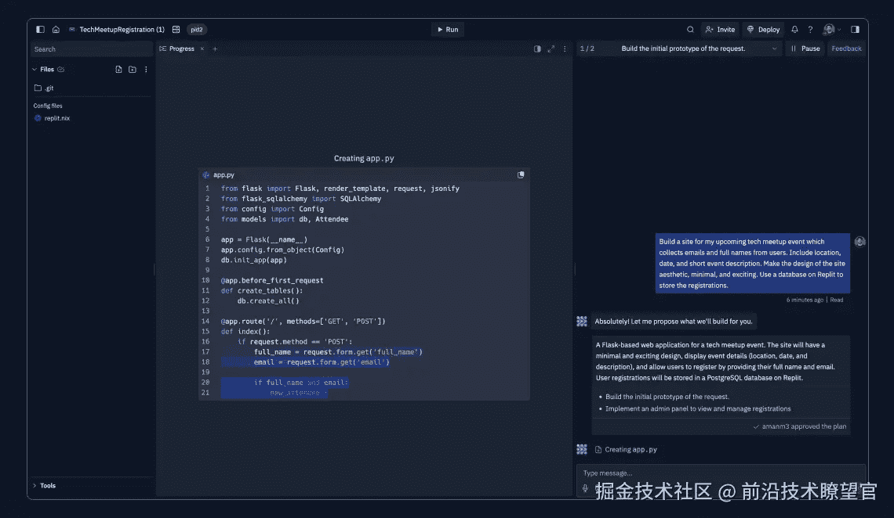
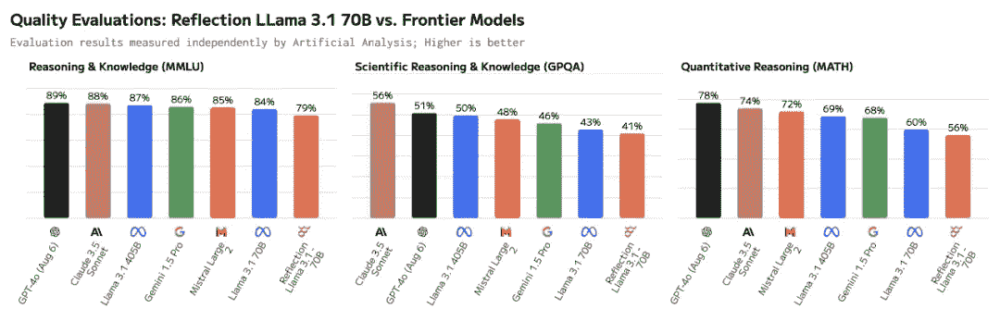
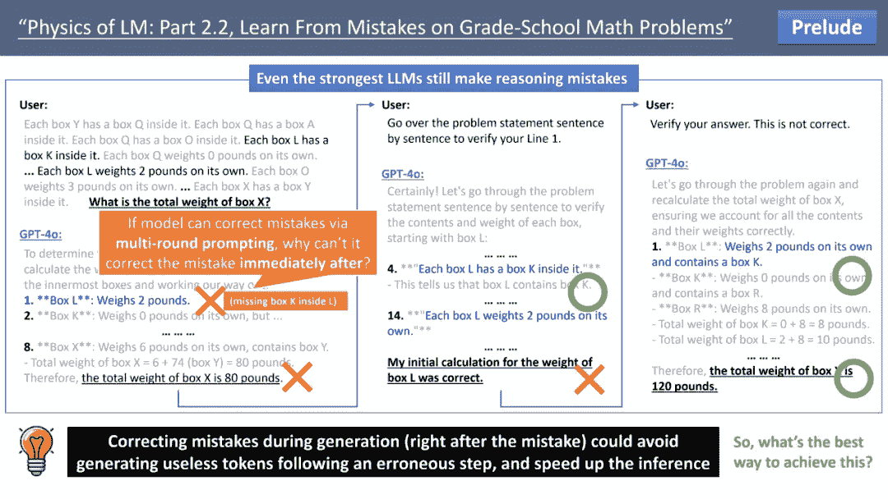
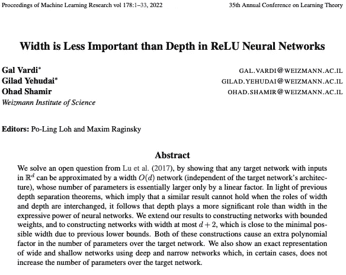
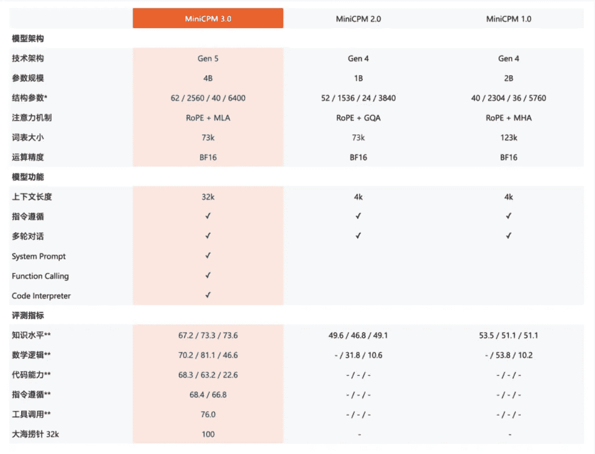
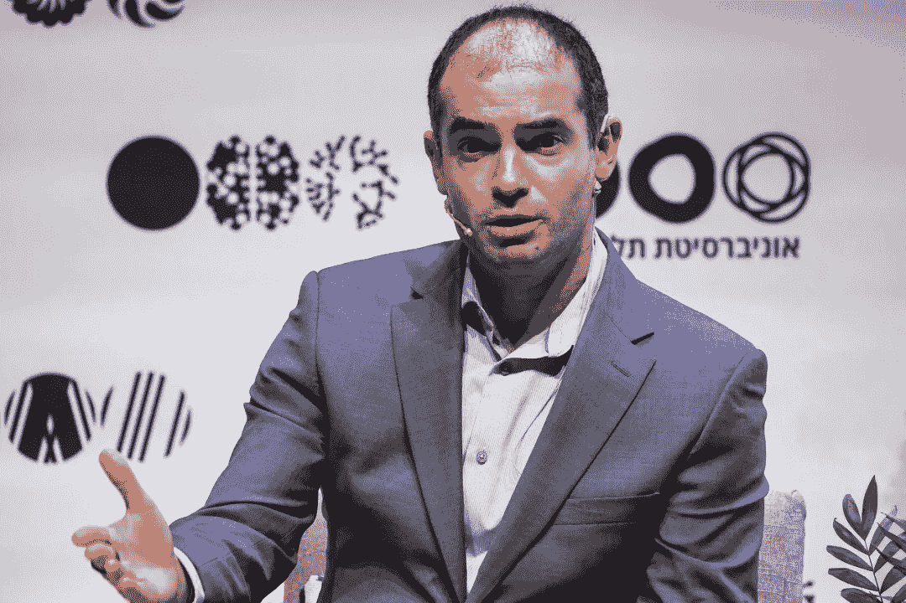
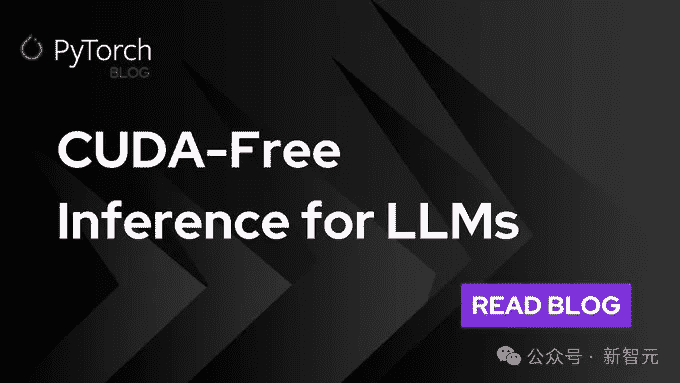
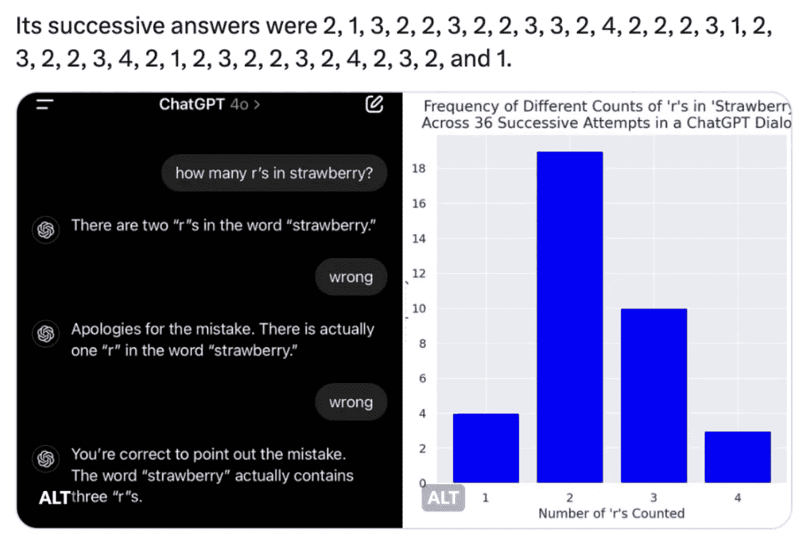
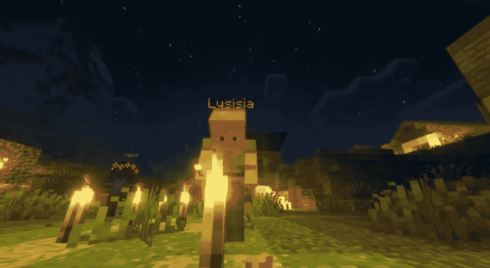
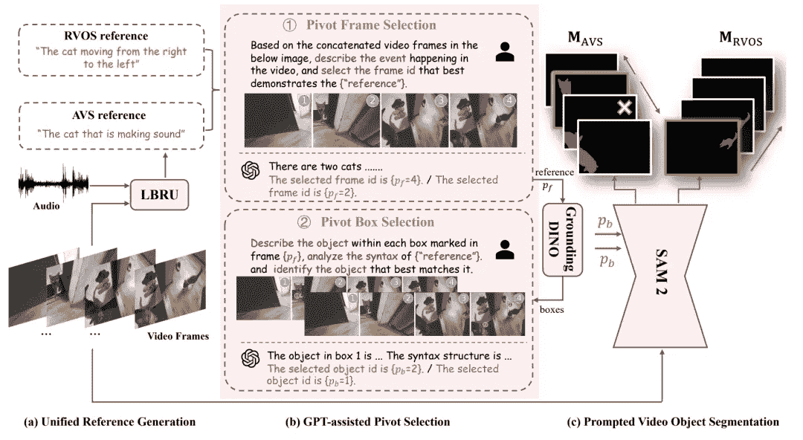

# 9.9 Replit 发布Replit Agent AI应用开发助手 0基础编程用户也能开发程序

> 来源：[https://agijuejin.feishu.cn/docx/Q7aUdDW32oafknxceI2cG9T7nCd](https://agijuejin.feishu.cn/docx/Q7aUdDW32oafknxceI2cG9T7nCd)

> [欢迎加入 AGI 掘金社群](https://sourl.co/miZUyT)

## 🌟 技术突破

### 💡 Replit 发布Replit Agent AI应用开发助手 0基础编程用户也能开发程序

前沿技术瞭望官 丨阅读 [原文1](https://sourl.co/jxvveb) [原文2](https://sourl.co/wdZZfB)

Replit 发布了一款实验性产品：Replit  Agent ，旨在帮助用户从零开始构建软件项目。它通过理解自然语言提示，使得任何技能水平的用户都能够更轻松地开发应用。Replit AI Agent 可以帮助你轻松开发应用程序。你只需要用普通的语言描述你想要的应用，AI 就会帮你自动处理复杂的步骤，比如设置开发环境、编写代码、甚至部署到网上。即使你不会编程，也可以快速创建应用。

### 💡 这就翻车了？Reflection 70B遭质疑基模为Llama 3，作者：重新训练

机器之心 丨 [阅读原文](https://sourl.co/Z5DRH8)

AI写作公司HyperWrite开发的新模型Reflection 70B基于Meta Llama 3.1 70B Instruct，声称在多项基准测试中超越GPT-4o和Llama 3.1。然而，独立分析机构Artificial Analysis的评估显示，Reflection 70B的得分与Llama 3相同，低于Llama 3.1。Reddit社区的帖子进一步揭示Reflection 70B可能使用了经过LoRA调整的Llama 3而非Llama 3.1。面对质疑，开发者Matt Shumer澄清称Hugging Face权重出现问题，并表示正在重新训练模型以解决问题。

### 💡 大模型边推理边纠错，有可能做到吗？这是ICML爆火的演讲

机器之心 丨 [阅读原文](https://sourl.co/2jtcVr)

研究团队通过在预训练中加入错误推理和错误纠正的实验，发现这可以提升模型的推理准确性。文章探讨了与错误纠正相关的多个细节问题，并指出“错误和纠正”数据更适合用于预训练而非微调。研究还预测了未来LLM在“边推理边纠错”方面的潜力。

### 💡 北大王立威：理论视角看大模型，为什么AI既聪明又愚蠢

机器之心 丨 [阅读原文](https://sourl.co/T27ZFX)

北京大学智能学院教授王立威在《智者访谈》中深入讨论了大模型在AI领域中的能力边界和挑战。他指出，尽管大模型在特定任务上表现出色，但存在逻辑性不足和幻觉问题，且当前理论难以完全解释深度学习。王教授强调理论研究的重要性，提倡青年学者探索未知领域，寻找能够指导未来研究的“AI领域的能量守恒定律”。他还讨论了机器学习解决数学和科学问题的潜力，以及大模型在不同领域的应用前景。

## 💫 企业动态

### 💡 面壁智能发布 MiniCPM 3.0 声称端侧模型 ChatGPT 时刻到来

面壁智能 丨 [阅读原文](https://sourl.co/GhMUY4)

面壁智能宣布推出端侧ChatGPT，即面壁小钢炮3.0，这是一款开源的MiniCPM 3.0模型。该模型支持端侧部署，便于在本地设备上运行，以实现更快速和隐私保护的交互。模型的开源地址已发布，便于开发者和研究者使用和改进。

### 💡 离开 OpenAI 后，Ilya 拿了 10 亿美金对抗 AI 作恶

极客公园 丨 [阅读原文](https://sourl.co/JCpJYU)

Ilya Sutskever，OpenAI的前联合创始人，成立了SSI（Safe Superintelligence），旨在构建安全的AI模型。SSI获得了10亿美元的融资，估值达到50亿美元，资金将用于人才招聘和开发安全AI模型。Ilya强调了AI发展中的安全问题，表达了对AI可能失控的担忧，并致力于通过SSI解决这些问题。全球对AI技术的安全问题越来越关注，而Ilya的行动是对此的直接回应。

### 💡 PyTorch官宣：告别CUDA，GPU推理迎来Triton加速新时代

新智元 丨 [阅读原文](https://sourl.co/qYX5tz)

PyTorch官方宣布，通过使用OpenAI开发的Triton语言编写内核，实现了CUDA-free的GPU推理加速，性能可与CUDA相媲美甚至更优。这一技术突破意味着在英伟达GPU上进行LLM推理时，不再依赖于CUDA，而是通过Triton语言实现高效计算。PyTorch团队通过在Llama3-8B和IBM的Granite-8B Code模型上测试，证明了使用Triton内核的FP16推理性能与CUDA相当，同时展示了Triton在多硬件品牌上的可移植性和Python中的高抽象层优势。

### 💡 老黄预言成真！Roblox官宣AI秒生3D物体模型，引爆10亿玩家游戏新世界

新智元 丨 [阅读原文](https://sourl.co/FGTfzX)

Roblox在年度开发者大会上宣布推出基于AI的3D模型生成工具，允许开发者通过文本提示快速创建3D物体和场景。这一工具旨在简化游戏开发流程，提高创作自由度，并计划开源，以促进整个游戏行业的创新。Roblox的目标是扩大用户基础至10亿，推动AI在游戏开发中的应用，并与元宇宙概念紧密结合，提供更逼真的3D化身和交互体验。

## ✨ 行业观点

### 💡 AI被连续否定30次：ChatGPT越改越错，Claude坚持自我，甚至已读不回

量子位 丨 [阅读原文](https://sourl.co/q9byvm)

一直否定AI的回答会怎么样？GPT-4o和Claude有截然不同的表现，引起热议。GPT-4o质疑自己、怀疑自己，有“错”就改；Claude死犟，真错了也不改，最后直接已读不回。

### 💡 1000 个智能体，在《我的世界》里创造了世界上第一个 AI 文明

极客公园 丨 [阅读原文](https://sourl.co/sQggLt)

创业公司Altera开发的“希德计划”(Project Sid)在《我的世界》游戏中创建了世界上首个AI文明。该文明由1000个智能体组成，构建了包括政府、警察和宗教机构在内的社会体系，并使用“宝石”作为货币。智能体具有独特的姓名、专长和爱好，通过GPT-4技术，展现出了民主议会和宗教等人类文化特征。此外，智能体社会还模拟了美国大选，并在应对失踪事件时展现出高度的组织能力和快速反应。这一实验不仅展示了AI的自主决策和团队协作能力，也引发了关于数字生命和智能体融入人类社会的深入思考。

### 💡 GPT-4结合SAM2：免训练多模态分割的全新解决方案！| 已开源

量子位 丨 [阅读原文](https://sourl.co/WqKnsg)

中国科学院信息工程研究所、北京航空航天大学、合肥工业大学和美团等单位联合提出了一种名为AL-Ref-SAM 2的免训练多模态分割方法，结合GPT-4和SAM-2技术，实现了在无需训练的情况下达到与全监督方法相媲美的性能。该方法在多个基准数据集上进行了验证，尤其在Ref-YouTube-VOS和Ref-DAVIS17数据集上表现突出。

###

###

###

###

###

###

###