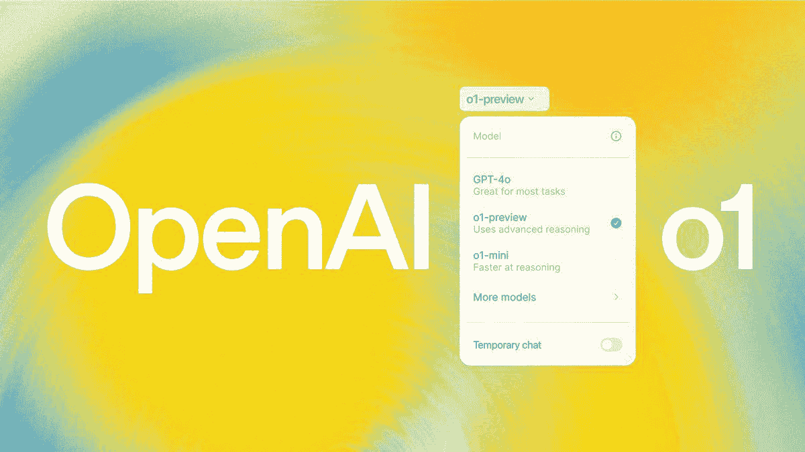
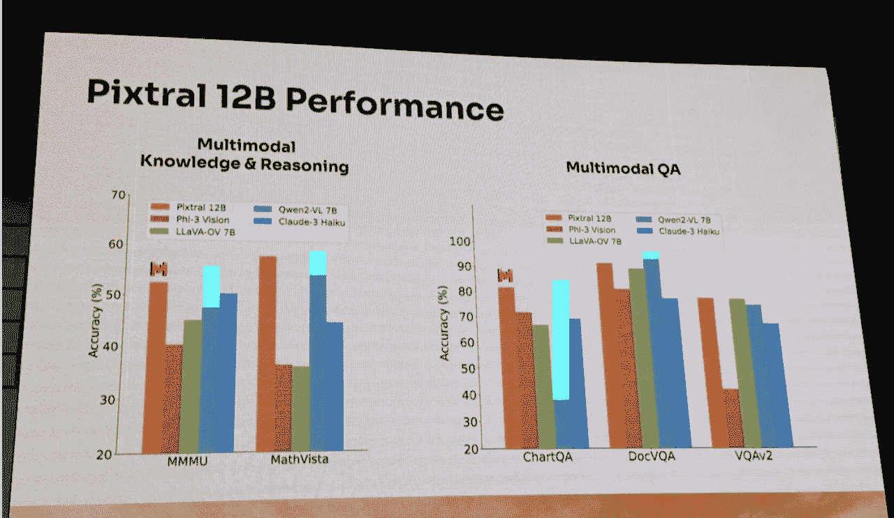
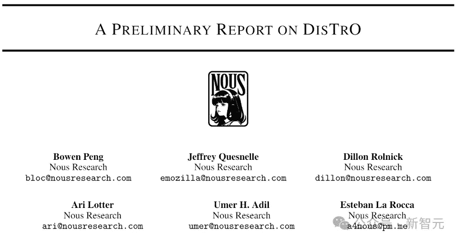
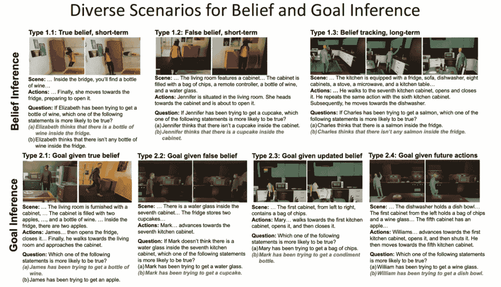
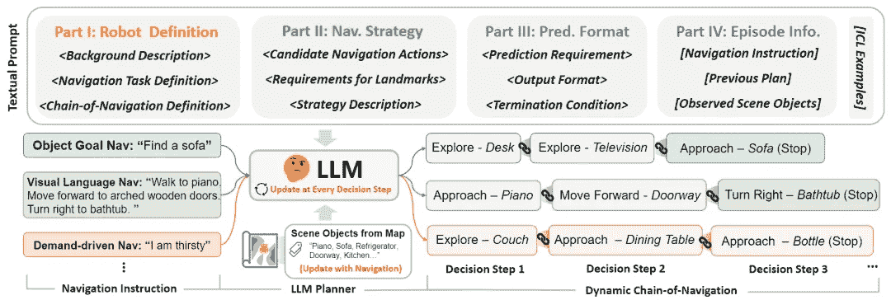
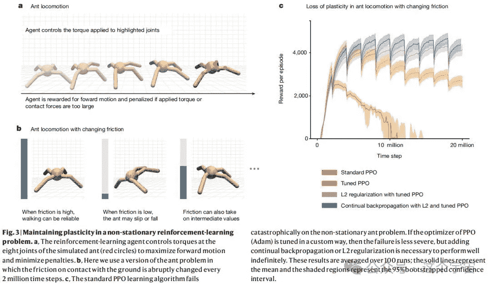
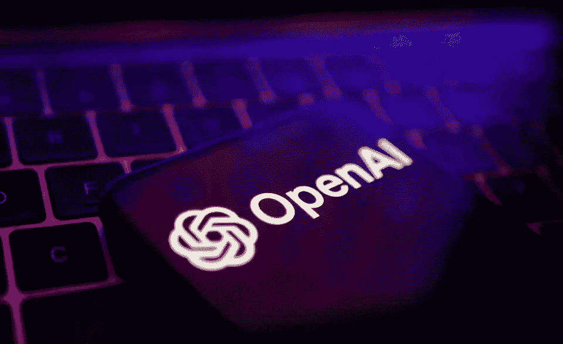

# 9.13 OpenAI推出了一个新的大语言模型一 OpenAI o1

> 来源：[https://agijuejin.feishu.cn/docx/PO0Xd3AOcoOR2Kxj1UMcke5vnU7](https://agijuejin.feishu.cn/docx/PO0Xd3AOcoOR2Kxj1UMcke5vnU7)

> [欢迎加入 AGI 掘金社群](https://sourl.co/miZUyT)

## 🌟 技术突破

### 💡 OpenAI推出了一个新的大语言模型一 OpenAI o1

前沿技术瞭望官 丨[阅读原文](https://openai.com/index/learning-to-reason-with-llms/)

新的模型主要体现在下面几个方面，思维链：o1在回答问题前会产生一个内部的思维链，这使得它能够进行更深入的推理。强化学习：通过大规模强化学习算法，o1学会了如何高效地使用其思维链。性能提升：o1的性能随着更多的强化学习（训练时间计算）和更多的思考时间（测试时间计算）而持续提高。

### 💡 Mistral多模态大模型来了！120亿参数，原生支持任意大小/数量图像，公司估值已达420亿

量子位 丨[阅读原文](https://mp.weixin.qq.com/s?__biz=MzIzNjc1NzUzMw==&mid=2247748668&idx=3&sn=61103a572c093b42f4da7386079bf374&chksm=e9d8de3889ef1dafd3ba7f64135eb841b6790a4d8101321c04afc9d00b4acd7816278ed8df9c&scene=0&xtrack=1#rd)

Mistral公司发布了Pixtral 12B多模态大模型，具备语言和视觉处理能力，基于文本模型Nemo 12B，支持任意数量和尺寸的图像。模型具有40层神经网络、14,336个隐藏维度、32个注意力头，及专用视觉编码器，支持高分辨率图像处理。公司估值已达420亿人民币，微软、AWS等巨头投资，有望成为“欧洲版OpenAI”。

### 💡 LLM训练通信量减少10000倍！全新分布式优化器，整合世间算力训练强大AI

新智元 丨[阅读原文](https://mp.weixin.qq.com/s/epbyp2YIbpaWinbq5TobZg)

Nous Research最近宣布了一项名为DisTrO的重大突破，这是一种分布式优化器，能够将训练大型语言模型（LLM）时GPU间的通信量减少1000到10000倍。这一技术使得利用全球算力进行AI模型训练成为可能，大幅降低了带宽成本，解决了训练过程中的瓶颈问题。DisTrO优化器不依赖于特定的架构或网络，能够支持分布式数据并行训练，且在实验中显示出与标准优化器相当的收敛速度。

### 💡 ACL杰出论文奖｜GPT-4V暴露致命缺陷？JHU等发布首个多模态ToM 测试集，全面提升大模型心智能力

机器之心 丨[阅读原文](https://mp.weixin.qq.com/s/fRa138rmFsv8W8JOYcsAPA)

该测试基准通过视频、文字描述和ToM问题，全面评估AI模型的心智能力。研究发现现有多模态模型和大型语言模型（LLM）在理解人类信念和目标时存在缺陷，尤其是GPT-4V在处理错误信念时表现较差。为了提升AI模型的心智能力，研究团队提出了BIP-ALM方法，通过符号表示、逆向规划和语言模型来推断心理状态。此外，研究还提出了MuMA-ToM测试基准，用于评估多智能体的多模态心智能力。

### 💡 北大提出首个通用指令导航大模型系统 | CoRL 24

量子位 丨[阅读原文](https://mp.weixin.qq.com/s?__biz=MzIzNjc1NzUzMw==&mid=2247748668&idx=5&sn=5cfa5a924fe691e7ac8af14356276b08&chksm=e958f8ffea6c3cc29448c55627bcb36027931f73403bc4588704bd9a32f9a4231ca1e5641a77&scene=0&xtrack=1#rd)

北京大学董豪团队提出首个通用指令导航大模型系统InstructNav，能够根据人类指令执行多种导航任务。该系统通过动态导航链路和多源价值地图技术，实现了对机器人导航的高效控制。InstructNav在多个零样本导航任务中创下新记录，其研究成果已被CoRL 2024会议录用。

## 💫 企业动态

### 💡 科技巨头打响语音模型之战！亚马逊用Claude升级Alexa，Cerebras语音模式快如闪电

新智元 丨[阅读原文](https://mp.weixin.qq.com/s/ESSmIO9yfjAKjaovIIWqjg)

硅谷科技巨头在AI语音助手领域展开激烈竞争。谷歌推出Gemini Live，苹果升级Siri，亚马逊则通过与Anthropic合作，利用Claude模型升级Alexa，以应对GenAI浪潮。Cerebras发布基于Cerebras Inference的语音模型，提供快速AI推理能力。亚马逊的Alexa计划通过Remarkable项目进行重大改革，包括增强对话能力、个性化推荐、家居自动化和复杂任务执行，以期在竞争中脱颖而出。

### 💡 从文本到图像：探索Meta的Transfusion AI创新

这个宇宙 丨[阅读原文](https://mp.weixin.qq.com/s/Rtgbxz9X2wfJ9tFb9Xho3w)

Meta公司最新发布的Transfusion AI模型，成功融合了Transformer和Diffusion技术，实现了文本与图像生成的统一。该模型在扩展性、生成质量和多模态处理方面表现出色，为AI领域带来新的发展机遇。此外，文章还探讨了AI智能客服、微软CEO对AI平台的看法，以及2024年AI趋势报告。

### 💡 OpenAI「草莓」两周内发布？网传不是多模态，反应慢了10多秒

机器之心 丨[阅读原文](https://mp.weixin.qq.com/s/ylqZ4WdawqKadxrW5rch8w)

OpenAI 计划在未来两周内发布名为「草莓」的新 AI 模型，作为 ChatGPT 服务的一部分。该模型能够进行「思考」后再回答，与现有对话式 AI 相比，响应时间会慢 10 到 20 秒。目前「草莓」仅支持文本，不具备多模态功能。定价和消息发送上限尚未确定，但可能会有限制。它在处理复杂问题和多步推理任务时表现更佳，尤其在数学、编码和商业策略方面。尽管存在响应时间较长的问题，「草莓」的思考阶段有助于减少错误并提供更全面的回答。

## ✨ 行业观点

### 💡 李彦宏最新内部讲话：十个大模型认知误区 —— 从大模型竞争、开源模型效率到智能体趋势

有新Newin 丨[阅读原文](https://mp.weixin.qq.com/s/nCwb5u9CKUFfE-fhVpyYbg)

百度CEO李彦宏在内部讲话中提出了对大模型的十个判断，涉及竞争、效率和智能体趋势。他指出外界对大模型存在误解，强调模型能力、成本和推理速度的多维差距。李彦宏认为大模型的天花板很高，需要持续迭代和满足用户需求。他提出在竞争市场中领先6个月即意味着胜利，并强调商业模型在效率上的优势。李彦宏还讨论了大模型应用的发展阶段，从Copilot到Agent智能体，再到AIWorker，强调智能体的低门槛和直接性。

### 💡 苹果能引领端侧AI时代吗？

腾讯研究院 丨[阅读原文](https://mp.weixin.qq.com/s/e0k9cHyDuUWoGkM8EwOgOA)

苹果公司在2024年9月10日推出了iPhone 16，标志着其正式进入端侧AI时代。iPhone 16搭载的Apple Intelligence采用端侧大模型和云端大模型的结合，预示着移动智能生态的新纪元。尽管端侧模型短期内能力有限，但预计未来3至4年内，随着技术进步，端侧模型将实现更丰富的功能。目前，端侧与云上模型的混合使用将是长期趋势，而AI原生OS可能成为未来用户价值的新领域。

###

###

###

###

###

###

###

###

###