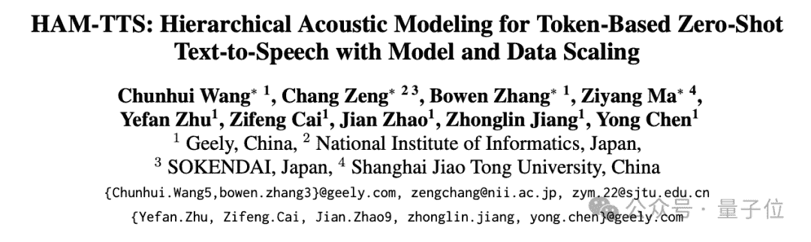

# 9.24-OpenAI再获65 亿认购、奥特曼预言ASI几年内降临、开源版GPT-4o来了、英伟达开源NVLM 1.0屠榜

> 来源：[https://agijuejin.feishu.cn/docx/IuSvdIuako1sedxWaDMcubaDngg](https://agijuejin.feishu.cn/docx/IuSvdIuako1sedxWaDMcubaDngg)

> [欢迎加入 AGI 掘金社群](https://sourl.co/miZUyT)

### 💡 英伟达开源NVLM 1.0屠榜多模态！纯文本性能不降反升

新智元 | [阅读原文](https://www.163.com/dy/article/JCRJPVBB0511ABV6.html?spss=dy_author)

NVLM 1.0在视觉语言任务上达到了与GPT-4o和其他开源模型相媲美的水平，并且在纯文本性能上甚至超过了LLM骨干模型。特别值得注意的是，NVLM 1.0在文本数学和编码基准测试中的平均准确率提高了4.3个百分点。

文章中提到，NVLM 1.0的模型设计方面，研究人员对纯解码器多模态大模型和基于交叉注意力的模型进行了全面对比，并提出了一种全新架构，提升了模型的训练效率和多模态推理能力。此外，还引入了一种1-D图块（tile）标签设计，用于基于tile的动态高分辨率图像，显著提高了多模态推理和与OCR相关任务的性能。

在训练数据方面，研究人员详细介绍了多模态预训练和监督微调数据集的详细信息，强调了数据集的质量和任务多样性比规模更重要。值得注意的是，研究人员将高质量的纯文本数据集精心整合到多模态训练中，增强了数学和编码能力。

NVLM 1.0模型架构包括三种可选架构：NVLM-D（仅解码器）、NVLM-X（基于Cross (X)-attention的模型）和NVLM-H（混合架构）。每种架构都有其特点和优势，例如NVLM-D使用多层感知器作为投影器或模态对齐模块，NVLM-X使用门控交叉注意力处理图像token，NVLM-H结合了NVLM-D和NVLM-X的优势。

实验结果显示，NVLM-1.0 72B模型在九个视觉-语言基准测试和四个纯文本基准测试上表现出色，可以与其他最强的开源、闭源模型相媲美。NVLM-D和NVLM-H在特定任务上取得了最高分，而NVLM-X在训练和推理速度上具有优势。

### 💡 倒计时！奥特曼罕见长文预言：ASI几年内降临，人类奇点将至

新智元 | [阅读原文](https://www.163.com/dy/article/JCRJN9SQ0511ABV6.html?spss=dy_author)

“奥特曼罕见长文预言：ASI几年内降临，人类奇点将至”这一话题的最新动态和分析：

1.  **奥特曼的预言**：奥特曼在文章中预言，超级人工智能（ASI）将在几千天内降临，并强调深度学习已经奏效，能够学习任何数据的分布模式。这一观点比大多数专家预测的五年时间要早。

1.  **专家意见分歧**：尽管奥特曼对AI的未来持乐观态度，但并非所有专家都同意他的看法。例如，NYU教授马库斯认为，如果我们继续沿着深度学习和语言模型的路线，将永远无法实现AGI，更遑论ASI。华盛顿大学计算机科学教授、《终极算法》作者Pedro Domingos也认为ASI只是一个白日梦。

1.  **AI的潜在影响**：奥特曼提到，AI的发展将带来巨大的好处，但也存在一些挑战，如先进芯片的需求、降低计算成本、AI导致的失业问题等。他强调，AI将改变劳动力市场，但人们永远不会无事可做。

1.  **AI的进步**：最近，AI模型在标准化门萨智商测试中首次显著超过了人类智商的中位数。这表明AI的进步速度非常快。

1.  **AI的潜在风险**：奥特曼也提到了AI可能带来的风险，如不建设基础设施来支持AI的发展可能导致AI成为稀缺资源，甚至引发战争，最终沦为少数富人的工具。

1.  **AI的未来**：奥特曼相信，随着算力、数据增加，深度学习帮助人类解决难题的能力将变得更强。他预测，AI将随着规模的扩大而不断进步，这将为全球人类生活带来实质性的改善。

### 💡 开源版GPT-4o来了，AI大神Karpathy盛赞！67页技术报告全公开

新智元 | [阅读原文](https://www.163.com/dy/article/JCRJMEJ30511ABV6.html?spss=dy_author)

这篇文章介绍了开源版GPT-4o的发布，以及AI专家Karpathy对它的评价。以下是文章的主要观点和分析：

1.  **开源版GPT-4o的发布**：文章提到，法国初创团队Kyutai发布了对标GPT-4o的端到端语音模型Moshi，并已将其代码、模型权重和一份67页的技术报告开源。

1.  **Moshi的特点**：Moshi模型具有自然聊天、情绪丰富、可以随意打断等特点，拒绝呆板和回合制。它能够以流式方式处理24 kHz音频，并具有7.69B的参数量。

1.  **技术细节**：文章详细介绍了Moshi的架构，包括Mimi（流式神经音频编解码器）、Helium Temporal Transformer和Depth Transformer。Moshi还引入了“内心独白”的概念，通过联合建模文本和音频，提高了生成语音的事实性和语言质量。

1.  **性能表现**：Moshi的理论延迟为160毫秒，实际总延迟仅为200毫秒，突破了传统AI对话模型的限制。

1.  **应用前景**：Moshi作为一个全双工口语对话框架，具有广泛的应用前景，如在线免费体验、AI语音助手等。

相关文章和评论方面，可以通过以下链接获取更多信息：

+   [Moshi论文地址](https://kyutai.org/Moshi.pdf)

+   [Moshi开源代码](https://github.com/kyutai-labs/moshi)

+   [Moshi开放权重](https://huggingface.co/collections/kyutai)

+   [Moshi官网在线体验](https://moshi.chat)

### 💡 OpenAI再获资本追捧：最新65亿融资获超额认购，估值飙至1500亿美元

新智元 | [阅读原文](https://www.163.com/dy/article/JCRJLIO90511ABV6.html?spss=dy_author)

OpenAI最近完成了一轮65亿美元的融资，这一轮融资获得了超额认购，意味着投资者希望投入的资金超过了公司愿意接受的额度。这笔交易将使OpenAI的估值达到1500亿美元，不包括新的投资。在开启这一轮融资之前，OpenAI的估值还是860亿美元。Thrive Capital将主导本轮融资，并已承诺投资12.5亿美元。此外，包括微软、英伟达、苹果在内的多家战略投资者也参与了这一轮融资。

OpenAI的这次融资不仅体现了其在AI领域的领先地位，也反映了市场对于AI技术未来发展的乐观预期。参与交易的投资者表示，这样的融资规模和结构在风险投资领域极为罕见。通常，像Thrive和Tiger这样的风险投资公司会向尚处于早期阶段的创业公司投资较小金额，并期望获得10到100倍的回报。

OpenAI起源于一个非营利研究项目，旨在为全人类的利益开发人工智能。近年来，通过向消费者和企业提供基于订阅的服务，如ChatGPT，OpenAI加速了商业化努力；该服务现在拥有超过2亿用户。知情人士透露，自近两年前推出ChatGPT以来，OpenAI的收入已飙升至每年约36亿美元。尽管如此，OpenAI仍然每年烧掉超过50亿美元，因为它在新的模型和产品上进行投资，以领先于竞争对手。

这轮融资的成功可能会推动OpenAI进一步取消利润上限，从而为投资者带来更大的回报可能性。然而，这也可能引发关于OpenAI的治理和偏离其非营利使命的疑问。与此同时，OpenAI也面临着来自谷歌、Meta等科技巨头的竞争压力。为了实现所需的投资回报，OpenAI需要不断寻找资源来训练越来越昂贵的AI模型，并管理从初创公司向企业巨头的转变。

### 💡 AI“攻克”CAPTCHA 网站验证系统

IT 之家 | [阅读原文](https://www.ithome.com/0/797/907.htm)

IT之家报道了一项关于人工智能（AI）的最新研究进展。这项研究来自苏黎世联邦理工学院（ETH Zurich），它表明AI现在能够成功破解CAPTCHA网站验证系统。CAPTCHA是一种常见的验证系统，用于区分人类用户和机器人用户。

研究人员开发了一个基于YOLO（You Only Look Once）人工智能图片处理模型的解谜软件。他们使用14000张带有街道的图片作为训练数据，使得AI能够像人类一样一次性准确识别reCAPTCHAv2版本的验证码。

这一进展意味着，随着AI技术的发展，传统的CAPTCHA验证系统在防御机器人访问方面的能力受到了挑战。这可能对网站的安全性和用户体验产生重要影响。

### 💡 新“作弊神器”？德州仪器 TI-84 PLUS 计算器被改造接入 ChatGPT AI

IT 之家 | [阅读原文](https://www.ithome.com/0/797/877.htm)

内容概述：

+   YouTube频道ChromaLock发布了一个视频，介绍了一种名为TI-32的改造电路板，它可以安装在德州仪器TI-84 Plus图形计算器上，使其能够接入ChatGPT。

+   TI-84 Plus图形计算器在PSAT、SAT和ACT大学入学考试、IB和AP考试中已被标准化组织批准使用。

+   ChromaLock设计了TI-32电路板，其中包含一个支持Wi-Fi的微型微控制器Seed Studio ESP32-C3以及其他元件，用于连接无线系统。

+   在开发过程中，ChromaLock遇到了电压不兼容和信号完整性等工程难题，但最终成功地将定制电路板安装到了计算器的外壳中。

+   该系统模拟了另一个TI-84，允许用户通过计算器内置的“发送”和“获取”命令来传输文件，用户可以下载启动程序，访问专为作弊设计的“小程序”。

+   除了ChatGPT界面外，设备还提供其他作弊工具，如图像浏览器和应用程序浏览器，后者允许下载伪装成程序源代码的文本小抄。

+   ChromaLock暗示未来将在视频中讨论相机功能，但目前细节不多。

### 💡 OpenAI 阿尔特曼预测“智能时代”即将到来：能独立完成科学发现，影响就业但有助于解决气候变化等重大挑战

IT 之家 | [阅读原文](https://www.ithome.com/0/797/864.htm)

文章《OpenAI 阿尔特曼预测“智能时代”即将到来：能独立完成科学发现，影响就业但有助于解决气候变化等重大挑战 - IT之家》的主要内容如下：

OpenAI 首席执行官山姆・阿尔特曼（Sam Altman）在其个人博客中预测，人类即将进入一个由人工智能驱动的新时代，即“智能时代”。他相信，在未来几十年内，人工智能将带来巨大的经济收益。阿尔特曼指出，AI 系统将很快成为个人助理，提供定制教育，甚至帮助医疗保健，最终可能独立完成科学发现。

阿尔特曼还提到，“超级智能 AI”可能需要更长的发展周期，但预计将在未来“几千天内”出现。他强调深度学习是实现这一进展的关键，并认为随着计算和数据规模的扩大，深度学习的效果会越来越好。

此外，阿尔特曼表示，为了充分发挥人工智能的潜力，必须大规模扩展计算能力。他提到 OpenAI 正在与微软合作开展大型数据中心项目。

关于 AI 对就业的影响，阿尔特曼认为 AI 会严重干扰就业市场，但总体而言，社会效益将大于负面影响。从长远来看，他相信人工智能可能有助于解决气候变化、太空探索和物理学等重大挑战。

### 💡 车圈最大AI「黑马」吉利：自研语音大模型登顶，性能超SOTA 10%

量子位 | [阅读原文](https://www.qbitai.com/2024/09/194113.html)

吉利汽车在人工智能领域取得了显著进展。他们自研的语音大模型HAM-TTS在发音准确性、自然度和说话人相似度上超过了之前的最优水平（SOTA），性能提升了10%以上。这个模型是基于token的零样本文字转语音分层声学建模，是吉利星睿AI大模型体系下的重要一员。

吉利星睿AI大模型的应用主要体现在智能座舱的交互环节，如语音导航、新闻播报等，提供了更自然、个性化的语音交互体验。此外，该模型还支持跨语种无缝切换，包括多种方言和跨语种语音合成，并且在声音复刻能力上表现出色，仅需3秒钟的样本输入即可实现。

吉利在TTS模型上的创新包括引入分层声学建模方法，通过文本预测出蕴含声学信息和语义信息的隐变量，以及使用基于UNet架构的声音转换预训练模型来增加训练数据的多样性和数量。这些技术突破不仅提高了语音合成的准确性，还降低了训练成本。