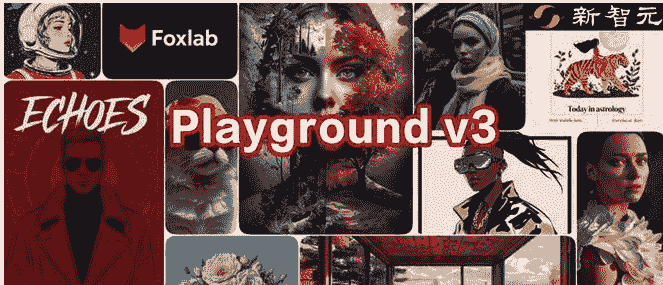
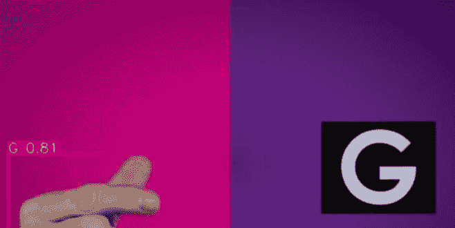
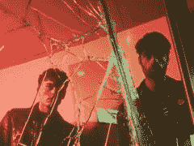
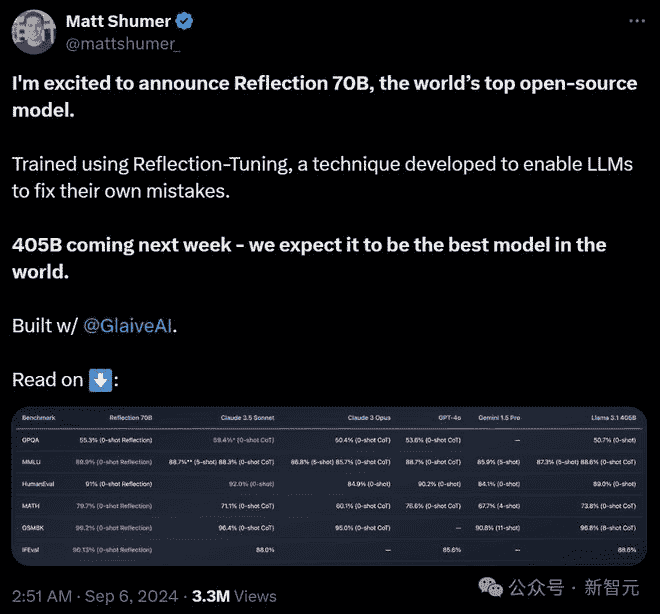
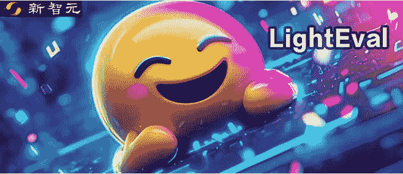

# 10.8 -OpenAI 要求投资者不继续支持竞争对手、240亿 参数！Playground v3发布、「世界开源新王」重测跑分暴跌实锤造假

> 来源：[https://agijuejin.feishu.cn/docx/Ate9dRNgsoToOPxtwILcW8RLneh](https://agijuejin.feishu.cn/docx/Ate9dRNgsoToOPxtwILcW8RLneh)

> [欢迎加入 AGI 掘金社群](https://sourl.co/miZUyT)

## ⭐ 今日热点

### 💡 消息称 OpenAI 要求新一轮投资者不得再支持 Anthropic 等 5 家 AI 公司

IT之家 | [阅读原文](https://www.ithome.com/0/800/550.htm)

OpenAI 在筹集 66 亿美元融资后，估值达 1570 亿美元。有消息称其要求新一轮投资者不得再支持 Anthropic 等 5 家竞争对手公司，包括 Anthropic、xAI、SSI、Perplexity 和 Glean。埃隆·马斯克指责 OpenAI，ARK Invest 首席执行官 Cathie Wood 则称报道不真实。

## 🌟 技术突破

### 💡 文生图参数量升至240亿！Playground v3发布：深度融合LLM，图形设计能力超越人类

新智元 | [阅读原文](https://www.163.com/dy/article/JDTAJLVV0511ABV6.html?spss=dy_author)

Playground Research 发布新一代文本到图像模型 PGv3，参数量达 240 亿。它深度融合大型语言模型，在图形设计和遵循文本提示指令上超越人类设计师，支持精确 RGB 颜色控制和多语言识别。采用全新的深度融合架构，复制 LLM 的所有 Transformer 块以利用其完整‘思考过程’，还引入新的基准 CapsBench 评估图像描述性能，在多个方面表现出色。

### 💡 使用 YOLOv 11 模型实现实时手语检测 可同时识别多个手语手势

小互日报 | [阅读原文](https://xiaohu.ai/p/14469)

使用 YOLOv11 模型实现实时手语检测，可同时识别多个手语手势。该模型优化了检测速度和准确度，能在较低计算资源下高效运行，适用于视频流和实时检测。项目使用 Asl_Videos 数据集，可对手语进行分类，如字母、单词等。适用于手语翻译系统、教育及智能设备等场景。项目地址：https://www.kaggle.com/code/duygujones/sign-language-detection-using-yolo11。YOLOv11：https://github.com/ultralytics/ultralytics。手语数据集：https://universe.roboflow.com/。

## 💫 企业动态

### 💡 因 AI 生成的艺术作品注册申请被拒，当事艺术家向美国版权局提出上诉

IT之家 | [阅读原文](https://www.ithome.com/0/800/479.htm)

艺术家杰森·艾伦因 AI 生成作品《太空歌剧院》注册申请被美国版权局拒绝后提出上诉。他认为负面媒体影响审核员判断且版权局规则‘任意’，提示词创作应视为人类创作过程，花费超 100 小时优化 600 多个提示词，却拒绝共享提示词，希望为 AI 艺术作品版权问题提供清晰指导。

### 💡 「世界开源新王」Reflection 70B 跌落神坛？重测跑分暴跌实锤造假

IT之家 | [阅读原文](https://www.ithome.com/0/800/457.htm)

Reflection 70B 刚发布时号称可与顶级闭源模型一较高下，后被打假。重测跑分暴跌，被质疑造假、套壳。开发者承认未达最初基准，解释因代码 bug 导致部分分数过高，现公布模型权重等。但开源社区对其道歉不买账，仍存诸多质疑。

### 💡 「世界开源新王」跌落神坛？重测跑分暴跌实锤造假，2人团队光速「滑跪」

新智元 | [阅读原文](https://www.163.com/dy/article/JDTAM1AQ0511ABV6.html?spss=dy_author)

Reflection 70B被质疑造假，开发者承认未达最初报告基准。团队操作引发众多质疑，如匆忙发布未测试、权重有误、模型 API 被怀疑有问题等。虽已道歉，但未被开源社区接受。目前对该模型仍难下定论，其‘反思微调’方法是否神奇有待观察。

### 💡 Jim Fan再谈基准测试之弊！Hugging Face开源套件LightEval领跑LLM评估新篇章

新智元 | [阅读原文](https://www.163.com/dy/article/JDTAIAD50511ABV6.html?spss=dy_author)

HuggingFace 推出 LightEval 开源评估套件，为 AI 评估带来透明度和定制化。英伟达高级科学家 Jim Fan 分享破解 LLM 基准测试的方法，揭示当前评估体系漏洞。LightEval 可定制评估任务，支持多种设备，促进 AI 社区合作创新。AI 社区意见领袖 Denis Shiryaev 指出其可防止 AI 基准测试的戏剧性事件。LightEval 有望成为关键玩家，为确保 AI 系统可靠、公平和有效提供关键工具。