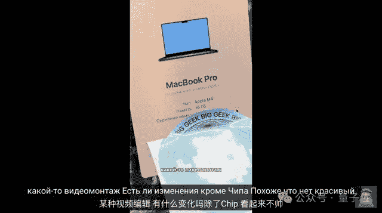
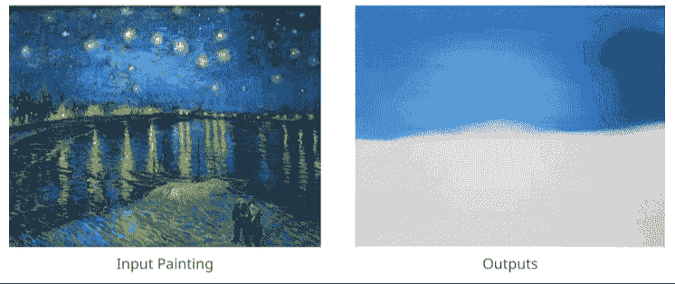
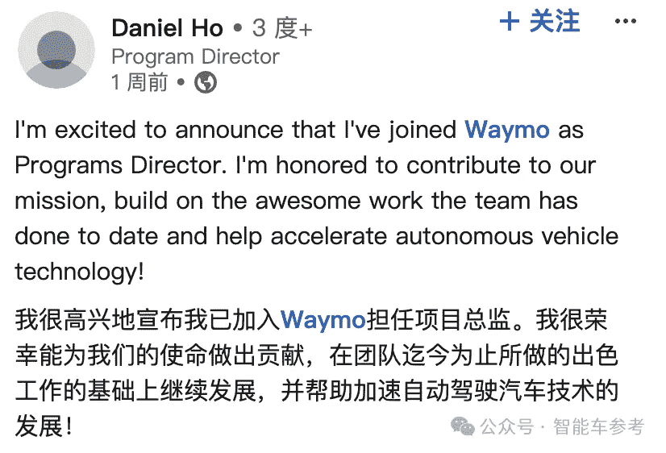

# 10.9 -苹果14年来最严重产品泄漏！、字节跳动豆包智能硬件 Ola Friend 预热、马斯克Robotaxi发布在即负责人跳槽

> 来源：[https://agijuejin.feishu.cn/docx/Ja0tdFenpo3AZTxRzvLckDOcneg](https://agijuejin.feishu.cn/docx/Ja0tdFenpo3AZTxRzvLckDOcneg)

[欢迎加入 AGI 掘金社群](https://sourl.co/miZUyT)

## ⭐ 今日热点

### 💡 苹果14年来最严重产品泄漏！M4版MacBook还没发，开箱视频满天飞

量子位 | [阅读原文](https://www.qbitai.com/2024/10/198636.html)

苹果发生 14 年来最严重产品泄漏事件，M4 版 MacBook 虽未发布但照片和视频已在网上流传。疑似自苹果仓库泄漏，14 英寸 MacBook Pro 搭载 M4 芯片，有 10 核 CPU 和 GPU、16GB RAM、512GB 存储等配置，外观颜色新增深空黑，端口也有变化。彭博社记者证实其存在，预计今年 10 月可能举行小型活动发布新的 M4 Mac，苹果正在放弃年更产品策略。

### 💡 字节跳动豆包智能硬件 Ola Friend 预热，预计为智能耳机

IT之家 | [阅读原文](https://www.ithome.com/0/800/619.htm)

2024 年 10 月 8 日，字节跳动豆包智能硬件 Ola Friend 预热，预计为智能耳机。10 月 10 日上午 11 点将公布更多信息。该智能耳机可能植入豆包大模型，并与豆包 App 结合。字节跳动在 9 月完成对开放式耳机品牌 Oladance 的收购并实现 100%控股。

### 💡 「国产Sora」最新升级！《沙丘》级大片视效，人人都能免费体验

量子位 | [阅读原文](https://www.qbitai.com/2024/10/198677.html)

国产 Sora（潞晨 Video Ocean）最新升级，支持任意角色、任意风格，可文生视频、图生视频、角色生视频，人人可免费注册体验。能生成逼真的写实人物视频，还能创造各种奇幻场景，在视频质感上有颠覆性提升，体验门槛低。

## 🌟 技术突破

### 💡 「乘法变加法」！MIT清华校友全新方法优化Transformer：Addition is All You Need

新智元 | [阅读原文](https://www.163.com/dy/article/JDVTF6MF0511ABV6.html?spss=dy_author)

MIT 两位华人学者提出新方法优化 Transformer，名为‘Addition is All You Need’。L-Mul 乘法算法用整数加法器以高精度近似进行浮点数乘法运算，能将逐元素浮点张量乘法的能量成本降低 95%，点积的能量成本降低 80%，可直接集成到现有模型中无需额外训练，在各种语言和视觉任务基准上评估效果良好，揭示了训练 L-Mul 原生 LLM 的潜质。

### 💡 重要的事情说两遍！Prompt「复读机」，显著提高LLM推理能力

新智元 | [阅读原文](https://www.163.com/dy/article/JDVTDA0G0511ABV6.html?spss=dy_author)

文章介绍了一种名为 Prompt「复读机」（RE2）的技术，可显著提高 LLM 的推理能力。在 14 个数据集的 112 个实验中，RE2 能带来性能提升，包括算术、常识和符号推理任务等。RE2 通过让 LLM 把输入再读一遍，促进双向编码，增强理解过程。实验还探索了问题重读次数，发现重读 2 次性能提高，多了则下降。

###

### 💡 AI逆向绘画火了！一键重绘梵高《星空》，来自华盛顿大学

量子位 | [阅读原文](https://www.qbitai.com/2024/10/198567.html)

来自华盛顿大学的 AI 逆向绘画项目 Inverse Painting 火了，相关论文入选 SIGGRAPH Asia 2024。该项目可一键重绘梵高《星空》，基于扩散模型，学习艺术家绘画视频，生成绘画指令并逐步渲染。项目作者有五位，其中两位是华人。此技术引发热议，有人担心会被用于谎称作者，也有人质疑其对学绘画的帮助。

## 💫 企业动态

### 💡 2024 诺贝尔物理学奖揭晓：机器学习奠基人 John J. Hopfield 和 Geoffrey E. Hinton 获奖

IT之家 | [阅读原文](https://www.ithome.com/0/800/682.htm)

2024 诺贝尔物理学奖揭晓，获奖者为 John J. Hopfield 和 Geoffrey E. Hinton，表彰他们通过人工神经网络实现机器学习的基础性发现和发明。他们利用物理学方法为强大的机器学习奠定基础，如 Hopfield 创建可存储和重建信息的结构，Hinton 发明可独立发现数据属性的方法。

### 💡 OpenAI 重点转向产品开发，研究人才外流给了对手机会

IT之家 | [阅读原文](https://www.ithome.com/0/800/639.htm)

OpenAI 重点转向产品开发，研究人才外流。多位高管及核心研究人员离职，包括 CTO 米拉·穆拉蒂等。2021 年 OpenAI 招聘职位中一般研究类职位占 23%，2024 年降至 4.4%。人才流失或影响其发展，如早期 GPT 论文作者、ChatGPT 技术博客致谢者中多人已离职。OpenAI 需填补关键职位空缺，面临激烈竞争，其目标是 2029 年将年收入提升至 1000 亿美元。

###

### 💡 2024诺贝尔物理学终极预测！凝聚态物理大热门，复旦教授吴咏时被提名

新智元 | [阅读原文](https://www.163.com/dy/article/JDVTD47U0511ABV6.html?spss=dy_author)

2024 年诺贝尔物理学奖将于今日下午开奖。凝聚态物理、量子计算、超材料等是夺奖热门方向。复旦大学施郁教授预测可能授予分数统计和任意子领域，多人获得预测提名。《物理世界》杂志预测今年获奖领域可能是凝聚态物理学中的魔角石墨烯和超材料，其信息图预测有一定准确性。魔角石墨烯领域的曹原和 Allan H. MacDonald 呼声高，超材料是人造材料能实现自然不存在的电磁特性。物理学博士 Superconformal Hassaan 也给出了自己的预测名单。距离诺奖颁布不到 5 小时，众人拭目以待。

### 💡 宋紫薇回应从理想汽车离职：创业一直是我心里一颗种子，希望去探索 AI 智能硬件赛道

IT之家 | [阅读原文](https://www.ithome.com/0/800/589.htm)

宋紫薇确认从理想汽车离职，称创业是心中种子，希望探索 AI 智能硬件赛道。她曾在 iQOO、华为、vivo 任职，去年 12 月在理想汽车首秀。今年还因不当退货言论道歉。

### 💡 联发科新一代天玑旗舰芯片针对谷歌 Gemini Nano 多模态 AI 进行优化，支持图像和音频处理

IT之家 | [阅读原文](https://www.ithome.com/0/800/585.htm)

10 月 8 日，联发科宣布新一代天玑旗舰芯片针对谷歌 Gemini Nano 多模态 AI 进行优化，支持图像和音频处理。该芯片搭载第八代联发科 AI 处理器（NPU），具备文字、图像、语音多模态硬件加速功能，将于 10 月 9 日 10:30 正式发布。天玑 9400 采用 Cortex-X925 超大核等配置，OPPO、vivo、小米均采购了这颗芯片。

### 💡 马斯克Robotaxi发布在即，量产负责人跳槽Waymo

量子位 | [阅读原文](https://www.qbitai.com/2024/10/198815.html)

2024 年 10 月，在马斯克 Robotaxi 发布前夕，特斯拉车辆项目总监丹尼尔·侯跳槽 Waymo。侯在特斯拉任职近 11 年，曾负责特斯拉两大超级工厂产能拉升工作，自称为 Robotaxi 奠定基础。其直接下属大卫·张也同期离职。此外，特斯拉首席信息官纳格什·萨尔迪也离开了特斯拉。同期 Waymo 与特斯拉完成人才互送，半年前 Waymo 技术主管加盟特斯拉，如今特斯拉车辆负责人去了 Waymo。

## ✨ 行业观点

### 💡 开发者火冒三丈炮轰GenAI：垃圾语料太多，模型正在变得越来越笨

新智元 | [阅读原文](https://www.163.com/dy/article/JDVTB0V50511ABV6.html?spss=dy_author)

有观点认为生成式 AI 性能不如以前，如 ChatGPT 等模型准确性下降，变得越来越笨。原因包括训练集内容质量问题，如包含来自不良网站的数据，且高质量数据可能在 2026 年耗尽；还因生成式 AI 内容取代专家级人类内容导致‘模型崩溃’。但特定用途的生成式 AI 聊天机器人有一定作用，不过作为替代知识型员工方式不可取。

### 💡 谷歌前 CEO 施密特：气候目标难以实现，不如放手发展 AI

IT之家 | [阅读原文](https://www.ithome.com/0/800/590.htm)

谷歌前 CEO 施密特在 AI + 能源峰会上表示气候目标难以实现，应放手发展 AI，因为 AI 可提高能源效率，承诺能使能源生产系统至少提高 15%效率，虽发展 AI 需大量能源但值得，能解决气候问题。其观点引发争议，有人反对为发展 AI 放弃气候目标，也有人支持，认为 AI 可解决气候变化。同时有专家指出 AI 发展或致能源需求增加，还有人担心将未来寄托在 AI 身上有风险。

### 💡 富士康计划在墨西哥建造全球最大的英伟达 GB200 AI 芯片制造工厂

IT之家 | [阅读原文](https://www.ithome.com/0/800/654.htm)

2024 年 10 月，富士康计划在墨西哥建造全球最大的英伟达 GB200 AI 芯片制造工厂。富士康作为苹果主要供应商正扩大业务，想借英伟达搭上 AI 发展快车。鸿海董事长刘扬伟称公司供应链已为人工智能革命做好准备，新工厂在墨西哥，产能将非常巨大。