# 10.10-字节跳动豆包智能硬件 Ola Friend 预热，预计为智能耳机、解密诺奖物理学奖为啥颁给AI？Anthropic 推出的 Message Batches API

> 来源：[https://agijuejin.feishu.cn/docx/S2yLdikv1opFBFxxAGxcyMPGn3b](https://agijuejin.feishu.cn/docx/S2yLdikv1opFBFxxAGxcyMPGn3b)

[欢迎加入 AGI 掘金社群](https://sourl.co/miZUyT)

## ⭐ 今日热点

### 💡 字节跳动豆包智能硬件 Ola Friend 预热，预计为智能耳机

IT之家 | [阅读原文](https://www.ithome.com/0/800/619.htm)

2024 年 10 月 8 日，字节跳动豆包📕官方号发布预热海报，智能硬件 Ola Friend 即将亮相，预计为智能耳机。该耳机将植入豆包大模型，可与豆包 App 结合使用。9 月字节跳动完成对开放式耳机品牌 Oladance 的收购并实现 100%控股。

### 💡 解密诺奖物理学奖为啥颁给AI？Hinton和Ilya 12年前对话，竟引发物理诺奖AI风暴！

新智元 | [阅读原文](https://www.163.com/dy/article/JE2GHRVO0511ABV6.html?spss=dy_author)

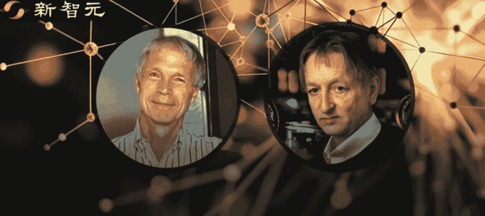

2024 年诺贝尔物理学奖颁给 AI 引发争议。Geoffrey Hinton 和 John Hopfield 获奖，他们的成果包括反向传播算法、Hopfield 网络等。AI 圈对此反应积极，诺奖委员会解释人工神经网络是用物理学工具训练的。Hopfield 网络与物理学关系紧密，其行为像人脑，是物理学中‘自旋玻璃模型’的扩展，对统计物理学、计算机科学和 AI、神经科学产生巨大影响。此次诺奖也是 AI 大爆发对人类社会颠覆影响的写照。

### 💡 Anthropic 推出的 Message Batches API 可以批量处理大量请求 价格便宜50%

小互日报 | [阅读原文](https://xiaohu.ai/p/14511)

Anthropic 推出 Message Batches API，可批量处理大量请求，价格便宜 50%。适用于无需即时响应、需处理大量数据的场景，如分析客户反馈、翻译文档等。不影响实时 API 限额，按处理的输入和输出 tokens 收费。Quora 利用该 API 进行内容总结和亮点提取，节省成本、简化复杂度并提升工程师效率。

## 🌟 技术突破

### 💡 清华微软最新力作：用物理学革新Transformer注意力，「大海捞针」精度暴涨30%！

新智元 | [阅读原](https://www.163.com/dy/article/JE2FQD9P0511ABV6.html?spss=dy_author)

清华微软团队提出 Differential Transformer，从注意力模块入手提升 Transformer 核心能力。改进后的模型能缓解 LLM 的幻觉，在关键信息检索任务中精度暴涨，如在‘大海捞针’测试中，将针放置在 25%深度时，相对于传统 Transformer 实现了 76%的精度提升。该模型遵循 Scaling Law，在扩展模型规模和训练 Token 方面表现出色，对量化和位宽的稳健性也更高。四位共同一作来自微软研究院，其中两位是清华学生。

### 💡 成熟的AI要学会自己搞研究！MIT推出「科研特工」

新智元 | [阅读原文](https://www.163.com/dy/article/JE2FQD5C0511ABV6.html?spss=dy_author)

2024 年 10 月，MIT 团队推出自动搞科研的 AI 系统 SciAgents。它由大规模本体知识图、大语言模型和数据检索工具、多智能体系统三部分构成。SciAgents 锁定仿生材料研究，揭示跨学科关系，超越传统人类研究方法。其两种策略利用多智能体集体智慧，一种交互预编程，一种更灵活且有人机交互。它从知识图生成路径，采用随机路径增强探索，利用 LLM 驱动的本体论智能体深入理解关系并提出新假设。

### 💡 AI 架构 Transformer 再进化：谷歌新方法突破长文本处理，注意力模块内存需求可降至 1/47

IT之家 | [阅读原文](https://www.ithome.com/0/800/806.htm)

2024 年 10 月，谷歌推出选择性注意力新方法，提高 Transformer 架构模型性能。Transformer 于 2017 年由谷歌提出，核心是自注意力机制，用于处理序列数据尤其是自然语言处理领域。但处理长文本序列效率低下，谷歌新方法可动态忽略不相关标记，将注意力模块内存需求降至 1/47，如在 1 亿参数模型中，不同上下文大小下内存需求大幅降低，在 HellaSwag 基准测试中也优于传统 Transformer，准确率提升高达 5%。

### 💡 Podcastfy：将任何网页、PDF和文本内容自动生成播客音频内容

小互日报 | [阅读原文](https://xiaohu.ai/p/14506)

Podcastfy-Demo 是开源 Python 项目，能将网页、PDF 和文本内容自动转化为多语言音频对话。与专注笔记或研究整合的工具不同，它为用户提供简单高效方式生成类似播客音频内容，实现内容创作自动化和多语言扩展。

### 💡 PMRF：一种新的图像恢复算法 高质量修复图像 降低图像失真还原跟自然逼真度

小互日报 | [阅读原文](https://xiaohu.ai/p/14489)

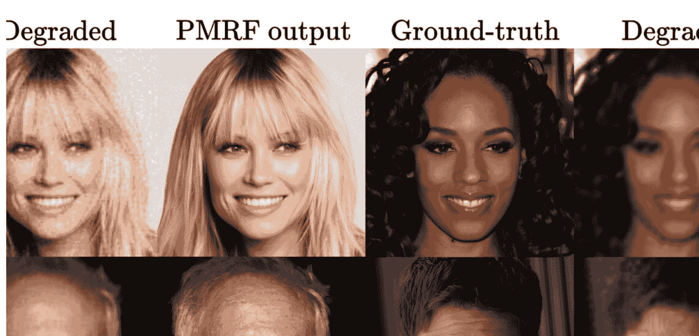

PMRF 是一种新的图像恢复算法，通过后验均值预测和修正流模型，在降低图像失真的同时提高感知质量。在多个基准和真实世界数据集上表现出色，如在 CelebA-Test 基准测试中，在失真和感知质量指标上优于其他方法。在多任务实验中也有明显优势，能处理复杂图像退化问题。

### 💡 「乘法变加法」！MIT清华校友全新方法优化Transformer：Addition is All You Need

新智元 | [阅读原文](https://www.163.com/dy/article/JDVTF6MF0511ABV6.html?spss=dy_author)

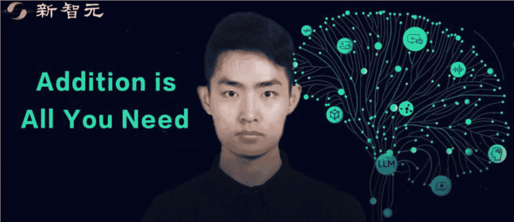

MIT 两位华人学者提出新方法优化 Transformer，名为‘Addition is All You Need’。该方法用整数加法器以高精度近似进行浮点数乘法运算（L-Mul 乘法算法），能将逐元素浮点张量乘法的能量成本降低 95%，点积的能量成本降低 80%，可直接集成到现有模型中无需额外训练，在 LLM 实验中精度表现良好，显著优于 fp8 格式，且微调可弥补性能差距。论文作者 Hongyin Luo 是 MIT 研究科学家。

### 💡 重要的事情说两遍！Prompt「复读机」，显著提高LLM推理能力

新智元 | [阅读原文](https://www.163.com/dy/article/JDVTDA0G0511ABV6.html?spss=dy_author)

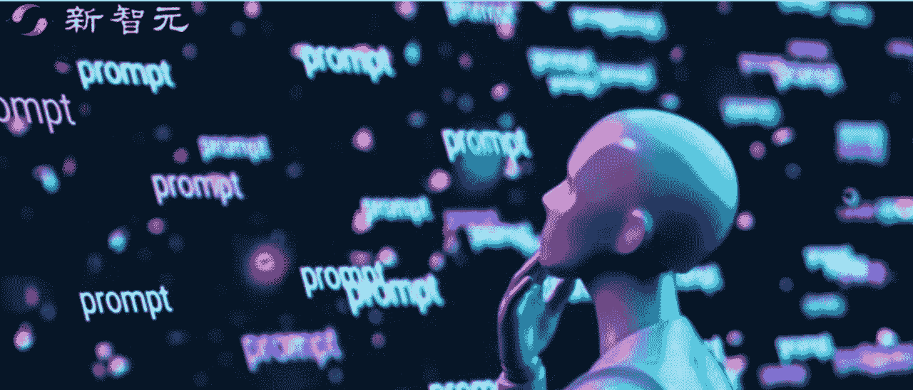

2024 年 10 月，新智元报道了 Prompt「复读机」技术。该技术通过让大语言模型重复输入问题，可显著提高 LLM 的推理能力。实验在 14 个数据集上的 112 个实验中均带来性能提升，涵盖算术、常识和符号推理任务等。且随着问题重读次数增加，性能先升后降，重读两次效果最佳。该技术将焦点转移到输入，促进双向编码，增强 LLM 理解过程。

## 💫 企业动态

### 💡 微软“炫耀”新装备：内置英伟达最新 GB200 AI 芯片的服务器

IT之家 | [阅读原文](https://www.ithome.com/0/800/884.htm)

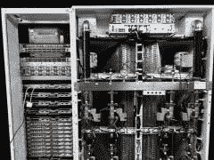

2024 年 10 月，微软宣布拿到内置英伟达最新 GB200 AI 芯片的服务器，成为全球首个用上 Blackwell 体系的云服务供应商。GB200 采用台积电 4 纳米工艺，Blackwell 的 AI 性能达 20 petaflops，远超 H100 的 4 petaflops。GB200 超级芯片售价高达 7 万美元。富士康高级副总裁宣布计划在墨西哥建造全球最大的英伟达 GB200 芯片制造工厂。

### 💡 OpenAI获英伟达B200最强超算！GPT-5训练无底洞，微软算力却严重不足

新智元 | [阅读原文](https://www.163.com/dy/article/JE2FQ6OF0511ABV6.html?spss=dy_author)

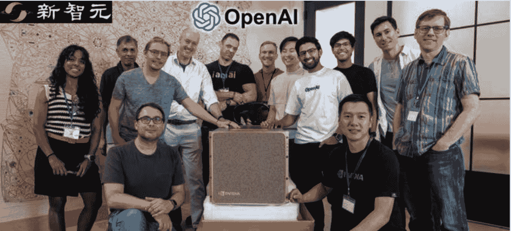

Ope**nAI 获**英伟达首批工程版 DGX B200。因微软提供算力不足，OpenAI 正与甲骨文谈判。OpenAI 与微软在‘Fairwater’项目设计上有分歧，还在讨论合作建设价值 1000 亿美元的超算服务器集群。过去 10 年，生成 token 的能源成本下降了10 万倍。英伟达的算力对多个领域至关重要，其 CUDA 库为超过 4000 个加速应用程序提供支持。

### 💡 继日本东京后，OpenAI 宣布在新加坡组建第二个亚洲办事处

IT之家 | [阅读原文](https://www.ithome.com/0/800/835.htm)

OpenAI 宣布今年晚些时候在新加坡开设第二个亚洲办事处，将成为为亚太地区客户和合作伙伴提供支持的枢纽。此前，OpenAI 于今年 4 月在日本东京设立首个亚洲办事处。新加坡人是 ChatGPT 人均用户最多的国家之一。

### 💡 仅靠微软无法满足激增的 AI 计算需求，OpenAI 被曝和甲骨文合作

IT之家 | [阅读原文](https://www.ithome.com/0/800/798.htm)

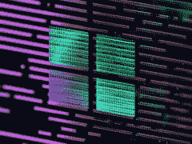

OpenAI 因微软 Azure 云服务无法满足激增的 AI 计算需求，被曝与甲骨文合作。OpenAI 首席执行官担忧过度依赖微软云服务器会影响对竞争公司的领先优势。OpenAI 今年 6 月已与甲骨文达成交易，目前正谈判租赁美国得克萨斯州阿比林数据中心，该中心预计 2026 年中期装备数十万块 Nvidia AI 芯片，耗电量接近 1 吉瓦。微软计划明年年底向 OpenAI 提供约 30 万个英伟达 GB200 图形处理器，用于威斯康星州和亚特兰大数据中心，OpenAI 首席执行官要求微软加快威斯康星州项目进度，该项目可能 2025 年下半年部分开放。

### 💡 Adobe 将推出全新免费应用：创作者可在作品上附上“证书”防止被 AI 使用

IT之家 | [阅读原文](https://www.ithome.com/0/800/770.htm)

2024 年 10 月，Adobe 宣布将于 2025 年第一季度推出免费网络应用，创作者可在作品上附上‘证书’防止被 AI 使用，能添加归属信息如创作者姓名等，还能表明是否希望作品被用于 AI 训练。目前尚无大型人工智能公司同意遵守该透明度体系。

### 💡 英伟达：若各行业运用 AI，将为其带来高达 20 万亿美元的经济影响

IT之家 | [阅读原文](https://www.ithome.com/0/800/758.htm)

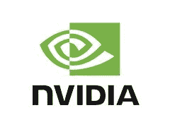

英伟达在美国召开为期三天的‘AI 峰会’，焦点在 AI 实际应用。其副总裁 Bob Pette 预测 AI 将为各行业带来高达 20 万亿美元的经济影响，峰会介绍了 AI 下一阶段发展及多种应用场景。目前有数千预训练‘AI 智能体’提升各行业生产力，英伟达的 CUDA 库包含超 4000 种加速应用。英伟达认为下一波 AI 革命将是‘物理 AI’。

### 💡 刚刚，地平线通过聆讯，上市只差敲钟

量子位 | [阅读原文](https://www.qbitai.com/2024/10/198938.html)

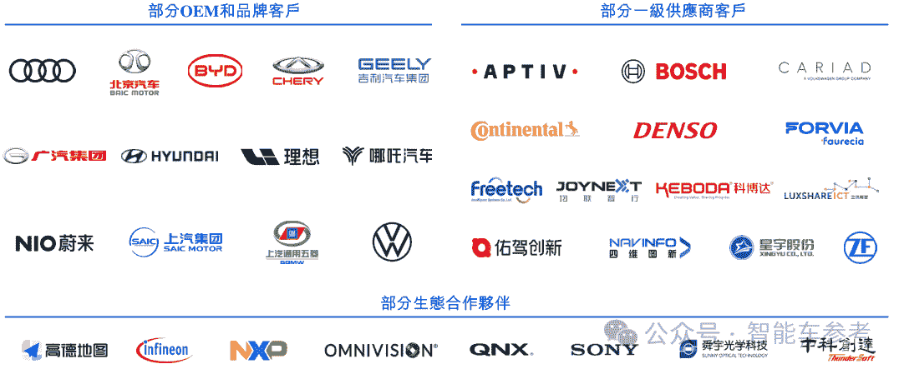

地平线正式通过港交所聆讯，即将登陆港股。过去 3 年营收年复合增长率达 82.3%，今年上半年营收 9.35 亿元，同比增长 151.6%。推出的征程解决方案出货量超 600 万套。截至 2024 年 6 月 30 日，研发团队 1696 人，占员工总数 73.1%。现金及现金等价物余额为 104.52 亿元，已获十多轮投资超 34 亿美元。其提供三种智驾方案，中国十大 OEM 均选择其解决方案。

### 💡 2024 诺贝尔物理学奖揭晓：机器学习奠基人 John J. Hopfield 和 Geoffrey E. Hinton 获奖

IT之家 | [阅读原文](https://www.ithome.com/0/800/682.htm)

2024 诺贝尔物理学奖授予 John J. Hopfield 和 Geoffrey E. Hinton，表彰他们通过人工神经网络实现机器学习的基础性发现和发明。他们利用物理学概念和方法，开发出利用网络结构处理信息的技术，为强大的机器学习奠定了基础。

### 💡 富士康计划在墨西哥建造全球最大的英伟达 GB200 AI 芯片制造工厂

IT之家 | [阅读原文](https://www.ithome.com/0/800/654.htm)

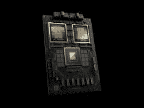

2024 年 10 月，富士康计划在墨西哥建造全球最大的英伟达 GB200 AI 芯片制造工厂。富士康作为苹果主要供应商正扩大业务，想借英伟达争夺新市场。鸿海董事长刘扬伟称公司供应链已为人工智能革命做好准备，新工厂在墨西哥，产能将非常巨大，且提到先进制造能力包括液体冷却和散热系统等关键技术。

### 💡 OpenAI 重点转向产品开发，研究人才外流给了对手机会

IT之家 | [阅读原文](https://www.ithome.com/0/800/639.htm)

OpenAI 重点转向产品开发致研究人才外流，多位高管及核心人员离职。2021 年 OpenAI 招聘职位中一般研究类职位占 23%，2024 年降至 4.4%。尽管仍有人才储备，但竞争激烈下保持领先难度增加。OpenAI 需填补关键职位空缺，其目标是 2029 年将年收入提升至 1000 亿美元。公司内部对产品开发的关注引发紧张情绪，领导层变动被视为公司发展正常过程，但也引发担忧。

###

## ✨ 行业观点

### 💡 2024诺贝尔物理学终极预测！凝聚态物理大热门，复旦教授吴咏时被提名

新智元 | [阅读原文](https://www.163.com/dy/article/JDVTD47U0511ABV6.html?spss=dy_author)

2024 年诺贝尔物理学奖将于今日下午开奖。凝聚态物理、量子计算、超材料等是热门方向。复旦大学施郁教授预测可能授予分数统计和任意子领域。《物理世界》杂志预测热门为凝聚态物理（魔角石墨烯）和超材料。魔角石墨烯领域曹原等有突出成果，超材料是人造材料能实现特殊电磁特性。此外，物理学博士 Superconformal Hassaan 也给出了自己的预测名单。目前距离开奖不到 5 小时。

### 💡 2024 诺贝尔物理学奖得主“AI 教父”辛顿：最担心 AI 最终反噬人类

IT之家 | [阅读原文](https://www.ithome.com/0/800/767.htm)

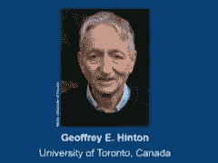

2024 诺贝尔物理学奖得主、‘AI 教父’辛顿获殊荣。他担忧 AI 迅速发展，担心 AI 系统超越人类并反噬人类。辛顿认为 AI 如工业革命，虽可提升医疗服务和效率，但有失控风险，呼吁科学家、政策制定者和业界领导者紧密合作确保其符合伦理标准。2024 诺贝尔奖官方评语称两位得主为强大机器学习奠定基础。

### 💡 开发者火冒三丈炮轰GenAI：垃圾语料太多，模型正在变得越来越笨

新智元 | [阅读原文](https://www.163.com/dy/article/JDVTB0V50511ABV6.html?spss=dy_author)

有开发者炮轰 GenAI，认为模型正在变得越来越笨。如史蒂文指出 ChatGPT 等模型性能不如以前，错误多且反复。原因一是训练集包含低质量网站数据，可能导致错误答案；二是生成式 AI 内容取代人类内容引发‘模型崩溃’。尽管有特定用途的生成式 AI 有用，但作为替代知识型员工方式不可取