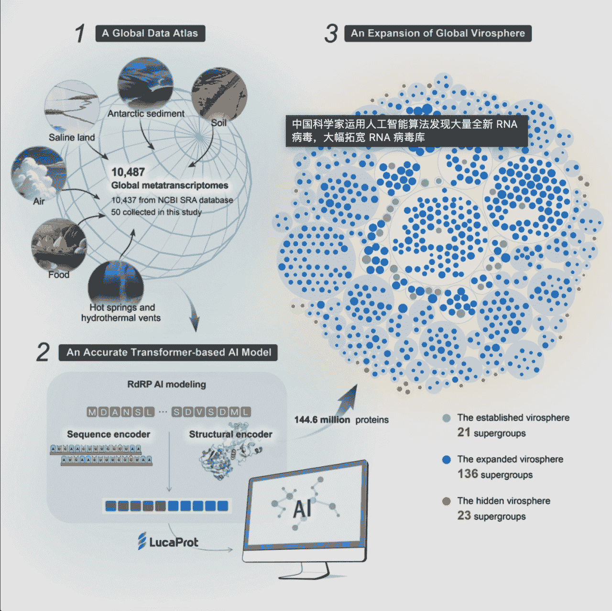
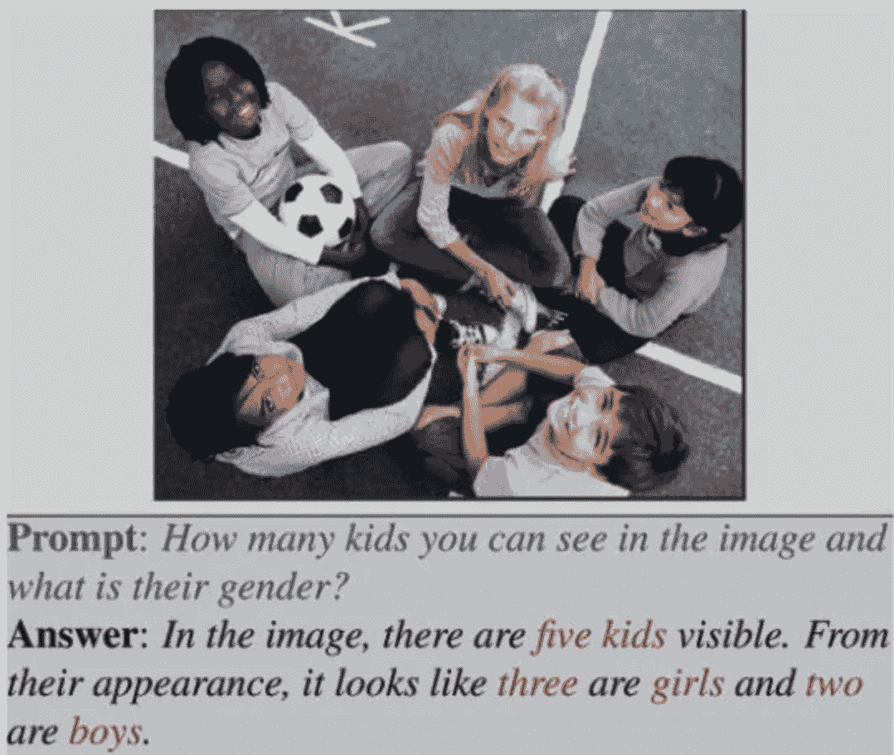
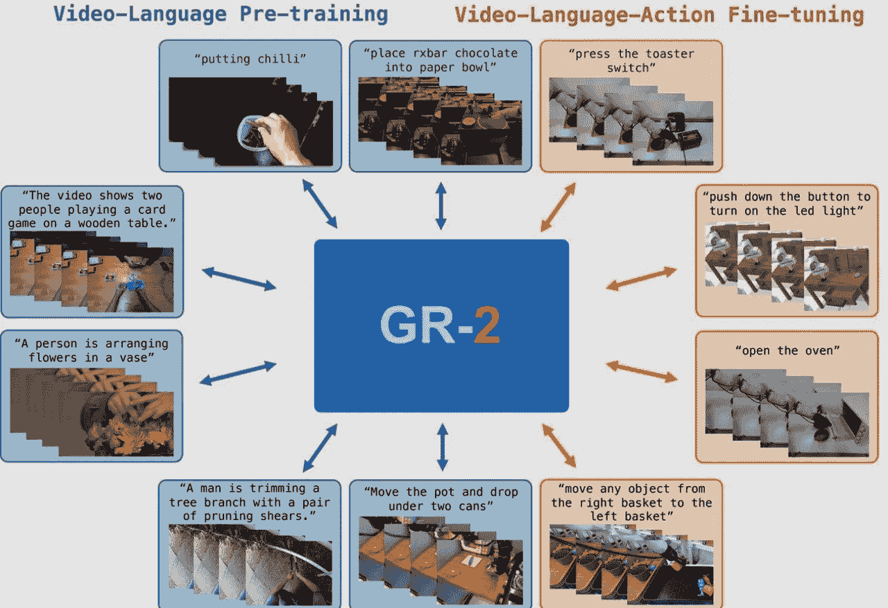
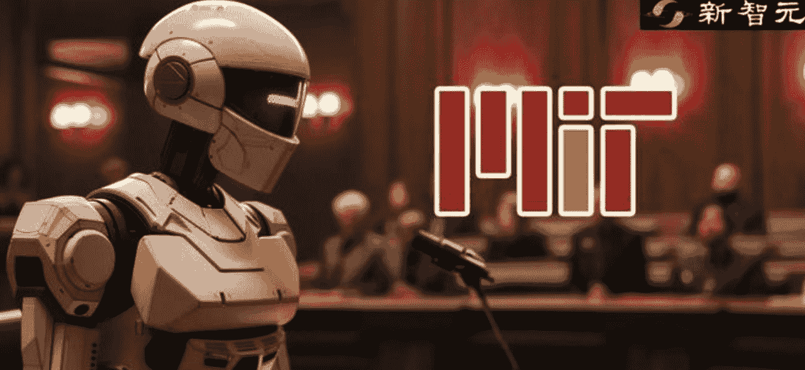
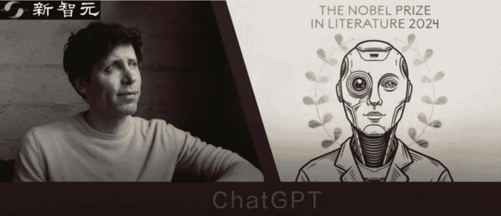
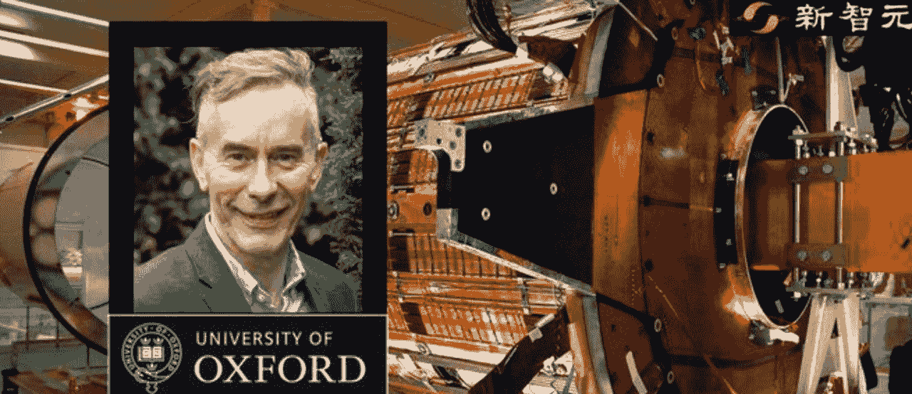
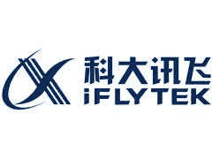

# 10.11-vivo 宣布开放无障碍产品安卓公版，全栈 AI 能力免费用、Meta 推出革命性 AI 视频工具、ChatGPT o1 推理模型幕后大佬离职

> 来源：[https://agijuejin.feishu.cn/docx/CDMcdZ0kCoCPTExxdZ5cASGun5b](https://agijuejin.feishu.cn/docx/CDMcdZ0kCoCPTExxdZ5cASGun5b)

[欢迎加入 AGI 掘金社群](https://sourl.co/miZUyT)

## ⭐ 今日热点

### 💡 Meta 推出革命性 AI 视频工具，让广告创意焕然一新

IT之家 | [阅读原文](https://www.ithome.com/0/801/033.htm)

2024 年 10 月，Meta 在 Advertising Week 活动中推出两款 AI 工具，Image Animation 能将静态照片生成创意视频，Video Expansion 可扩展现有视频内容。早期广告客户反馈积极，认为其克服资源有限问题并为广告创意提供更长使用寿命。

### 💡 vivo 宣布开放无障碍产品安卓公版，全栈 AI 能力免费用

IT之家 | [阅读原文](https://www.ithome.com/0/801/100.htm)

2024 vivo 开发者大会上，vivo 公布无障碍进展。升级‘手语翻译官’，开放无障碍产品安卓公版且全栈 AI 能力免费使用。蓝心语音大模型支持多种语言，‘vivo 听说 - 方言自由说’支持多种方言。推出‘vivo 看见 - 蓝心升级版’。vivo 成为中国残联战略合作伙伴，捐赠无障碍设备并招募梦想导师。还将开放无障碍产品安卓公版，让用户体验无障碍成果，向开发者免费开放全栈 AI 能力。

### 💡 ChatGPT 幕后大佬、o1 推理模型作者 Luke Metz 官宣从 OpenAI 离职

IT之家 | [阅读原文](https://www.ithome.com/0/801/096.htm)

ChatGPT 幕后大佬、o1 推理模型作者 Luke Metz 官宣从 OpenAI 离职。此前出走的后训练团队负责人 Barret Zoph 离职两周后，William (Liam) Fedus 成为新的继任者，他也是 o1 模型七大负责人之一。Metz 曾与 Zoph 和 Fedus 在谷歌是同僚，在 OpenAI 任职两年。Zoph 计划创办新公司，尚不清楚 Metz 去向。

## 🌟 技术突破

### 💡 中国科学家运用人工智能算法发现大量全新 RNA 病毒，大幅拓宽 RNA 病毒库

IT之家 | [阅读原文](https://www.ithome.com/0/801/103.htm)

中国科学家施莽教授团队与阿里云李兆融团队在《细胞》杂志发表论文。他们运用 LucaProt 人工智能算法发现大量全新 RNA 病毒，使 RNA 病毒超群数量扩容约 9 倍，还报告了迄今最长 RNA 病毒基因组等成果。该算法能深度学习病毒和非病毒基因组序列，自主判断病毒序列，假阳性率仅 0.014%。团队开源了 LucaProt 模型并分享给全球科学家。

### 💡 OpenAI GPT-4 解锁新成就：100% 识别性别、74.25% 识别年龄范围，未专门训练可媲美专业算法

IT之家 | [阅读原文](https://www.ithome.com/0/801/079.htm)

OpenAI 的 GPT-4 在未经专门训练下能识别面孔、判断性别和估计年龄。在性别识别测试中，对 5400 张图像的数据集准确率达 100%，超越 DeepFace 模型（99%准确率）。年龄估计方面，正确识别年龄范围比例为 74.25%。但研究也发现可绕过 GPT-4 保护措施透露敏感生物识别信息。

### 💡 字节跳动发布 GR-2 机器人 AI 大模型：任务平均完成率 97.7%，模拟人类学习处理复杂任务

IT之家 | [阅读原文](https://www.ithome.com/0/801/030.htm)

字节跳动发布 GR-2 机器人 AI 大模型，创新构建‘机器人婴儿期’学习阶段，模拟人类学习处理复杂任务。在预训练阶段‘观看’3800 万个互联网视频及 500 亿个 tokens，在微调阶段展现卓越多任务学习能力，在超 100 个任务中平均成功率达 97.7%，且在新场景中有出色泛化能力。

### 💡 清华微软最新力作：用物理学革新Transformer注意力，「大海捞针」精度暴涨30%！

新智元 | [阅读原文](https://www.163.com/dy/article/JE2FQD9P0511ABV6.html?spss=dy_author)

清华微软推出 Differential Transformer，从注意力模块入手提升 Transformer 核心能力。该模型能让模型更关注关键信息，提升检索精度，缓解 LLM 幻觉。如在‘大海捞针’测试中，64k 上下文长度下，DIFF Transformer 在关键信息位于前半部分时精度提升显著，尤其在 25%深度时达 76%。它还遵循缩放规律，在参数和训练 Token 扩展方面表现良好，且对量化和位宽稳健性更高。作者包括微软研究院和清华学生。

### 💡 成熟的AI要学会自己搞研究！MIT推出「科研特工」

新智元 | [阅读原文](https://www.163.com/dy/article/JE2FQD5C0511ABV6.html?spss=dy_author)

2024 年 10 月 9 日，MIT 团队推出自动搞科研的 AI 系统 SciAgents。它由大规模本体知识图、大语言模型和数据检索工具、多智能体系统构成。SciAgents 锁定仿生材料研究，揭示跨学科关系，超越传统人类研究方法。它能自动生成完善假设，两种策略实现智能体交互，还可纳入人机交互。其核心是广泛知识图，采用随机路径生成，利用 LLM 驱动的本体论智能体深入洞察关系，为科学研究提供新角度。

## 💫 企业动态

###

###

### 💡 诺贝尔文学奖要颁给ChatGPT？奥特曼得奖呼声高，Hinton怒斥：他不配！

新智元 | [阅读原文](https://www.163.com/dy/article/JE51JBFB0511ABV6.html?spss=dy_author)

2024 年诺贝尔物理学奖颁给 Hinton 和 Hopfield，引发争议。Hinton 获诺奖后炮轰奥特曼更关心利润而非安全，LSTM 之父 Schmidhuber 则称 Hinton 不配诺奖，因忽视了 AI 先驱 Amari 的贡献。此外，今年诺奖 AI 含量高，文学奖 ChatGPT 和奥特曼呼声高，有人预测奥特曼会得诺贝尔经济学奖。John Jumper 博士毕业 7 年获诺奖，是近 70 年最年轻得主，因开发 AlphaFold 获化学奖。最后，让大模型预测文学奖得主，引发对今晚文学奖是否颁给 AI 的讨论。

### 💡 享年65岁！牛津著名粒子物理学家猝死在办公室，让人类重新认知重夸克

新智元 | [阅读原文](https://www.163.com/dy/article/JE5142CV0511ABV6.html?spss=dy_author)

牛津大学著名粒子物理学家 Ian Shipsey 教授猝死在办公室，享年 65 岁。他是实验粒子物理学界领军人物，对含有底夸克和粲夸克的粒子罕见衰变等有深入研究，为发现希格斯玻色子做出贡献，2022 年当选英国皇家学会院士。他还致力于改善大学无障碍环境，牛津大学各界领导对其表达深切哀悼。

### 💡 vivo 全新蓝心大模型矩阵发布，推出 30 亿蓝心端侧大模型 3B、语音大模型

IT之家 | [阅读原文](https://www.ithome.com/0/801/065.htm)

2024 年 10 月 10 日，vivo 在开发者大会上发布全新蓝心大模型矩阵，推出 30 亿蓝心端侧大模型 3B 和语音大模型等。蓝心 3B 在多项能力上可越级比肩行业 7B - 9B 模型，性能提升 300%，功耗优化 46%，内存减小 63%。蓝心语音大模型能准确理解自然语义，图像大模型强化中国特色与东方美学融合生成能力，多模态大模型升级视觉感知理解能力，多个模型在专业榜单上位列第一。

### 💡 字节豆包首个AI硬件来了，定价1199元！

量子位 | [阅读原文](https://www.qbitai.com/2024/10/199254.html)

2024 年 10 月，字节跳动推出首个 AI 硬件——Ola Friend 蓝牙耳机，定价 1199 元。其最大亮点是将通用大模型应用于耳机场景，可练英语口语等。采用不入耳开放式设计，单只重 6.6 克，有多项提升音质的设计。能在嘈杂环境和方言下准确识别用户声音，依靠 Seed-TTS、Seed-ASR 和豆包大模型实现高效交互，10 月 17 日起售，后续 AI 功能将持续更新。

### 💡 vivo 手机智能体 PhoneGPT 亮相，可自动打电话订餐厅

IT之家 | [阅读原文](https://www.ithome.com/0/801/063.htm)

2024 vivo 开发者大会上，vivo 公布手机智能体 PhoneGPT，它支持自主拆解需求等功能，可自动打电话订餐厅，如小 V 订座助手能与用户沟通后完成订座。未来 PhoneGPT 将实现端侧化。

### 💡 2024 科大讯飞全球 1024 开发者节官宣：首发多模态视觉交互、超拟人虚拟人交互能力

IT之家 | [阅读原文](https://www.ithome.com/0/801/049.htm)

2024 科大讯飞全球 1024 开发者节将于 10 月 24 日在合肥开启。届时将发布讯飞星火大模型升级版，底座能力升级，包含数学、代码和长文本能力提升等。还将首发多模态视觉交互、超拟人虚拟人交互能力，并在多个领域升级行业大模型及应用产品。科大讯飞 2024 年上半年营收 93.25 亿元，同比增长 18.91%，净亏损 4.01 亿元，同比转亏。

### 💡 首个开源 AI 候选版定义稿发布：四大要求，训练数据上有妥协

IT之家 | [阅读原文](https://www.ithome.com/0/801/038.htm)

2024 年 10 月 9 日开源倡议组织发布首个开源 AI 定义候选版本，明确 AI 系统需具备四种基础自由要求才可视为开源。在训练数据方面有所妥协，只要求提供详细信息而非完整数据集。该定义尚未定稿，可能根据反馈调整，最终版本计划在 10 月 28 日的 All Things Open 会议发布。

### 💡 消息称 Kimi AI 助手内测深度推理功能，月之暗面有团队国庆加班 7 天 3 倍工资

IT之家 | [阅读原文](https://www.ithome.com/0/801/032.htm)

国产 AI 大模型 Kimi 的开发团队月之暗面有团队国庆加班 7 天拿 3 倍工资赶进度，准备上线深度推理功能。月之暗面 2023 年 3 月创立，10 月推出 Kimi，核心成员参与多个大模型研发。今年估值曾达 30 亿美元，阿里投资约 8 亿美元购入 36%股权，腾讯也参与 3 亿美元融资使其估值提升至 33 亿美元。

###

###

###