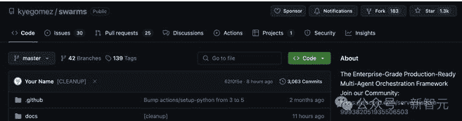

# 10.14-苹果多模态模型大升级:文本密集、多图理解，全能小钢炮、智谱开源文生图模型 CogView3-Plus、 OpenAI 多智能体 Swarm 陷争议

> 来源：[https://agijuejin.feishu.cn/docx/UySBdm3hUokqJ5xUMYNcYQfVnQb](https://agijuejin.feishu.cn/docx/UySBdm3hUokqJ5xUMYNcYQfVnQb)

加入飞书群：[欢迎加入 AGI 掘金社群](https://sourl.co/miZUyT)

## ⭐ 今日热点

### 💡 苹果多模态模型大升级！文本密集、多图理解，全能小钢炮

新智元 | [阅读原文](https://www.163.com/dy/article/JECMDCCK0511ABV6.html?spss=dy_author)

2024 年苹果推出升级版多模态大模型 MM1.5，参数量从 1B 到 30B，涵盖密集和专家混合模型。该模型增强了文本密集型图像理解、视觉指代和定位、多图像推理等能力，提升了 OCR 能力，支持高分辨率图像。作者通过持续预训练、SFT、动态高分辨率等方法改进模型，还进行了消融实验以优化数据组合，平衡各功能性能。

### 💡 智谱开源文生图模型 CogView3-Plus，相关功能上线智谱清言 App

IT之家 | [阅读原文](https://www.ithome.com/0/802/017.htm)

2024 年 10 月 14 日，智谱技术团队开源文生图模型 CogView3 及 CogView3-Plus-3B，相关功能上线‘智谱清言’App。CogView3 分三个阶段生成图像，在人工评估中比 SDXL 高出 77.0%且推理时间仅为其 1/10。CogView3-Plus 在 CogView3 基础上引入 DiT 框架，采用 Zero-SNR 扩散噪声调度和文本 - 图像联合注意力机制，降低训练和推理成本，使用潜在维度为 16 的 VAE。开源仓库地址见文中。

###

### 💡 OpenAI 多智能体 Swarm 陷争议，20 岁创始人自曝代码结构被抄袭

IT之家 | [阅读原文](https://www.ithome.com/0/801/850.htm)

OpenAI 推出多智能体框架 Swarm，获大量关注。但 20 岁的 Swarms Corporation 创始人自曝 OpenAI 抄袭其项目名称、代码结构和方法，引发争议。OpenAI 的 Swarm 通过智能体和交接实现让智能体协调和执行更高效，目前争议双方各执一词。

## 🌟 技术突破

### 💡 大模型「强崩溃」！Meta新作：合成数据有「剧毒」，1%即成LLM杀手

新智元 | [阅读原文](https://www.163.com/dy/article/JECMDO3Q0511ABV6.html?spss=dy_author)

Meta、纽约大学、UCLA 机构研究发现，即使合成数据仅占总数据集 1%比例，仍可能导致模型崩溃，且 ChatGPT 和 Llama 等较大模型可能放大这种崩溃现象。作者通过理论分析和实验，探讨了模型崩溃的原因及合成数据比例对模型的影响，还尝试了数据混合方法缓解崩溃，但效果不佳。

### 💡 台积电计划在欧洲建设更多工厂，重点瞄准 AI 芯片

IT之家 | [阅读原文](https://www.ithome.com/0/801/951.htm)

2024 年 10 月 14 日消息，台积电已在德国德累斯顿动工建设首座晶圆厂，未来计划在欧洲建设更多工厂，重点瞄准 AI 芯片市场。8 月启动价值 100 亿欧元（约 773.44 亿元人民币）的芯片制造厂建设项目，2027 年底投产，资金一半由当地政府补贴。AI 市场被认为是重要增长领域，台积电可能为欧洲准备更多工厂并在评估后续建厂地点。

## 💫 企业动态

### 💡 中国移动研究院发布网络运行智能（AIR）训练及开放平台

IT之家 | [阅读原文](https://www.ithome.com/0/801/952.htm)

2024 年 10 月 14 日，在中国移动全球合作伙伴大会期间，中国移动研究院联合多家合作伙伴发布网络运行智能（AIR）训练及开放平台。该平台实现‘一体 + 三能力’，包括智能控制体及构建网络运行基础模型、打造网络数据治理工具集、提供网络开放仿真环境等能力。

### 💡 中国移动推出“灵犀”家庭智能体，支持智能搜索、对话交互等功能

IT之家 | [阅读原文](https://www.ithome.com/0/801/883.htm)

2024 年 10 月 12 日，中国移动在全球合作伙伴大会上推出‘灵犀’家庭智能体。它基于九天能力底座，适配多形态终端硬件，支持智能搜索、对话交互等功能，以数智形象为载体，实现家庭全场景信息服务，后续将打造家庭智能体生态平台。

### 💡 特斯拉人形机器人 Optimus 现场做饮料，员工证实有人在远程控制

IT之家 | [阅读原文](https://www.ithome.com/0/801/846.htm)

2024 年 10 月，特斯拉在自动驾驶出租车活动上展示人形机器人 Optimus，它现场做饮料等，但员工证实有人在远程控制。技术传播者罗伯特·斯考伯指出这并非纯粹人工智能。马斯克的展示被指像上世纪 50 年代的‘奇迹厨房’，有误导观众之嫌，一些投资者对此次特斯拉发布会评价为‘令人失望’。

###

## ✨ 行业观点

### 💡 Meta 首席人工智能科学家 LeCun：AI 威胁人类论完全是胡说八道

IT之家 | [阅读原文](https://www.ithome.com/0/801/963.htm)

Meta 首席人工智能科学家 LeCun 称 AI 威胁人类论完全是胡说八道。他认为如今的语言大模型缺乏关键‘猫级’能力，不会产生真正的通用人工智能（AGI）。同时，他也不完全否认实现 AGI 的可能性，并指出其领导的 Meta 基础人工智能研究团队正在研究消化真实世界视频这一有前景的方向。

### 💡 OpenAI惊天剽窃！20岁创始人自曝代码结构被抄袭，多智能体Swarm陷争议

新智元 | [阅读原文](https://www.163.com/dy/article/JECMBUF00511ABV6.html?spss=dy_author)

2024 年 10 0 月 13 日，OpenAI 新推出多智能体框架 Swarm 爆火后，被 20 岁的 Swarms Corporation 创始人 Kye Gomez 指控剽窃，称 OpenAI 盗用其项目名称、代码结构和方法。Gomez 警告 OpenAI 要么投资要么面临法律责任，同时列出多项指控，如名字一致、复制语法规则等。OpenAI 的 Swarm 框架已狂揽 4.6k 星，专注于让智能体协调和执行更轻量级等。