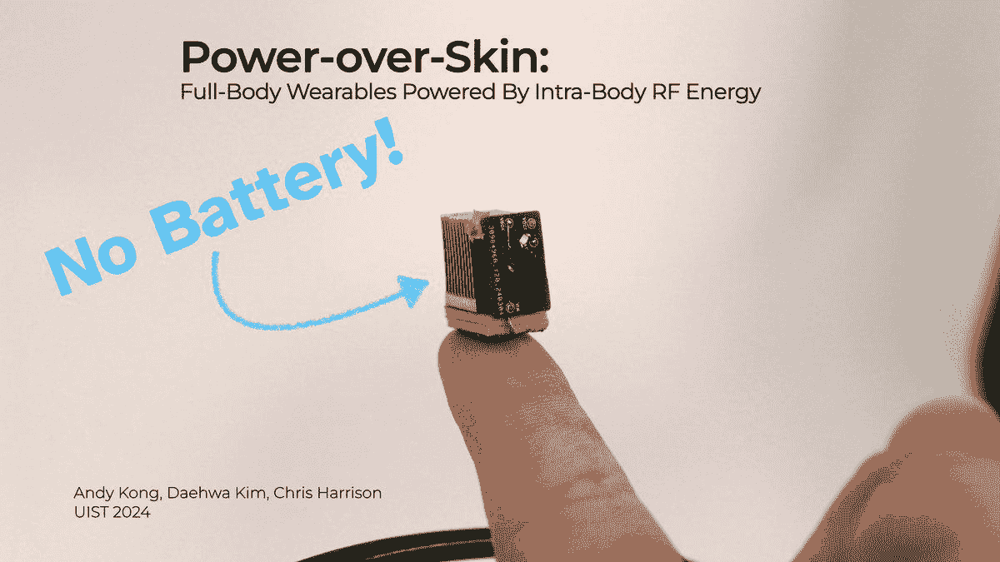

# 10.17-阿里国际发布 Marco 翻译大模型、 Power-over-Skin “皮肤供电”技术 让可穿戴设备无需电池也能工作

> 来源：[https://agijuejin.feishu.cn/docx/AHHFd1z77oOSNTxnQJncYcBunEh](https://agijuejin.feishu.cn/docx/AHHFd1z77oOSNTxnQJncYcBunEh)

## ⭐ 今日热点

### 💡 阿里国际 Marco 翻译大模型发布：支持中英日韩西法等 15 种主流语言

IT之家 | [阅读原文](https://www.ithome.com/0/802/710.htm)

2024 年 10 16 日，阿里国际发布翻译大模型 Marco，支持中英日韩西法等 15 种主流语言。在 BLEU 自动评测指标上领先 Google 翻译、DeepL、GPT-4 等。Marco 通过多语言数据筛选技术和混合专家等方法，保证主导语言性能同时提升其他语种质量，能为个人用户提供高质量翻译和良好可读性，满足多样化需求。

## 🌟 技术突破

### 💡 Power-over-Skin “皮肤供电”技术 让可穿戴设备无需电池也能工作

小互日报 | [阅读原文](https://xiaohu.ai/p/14666)

2024 年 10 月 16 日消息，‘皮肤供电’技术出现，可让可穿戴设备无需电池工作。目前现代可穿戴设备虽功能强大且小巧，但电池成为设计和用户体验阻碍，增加重量体积且需定期充电。传统无线能量传输技术要么功率不足要么需专门环境，而‘皮肤供电’技术有望解决这些问题。

### 💡 重新定义自监督学习！LeCun团队让MMCR再进一步

新智元 | [阅读原文](https://www.163.com/dy/article/JEKFSPD90511ABV6.html?spss=dy_author)

2024 年，来自斯坦福、MIT、纽约大学和 Meta-FAIR 等机构的研究人员重新定义了最大流形容量表示法（MMCR）。MMCR 不依赖对比、聚类、蒸馏等方法却效果出色。研究人员利用高维概率工具证明了 MMCR 可激励学习嵌入的对齐和均匀性，将其几何视角与信息论视角联系起来，发现了计算上的 scaling law，并证明其在多模态图像文本数据上表现优异。

### 💡 宇宙竟是一个智能体？万物智能演化Ω理论，探索宇宙终极之迷

新智元 | [阅读原文](https://www.163.com/dy/article/JEKFS8T80511ABV6.html?spss=dy_author)

2024 年 10 月，中国科学院大学研究人员提出万物智能演化理论（Omega 理论）。该理论以观察者和智能体的统一为突破点，揭示观察者智能水平是导致经典力学、相对论和量子力学差异的根本原因。理论由三个核心模型组成，将宇宙看作不断演化的智能体，受α引力和Ω引力驱动。此理论为解决 21 世纪科学的两朵乌云奠定基础，也为智能科学和物理学的统一提供探索方向。

## 💫 企业动态

### 💡 摩托罗拉 Moto AI 开启便捷生活新篇章：点咖啡、叫网约车等一句话搞定

IT之家 | [阅读原文](https://www.ithome.com/0/802/744.htm)

2024 年 10 月 16 日，在联想科技世界大会上，摩托罗拉推出 Moto AI 功能，可支持自然语言指令操作，如点咖啡、叫网约车等，还能自动化日常任务，提供个人通讯摘要及记录对话转录总结等。新功能提升了手机智能化程度，为用户生活带来便利，未来有望成为不可或缺的助手。

### 💡 OpenAI 最新 53 页论文：ChatGPT 看人下菜碟，对“小美”和“小帅”回答不一致

IT之家 | [阅读原文](https://www.ithome.com/0/802/728.htm)

OpenAI 新论文指出 ChatGPT 会看人下菜碟，对不同名字回答不一致。比如‘小美’和‘小帅’问同样问题可能得到不同答案。女性名字易获友好回复及通俗表达，男性则多为专业术语。研究还发现开放式任务中有害刻板印象可能性高，不同方式输入用户名偏见评估相关等结论。同时，GPT-3.5 Turbo 偏见程度高，新模型偏见低于 1%，增强学习技术可减轻有害刻板印象。该研究为评估聊天机器人偏见提供方法，但也有局限性。

### 💡 ChatGPT竟会「看人下菜」！ OpenAI 53页研究曝惊人结果：「你的名字」能操控AI回答

新智元 | [阅读原文](https://www.163.com/dy/article/JEKFSV680511ABV6.html?spss=dy_author)

OpenAI 发布 53 页研究，发现名字可能影响 ChatGPT 回答，不足 1%响应存在有害刻板印象。研究了 ChatGPT 对不同性别、种族用户的回复差异，如男性被建议做电路，女性被建议育儿等。未来需进一步研究定义有害刻板印象，提高检测准确性，让 LLM 更公平。

### 💡 逐际动力发布多形态双足机器人 TRON 1：可选双点足 / 双足 / 双轮足，6.98 万元起

IT之家 | [阅读原文](https://www.ithome.com/0/802/665.htm)

2024 年 10 月 16 日，逐际动力发布多形态双足机器人 TRON 1，中国和海外同步上架，标准版早鸟价 6.98 万起。TRON 1 采用‘三合一’模块化设计，可切换双点足/双足/双轮足三种形态，实现足端自适应识别和运控模式自动切换，为科研用户提供多用途研究平台。内置高性能运动控制算法，支持基于模型和强化学习的前沿研究，配备全自研高性能关节，支持 Python 全流程开发和 Sim2Real 一键部署，还配备二次开发指南及代码示例，支持主流仿真平台，可选多样化扩展配件。