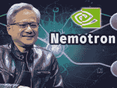
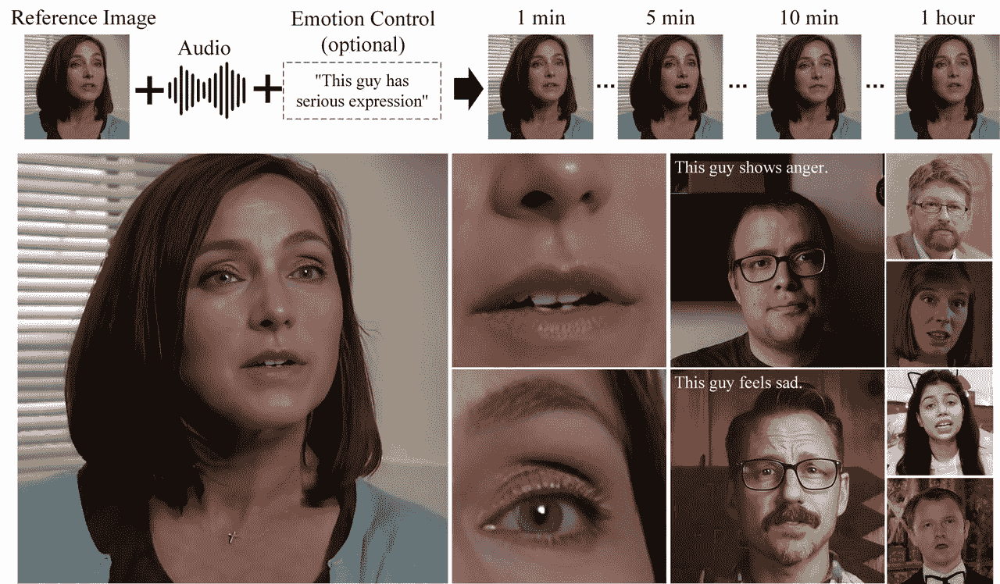
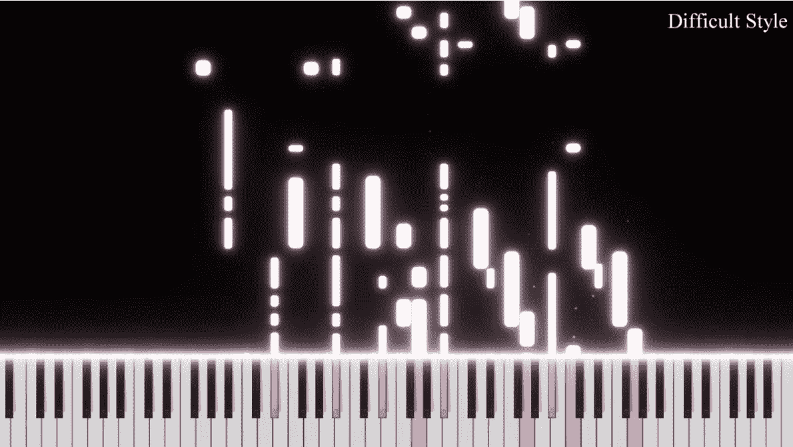
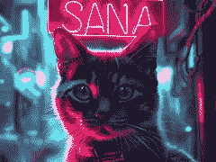
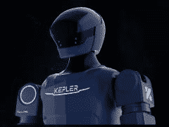

# 10.18-英伟达开源模型 Nemotron-70B 、OpenAI 推出 Windows 版 ChatGPT 客户端、 52万张GPU集群塞进一个「盒子」？

> 来源：[https://agijuejin.feishu.cn/docx/CaTsd02scopGTgxMTSrcTzKtnyb](https://agijuejin.feishu.cn/docx/CaTsd02scopGTgxMTSrcTzKtnyb)

> [欢迎加入 AGI 掘金社群](https://sourl.co/miZUyT)

## ⭐ 今日热点

### 💡 英伟达开源模型 Nemotron-70B 超越 GPT-4o 和 Claude 3.5，仅次于 OpenAI o1

IT之家 | [阅读原文](https://www.ithome.com/0/803/156.htm)

2024 年 10 月，英伟达开源模型 Nemotron-70B 在多个基准测试中超越 GPT-4o 和 Claude 3.5 等 140 多个模型，仅次于 OpenAI o1。它基于 Llama-3.1 开发，采用混合训练方法，训练奖励模型时用 Bradley-Terry 和 Regression，还开源了训练数据集。在各种测试中表现出色，目前模型权重可在 Hugging Face 上获取。

## 🌟 技术突破

### 💡 Hallo 2：根据单张图像和音频输入能够生成长达一小时的4K分辨率人像视频

小互日报 | [阅读原文](https://xiaohu.ai/p/14743)

2024 年 10 月，模型 Hallo 发布更新版本 Hallo2。它能根据单张图像和音频输入生成长达一小时的 4K 分辨率人像视频，解决了长时、高分辨率视频生成问题。通过补丁丢弃、噪声增强和时间对齐等技术，保持视觉一致性与时间连贯性，支持灵活的语音与文本控制，生成质量业内领先。

### 💡 AMT-APC：自动生成钢琴伴奏模型 将任意音乐转换成与原曲匹配钢琴伴奏

小互日报 | [阅读原文](https://xiaohu.ai/p/14734)

AMT-APC是自动生成钢琴伴奏的模型，能从音频文件中提取信息生成与原曲匹配的钢琴伴奏。其特点包括自动生成、高保真度、多样化风格生成、支持复杂乐曲及风格控制功能。核心架构基于自动音乐转录模型，采用 hFT-Transformer，通过预训练和微调实现，还使用矩阵输出损失计算和风格向量等关键技术。

### 💡 RTX 4090 笔记本 0.37 秒直出大片：英伟达联手 MIT 清华祭出 Sana 架构，速度秒杀 FLUX

IT之家 | [阅读原文](https://www.ithome.com/0/803/164.htm)

英伟达联手 MIT、清华团队推出 Sana 架构，在 RTX 4090 笔记本上仅需 0.37 秒就能生成 1024×1024 像素图片，最高可实现 4k 分辨率。其核心设计包括深度压缩自编码器、线性 DiT、基于仅解码器模型的文本编码器和高效的训练采样策略等。与领先模型相比，Sana 参数小且吞吐量飙升，在不同分辨率下性能出色，还能在消费级 4090 上实现快速生成高质量图像。

### 💡 4090笔记本0.37秒直出大片！英伟达联手MIT清华祭出Sana架构，性能秒杀FLUX

新智元 | [阅读原文](https://www.163.com/dy/article/JEN12I890511ABV6.html?spss=dy_author)

2024 年 10 月，英伟达联手 MIT 清华团队推出 Sana 架构。4090 笔记本仅需 0.37 秒可生成 1024×1024 像素图片，最高能实现 4k 分辨率。其核心设计包括深度压缩自编码器、线性 DiT、基于仅解码器模型的文本编码器和高效的训练和采样。相较于领先扩散模型 Flux-12B，Sana-0.6B 参数小 12 倍，吞吐量飙升 100 倍，在多个方面表现出色，且优化后在消费级 4090 上生成图像速度快。

## 💫 企业动态

### 💡 日企正开发 AI 系统，帮客服应对客户辱骂等问题

IT之家 | [阅读原文](https://www.ithome.com/0/803/254.htm)

2024 年 10 月，日企 NTT 通讯公司和软银公司正开发 AI 系统帮助客服应对恶劣客户。NTT 通讯的系统可实时监控交流并显示恰当回应语言，减轻员工心理负担。软银在研发柔化客户声音语气的 AI 系统，计划 2025 财年商业化。这些创新为改善客户服务体验开辟新可能。

### 💡 微软将终止中国个人 Azure OpenAI 服务，仅企业客户可用

IT之家 | [阅读原文](https://www.ithome.com/0/803/229.htm)

10 月 18 日消息，微软将终止中国个人 Azure OpenAI 服务，10 月 21 日起仅企业客户可用。多数开发者 17 日收到邮件，有开发者表示这是个人在国内合规使用 OpenAI 的唯一窗口被关闭，且不满仅四天处理时间。微软暂未表态，还悄悄删除了 6 月 26 日一篇关于 Azure OpenAI 的文章。

### 💡 开普勒发布人形机器人先行者 K2：单手负载 15kg，100TOPS 算力

IT之家 | [阅读原文](https://www.ithome.com/0/803/190.htm)

2024 年 10 月 18 日，上海开普勒机器人有限公司发布人形机器人先行者 K2，在 GITEX GLOBAL 2024 亮相。K2 单手负载 15kg，有 100TOPS 算力，四肢主体一体化设计，单手 11 个自由度，指尖有柔性传感器。采用全新布线方式，续航 8 小时，有特殊充电接口。已在多家头部客户实际场景测试，如物料搬运等。

### 💡 OpenAI 推出 Windows 版 ChatGPT 客户端：支持热键调用、暂仅限付费用户测试

IT之家 | [阅读原文](https://www.ithome.com/0/803/184.htm)

2024 年 10 0月 18 日，OpenAI 推出 Windows 版 ChatGPT 客户端，目前仅限 ChatGPT Plus/Enterprise/Team/Edu 版本的付费用户在微软应用商店下载测试。该客户端本质是网页版套壳，支持热键调用等功能，预计今年晚些时候向所有用户开放。

### 💡 Siri 将更聪明：苹果加速整合 ChatGPT，正推进生成文本 / 图像技能

IT之家 | [阅读原文](https://www.ithome.com/0/803/175.htm)

2024 年 10 月，苹果被曝正为 iOS 18、iPad OS 18 和 macOS 15 添加全新 Apple Intelligence 特性，其在 Siri 中整合 ChatGPT。Siri 有望具备生成文本和图像技能，处理复杂问题更智能，还会在用户提出复杂问题时建议转交给 ChatGPT 获取更精准信息。苹果调用 ChatGPT 时注重保护用户隐私，这一系列更新将提升用户体验，推动苹果设备智能化进程。

### 💡 中国电信和移动发起、高通联发科等支持，GSMA 启动制定生成式 AI 移动终端需求规范

IT之家 | [阅读原文](https://www.ithome.com/0/803/099.htm)

2024 年 10 月 17 日，GSMA 宣布由中国电信和中国移动发起，沃达丰、DU、高通、联发科、中兴和荣耀共同支持的生成式 AI 移动终端需求规范正式立项。该项目旨在制定一系列规范，明确生成式 AI 在端到端架构中的角色，包括 AI 服务体验、记忆、感知、规划与决策、行动等方面，为设备制造商和服务提供商提供指南。GSMA 成立于 1995 年，举办过多个移动通信行业盛会。

### 💡 人形机器人公司星动纪元完成近 3 亿元 Pre-A 轮融资：阿里巴巴联合领投，联想追投

IT之家 | [阅读原文](https://www.ithome.com/0/803/044.htm)

人形机器人公司星动纪元完成近 3 亿元 Pre-A 轮融资，由清流资本、元璟资本、阿里巴巴联合领投，策源资本跟投，老股东联想创投等持续追投。本轮融资将加速具身智能技术研发和通用人形机器人商业化进程，巩固人才、技术壁垒和市场领先地位。星动纪元自 2023 年 8 月成立以来已完成三轮融资，由清华大学交叉信息研究院助理教授陈建宇创立，是唯一一家清华大学占股的人形机器人企业。

### 💡 支付宝发布“湾事助手”支小宝智能体：AI 带你看广交会

IT之家 | [阅读原文](https://www.ithome.com/0/803/010.htm)

10 月 17 日，支付宝在中国进出口商品交易会期间，联合广东省政务服务和数据管理局发布‘湾事助手’支小宝智能体。用户可通过支付宝 App 或支小宝 App 唤醒该智能体，获得看展攻略等服务，还能为粤港澳大湾区居民提供多项双语生活服务及即时解答引导。在广州等地交通站点和酒店，用户可用手机碰触‘支付宝碰一下’台卡体验该服务。9 月 5 日，支付宝推出 AI 独立 App 支小宝。

### 💡 端侧 AI 崛起：Mistral 发布 Ministral 3B / 8B，“全球最好的边缘模型”

IT之家 | [阅读原文](https://www.ithome.com/0/803/000.htm)

2024 年 10 月 17 日，Mistral 公司发布 Ministral 3B 和 Ministral 8B 两款 AI 模型，无需连接云服务器，可提升笔记本和智能手机等设备的本地化 AI 体验，被称为‘世界上最好的边缘模型’。能在无互联网接入下执行多项服务，上下文窗口为 128K，可处理 50 页文档。8B 版本每百万个 tokens 售价 0.1 美元，3B 版本为 0.04 美元。8B 采用交错滑动窗口注意力机制，推理时更快且省内存。

### 💡 .ai 域名卖爆，小岛安圭拉 2023 年意外躺赚 3200 万美元

IT之家 | [阅读原文](https://www.ithome.com/0/802/994.htm)

随着人工智能产业火热，.ai 域名卖爆。加勒比海小岛安圭拉 2023 年意外躺赚 3200 万美元，域名注册费收入翻了两番，占政府总收入约 20%。目前全球有超过 53.3 万个.ai 网页域名，自 2018 年以来增长了 10 倍以上。安圭拉将与美国域名管理公司签署协议以应对域名注册增长。

### 💡 ICLR 2025钦定AI参审，11000篇总投稿数暴增61%！

新智元 | [阅读原文](https://www.163.com/dy/article/JEN12I7H0511ABV6.html?spss=dy_author)

ICLR 2025评审开启，投稿数达 11000 多篇，同比增长 61%。为提高审稿质量，引入‘评审反馈智能体’让 AI 协助审稿，对三类问题提供建议，包括改写含糊评论、突出已回答问题部分、处理不恰当言论等。今年有 15249 位审稿人，存在部分问题待解决。同时，ICLR 2025 延续传统可接收博客文章。

### 💡 52万张GPU集群塞进一个「盒子」？AI神器破解百模争霸困局！

新智元 | [阅读原文](https://www.163.com/dy/article/JEN1289D0511ABV6.html?spss=dy_author)

浪潮信息推出元脑企智 EPAI 一体机，堪称 AI 应用开发‘超级工作台’。该一体机共有五种规格，具备卓越算力性能和弹性架构，支持多元算力和多模态算法。预置元脑企智大模型开发平台，提供一站式大模型开发平台，可实现数据准备、模型训练、知识检索等全流程自动化，还支持 RAG 系统弥补大模型知识更新难题，保护企业数据安全，能广泛赋能企业内部各类应用场景。

## ✨ 行业观点

### 💡 诺奖得主迈克尔・莱维特：ChatGPT 比我 IQ 高很多，我啥事都问它

IT之家 | [阅读原文](https://www.ithome.com/0/803/201.htm)

2013 年诺奖得主迈克尔·莱维特认为 ChatGPT 比自己 IQ 高很多，他每天用 ChatGPT 十多次。他指出教育在未来 10 年将因人工智能完全颠覆，老师可能向学生学习。还强调年轻人的变革很重要，如一些辍学的人做出重大成就，世界 80%人口将拥有智能手机和人类知识，他对未来充满信心。

### 💡 LeCun最新万字演讲：纯语言模型到不了人类水平，我们基本已放弃

量子位 | [阅读原文](https://www.qbitai.com/2024/10/207904.html)

LeCun 在最新演讲中指出纯语言模型到不了人类水平，Meta 基本已放弃纯语言模型。实现人类水平的人工智能系统需推理、规划和理解物理世界，至少还需几年甚至十年。他提到目前人工智能存在局限性，如自回归预测无真正推理、仅文本训练无法达人类水平等。同时，他提出放弃机器学习四大支柱，未来在于联合嵌入预测架构，并强调开源 AI 的重要性，认为机器虽将超越人类智能但会受控制，因它们是目标驱动的。