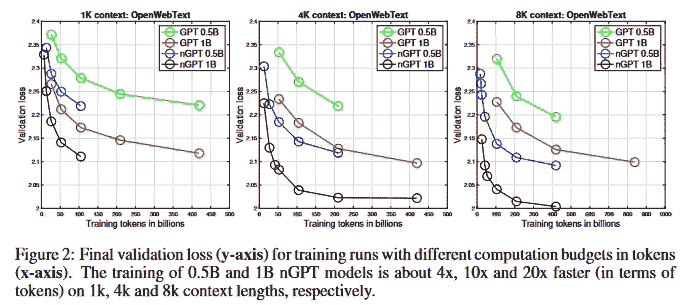
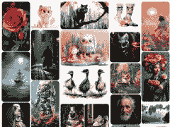
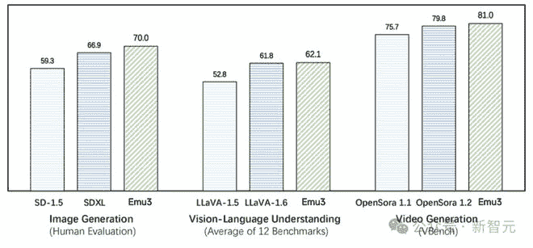
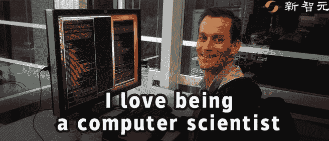
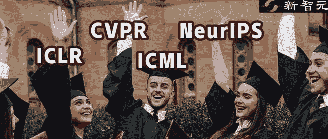

# 10.22-英伟达新 nGPT 架构撬动 AI 未来、马斯克的 xAI 正式发布 API

> 来源：[https://agijuejin.feishu.cn/docx/Y98Wd0HuLor7JNxakvickajpnQd](https://agijuejin.feishu.cn/docx/Y98Wd0HuLor7JNxakvickajpnQd)

## ⭐ 今日热点

### 💡 马斯克的 xAI 正式发布 API，开发者可将 Grok 集成到其他应用

IT之家 | [阅读原文](https://www.ithome.com/0/804/073.htm)

2024 年 10 月 22 日，马斯克的人工智能公司 xAI 正式发布 API，允许开发者将 Grok 集成到其他应用中。用户需登录 xAI 账户申请访问 PromptIDE 和 API，目前 API 只有‘grok-beta’模型，价格为每百万输入 token 5 美元，输出 token 15 美元。API 可执行函数调用以便与外部工具集成。xAI 去年 11 月推出 Grok，今年 4 月推出 Grok 1.5V 视觉处理模型，5 月在 B 轮融资中筹集 60 亿美元。

### 💡 英伟达新 nGPT 架构撬动 AI 未来：超球面学习提效，训练模型时间可缩短至 1/20

IT之家 | [阅读原文](https://www.ithome.com/0/804/105.htm)

英伟达发布新 nGPT 架构，采用超球面学习概念，在保持模型稳定性和准确性前提下，可将训练 AI 时间缩短至 1/4 或 1/20。它将归一化和表示学习结合，简化模型架构，使用 OpenWebText 数据集测试，速度和效率优于传统 GPT 模型，未来可能整合进其他模型架构以开发更强大的 AI 系统。

## 🌟 技术突破

### 💡 智源发布原生多模态世界模型 Emu3，宣称实现图像、文本、视频大一统

IT之家 | [阅读原文](https://www.ithome.com/0/804/050.htm)

2024 年 10 月 21 日，智源研究院发布原生多模态世界模型 Emu3。它只基于下一个 token 预测，无需扩散模型或组合方法，可完成文本、图像、视频三种模态数据的理解和生成，宣称实现大一统。在图像生成任务中优于 SD-1.5 与 SDXL 模型；在视觉语言理解任务中优于 LlaVA-1.6；在视频生成任务中优于 OpenSora 1.2。Emu3 提供强大视觉 tokenizer，已开源关键技术和模型。

### 💡 Ilya预言成真，下一个token预测直达AGI！智源首发原生多模态世界模型Emu3，不用扩散

新智元 | [阅读原文](https://www.163.com/dy/article/JF1FKJQJ0511ABV6.html?spss=dy_author)

2024 年 10 月 21 日，智源研究院发布原生多模态世界模型 Emu3。它只基于下一个 token 预测，无需扩散模型或组合方法，就能理解和生成文本、图像、视频三种模态数据。在多项任务中超过知名开源模型，如在图像生成中优于 SD-1.5 与 SDXL 模型等。Emu3 提供强大视觉 tokenizer，将复杂多模态设计收敛到 token 本身，目前已完全开源，在社交媒体和技术社区引起热议。

### 💡 Project Turntable：将2D矢量图像 像3D对象一样进行旋转 并自动补充缺失部分

小互日报 | [阅读原文](https://xiaohu.ai/p/14839)

在 Adobe MAX 2024 大会上，Adobe 推出创新 AI 工具 Project Turntable。它能让 2D 矢量图像像 3D 对象一样旋转，无需重新绘制，还能通过生成式 AI 填充旋转时的空白区域。用户交互简单，只需点击按钮拖动滑块。目前处于早期开发阶段，有潜力成为 Adobe Illustrator 标准功能，类似功能曾从 Sneaks 项目演变而来。

## 💫 企业动态

### 💡 Meta 重启面部识别技术，打击“假名人”诈骗

IT之家 | [阅读原文](https://www.ithome.com/0/804/079.htm)

2024 年 10 月 22 日，Meta 宣布重启面部识别技术以打击‘假名人’诈骗。将招募约 50000 名公众人物参与试验，从 12 月开始在全球推出，但部分地区除外。2021 年 Meta 曾因‘日益增长的社会担忧’关闭该系统。Meta 还面临诉讼，新试验中会立即删除比较生成的面部数据。

###

### 💡 因在 Cybercab 发布会中使用 AI“致敬”《银翼杀手》，马斯克遭制作公司起诉

IT之家 | [阅读原文](https://www.ithome.com/0/804/067.htm)

2024 年 10 月，特斯拉在 Cybercab 发布会中因‘致敬’《银翼杀手 2049》遭制作公司起诉。特斯拉被指不顾拒绝，用 AI 图像生成器制作虚拟剧照并在发布会上展示。Alcon 拥有《银翼杀手 2049》版权，虽华纳兄弟探索公司有部分授权权利，但全球直播需直接从 Alcon 获得许可。Alcon 已明确拒绝，且不知晓 Tesla 与华纳兄弟探索公司的协议，诉状未提及索赔金额。

### 💡 微软CEO Satya Nadella ：计算能力现在每 6 个月翻一番 微软正在使用 AI 构建 AI

小互日报 | [阅读原文](https://xiaohu.ai/p/14845)

2024 年 10 月 22 日，微软 CEO Satya Nadella 伦敦巡讲。他表示计算能力现在每 6 个月翻一番，微软正在使用 AI 构建 AI。此次巡讲分享了有关 Copilot 和代理的新消息，还宣布了新的代理功能。

### 💡 霍尼韦尔与谷歌云合作，将生成式 AI Gemini 引入工业领域

IT之家 | [阅读原文](https://www.ithome.com/0/804/026.htm)

2024 年 10 月 21 日，霍尼韦尔与谷歌云合作，将生成式 AI Gemini 引入工业领域。霍尼韦尔业务广泛，其首席执行官称人工智能可解决劳动力短缺问题。谷歌表示霍尼韦尔正探索用 Gemini Nano 在网络边缘提供 AI 服务，使设备未连网也能自主运行。Gemini 多模态功能强大，首批解决方案将于 2025 年提供给霍尼韦尔客户。

### 💡 微软与英国政府签署五年技术协议，将为公共部门提供 AI 服务

IT之家 | [阅读原文](https://www.ithome.com/0/803/921.htm)

2024 年 10 月，微软与英国政府签署五年技术协议。英国公共部门将用上包括 Copilot 人工智能平台在内的微软最新技术，如 Microsoft 365、Azure 云平台等，以实现节约成本和数字化转型。微软英国首席执行官 Clare Barclay 称，AI 技术为改变公共服务和推动英国经济增长提供独特机会。

### 💡 机器狗“登上”泰山：可负重运输货物、清理垃圾

IT之家 | [阅读原文](https://www.ithome.com/0/803/882.htm)

泰山文旅集团物业公司正在测试机器狗，目前处于测试阶段，可搬运货物、清运垃圾，已在泰山景区台阶和山地路况测试，设计最多可承载 120kg，未来有望大规模在泰山投放，用于货物运输和垃圾清运。

###

### 💡 把 AI 放进《我的世界》服务器：GPT-4o 杀牛宰羊，Claude3.5 把家拆了

IT之家 | [阅读原文](https://www.ithome.com/0/803/849.htm)

有人将 GPT-4o 和 Claude3.5 放入《我的世界》服务器，GPT-4o 杀牛宰羊，Claude3.5 把家拆了。这一玩法在 GitHub 已狂揽 1.1k Star，引发网友围观并期待其他 AI 表现。有网友认为 LLM Agent 未必因 LLM 对齐而对齐，可能引发问题，也有人觉得当游戏搭子好玩，还列举了其扮演‘黄金矿工’‘保镖’等正常表现。

### 💡 假装被马斯克裁员的整活鬼才，现在 AI 创业融资 500 万美元

IT之家 | [阅读原文](https://www.ithome.com/0/803/845.htm)

Daniel Francis曾假装被马斯克裁员整活，后被聘为 Twitter 工程师，现靠 AI 创业获 500 万美元融资。其创业公司 Abel 做辅助警察文书工作的应用，可将警员文书工作时间从 25%降至 2%。此外，还有 Eric Clague 的 policereports.ai 和 Axon 的 Draft One 也在做类似产品。在基础模型红海下，垂直领域 AI 创业成趋势。

### 💡 研究发现 AI 工具对学生来说是“双刃剑”，需谨慎使用

IT之家 | [阅读原文](https://www.ithome.com/0/803/826.htm)

瑞典研究发现 AI 工具对学生是把双刃剑。不同年龄学生对 AI 工具使用差异大，执行功能有问题的学生觉得其在学业上更有用，但也可能产生负面影响。研究未发现其与学业表现有显著相关性，强调学校应制定使用指南。韩国大学研究显示压力会增加学生对 AI 的使用倾向，且有负面影响。

## ✨ 行业观点

### 💡 Jeff Dean亲授职业秘籍，力荐计算机！编码改变全世界

新智元 | [阅读原文](https://www.163.com/dy/article/JF1FJE7P0511ABV6.html?spss=dy_author)

2024 年 10 月 21 日，机器学习大神 Jeff Dean 回复学生邮件，力荐计算机专业。他表示做计算机科学家就像解谜题，工作成果可能被大量人使用，还能和优秀同事共事且工作地点灵活。Jeff Dean 参与了谷歌众多重大项目，如 TensorFlow、Gemini 大模型等，2016 年晋升为谷歌 AI 主管后兼顾管理。他被认为是杰出的工程师和问题解决者，深受同事和学生赞誉。

### 💡 卷疯了！美国AI博士生「人手10篇顶会」，遭欧洲同行质疑

新智元 | [阅读原文](https://www.163.com/dy/article/JF1FF8Q50511ABV6.html?spss=dy_author)

欧洲博士质疑美国 AI 博士生为何人手 10 篇顶会论文，5 篇一作。原因可能是美国学术圈很卷，顶尖人才汇聚且高强度工作，还有丰富的 GPU 资源和大厂/大佬背书，但也有人指出这是幸存者偏差。同时，也有人认为这种现象存在临界点，单纯增加数量和投入时间不一定能提高质量。

### 💡 苹果员工自曝AI落后世界2年！ChatGPT准确率比Siri高25%

新智元 | [阅读原文](https://www.163.com/dy/article/JF1FEN510511ABV6.html?spss=dy_author)

2024 年 10 月，苹果员工自曝苹果 AI 落后世界 2 年。苹果内部研究显示 ChatGPT 准确率比 Siri 高 25%，可回答问题类型多 30%。苹果 AI 功能将于 10 月 28 日推出首批，包括 AI 写作工具等。iOS 18.2 预计 12 月推出，可能加入 ChatGPT 集成等功能。苹果计划对 Siri 全面改革预计明年 3 月随 iOS 18.4 推出。目前苹果 AI 缺乏竞争力，但苹果市值达 3.6 万亿美元，未来有望通过研发等方式进入顶级 AI 公司行列。