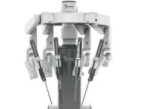
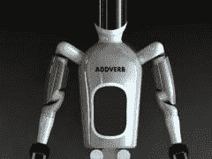
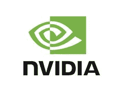

# 11.18-填补空白：中国信通院牵头制定的 8 项大模型标准发布，覆盖汽车、家居、通信等

> 来源：[https://agijuejin.feishu.cn/docx/AnuzdGu08odm3Hx8qMUcKXCInNe](https://agijuejin.feishu.cn/docx/AnuzdGu08odm3Hx8qMUcKXCInNe)

> [欢迎加入 AGI 掘金社群](https://sourl.co/miZUyT)

## ⭐ 今日热点

### 💡 填补空白：中国信通院牵头制定的 8 项大模型标准发布，覆盖汽车、家居、通信等

IT之家 | [阅读原文](https://www.ithome.com/0/811/294.htm)

2024 年 11 月 18 日，中国信通院发布《面向行业的大规模预训练模型通用要求》系列首批 8 项团体标准，涵盖金融、通信、教育等 8 个行业领域，规定了各领域大模型技术及应用的功能与性能要求，填补了大模型应用标准领域的空白，为行业发展提供重要支撑。该系列标准由中国信通院牵头，联合百余家单位建立标准起草组，并已开展标准试点验证，覆盖多个领域。下一步，中国信通院将加强合作，推进标准宣贯培训和符合性验证工作。

## 🌟 技术突破

### 💡 AI 可“听”出电池起火征兆，准确率达 94%

IT之家 | [阅读原文](https://www.ithome.com/0/811/214.htm)

2024 年 11 月，一项新研究利用** AI** 可‘听’出电池起火征兆，准确率达94%。锂离子电池起火前安全阀破裂会发出独特声音，研究人员训练机器学习算法识别该声音，收集了 38 个爆炸电池音频数据并生成超 1000 个样本训练算法。测试中该算法在各种背景噪音下仍有较高准确率，有望开发新型火灾报警器安装在多种场所提前发出警报。关键词：AI、人工智能、电池。

### 💡 超 12000 公里，国产腔镜手术机器人完成远程手术、加速出海

IT之家 | [阅读原文](https://www.ithome.com/0/811/138.htm)

2024** 年 **11 月 16 日，国产图迈腔镜手术机器人在上海浦东新区张江高科的微创机器人总部手术机器人全球远程指挥中心，为 12000 公里外的摩洛哥患者完成前列腺癌根治术。它是首个获 NMPA 批准上市的四臂腔镜手术机器人，2024 年 5 月获欧盟 CE 认证。成本低于欧美机器人，已打开欧美高端市场等多地实现商业化。关键词：手术机器人。

### 💡 14天速成LLM高手！大佬开源学习笔记，GitHub狂揽700星

新智元 | [阅读原文](https://www.163.com/dy/article/JH6QFP490511ABV6.html?spss=dy_author)

2024 年一位 AI 从业者分享 14 天学完 LLM 核心知识的学习路线，在 GitHub 获 675+星。路线分三步，包括从头构建大模型，涉及 token 嵌入、自注意力等；研究大模型幻觉，如位置偏差、曝光偏差等问题及解决策略；学习 LLM Edge 知识，如暂停 Tokens、无限注意力等。学习资源丰富，强调享受学习过程，不必拘泥路线图和读完所有内容，涉及多种预备知识。

### 💡 Scaling Law或将终结？哈佛MIT预警：低精度量化已无路可走，重磅研究掀翻AI圈

新智元 | [阅读原文](https://www.163.com/dy/article/JH6QCL0G0511ABV6.html?spss=dy_author)

2024 年哈佛斯坦福 MIT 等机构提出‘精度感知’scaling law，揭示精度、参数规模、数据量统一关系。研究发现低精度训练会降低模型‘有效参数量’，论文在最大 1.7B 参数、26B token 的模型上验证。艾伦研究所科学家 Tim Dettmers 评价其重要，指出接近‘量化’极限。论文还探讨了精度、参数、数据三者权衡及不同阶段区别等问题，也指出当前研究存在局限性，未来将在更大规模模型上继续研究。

## 💫 企业动态

### 💡 印度信实控股机器人公司 Addverb 拟 2025 年推出人形机器人

IT之家 | [阅读原文](https://www.ithome.com/0/811/297.htm)

2024 年 11 月 18 日消息，印度机器人企业 Addverb 拟于 2025 年推出人形机器人产品。成立于 2016 年，全球有 15 个办事处及 350 余家客户。信实集团于 2022 年购入其 56%股份。初期将在诺伊达市郊区工厂生产，首年产能约 100 台，产品瞄准美欧市场，可执行时尚等行业工作，但未明确具体用例和售价，正同印度航天局讨论人形机器人赴火星任务。

### 💡 人工智能智库网络在京启动，百度、快手、华为、蚂蚁、腾讯、阿里等发起

IT之家 | [阅读原文](https://www.ithome.com/0/811/293.htm)

2024 年 11 月 12 日，人工智能智库网络在中国人工智能产业发展联盟第十三次全体会议上成立，由众多企业和研究院共同发起。中国信通院人工智能研究所所长魏凯介绍其成立背景和定位，中国新一代人工智能发展战略研究院首席经济学家刘刚建议定期举办交流活动，清华大学人工智能国际治理研究院秘书长鲁俊群提出其在多方面将起到积极促进作用。

### 💡 我国创新药市场规模突破 1000 亿元，将推动生物合成、基因编辑、AI 制药等前沿技术转化

IT之家 | [阅读原文](https://www.ithome.com/0/811/290.htm)

2024 年 11 月 16 日中国医药工业发展大会在上海召开。我国在研新药数量跃居全球第二位。今年 9 月医药工业增加值增速达 10.5%，占全部工业比重 3.7%。工信部将推动生物合成、基因编辑、AI 制药等前沿技术转化，加强短缺药品研发生产。今年以来，37 个创新药、51 个创新医疗器械获批上市。‘十四五’以来，113 个国产创新药获批，市场规模达 1000 亿元，165 个创新医疗器械获批，融合前沿技术。

### 💡 昆仑万维：国内首款具备中文逻辑推理能力 o1 模型“天工大模型 4.0 O1 版”11 月 27 日启动邀测

IT之家 | [阅读原文](https://www.ithome.com/0/811/273.htm)

2024 年 11 月 18 日，昆仑万维宣布旗下天工大模型 4.0 O1 版将于 11 月 27 日启动邀测。这是国内首款具备中文逻辑推理能力的 o1 模型，包括基于开源 Llama 3.1 8B 的开源模型和进阶能力更强版。此外，昆仑万维今年 4 月开启天工大模型 3.0 公测并开源，本月还发布了天工 AI 高级搜索功能并进行了智能优化。

### 💡 英伟达新一代 Blackwell GPU 被曝存在过热问题，导致交付延迟

IT之家 | [阅读原文](https://www.ithome.com/0/811/224.htm)

2024 年 11 月，英伟达新一代 Blackwell GPU 被曝存在过热问题，导致交付延迟。在高容量服务器机架中，此 GPU 专为 AI 和高性能计算设计，但出现过热问题后，迫使英伟达多次修改机架设计，还可能损坏硬件。目前英伟达正与云服务提供商合作解决问题，修订后的 Blackwell GPU 于今年 10 月底量产，预计最快明年 1 月底出货。

### 💡 「谍战」开启！基建狂魔马斯克122天交付10万卡超算，对手大恐慌派间谍飞机侦查

新智元 | [阅读原文](https://www.163.com/dy/article/JH6QAFSL0511ABV6.html?spss=dy_author)

马斯克 122 天交付 10 万卡超算，震惊行业。这一速度引发对手恐慌，甚至派出间谍飞机侦查。马斯克的做法让 OpenAI 对微软不满，多家公司在数据中心建设上展开竞争。马斯克的超算建设速度快，部分原因是省略关键环节。他力推孟菲斯当地官员批准项目，引入移动式天然气发电涡轮机解决电力问题，但遭到环保组织反对。业内对马斯克超算有质疑，但他未受影响，同行们压力巨大，纷纷研究其做法。

## ✨ 行业观点

### 💡 前谷歌 AI 研究员：ChatGPT 原本可以更早出现的

IT之家 | [阅读原文](https://www.ithome.com/0/811/222.htm)

前谷歌 AI 研究员认为 ChatGPT 原本可以更早出现。2017 年谷歌团队发表引入 Transformer AI 架构的论文，如今该架构支撑众多主流生成式 AI 模型。谷歌研究员虽对技术寄予厚望，但未预见其在 ChatGPT 中的关键作用。他们对 ChatGPT 的成功感到惊讶，同时提到谷歌当时对开发大规模产品持保守态度。此外，研究员还介绍了其离开谷歌后创立的 Inceptive 公司，致力于将深度学习引入生物化学领域。