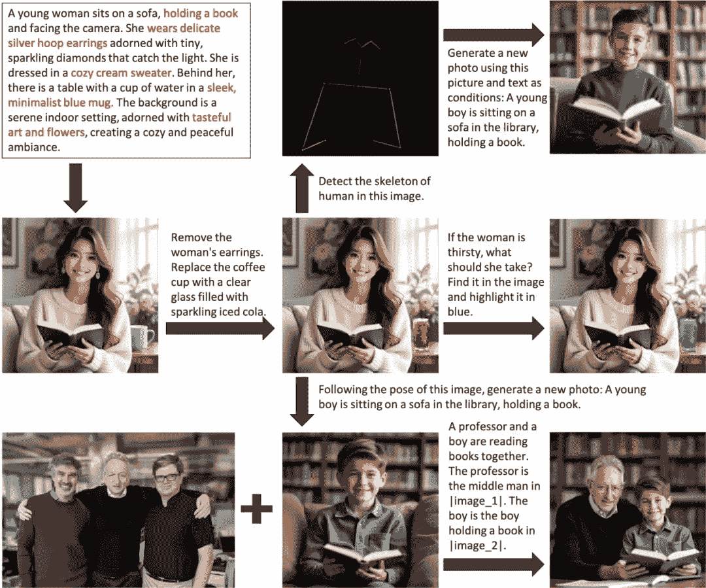
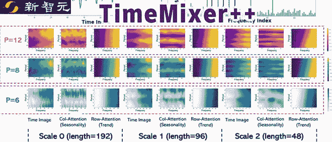
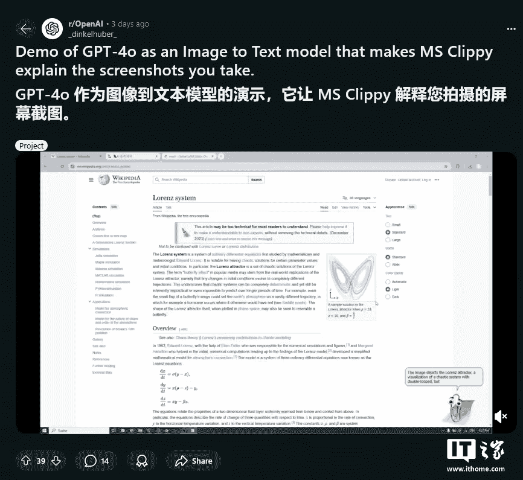
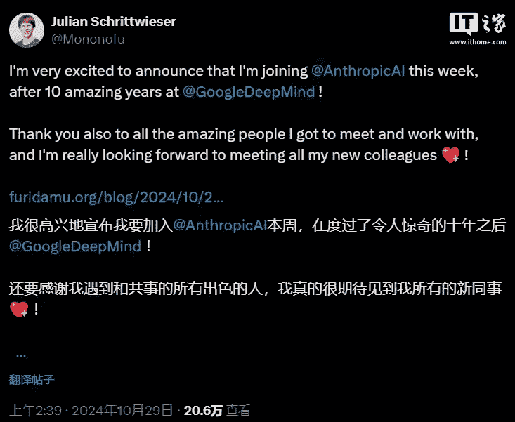
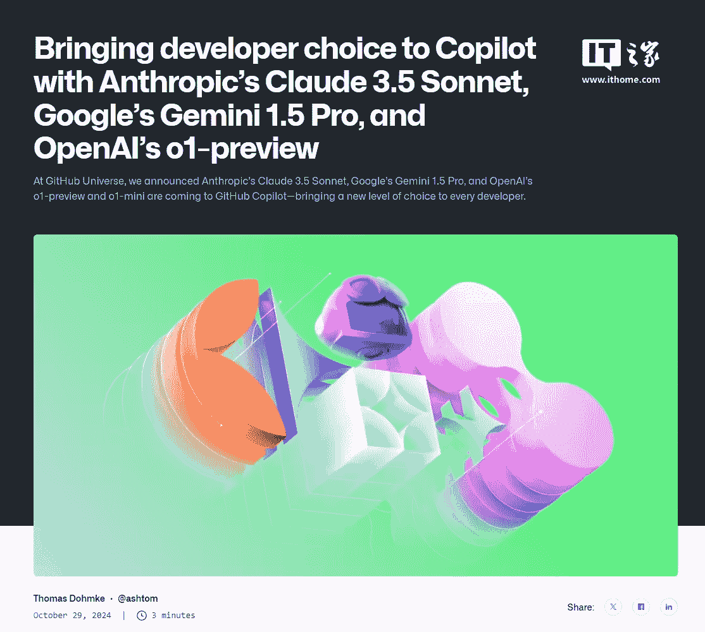
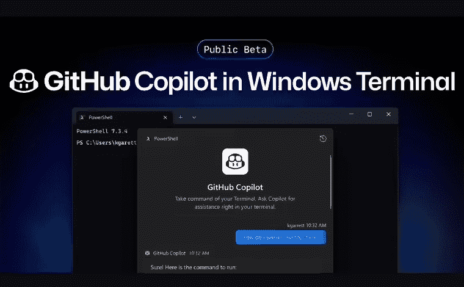
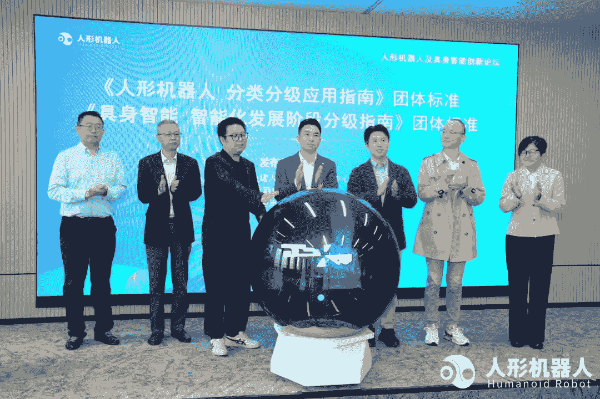
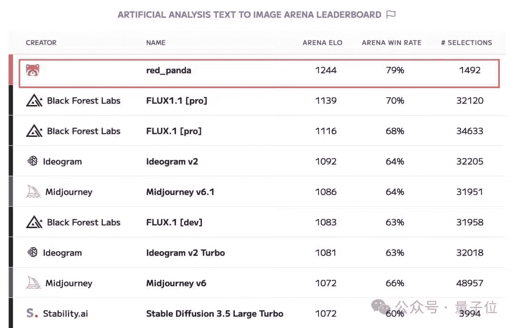

# 10.30-GitHub官宣接入Claude+Gemini、智源推出全能视觉生成模型 OmniGen、Meta秘密研发自家AI搜索引擎

> 来源：[https://agijuejin.feishu.cn/docx/WFTbdNjatoSte2xtkujcNNZRnDg](https://agijuejin.feishu.cn/docx/WFTbdNjatoSte2xtkujcNNZRnDg)

欢迎大家扫码加入掘金AGI交流群，第一时间获得AI知识与资讯📕。

**          **   扫码加入 AGI掘金🛰️交流群

**          **   扫码加入 AGI掘金🛰️交流群

## ⭐ 今日热点

### 💡 Copilot一夜杀死编程助手，GitHub官宣接入Claude+Gemini！OpenAI沦为备胎

新智元 | [阅读原文](https://www.163.com/dy/article/JFOH3NMF0511ABV6.html?spss=dy_author)

2024 年 10 月，第十届 GitHub 开发者大会上，微软让 GitHub Copilot 接入 Claude 3.5 Sonnet 和 Gemini 1.5 Pro 两大模型，解绑 OpenAI。还推出 AI 零代码编程微应用平台 GitHub Spark，希望用 AI 赋能 10 亿开发者。同时，Python 成为世界使用最多的编程语言，GitHub 发布 2024 年度开发者报告，展示了生成式 AI 项目激增、全球开发者数量增长、编程语言崛起等趋势。

## 🌟 技术突破

### 💡 AI「长脑子」了？LLM惊现「人类脑叶」结构并有数学代码分区，MIT大牛新作震惊学界！

新智元 | [阅读原文](https://www.163.com/dy/article/JFOH26PJ0511ABV6.html?spss=dy_author)

2024 年 10 月，MIT 传奇大牛 Max Tegmark 团队发现 LLM 中存在类似人类大脑结构的脑叶分区，分为数学/代码、短文本、长篇科学论文等部分。研究揭示了 LLM 学习概念中的三层几何结构，包括原子尺度的晶体结构、大脑尺度的模块结构和星系尺度的点云结构，为理解 LLM 的内部表征和处理机制提供了全新见解。

### 💡 全球AI算力短缺，算力大厂一举破局！一机多芯，引领计算新纪元

新智元 | [阅读原文](https://www.163.com/dy/article/JFOH0QL60511ABV6.html?spss=dy_author)

2024 年 10 月，浪潮信息发布元脑®服务器第八代新品，实现算力全方位‘智能增强’。在通用算力领域达成‘一机多芯’，同一架构支持多款 CPU 处理器，性能大幅提升。还推出基于 OCM 和 OAM 架构的产品，解决多元 CPU 生态挑战和大模型互联瓶颈。同时，浪潮信息推出‘All in 液冷’解决方案，包括冷板式液冷和高功率整机柜液冷，实现绿色节能，为数据中心提供全生命周期解决方案。

### 💡 智源推出全能视觉生成模型 OmniGen：支持文生图、图像编辑等

IT之家 | [阅读原文](https://www.ithome.com/0/806/122.htm)

2024 年 10 月 29 日，北京智源人工智能研究院推出全能视觉生成模型 OmniGen。它支持文生图、图像编辑等多种任务，具有统一性、简单性和知识迁移等特点。其架构高度简化，用户友好，可通过指令完成复杂任务，无需额外模块，还能跨任务迁移知识。相关论文、代码和演示可通过链接获取。

### 💡 超越Transformer，全面升级！MIT等华人团队发布通用时序TimeMixer++架构，8项任务全面领先

新智元 | [阅读原文](https://www.163.com/dy/article/JFLTAB960511ABV6.html?spss=dy_author)

2024 年 10 月 29 日，MIT 等华人团队发布通用时序 TimeMixer++架构。它在长程时序预测、短程时序预测等 8 项任务上全面超越 Transformer 等模型。其将时间序列转化为多分辨率时序图，提取多尺度、多周期特征，在内存占用和训练时间上高效，且经消融实验验证架构合理。未来有望推动时序预测技术发展。

### 💡 一个模型走天下！智源提出全新扩散架构OmniGen，AI生图进入「一键生成」时代

新智元 | [阅读原文](https://www.163.com/dy/article/JFLT7U8D0511ABV6.html?spss=dy_author)

2024 年 10 月，智源推出全新扩散模型架构 OmniGen，单个模型可处理多种图像生成任务，如文生图、图像编辑等，无需额外插件和操作。具有统一性、简单性和知识迁移等特点，其基本架构为 Transformer 模型和 VAE 模块，共 3.8B 参数。还构建了大规模多样化的统一图像生成数据集 X2I，目前部分内容已开源，未来有很大提升空间。

## 💫 企业动态

### 💡 华人带队，小扎亲自督战！Meta秘密研发8个月，打造自家AI搜索引擎

新智元 | [阅读原文](https://www.163.com/dy/article/JFOGVGDU0511ABV6.html?spss=dy_author)

Meta 正在秘密研发 AI 搜索引擎，已进行超 8 个月，由华人高级工程师 Xueyuan Su 带队。研发旨在为 Meta AI 聊天机器人用户提供时事对话式回答，降低对谷歌和微软的依赖，提升竞争力和用户体验。但面临技术挑战、数据隐私和营销难题等风险。

### 💡 开发者让微软大眼夹“重生”，变身截屏解读 AI 助手

IT之家 | [阅读原文](https://www.ithome.com/0/806/390.htm)

2024 年 10 月，名为 AI-Snip 的工具在 Reddit 上引发关注。它能截屏后自动调用 AI 模型进行解释、翻译等操作，外观是微软大眼夹。开发者 Yannik Keller 称其可提升工作效率，还能自定义提示词。微软 Edge 有类似功能。目前 AI-Snip 已开源，支持 Windows 和 Linux 系统。其引发网友怀旧情怀，或为微软提供新启示。

### 💡 谷歌 DeepMind 顶尖研究员 Julian Schrittwieser 加入 Anthropic，曾参与开发 AlphaGo 等

IT之家 | [阅读原文](https://www.ithome.com/0/806/380.htm)

2024 年 10 月 29 日，谷歌 DeepMind 顶尖研究员 Julian Schrittwieser 宣布加入 Anthropic。他在 DeepMind 工作十年，曾参与开发 AlphaGo、AlphaZero 和 MuZero 等项目。他赞扬 Anthropic 的 Claude 项目实用，还提到了 Artifact 和 Computer Use 等创新技术。他感叹在 DeepMind 的十年参与了很多激动人心的项目，如 AlphaCode、AlphaTensor、Gemini 和 AlphaProof 等。

### 💡 GitHub Copilot 拥抱多模型，将引入 Claude 3.5 Sonnet 和 Gemini 1.5 Pro

IT之家 | [阅读原文](https://www.ithome.com/0/806/354.htm)

2024 年 10 月 30 日，GitHub CEO 宣布 GitHub Copilot 将拥抱多模型策略，引入 Claude 3.5 Sonnet 和 Gemini 1.5 Pro 等。未来几周 Claude 3.5 Sonnet 将率先集成，随后 Gemini 1.5 Pro 也将加入。还将支持更多 OpenAI 模型，为多个功能引入多模型选择。同时推出 Spark，一款自然语言应用开发工具，目前处于早期预览阶段。GitHub Copilot 转向多模型策略引发对微软其他 AI 产品未来发展的猜测。

### 💡 谷歌：公司超过 1/4 的新代码是由人工智能生成的

IT之家 | [阅读原文](https://www.ithome.com/0/806/338.htm)

2024 年 10 月 30 日消息，谷歌超过 1/4 的新代码由人工智能生成。谷歌本季度收入为 883 亿美元，其中谷歌服务收入 765 亿美元，同比增长 13%，谷歌云收入 114 亿美元，同比增长 35%。谷歌推出多款 AI 创新产品，如 Gems、Google Meet 自动笔记功能等。但谷歌正面临反垄断挑战，有被拆分风险。

### 💡 OpenAI 约 75% 收入来自消费者订阅，ChatGPT 周活跃用户数达 2.5 亿

IT之家 | [阅读原文](https://www.ithome.com/0/806/322.htm)

OpenAI 约 75%收入来自消费者订阅，ChatGPT 每月订阅费 20 美元（约 143 元人民币），将 5%-6%免费用户转化为付费会员，周活跃用户达 2.5 亿。其企业产品有超百万付费客户，面向企业业务已盈利。公司还在扩充基础设施，建设数据中心以支持 AI 业务发展。

### 💡 GitHub Copilot 进驻 Windows Terminal 和苹果 Xcode，助力开发者效率提升

IT之家 | [阅读原文](https://www.ithome.com/0/806/299.htm)

2024 年 10 月 30 日，在 GitHub Universe 大会上，GitHub Copilot 宣布重大更新，将进驻 Windows Terminal 和苹果 Xcode。在 Windows Terminal 中，开发者可在终端内获命令建议和解释。Copilot for Xcode 公开预览版提供代码补全、多语言支持、多行建议等特性，还有内容过滤和阻止匹配公共代码的功能。此外，GitHub 为 Copilot 带来新功能，其访问必应功能使部分用户可进行网络搜索。

### 💡 消息称 OpenAI 正与博通、台积电联手，共同打造自研芯片

IT之家 | [阅读原文](https://www.ithome.com/0/806/288.htm)

2024 年 10 月 30 日消息，OpenAI 正与博通、台积电联手打造自研芯片，还增添了 AMD 芯片。OpenAI 曾考虑自建晶圆厂但因耗资巨大暂搁置，现转向内部设计芯片。OpenAI 组建约 20 人芯片团队，预计 2026 年推出首款定制芯片，今年预计亏损 50 亿美元，收入 37 亿美元，算力支出为最大开支。

### 💡 谷歌 CEO 桑达尔・皮查伊：努力在明年推出具有可视化功能的 AI 助理

IT之家 | [阅读原文](https://www.ithome.com/0/806/286.htm)

谷歌 CEO 桑达尔·皮查伊表示努力在明年推出具有可视化功能的 AI 助理，该助理基于‘Project Astra’计划。‘Project Astra’是谷歌在 2024 年 5 月展示的新技术，能识别周围环境并回答问题等。谷歌原计划最早在今年 12 月推出面向消费者的‘智能代理’服务，现看来难以如期实现。

### 💡 GitHub把OpenAI当备胎，Copilot接入Claude+Gemini，网友：Cursor的商业模式没了

量子位 | [阅读原文](https://www.qbitai.com/2024/10/213330.html)

2024 年 10 月，GitHub Copilot 宣布引入多模型选择，接入 Claude 3.5 Sonnet、谷歌 Gemini 1.5 Pro 及 OpenAI o1-preview 和 o1-mini。新模型将首先在 Copilot Chat 推出，之后会在其他功能中引入。同时推出全新 AI 原生工具 GitHub Spark，可完全用自然语言构建应用程序。此举引发网友对 Cursor 商业模式的担忧。

### 💡 探秘全球最大 AI 集群 xAI Colossus：122 天建成，10 万张英伟达 H100 构筑马斯克 AI 愿景

IT之家 | [阅读原文](https://www.ithome.com/0/806/136.htm)

2024 年 10 月 29 日消息，xAI 公司的全球最大 AI 训练集群 Colossus 在 122 天建成，由 10 万张英伟达 H100 构成。该集群配备英伟达 HGX H100 服务器，每台含 8 张 H100 GPU，采用 Supermicro 的 4U 水冷系统和通用 GPU 系统，液冷设计提升散热效率。每个机架可容纳 8 台服务器，集群内有超 1500 个 GPU 机架，每个 GPU 配备 400GbE 的网络接口控制器。未来 xAI 计划再增加 10 万张 GPU，其中 5 万张为更先进的 H200。此次展示获埃隆・马斯克团队特别批准，Supermicro 赞助巡展。

### 💡 全国首批人形机器人具身智能标准发布：按下肢运动、上肢作业等分 4 个等级

IT之家 | [阅读原文](https://www.ithome.com/0/806/127.htm)

2024 年 10 月 29 日，人形机器人及具身智能创新论坛在上海召开，发布全国首批人形机器人具身智能标准。《人形机器人分类分级应用指南》将人形机器人划分为 L1-L4 四个技术等级。《具身智能智能化等级分级指南》将智能化等级划分为 G1-G5 五个阶段。同时，全国 50 多家人形机器人头部企业、研究院所发起《共建具身智能语料数据生态》倡议并签订合作意向书。

### 💡 神秘 AI 模型“小熊猫”一夜刷屏：排名超 Flux、Midjourney

IT之家 | [阅读原文](https://www.ithome.com/0/806/070.htm)

神秘文生图模型‘小熊猫’一夜刷屏，排名超 Flux、Midjourney。其 ELO 得分比 Flux 1.1 Pro 高出 100 多，胜率高达 79%，每 7 秒生成一张图像。目前无人认领，引发众多猜测，可能出自中国厂商、Midjourney V7、Stable Diffusion 3.5、OpenAI 的 DALL-E 4、Mistral AI 或 Flux 等。在竞技场实测中，虽表现出色但未取得压倒性胜利。目前‘小熊猫’仍占据榜首，但与后位选手差距逐渐缩小。

### 💡 国庆期间被 AI 雷军“骂了 7 天”，雷军本人呼吁网友不要再玩

IT之家 | [阅读原文](https://www.ithome.com/0/806/049.htm)

2024 年国庆期间，网友利用 AI 克隆雷军声音进行恶搞，如‘劝导不上早八的大学生’等，还涉及不良内容。雷军本人回应称很困扰不舒服，呼吁大家不要再玩，同时认为 AI 是好技术且实用。相关短视频平台已下架部分内容。

### 💡 苹果AI上线，ChatGPT免费用！首款M4 Mac诞生，库克：这是全世界最佳AI一体机

新智元 | [阅读原文](https://www.163.com/dy/article/JFLT8T230511ABV6.html?spss=dy_author)

2024 年 10 月，苹果 AI 正式上线，iOS 18.1、iPadOS 18.1 和 macOS Sequoia 15.1 用户可免费体验首批功能。首款 M4 Mac 系列中的 iMac 发布，有七种配色，性能大幅提升，如处理速度比 M1 iMac 快 1.7 倍。苹果 AI 可改变工作方式，包括写作工具、更智能的 Siri、照片视频搜索及编辑等功能。预计 12 月 Mac 将有更多新功能，且 Siri 可借助 ChatGPT 回答问题。该功能目前支持美式英语，明年在国内上线。

### 💡 Grok图像理解功能上线，单挑ChatGPT结果惊人！无地标照片秒定位，18世纪手稿一眼识别

新智元 | [阅读原文](https://www.163.com/dy/article/JFLT8IFB0511ABV6.html?spss=dy_author)

2024 年 10 月 29 日，xAI 为 Grok 增加图像理解功能。马斯克官宣 Grok 能理解图像甚至解释笑话，但在解释笑话方面表现不佳。Grok 在转录 18 世纪手稿和推测无地标照片拍摄地任务中有不错表现，但在处理某些文件格式上落后于 ChatGPT。马斯克回应称不久后会改进，称几个月完成的事别人需数年。