# 11.06-xAI、Anthropic同日上线API：Grok免费公测，Claude 3.5 Haiku价格暴涨、腾讯混元开源 Hunyuan3D-1.0、超越 OCR，谷歌 AI 技术 InkSight 可精准识别手写文字

> 来源：[https://agijuejin.feishu.cn/docx/PJ6SdteUHoUqlVxzUOrcNMh8nNe](https://agijuejin.feishu.cn/docx/PJ6SdteUHoUqlVxzUOrcNMh8nNe)

## ⭐ 今日热点

### 💡 AI圈卷疯了！xAI、Anthropic同日上线API：Grok免费公测，Claude 3.5 Haiku价格暴涨

新智元 | [阅读原文](https://www.163.com/dy/article/JG816ORG0511ABV6.html?spss=dy_author)

2024 年 11 月 05 日，Anthropic 的 Claude 3.5 Haiku 正式开放 API，可在多个平台使用，更新了知识至 2024 年 7 月，性能不俗但价格暴涨至之前 4 倍。xAI 的大模型 Grok 开启 API 公测，年底有每月 25 美金免费额度，新模型上下文长度为 128000 token，支持函数调用和系统提示词，下周将发布多模态版本且 API 兼容 OpenAI 和 Anthropic API。

### 💡 腾讯混元开源 Hunyuan3D-1.0：首个同时支持文生和图生的 3D 开源大模型

IT之家 | [阅读原文](https://www.ithome.com/0/808/138.htm)

2024 年 11 月 5 日，腾讯混元开源 Hunyuan3D-1.0，这是首个同时支持文生和图生的 3D 开源大模型。采用两阶段生成方法，10 秒即可生成 3D 资产。轻量版模型约 4 秒生成多视角图像，再用约 3 秒重建 3D 资产。模型泛化能力和可控性强，可重建各类尺度物体。相关链接有 Github、Huggingface 和研究论文。关键词：腾讯、混元、开源、大模型。

## 🌟 技术突破

### 💡 超越 OCR，谷歌 AI 技术 InkSight 可精准识别手写文字

IT之家 | [阅读原文](https://www.ithome.com/0/808/127.htm)

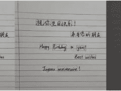

2024 年 11 月 5 日，谷歌推出 AI 技术 InkSight，可精准识别手写文字，超越传统 OCR。它通过模仿人类学习阅读过程，在复杂场景下表现出色，人类阅读其生成文本描摹准确率高达 87%。该技术对喜欢手写的人及手写遗产保护有巨大潜力，且谷歌并非唯一开发手写识别 AI 工具的公司，如亚马逊 Kindle Scribe 和 Goodnotes 也有类似功能。关键词：谷歌、AI、人工智能。

### 💡 极智嘉发布全球首款搭载英特尔视觉导航模块的纯视觉机器人方案，在设备内完成所有深度计算

IT之家 | [阅读原文](https://www.ithome.com/0/808/102.htm)

2024 年 11 月 4 日，极智嘉携手英特尔发布全球首款搭载英特尔视觉导航模块的纯视觉机器人方案。该方案包含 M600 和 MP1000R 两款产品，将在 2024 CeMAT 亚洲物流展极智嘉展台首次亮相。方案中集成英特尔实感摄像头，在设备内完成所有深度计算，功耗低且不受特定平台限制，具备从环境中学习等能力，其视觉导航模块还包含 Robotic Vision Hub，为算法提供算力支撑并实现云边协同。关键词：机器人、英特尔、极智嘉。

### 💡 视觉定位新SOTA！华人团队开源革新框架SegVG，边界框转为分割信号 | ECCV 2024

新智元 | [阅读原文](https://www.163.com/dy/article/JG814JUU0511ABV6.html?spss=dy_author)

2024 年华人团队开源视觉定位新方法 SegVG。该方法将边界框注释转化为像素级分割信号，增强监督信号，还引入三重对齐模块解决特征域差异。在多个标准数据集上超越现有最佳模型，如在 RefCOCO+和 RefCOCOg 数据集上有显著准确率提升。消融研究和计算开销比较也证明其有效性和合理性。

### 💡 英伟达团队机器训练新方法：仅 5 次演示让机器生成 1000 个新 demo

IT之家 | [阅读原文](https://www.ithome.com/0/808/004.htm)

2024 年英伟达实验室推出 DexMimicGen，人类仅需演示五次，它就能生成 1000 个新 demo。在仿真环境中任务成功率高，如整理抽屉可达 76%，罐子分类高达 97.3%。迁移到真实环境，易拉罐分拣任务用 40 个生成 DEMO 成功率达 90%。它由 MimicGen 改造，针对双臂机器人灵巧操作任务改进，三位共同一作均为华人学生，出自朱玉可门下。

### 💡 腾讯发布3D开源模型：混元-3D 10秒即可生成高分辨率细3D模型

小互日报 | [阅读原文](https://xiaohu.ai/p/15268)

2024 年 11 月 5 日，腾讯发布一体化 3D 生成框架混元 3D-1.0，支持从文本和图像生成 3D 内容，仅需 10 秒即可生成高分辨率 3D 模型。如通过文本描述一片绿叶或一把棕色吉他可生成 3D 对象，还能对多种尺度物体从大型建筑到小型工具和植物进行准确重建。

### 💡 Hertz-dev：首个会话音频开源模型 全双工实时语音交互 120毫秒超低延迟

小互日报 | [阅读原文](https://xiaohu.ai/p/15263)

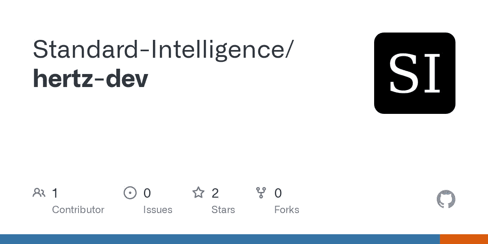

2024 年 11 月，Standard Intelligence 公司开发出首个会话音频开源模型 Hertz-dev。它是全双工、仅支持音频的 Transformer 基础模型，主要用于生成对话音频，可同时接收和生成音频，实现全双工实时语音交互，具有 120 毫秒超低延迟。

### 💡 腾讯发布目前最大开源MoE模型：腾讯混元大模型（Hunyuan-Large） 具有 3890 亿参数

小互日报 | [阅读原文](https://xiaohu.ai/p/15254)

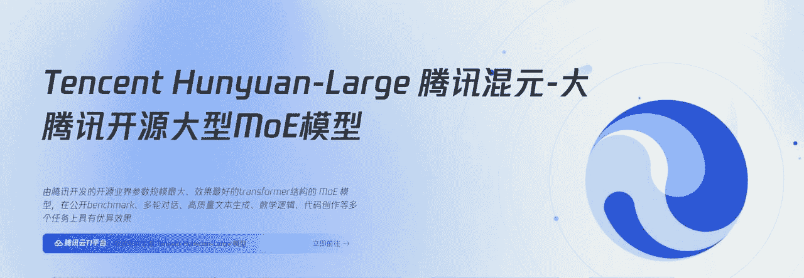

2024 年 11 月，腾讯发布目前业界规模最大的开源 Transformer 专家模型腾讯混元大模型（Hunyuan-Large），具有 3890 亿参数。它在长文本处理、常识推理、数学能力等方面表现出色，支持 256K 上下文窗口和 128K 指令任务输入。在多项任务中表现优越，特别是在中文任务和与其他模型对比中优势明显。官网：https://llm.hunyuan.tencent.com/。

### 💡 腾讯3D大模型全面开源，文本图像10秒转3D资产，模型权重、推理代码全开放

量子位 | [阅读原文](https://www.qbitai.com/2024/11/215630.html)

2024 年 11 月 5 日，腾讯推出 Hunyuan3D - 1，开源轻量版和标准版。该模型支持文本图像转 3D 资产，最快 10 秒生成。采用多视图生成、重建两步法，定性定量评估超越此前 SOTA 开源模型。目前模型权重、推理代码等全开源，已在腾讯地图、腾讯元宝 APP 落地应用。腾讯混元 3D 负责人表示，3D 生成技术今年进入快速发展阶段，可应用于多个领域。

### 💡 Fish Audio 发布语音到语音模型Fish Agent V0.1 3B 实现“即时”语音克隆

小互日报 | [阅读原文](https://xiaohu.ai/p/15247)

2024 年 11 05 日，Fish Audio 发布语音到语音模型 Fish Agent V0.1 3B。它在 Qwen-2.5-3B-Instruct 基础上预训练，涵盖 2000 亿语音和文本令牌。具有零样本语音克隆、3B 参数、支持文本和音频输入、超快响应时间等特点。采用无语义令牌架构，可快速自然生成高质量语音，实现‘即时’语音克隆和文本到语音转换。支持多语言，基于约 70 万小时多语言音频数据训练。同时发布 Fish Speech 1.4 技术报告，提出创新 TTS 解决方案。可在 fish.audio/demo/live 体验初步演示版本。

### 💡 Llama版o1来了，来自上海AI Lab，强化学习代码已开源，基于AlphaGo Zero范式

量子位 | [阅读原文](https://www.qbitai.com/2024/11/215576.html)

2024 年 11 月，上海 AI Lab 发布 LLaMA 版 o1，强化学习代码已开源，基于 AlphaGo Zero 范式。包括预训练数据集、模型及训练代码，使用蒙特卡洛树搜索等技术。在 AIME2024 测试中表现出色，目前官方预训练模型基于谷歌 Gemma 2。同时，上交大团队的 O1-Journey 也是公开进展的 o1 复刻项目，核心开发团队由本科生和博士生组成，指导教师包括上交大副教授等。

### 💡 1000个智能体打造《我的世界》，北大校友35页技术报告揭秘

量子位 | [阅读原文](https://www.qbitai.com/2024/11/215551.html)

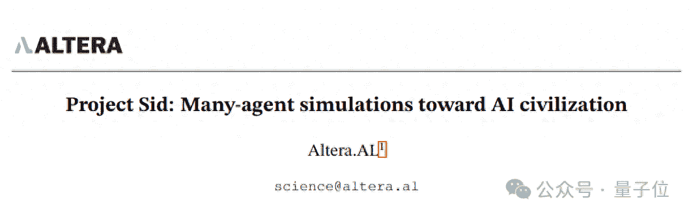

2024 年北大校友、MIT 教授 Robert Yang 发起项目 Sid，公开 35 页技术报告。其采用全新 PIANO 架构，由 10 个模块组成，解决多智能体交互问题。团队测试单智能体和多智能体行为，单智能体能产生专业化分工，多智能体能处理社会规则并传播文化内容，甚至形成虚拟宗教。网友期待更大规模智能体到来。

### 💡 Rive 发布 Layouts 新功能 只需设计一次 图像动画自动适应屏幕大小和各种布局

小互日报 | [阅读原文](https://xiaohu.ai/p/15231)

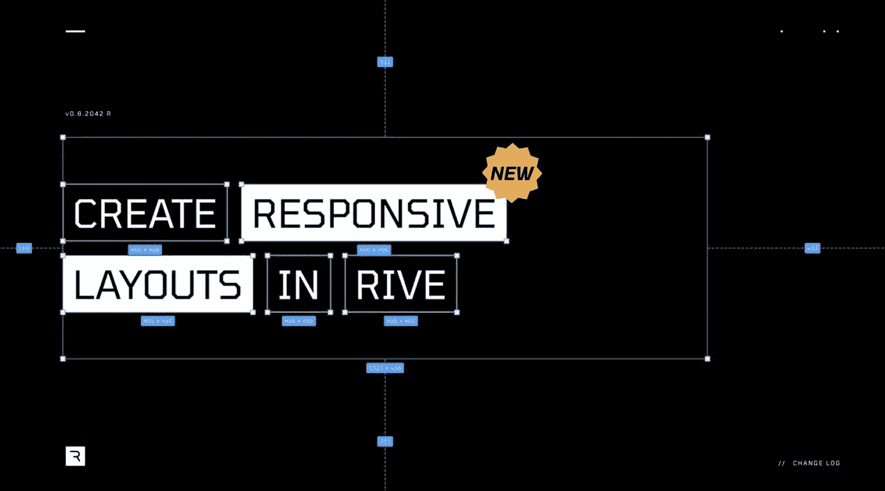

Rive 引入新功能 Layouts，可在各种设备上创建动态、响应式动画图形。能自动适应屏幕大小，如调整菜单大小、支持跨设备、多语言，具有可扩展设计系统、深层嵌套和灵活性等特点。还支持创建响应式布局，为布局属性添加动画，独特的布局方式结合了自由绘图与布局引擎，增强了交互性。

### 💡 英伟达团队机器训练新方法！仅5次演示让机器生成1000个新demo，李飞飞高徒与徒孙联手出品

量子位 | [阅读原文](https://www.qbitai.com/2024/11/215403.html)

2024 年 11 月，英伟达实验室提出新解决方案 DexMimicGen，仅需人类 5 次演示就能生成 1000 个新 demo。在仿真环境中任务成功率最高达 97%，比真人数据效果好。该方案由李飞飞徒孙等华人学生共同创作，将仿真方法迁移到现实，改进了 MimicGen 系统，针对双臂机器人灵巧操作任务做了多方面扩展，展现出跨任务泛化能力和对初始状态分布变化的鲁棒性。

### 💡 AI 医生来了：英国医院明年将用人工智能预测致命心脏病风险

IT之家 | [阅读原文](https://www.ithome.com/0/807/860.htm)

2024 年 11 月，英国国家医疗服务体系（NHS）明年将试用人工智能工具‘Aire’预测致命心脏病风险。Aire 经过训练可读取心电图结果，检测潜在心脏问题。用 189539 名患者的 116 万份心电图测试结果数据集训练。明年年中在伦敦两家 NHS 信托医院试用，初期数百名患者，未来五年推广。Aire 能在 78%病例中正确识别患者 10 年内死亡风险，预测严重心律问题准确率 76%，预测心血管疾病准确率 70%。

### 💡 我国科学家利用人工智能加速葡萄育种，效率提高 400%

IT之家 | [阅读原文](https://www.ithome.com/0/807/856.htm)

2024 年 11 月，我国科学家利用人工智能加速葡萄育种，效率提高 400%。周永锋团队构建了葡萄泛基因组，鉴定到与农艺性状显著相关的位点。团队引入机器学习，构建首个葡萄全基因组选择模型，预测准确率高达 85%。该技术可在葡萄幼苗期预测成熟后性状，提高育种效率，已申请多项专利。

### 💡 谷歌推出安全分析 AI 工具 Big Sleep，实战告捷抓出 SQLite 堆栈缓冲区下溢漏洞

IT之家 | [阅读原文](https://www.ithome.com/0/807/809.htm)

2024 年 11 月，谷歌推出安全分析 AI 工具 Big Sleep。它源于 Project Zero 团队的 Naptime 项目，能模仿人类安全专家发现漏洞。已成功找出 SQLite 的堆栈缓冲区下溢漏洞，现有工具无法发现。其动力是帮助开发者查找漏洞，因许多漏洞虽修复但可能有变种被黑客利用，而大模型可深度理解学习漏洞攻防。

### 💡 Jim Fan全华人团队HOVER问世，1.5M小模型让机器人获「潜意识」！

新智元 | [阅读原文](https://www.163.com/dy/article/JG5DIMOE0511ABV6.html?spss=dy_author)

2024 年 11 月，来自英伟达、CMU、UC 伯克利等的全华人团队提出人形机器人通用全身控制器 HOVER。仅用 1.5M 参数模型就能控制人形机器人身体，实现全身运动的动作模仿，支持多模式控制及无缝切换，在实验中表现出优越的泛化能力和跟踪误差低等优势，为未来人形机器人应用带来更高效率和灵活性。

### 💡 开源视频生成天花板？最强搅局者Mochi 1免费直出电影级特效

新智元 | [阅读原文](https://www.163.com/dy/article/JG5DIKJU0511ABV6.html?spss=dy_author)

2024 年 11 月，Genmo 推出开源视频生成模型 Mochi 1。它是基于非对称扩散 Transformer 架构，参数量达 100 亿，是开源最大视频生成模型。能生成 480p 视频，今年晚些时候将推出 Mochi 1 HD。它在运动质量和提示依从性方面表现出色，虽有局限性但开辟了多个领域的应用可能。Genmo 近日获 2840 万美元 A 轮融资，年底将发布 Mochi 1 完整版。

### 💡 Meta 公布机器人触觉感知能力研究成果：利用手指传感器结合“AI 大脑”理解 / 操作外界物体

IT之家 | [阅读原文](https://www.ithome.com/0/807/705.htm)

2024 年 11 月，Meta 公布机器人触觉感知能力研究成果。其核心是让机器人传感器感知理解物理世界，利用‘AI 大脑’精确控制反应。包括 Meta Sparsh 触觉编码器、Digit 360 高精度手指传感器及 Meta Digit Plexus 开放平台等成果，还开发了 PARTNR 基准用于评估人机协作能力。Meta 公开技术和数据供研究者使用。

### 💡 远程 “闻” 香，数字嗅觉公司 Osmo 用 AI 技术实现气味“传送”

IT之家 | [阅读原文](https://www.ithome.com/0/807/692.htm)

2024 年 11 月，数字嗅觉公司 Osmo 利用 AI 技术实现气味‘传送’。通过传感器收集气味，经气相色谱质谱仪分析，数据传输到分子打印机合成所需化学物质。如今利用 AI 实现自动化，将处理后的气味映射到主要气味图数据库，合成了‘新鲜的夏季李子’气味。

## 💫 企业动态

### 💡 优必选发布全栈式无人物流解决方案：人形机器人与无人车协同作业，应用于比亚迪工厂

IT之家 | [阅读原文](https://www.ithome.com/0/808/124.htm)

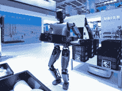

2024 年 11 月 5 日，优必选与其子公司在亚洲上海国际物流展发布全栈式无人物流解决方案，首次实现人形机器人与无人车协同作业，并应用于比亚迪工厂。该方案中 Walker S1、Wali 瓦力工业移动机器人、L4 级无人物流车 Chitu 赤兔协作，实现从分拣、搬运到配送的室内外一体化全自动流程。

### 💡 AI 赋能好莱坞：《此心安处》通过实时 AI 换脸技术让演员“逆生长”

IT之家 | [阅读原文](https://www.ithome.com/0/808/111.htm)

2024 年 11 月，索尼影业出品的《此心安处》大规模公映。该片耗资约 3.55 亿元人民币，利用实时生成式 AI 面部变换技术让演员‘逆生长’。制作团队用 AI 技术对汤姆·汉克斯和罗宾·怀特的容貌进行修改，该技术来自 Metaphysic 公司。其面部变换系统通过对演员以前电影画面训练定制机器学习模型，可实时生成变脸效果，无需传统 CGI 数月人工后期制作。关键词：AI 换脸、AI、人工智能。

### 💡 腾讯推出 Hunyuan-Large 大模型：389B 总参数，业界已开源基于 Transformer 的最大 MoE 模型

IT之家 | [阅读原文](https://www.ithome.com/0/808/080.htm)

2024 年 11 月 5 日，腾讯推出 Hunyuan-Large 大模型，拥有 3890 亿总参数（389B）和 520 亿激活参数（52B），是业界已开源基于 Transformer 的最大 MoE 模型。该模型有高质量合成数据、KV 缓存压缩、专家特定学习率缩放、长上下文处理能力等技术优势，并在多种语言和任务上进行广泛实验。相关资源已在 Hugging Face 等平台开源。关键词：腾讯，混元，大模型。

### 💡 GPT-4o mini 的 6.7/8.3 倍，Claude 3.5 Haiku AI 模型每百万 tokens 输入 1 美元 / 输出 5 美元

IT之家 | [阅读原文](https://www.ithome.com/0/808/014.htm)

2024 年 11 月 4 日，Anthropic 发布博文宣布开发者可通过多种方式调用 Claude 3.5 Haiku 模型，该模型在多项 AI 基准测试中超越 Anthropic 上一代模型。目前仅上线文本模态，未来将支持图像输入。其每百万 tokens 输入售价为 1 美元、输出售价为 5 美元，通过提示词缓存和 Message Batches API 可节省成本。相比之下，OpenAI 的 GPT-4 mini 和谷歌的 Gemini 1.5 Flash 售价较低。

### 💡 手机秒拍动画大片，高级运镜效果惊人！Runway两弹更新，火得一塌糊涂

新智元 | [阅读原文](https://www.163.com/dy/article/JG81JBS00511ABV6.html?spss=dy_author)

2024 年 11 月，Runway 连发两新功能，Act-One 可将真人面部表情精确复刻给 AI 角色，AI 摄像头控件实现 3D 化，为动画师等提供便利。Runway CEO 认为人工智能是机制，下一波创新来自用工具创造新事物的人。新摄像头控件可任意选择移动方向等，Act-One 支持多种角色类型，可创建多轮对话场景，单人可演一台戏，且生成人物视频稳定性高。

### 💡 震撼预警：满血版o1倒计时！奥特曼完整专访流出：o系列疯狂迭代，马上起飞

新智元 | [阅读原文](https://www.163.com/dy/article/JG814LUP0511ABV6.html?spss=dy_author)

OpenAI满血版 o1 即将出世引发科技圈关注。Sam Altman 透露推理是 OpenAI 重要未来，o 系列模型将快速迭代，如具备多种能力并可能带来突破性进展。同时讨论了 OpenAI 未来规划、初创公司机遇、AI 智能体、模型价值等问题，还对 OpenAI 未来两年蓝图进行了展望，并进行了快问快答。

### 💡 昆仑万维发布天工 AI 高级搜索功能，升级分析推理、金融 / 科研能力

IT之家 | [阅读原文](https://www.ithome.com/0/807/971.htm)

2024 年 11 月 5 日，昆仑万维天工 AI 发布新版本，迎来四个方面升级。包括全面升级多层次分析推理能力，可将复杂难题拆解并准确回答；升级金融投资专业 AI 搜索，能从财报中提取关键数据；升级科研学术专业 AI 搜索，建立国内最全学术元数据库；针对文档 AI 阅读分析智能优化，支持处理超 500K 字超长文本。目前天工 AI 高级搜索功能免费使用。

### 💡 每天入职2174人，比亚迪在招聘季杀疯了

量子位 | [阅读原文](https://www.qbitai.com/2024/11/215754.html)

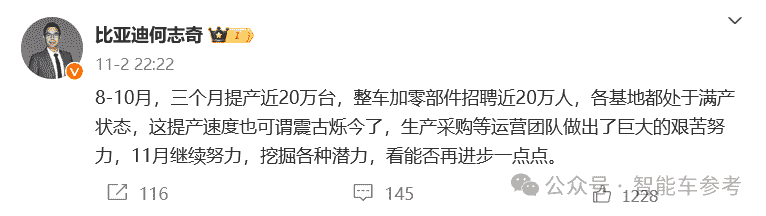

2024 年，比亚迪在招聘季大规模招人，三个月招聘 20 万人，平均每天入职 2174 人。截至 9 月员工总数超 90 万，其中近 11 万为技术研发人员。10 月比亚迪销售 502657 辆，同比增长 66.53%。今年前三季度营收增长，研发投入大。大规模招聘一是因销量飙升产能紧张，二是为追赶智能化，也为抢占人才先机，为公司发展和行业转型奠定基础。

### 💡 因发现稀有蜜蜂，扎克伯格拟建的核电 AI 数据中心计划受阻

IT之家 | [阅读原文](https://www.ithome.com/0/807/961.htm)

Meta 原计划在美国建设由核能驱动的人工智能数据中心，因选址附近发现稀有蜜蜂物种而受阻。核能被认为低碳高效，适合大规模数据处理。该事件引发环境监管关注，Meta 面临更复杂评估审批流程，凸显科技公司在追求创新与可持续发展间的矛盾挑战。

### 💡 小鹏鹏行前高管创业入局 AI 陪伴机器人，完成千万元级天使轮融资

IT之家 | [阅读原文](https://www.ithome.com/0/807/945.htm)

2024 年，原小鹏机器人产品设计负责人孙兆治创业成立珞博智能，年中完成千万元级天使轮融资。珞博智能团队成员来自多家科技及潮玩公司，业务方向为 AI 陪伴机器人，首款产品定位‘AI 潮玩’，预计明年发布和量产。孙兆治称明年有望成为 AI 陪伴硬件爆发元年。此外，小鹏鹏行曾在 2021 年发布可骑乘智能机器马，2022 年发布新一代智能机器人原型机，2023 年小鹏人形态双足机器人 PX5 亮相，今年 8 月小鹏‘机器手’亮相。

### 💡 OpenAI未来猛料全曝光！奥特曼承认自己最大弱点是产品

量子位 | [阅读原文](https://www.qbitai.com/2024/11/215696.html)

OpenAI 伦敦开发者日上，奥特曼接受采访。他认为自己最大弱点在产品方面，OpenAI 未来将在推理模型方向全面推进，如对 o1 进行多模态改进等。还谈到了开源的作用、Agent 的定义、模型贬值、人才浪费、Scaling Law 仍将持续有效、半导体供应链担忧以及用晶体管类比 AI 浪潮等问题，并在最后附上了 11 个快问快答彩蛋。

### 💡 有生命的AI？AI Agent的应用可不只游戏NPC｜对话超参数科技

量子位 | [阅读原文](https://www.qbitai.com/2024/11/215688.html)

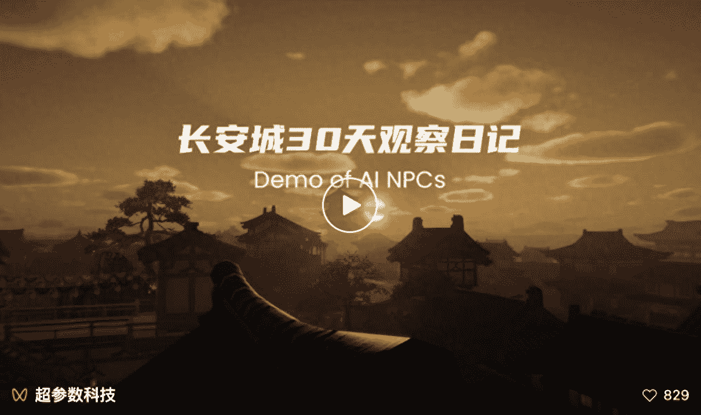

超参数科技是将 AI 与 Game Agent 深度融合的创新型科技公司。其创始人刘永升原是腾讯 AI Lab 总经理，曾打造围棋 AI‘绝艺’等产品。目前公司的 GAME Agent 处于拟人往多样性发展阶段，今年计划推出 AI 原生游戏。11 月 7 日 20:00，刘永升将在量子位‘365 行 AI 落地方案’中聊聊有生命的 AI Agent 的发展路径及 AI 游戏新形态。

### 💡 All in端到端后元戎获7亿融资，被曝长城独投！用L2+直达Robotaxi

量子位 | [阅读原文](https://www.qbitai.com/2024/11/215628.html)

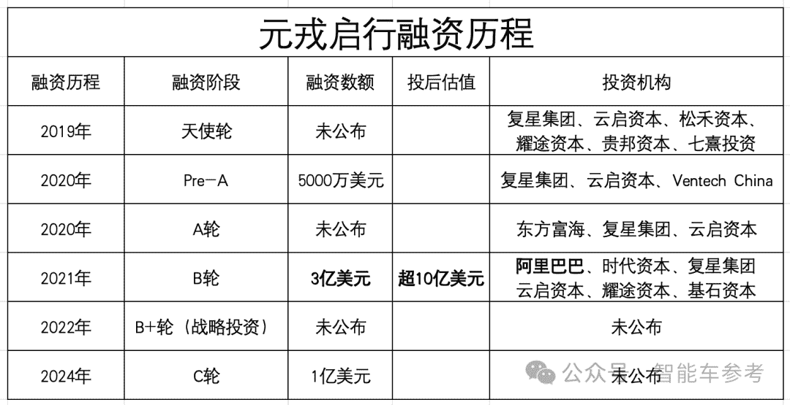

2024 年 11 月，元戎启行完成 1 亿美元（约 7 亿元人民币）C 轮融资，被曝由长城独投。元戎启行团队超 800 人，方案已落地近 2 万台，明年 Thor 上车，其 VLAM 方案将于广州车展开放试驾，明年上路，可实现百公里 1 次接管。元戎启行与长城合作紧密，长城正冲刺智能化，将智驾作为新护城河。元戎启行 CEO 周光认为市场回暖，上市和融资是实现目标的过程。

### 💡 ChatGPT搜索搞不定勾股定理新证明，但国产AI可以！

量子位 | [阅读原文](https://www.qbitai.com/2024/11/215445.html)

2024 年 11 月，国产昆仑万维天工 AI 的高级搜索功能引发关注。其在解读陶哲轩推荐的勾股定理新证明论文、掌握李飞飞空间智能原理、分析金融领域如英伟达财报等方面表现出色，还具有深度解析超长文档、跨文档回答等功能。其通过复杂技术堆栈为用户提供深度且权威的搜索体验，包括分钟级实时内容检索、深度推理与复杂问题分析、高权威信息信源保障等。此外，天工 AI 还有用户共创的宝典功能，有机会赚取收益。

### 💡 昆仑万维重磅发布天工AI高级搜索功能，做最懂金融投资、科研学术的AI搜索

量子位 | [阅读原文](https://www.qbitai.com/2024/11/215422.html)

2024 年 11 月 05 日，昆仑万维发布天工 AI 高级搜索功能，致力于为全球用户提供创新智能搜索和信息处理解决方案。该功能在处理复杂任务时推理能力有质的飞跃，全方位升级数据库做金融财经领域专业助手，建立国内科研学术最全学术元数据库，深度优化文档 AI 阅读分析功能，目前昆仑万维已构建多元 AI 业务矩阵并完成全产业链布局。

### 💡 前 OpenAI “AGI 准备工作”负责人：AI 将很快完成人类在计算机上能做的一切

IT之家 | [阅读原文](https://www.ithome.com/0/807/881.htm)

OpenAI 前‘AGI 准备工作’负责人 Miles Brundage 表示未来几年 AI 可能完成人类在计算机上的所有任务，包括呈现人类形象。OpenAI 联合创始人 John Schulman 也认为 AGI 可能在几年内实现，Anthropic 的 CEO Dario Amodei 预测 2026 年可能出现某种版本的 AGI。Brundage 上月离开 OpenAI，称离职并非因安全问题，希望以非营利身份产生更大影响。

### 💡 微软在英国启动生成式 AI 加速器计划，与英伟达、GitHub 联手帮助初创公司成长

IT之家 | [阅读原文](https://www.ithome.com/0/807/845.htm)

2024 年 11 月 4 日，微软在英国启动生成式 AI 加速器计划，与英伟达、GitHub 合作，为英国 AI 初创企业提供资源和机会。该计划运行时间为 2025 年 1 月至 3 月初，专为获种子资金并寻求发展的初创企业定制，旨在应对企业扩展规模和实现潜力的挑战，参与者将获微软 AI‘黑带’团队及合作伙伴的支持。

### 💡 戴尔在深圳成立 AI 智能解决方案中心，提供服务器、以太网等软硬件基础设施

IT之家 | [阅读原文](https://www.ithome.com/0/807/828.htm)

2024 年 11 月 4 日，戴尔在深圳成立 AI 智能解决方案中心，提供服务器、以太网与交换机等软硬件基础设施。戴尔全球资深副总裁吴冬梅称，该中心将立足深圳，面向大湾区，未来覆盖大中华区，为 AI 应用落地提供支持。中心展示了全栈 AI 解决方案，并为合作伙伴和客户提供成功实践和真实场景用例。

### 💡 AI 无处不在：谷歌将为 Chrome 浏览器增强保护模式引入人工智能

IT之家 | [阅读原文](https://www.ithome.com/0/807/819.htm)

2024 年 11 月，谷歌将为 Chrome 浏览器增强保护模式引入人工智能。在 Chrome Canary 版本中更新了该模式描述，开启后可基于浏览数据进行实时 AI 驱动的防护。但激活增强保护模式可能会将网站地址及活动数据样本发送至谷歌进行‘安全检查’。

### 💡 消息称马斯克正与英伟达就 xAI 投资事宜进行谈判

IT之家 | [阅读原文](https://www.ithome.com/0/807/817.htm)

2024 年 11 月消息称马斯克正与英伟达就其创立的 xAI 投资事宜进行谈判。xAI 开发的 Grok 虽推出晚于 ChatGPT 但增长快。英伟达 CEO 黄仁勋支持 xAI，称其团队仅用 19 天建立超级计算机集群令人难以置信。关于 xAI 投资报道不断，有称其正商谈筹集数十亿美元，估值约 400 亿或 450 亿美元。

### 💡 机器狗“职业”再加一：2024 杭州马拉松首次启用四足机器人配速员

IT之家 | [阅读原文](https://www.ithome.com/0/807/791.htm)

2024 杭州马拉松首次启用四足机器人配速员，配速约为 9 分 24 秒，速度最高可达 6 米/秒。有‘半马收尾’配速员气球，提供科学跑步节奏。‘陪跑兔’有语音播报功能。国际马拉松历史上尚属首次。今年国内多地也有‘机器狗’上岗，如成都宽窄巷子用于夜间安全巡逻，泰山景区用于清运垃圾，最多可承载 120kg。

### 💡 苹果发布 Ferret-UI 2 专门理解和与移动用户界面交互的模型 让手机成为通用UI助手

小互日报 | [阅读原文](https://xiaohu.ai/p/15211)

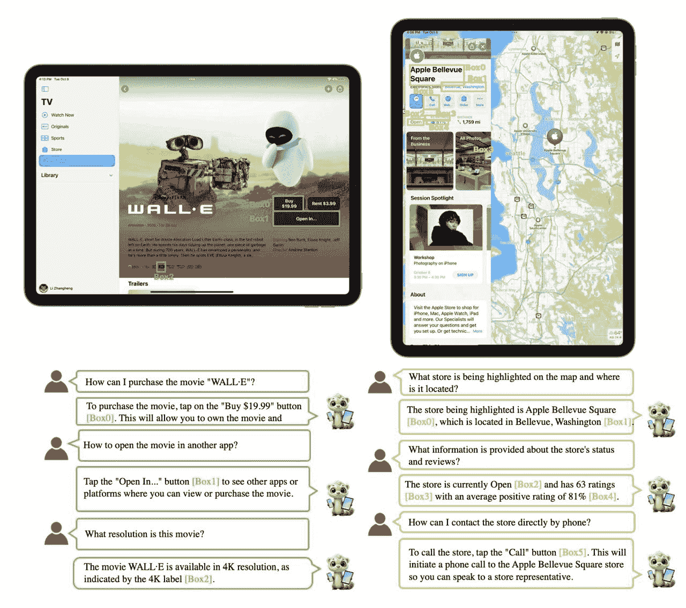

苹果开发了多模态大语言模型 Ferret-UI，能理解和与移动用户界面互动。文章还提及了众多 AI 相关的教程、项目及企业动态，如 Recraft 发布图像生成模型 V3、Meta FAIR 发布人工多模态指尖等。

### 💡 字节跳动内测 AI 模型分享社区“炉米 Lumi”，据称集成 LLM 分享 / 搭建 / 训练等功能

IT之家 | [阅读原文](https://www.ithome.com/0/807/747.htm)

2024 年 11 月 4 日，字节跳动内测 AI 模型分享社区‘炉米 Lumi’，该平台集成模型分享、Workflow 搭建及 LoRA 训练等功能。目前处于内部测试阶段，主流搜索引擎未收录，可通过‘artistrylab.net’访问但扫码登录无权限。字节跳动尚未官宣，IT 之家将持续关注后续情况。

### 💡 谷歌员工集体打脸劈柴，25%新代码AI生成夸大事实！Linux之父怒斥90%都是营销

新智元 | [阅读原文](https://www.163.com/dy/article/JG5DIRHF0511ABV6.html?spss=dy_author)

2024 年谷歌超 25%新代码由 AI 生成，CEO 言论遭自家员工质疑，被指夸大事实，Linux 之父也认为 AI 多为营销。AI 编程助手存在植入错误、侵犯版权等问题，有人质疑其对开发速度、代码质量等的提升效果。谷歌内部有 Goose 模型供员工使用，92%美国码农用 AI 写代码。科技行业招聘岗位减少，AI 影响科技就业市场，工程师需提升 AI 技能以保持竞争力。

### 💡 UCLA、MIT数学家推翻39年经典数学猜想！AI证明卡在99.99%，人类最终证伪

新智元 | [阅读原文](https://www.163.com/dy/article/JG5DIEO40511ABV6.html?spss=dy_author)

2024 年，UCLA 和 MIT 的研究者证伪了概率论中 39 年的‘上下铺猜想’。1985 年由数学家 Pieter Kasteleyn 首次提出该猜想，几十年来数学家们一直认为其正确，却无人能证。研究者曾用 AI 证明到 99.99%，后因不足百分百而放弃。最终受英国剑桥大学一项研究启发，构建出反例图，证明该猜想错误。这引发了数学家对数学证明本质及 AI 在数学研究中作用的讨论。

### 💡 英伟达要求 SK 海力士提前 6 个月供应 HBM4 芯片

IT之家 | [阅读原文](https://www.ithome.com/0/807/695.htm)

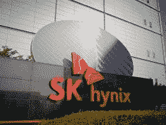

2024 年 11 月，英伟达要求 SK 海力士提前六个月供应 HBM4 芯片。SK 海力士计划 2025 年下半年推出 12 层 HBM4 产品，2026 年推出 16 层堆叠 HBM。今年 7 月有消息称英伟达、台积电和 SK 海力士将组建‘三角联盟’推进 HBM4 等下一代技术。SK 海力士 2024 财年第三季度收入 17.5731 万亿韩元，HBM 在 DRAM 总销售额中的比重预计从第三季度的 30%提升到第四季度的 40%。关键词：SK 海力士、英伟达内存、HBM4。

### 💡 教程：使用 E2F5工具实现文本转语音和唇同步视频制作

小互日报 | [阅读原文](https://xiaohu.ai/p/15205)

2024 年 11 月，多篇 AI 相关动态。包括 E2F5 工具可实现文本转语音和唇同步视频制作，苹果发布 Ferret-UI 2，Recraft 发布 V3 图像生成模型等。同时还提及了 Claude 3.5 新功能、Meta FAIR 发布人工多模态指尖等内容。

## ✨ 行业观点

### 💡 OpenAI CEO 阿尔特曼预测 AGI 可在 5 年内实现，但短期社会影响不大

IT之家 | [阅读原文](https://www.ithome.com/0/808/115.htm)

OpenAI CEO 阿尔特曼预测 AGI 可在 5 年内实现，但短期社会影响不大。他此前曾表示实现 AI 愿景需 7 万亿美元及多年建半导体工厂和数据中心。阿尔特曼认为未来 5 年 AI 技术进步速度快，AGI 时刻可能悄然到来，而短期对社会影响小，长远看可能带来根本性社会变革。关键词：AGI、人工智能、OpenAI。