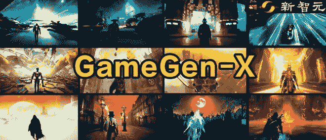
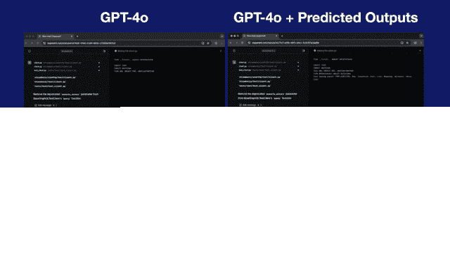
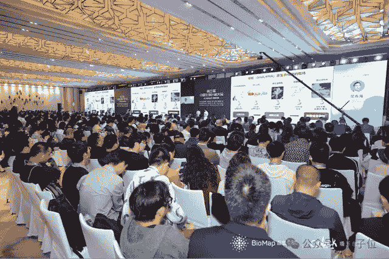
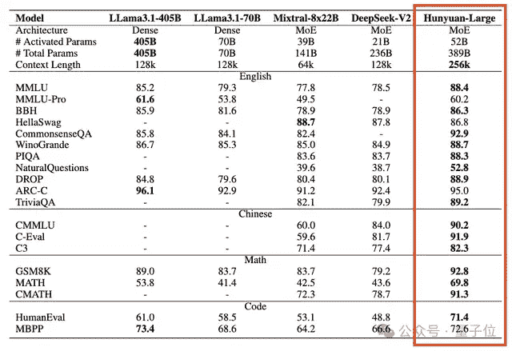
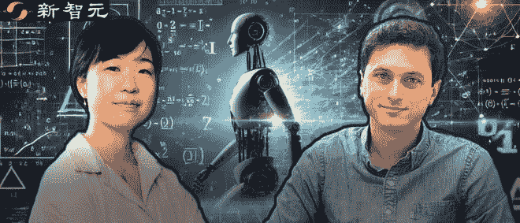
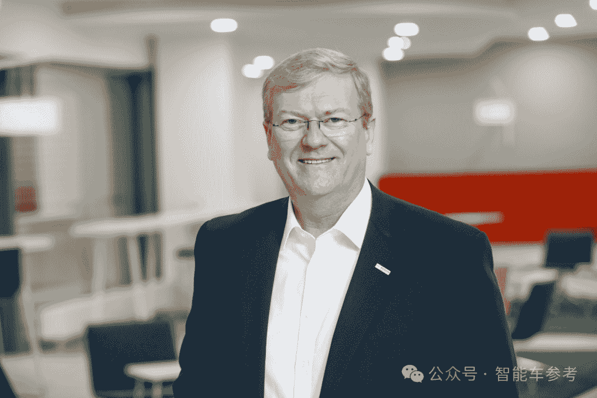
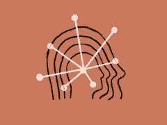

# 11.07-字节推出单图视频驱动模型 `X-Portrait 2`：一键生成相同表情神态、消息称王慧文回归美团，带队独立探索 AI 应用、最强扩散`Transformer`-黑神话级3A大作AI实时游戏生成

> 来源：[https://agijuejin.feishu.cn/docx/OVTjd3i9IoUF0pxIFUZcxtG5n0c](https://agijuejin.feishu.cn/docx/OVTjd3i9IoUF0pxIFUZcxtG5n0c)

## ⭐ 今日热点

### 💡 字节推出单图视频驱动模型 X-Portrait 2：一键生成相同表情神态，简化创作流程

IT之家 | [阅读原文](https://www.ithome.com/0/808/457.htm)

2024 年 11 月 6 日，字节跳动智能创作团队推出单图视频驱动技术 `X-Portrait 2`。该技术只需一张静态照片和一段驱动视频，就能生成高质量‘电影级’视频。它构建表情编码器模型，结合生成式扩散模型，在运动表现力和 ID 保持性方面优于先前技术，简化了内容创作流程。

### 💡 「黑神话」级3A大作AI实时游戏生成！港科大、中科大等祭出最强扩散Transformer，火爆国外

新智元 | [阅读原文](https://www.163.com/dy/article/JGAIAGQM0511ABV6.html?spss=dy_author)

2024 年，港科大、中科大等机构推出 `GameGen-X`，首个专为生成和交互控制开放世界游戏视频的扩散 `Transformer` 模型。它能模拟游戏引擎特性，生成高质量游戏内容，如角色、环境、动作、事件等，并可进行多模态交互控制。还构建了首个开放世界游戏视频数据集 `OGameData`，`GameGen-X` 在多项指标上表现良好，为游戏设计未来开辟新视野。

## 🌟 技术突破

### 💡 下载次数破39万！CMU、Meta联合发布VQAScore文生图优化方案：Imagen3已采用

新智元 | [阅读原文](https://www.163.com/dy/article/JGAI06NH0511ABV6.html?spss=dy_author)

2024 年 11 月，CMU、Meta 联合发布 `VQAScore` 文生图优化方案，下载次数破 39 万。`VQAScore` 利用视觉问答模型评估文生图质量，`GenAI-Bench` 是基准测试集。现有自动化指标有不足，`VQAScore` 无需人类标注且分数更精准，在多个基准测试上超越流行指标，`GenAI-Bench` 更具挑战性且能细粒度分析。`GenAI-Rank` 用 `VQAScore` 提升文生图表现，该方案已被多个项目采用。

### 💡 GPT-4o加钱能变快！新功能7秒完成原先23秒的任务

量子位 | [阅读原文](https://www.qbitai.com/2024/11/216051.html)

2024 年 11 月，OpenAI 推出新功能‘预测输出’，让 `GPT-4o` 速度提升至多 5 倍，如 7 秒完成原先 23 秒的任务。该功能适合更新博客文章、迭代响应等任务，在编程任务上响应时间快了 2 - 4 倍。目前仅支持 `GPT-4o` 和 `GPT-4o mini` 两个模型且以 `API` 形式。虽快但收费也高了。

### 💡 大模型重构生命科学！最大基础模型面世，解锁DNA超长序列，参数规模达2100亿

量子位 | [阅读原文](https://www.qbitai.com/2024/11/216008.html)

2024 年第三届中国生物计算大会上，百图生科推出全球规模最大的生命科学基础模型 `xTrimo V3`，参数规模达 2100 亿，覆盖七大主流模态。该模型不仅能处理复杂生物序列，为药物研发等助力，还限时为年底前注册用户提供免费 `Tokens`。其在多个方面表现出色，如在 200 个任务模型达 `SOTA` 水平，助力开发多种前沿抗体和酶等，为生命科学领域带来重大突破。

### 💡 腾讯发最大开源MoE模型，3890亿参数免费可商用，跑分超Llama3.1

量子位 | [阅读原文](https://www.qbitai.com/2024/11/215895.html)

2024 年 11 月腾讯发布最大开源 `MoE` 模型 `Hunyuan-Large`，3890 亿总参数，520 亿激活参数，跑分超 `Llama 3.1`，上下文长度支持达 256k，免费可商用。开源三个版本，`HuggingFace` 首席科学家推荐，有很多亮点。团队投入大量成本确定最优激活参数量约为 58.1B，`Hunyuan-Large` 选择 52B。采用混合路由、回收路由、专家特定学习率适配策略，有高质量合成数据流程，采用多项策略优化长文能力，结合 `GQA` 和 `CLA` 压缩 `KV Cache`，降低内存占用约 95%，采用两阶段后训练策略，未来还会考虑开源中小型号模型。

### 💡 极智嘉发布全球首款搭载英特尔视觉导航模块的纯视觉机器人方案，在设备内完成所有深度计算

IT之家 | [阅读原文](https://www.ithome.com/0/808/102.htm)

2024 年 11 月 4 日，极智嘉携手英特尔发布全球首款搭载英特尔视觉导航模块的纯视觉机器人方案。方案包含 `M600` 和 `MP1000R` 两款产品，11 月 5 日至 8 日亮相亚洲物流展。该方案功耗低，不受特定平台限制，能让机器人从环境中获取深度数据并准确识别互动。模块中除摄像头外还包含 `Robotic Vision Hub`，内含英特尔酷睿 `i7-1270P` 处理器等组件，为算法提供算力支撑并实现云边协同。

### 💡 英伟达团队机器训练新方法：仅 5 次演示让机器生成 1000 个新 demo

IT之家 | [阅读原文](https://www.ithome.com/0/808/004.htm)

2024 年英伟达团队提出新的机器训练方法 `DexMimicGen`，仅需人类 5 次演示就能生成 1000 个新 demo。在仿真环境中任务成功率高，如整理抽屉达 76%，罐子分类高达 97.3%。迁移到真实环境后，易拉罐分拣任务用 40 个生成 demo 成功率达 90%。该方法还具有跨任务泛化能力和对初始状态分布变化的鲁棒性，由 `MimicGen` 改造而成，针对双臂机器人灵巧操作任务做了改进和扩展。

## 💫 企业动态

### 💡 三星计划通过自研知识图谱技术，提升 Galaxy AI 个性化体验

IT之家 | [阅读原文](https://www.ithome.com/0/808/420.htm)

2024 年 11 月 6 日，三星电子全球 AI 中心总监透露公司计划通过自研知识图谱技术提升 `Galaxy AI` 的个性化体验并确保用户数据安全。将其与生成式 AI 结合，还计划在所有设备中使用混合 AI 模型。同时，三星将扩展 `Knox Matrix` 安全系统至家用电器。三星强调 AI 发展应以道德、安全和普惠为原则，并呼吁政府制定相关框架，已与韩国国家 AI 委员会合作推动 AI 健康发展。

### 💡 Instagram 将借助 AI 技术识别青少年谎报年龄行为：朋友祝贺生日的帖子也能推测真实年龄

IT之家 | [阅读原文](https://www.ithome.com/0/808/418.htm)

2024 年 11 月 6 日，Meta 将使用‘成人分类器’软件工具把 Instagram 用户分为 18 岁以上和以下两组。通过分析账户数据、关注者列表等推测年龄，自动转青少年账户，9 月已推青少年账户且隐私设置更严格。Meta 让谎报年龄变难，未来误分类用户可申诉，目前可自行关闭严格设置。

### 💡 消息称王慧文回归美团，带队独立探索 AI 应用

IT之家 | [阅读原文](https://www.ithome.com/0/808/373.htm)

2024 年 11 月，原美团联合创始人王慧文回归美团带队探索 AI 应用，其所在团队 `GN06` 专注情感陪伴、聊天机器人等方向，相对独立。美团 2023 年 11 月上线 AI 情感陪伴产品 `Wow` 就来自 `GN06`，如今 `Wow` 重点出海北美。2023 年王慧文因个人健康原因辞去美团董事，美团收购其‘光年之外’，8 月光年之外完成工商变更，王慧文退股。2024 年王慧文将用部分时间承担美团顾问一职。

### 💡 90后上海女生，成美国数学大奖首位女性华人得主！获评委陶哲轩盛赞

新智元 | [阅读原文](https://www.163.com/dy/article/JGAHTA850511ABV6.html?spss=dy_author)

2024 年美国塞勒姆奖由华人女数学家王艺霖和阿根廷数学家 Miguel Walsh 获得。王艺霖是塞勒姆奖首位女性华人得主，其研究在复分析、概率论和数学物理交叉领域有突出贡献，获评委陶哲轩盛赞。塞勒姆奖由普林斯顿高等研究院管理，以法国数学家拉斐尔·萨勒姆命名，许多菲尔兹奖得主曾获此奖。

### 💡 英伟达3.4万亿市值稳坐全球第一！苹果12年霸主地位终结

新智元 | [阅读原文](https://www.163.com/dy/article/JGAHRSS30511ABV6.html?spss=dy_author)

2024 年 11 月，英伟达市值达 3.43 万亿美元，超越苹果成为全球最高市值公司。今年英伟达股价上涨 186%，其 Q2 营收达 300 亿美元，数据中心业务营收 263 亿美元。`GPU` 业务增长迅猛，带动算力需求增长。11 月 8 日英伟达将代替英特尔成为道琼斯工业平均指数成员，`Blackwell` 芯片系列有望在第四季度发货。

### 💡 阳澄湖大闸蟹首次用上 AI 点码防伪

IT之家 | [阅读原文](https://www.ithome.com/0/808/264.htm)

2024 年 11 月，江苏省消保委发文称阳澄湖大闸蟹统一使用国家农业农村部农产品地理标志防伪专用标识。今年标识有新形状，采用介于椭圆形与菱形之间的形状，不同养殖区域有不同颜色标识。还首次采用 AI 点码防伪技术，消费者可通过🛰️扫描二维码追溯大闸蟹信息，具体操作是关注苏州市阳澄湖大闸蟹行业协会👸号进行查询。

### 💡 全球最大变压器生产商日立能源警告称行业“不堪重负”，AI 数据中心需求激增

IT之家 | [阅读原文](https://www.ithome.com/0/808/219.htm)

全球最大变压器生产商日立能源警告行业不堪重负，无法满足电网设备爆炸式需求。因生成式 AI 数据中心需求增长致供应紧张，变压器制造商难快速提产，公共事业项目或被推迟。目前变压器市场需求飙升，价格自 2019 年已上涨 40%，供应紧张至少持续到 2026 年底。日立能源将投资 60 亿美元并招聘 1.5 万人扩产能，其 CEO 否认行业很快产能过剩，称中国厂商暂未构成竞争威胁。

### 💡 全球第一Tier 1血裁7000人，年度KPI确定完不成，欧洲汽车寒气逼人

量子位 | [阅读原文](https://www.qbitai.com/2024/11/215981.html)

2024 年，全球第一 `Tier 1` 博世宣布在德国裁员 7000 人，大部分岗位来自汽车部。此次裁员或与巨额收购有关，其花费 80 亿美元收购江森自控—日立空调合资公司及日立 40%股权，将花去超 43.5%现金储备。博世预计 2024 年销售回报率将从 5%下降至 4%。此外，米其林将关闭 2 家法国工厂，舍弗勒裁员约 4700 人，欧洲各大主机厂业务表现也不理想，大众三季度净利润暴跌 63.7%并推出降本计划，而特斯拉柏林超级工厂全员加薪 4%。

### 💡 IDC：2023 年中国工业机器人厂商出海收入合计约 95.8 亿元

IT之家 | [阅读原文](https://www.ithome.com/0/808/178.htm)

2023 年中国工业机器人厂商出海收入约 95.8 亿元，主要市场在亚太、欧洲、北美等地区，占境外收入 90%。协作机器人是新兴热门领域，2023 年出海收入超 3.8 亿元。中国商用服务机器人厂商出海收入约 15.1 亿元，主要市场在亚太、欧洲地区，占境外收入 90%以上。头部企业海外收入高于国内，海外业务成重要业绩增长点。关键词：`IDC`、机器人。

### 💡 优必选发布全栈式无人物流解决方案：人形机器人与无人车协同作业，应用于比亚迪工厂

IT之家 | [阅读原文](https://www.ithome.com/0/808/124.htm)

2024 年 11 月 5 日，优必选与其子公司在亚洲上海国际物流展发布全栈式无人物流解决方案。该方案将人形机器人与无人车协同作业，应用于比亚迪工厂，实现从分拣、搬运到配送的室内外一体化全自动流程，包括 `Walker S1`、`Wali 瓦力`工业移动机器人、`L4` 级无人物流车 `Chitu 赤兔`等协同工作。

### 💡 腾讯推出 Hunyuan-Large 大模型：389B 总参数，业界已开源基于 Transformer 的最大 MoE 模型

IT之家 | [阅读原文](https://www.ithome.com/0/808/080.htm)

2024 年 11 月 5 日，腾讯推出 `Hunyuan-Large` 大模型，拥有 3890 亿总参数和 520 亿激活参数。在 `Hugging Face` 开源了多个版本，并发布技术报告和操作手册。其优势包括高质量合成数据、`KV` 缓存压缩、专家特定学习率缩放、长上下文处理能力和广泛的基准测试等。相关链接有论文、`Github`、`Huggingface` 和腾讯云。

### 💡 GPT-4o mini 的 6.7/8.3 倍，Claude 3.5 Haiku AI 模型每百万 tokens 输入 1 美元 / 输出 5 美元

IT之家 | [阅读原文](https://www.ithome.com/0/808/014.htm)

2024 年 11 月 4 日，Anthropic 发布博文宣布开发者可通过多种方式调用 `Claude 3.5 Haiku` 模型。该模型对标的是 OpenAI 的 `GPT-4o Mini` 和谷歌的 `Gemini 1.5 Flash`，在多项 AI 基准测试中超越上一代模型。目前仅上线文本模态，未来将支持图像输入。其每百万 `tokens` 输入售价为 1 美元、输出售价为 5 美元，通过提示词缓存和 `Message Batches API` 可节省成本。相比之下，OpenAI 的 `GPT-4 mini` 和谷歌的 `Gemini 1.5 Flash` 价格更低。

### 💡 手机秒拍动画大片，高级运镜效果惊人！Runway两弹更新，火得一塌糊涂

新智元 | [阅读原文](https://www.163.com/dy/article/JG81JBS00511ABV6.html?spss=dy_author)

2024 年 11 月，`Runway` 在 AI 视频赛道推出两个新功能。`Act-One` 可将真人面部表情精确复刻给 AI 角色，AI 摄像头控件实现 3D 化，为动画师等提供便利。其 CEO 认为人工智能是基础设施，下一波创新来自用其创造新事物的人。新的摄像头控件可任意选择移动方向等，`Act-One` 支持多种角色生成，可创建多轮对话场景，用手机拍摄视频也能为 AI 角色赋予逼真表情。

## ✨ 行业观点

### 💡 ChatGPT AI 搜索还不是“谷歌杀手”：关键字搜索不靠谱

IT之家 | [阅读原文](https://www.ithome.com/0/808/192.htm)

OpenAI 发布 `ChatGPT Search` 向谷歌发起挑战，但目前在处理简短查询时不够可靠，还不是‘谷歌杀手’。它在回答复杂问题上表现出色，但多数谷歌搜索查询较为简短。OpenAI 表示会根据用户反馈改进，目前其在短查询方面存在不足，依赖微软必应且大语言模型可能不擅长处理简短输入。`Perplexity` 也有同样问题，两款产品暂无法完全取代谷歌。

### 💡 OpenAI CEO 阿尔特曼预测 AGI 可在 5 年内实现，但短期社会影响不大

IT之家 | [阅读原文](https://www.ithome.com/0/808/115.htm)

OpenAI CEO 萨姆·阿尔特曼对通用人工智能充满热情，称现有的硬件可能实现 `AGI`。他曾表示实现 AI 愿景需 7 万亿美元及多年建工厂等。他预测未来 5 年 AI 进步速度快，`AGI` 时刻可能悄然到来，短期影响小，长远看会带来根本性社会变革。

### 💡 AI 赋能好莱坞：《此心安处》通过实时 AI 换脸技术让演员“逆生长”

IT之家 | [阅读原文](https://www.ithome.com/0/808/111.htm)

## 索尼影业《此心安处》利用生成式 AI 技术实现演员“逆生长”

2024 年 11 月，索尼影业出品的《此心安处》大规模公映。该片耗资 5000 万美元，利用实时生成式 AI 面部变换技术让演员‘逆生长’。该技术来自 Metaphysic 公司，通过对演员以前电影画面训练定制机器学习模型，可实时生成变脸效果，无需传统 CGI 数月人工后期制作。关键词：AI 换脸、AI、人工智能。

## 💡 消息称王慧文回归美团，带队独立探索 AI 应用

IT之家 | [阅读原文](https://www.ithome.com/0/808/373.htm)

2024 年 11 月，原美团联合创始人王慧文回归美团带队探索 AI 应用，其所在团队 GN06 专注情感陪伴、聊天机器人等方向，相对独立。美团 2023 年 11 月上线 AI 情感陪伴产品 Wow 就来自 GN06，如今 Wow 重点出海北美。2023 年王慧文因个人健康原因辞去美团董事，美团收购其‘光年之外’，8 月光年之外完成工商变更，王慧文退股。2024 年王慧文将用部分时间承担美团顾问一职。
