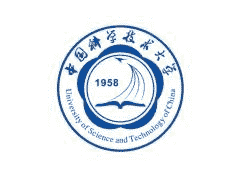
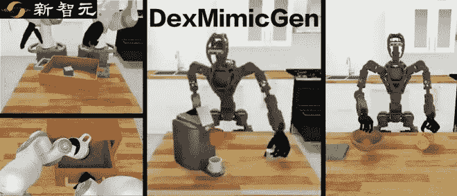
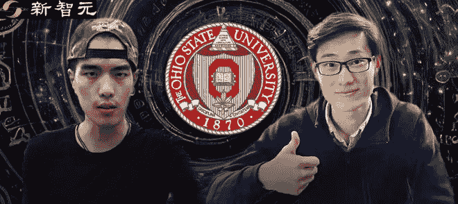

# 11.23-谷歌 Gemini 突发试验版模型：重回竞技榜第一，新版 GPT-4o 只领先了 1 天

> 来源：[https://agijuejin.feishu.cn/docx/QjHkduNHQofSCRxkEl1cELc4njf](https://agijuejin.feishu.cn/docx/QjHkduNHQofSCRxkEl1cELc4njf)

> [欢迎加入 AGI 掘金社群](https://sourl.co/miZUyT)

## ⭐ 今日热点

### 💡 谷歌 Gemini 突发试验版模型：重回竞技榜第一，新版 GPT-4o 只领先了 1 天

IT之家 | [阅读原文](https://www.ithome.com/0/812/435.htm)

2024 年 11 月，新版 GPT-4o 刚登顶竞技榜 1 天，谷歌就发布 Gemini-Exp-1121 试验版模型夺回第一。谷歌研究人员很得意，该模型重点提升了代码、推理和视觉理解能力。在视觉能力方面也有提升，风格控制下与其他模型水平相当。实际体验中，Gemini-Exp-1121 表现更优。同时，OpenAI 的 ChatGPT 测试版中发现‘实时摄像’功能代码，可能抢在谷歌前全量铺开。关键词：Gemini，GPT4o。

## 🌟 技术突破

### 💡 中国科大利用 AI，破解催化领域重大科学难题、成果登《Science》

IT之家 | [阅读原文](https://www.ithome.com/0/812/624.htm)

2024 年 11 月，中国科学技术大学李微雪教授课题组利用人工智能在催化基础研究中取得重要成果。通过可解释 AI 技术建立金属-载体相互作用与材料基本性质的控制方程，涵盖 25 种金属和 27 种氧化物，构建了庞大特征空间，筛选出描述符。成果有望加快新催化材料发现，推动 AI 与化学研究融合，相关成果发表于《科学》。

### 💡 首个可保留情感的音频 LLM：Meta 重磅开源 7B-Spirit LM，一网打尽“音频 + 文本”多模态任务

IT之家 | [阅读原文](https://www.ithome.com/0/812/438.htm)

2024 年 11 月，Meta 开源 7B-Spirit LM，这是一个可保留情感的音频多模态语言模型，能理解和生成语音及文本，自然转换两种模式，捕捉和再现语音情感风格。模型有基础版和表达版，采用交错训练，在多个任务中有良好表现，如自动语音识别和文本转语音等，准确率达 79%。但也可能生成不安全内容，需安全测试。

### 💡 机器人训练数据不缺了！英伟达团队推出DexMG：数据增强200倍

新智元 | [阅读原文](https://www.163.com/dy/article/JHJO67DS0511ABV6.html?spss=dy_author)

2024 年 11 月，英伟达团队推出 DexMimicGen，这是一种大规模自动化数据生成系统。它能基于少量人类演示合成类人机器人灵巧手运动轨迹，大幅提升机器人训练数据集的获取效率。例如从仅 5 个源人类演示可生成 1000 个演示，从 60 个源人类演示能生成 21000 个演示。该系统在不同任务中显著提高机器人策略成功率，如抽屉整理任务从 0.7%跃升至 76.0%，还能适应多样初始状态，跨基准数据生成表现优异。

### 💡 续命Scaling Law？世界模型GPT-4o让智能体超级规划，OSU华人一作

新智元 | [阅读原文](https://www.163.com/dy/article/JHJO58820511ABV6.html?spss=dy_author)

2024 年 11 月，俄亥俄州立大学等机构的研究人员提出 WebDreamer 框架，利用 GPT-4o 作为世界模型预测网站交互结果。WebDreamer 在性能、效率、安全和集成方面表现出色，如在 VisualWebArena 和 Mind2Web-live 上远超反应式基线，与树搜索相比只需一半交互次数，还能降低安全风险并可作为插件。它通过 LLM 模拟每个可能步骤结果进行规划，在实验中有效性和效率显著。

## 💫 企业动态

### 💡 消息称 OpenAI 正与三星洽谈合作，有望在 Galaxy 手机中搭载多项 AI 功能

IT之家 | [阅读原文](https://www.ithome.com/0/812/638.htm)

2024 年 11 月 23 日消息，OpenAI 正与三星洽谈合作，有望在 Galaxy 手机中搭载多项 AI 功能。OpenAI 希望成为谷歌潜在挑战者，预计开发 SearchGPT 等功能。OpenAI 与三星的合作可能扩大其覆盖范围，三星表示对与所有合作伙伴合作保持开放态度。

### 💡 OpenAI 在训练数据诉讼案中意外删除《纽约时报》等收集的关键证据

IT之家 | [阅读原文](https://www.ithome.com/0/812/626.htm)

2024 年 11 月 22 日消息，OpenAI 在与《纽约时报》等的 AI 训练数据诉讼案中，意外删除关键证据。报纸团队花 150 多小时搜索其训练数据，OpenAI 虽承认错误并尝试恢复但数据不完整不可靠。《纽约时报》去年 12 月起诉 OpenAI，要求赔偿‘数十亿美元’，已投入超 100 万美元。OpenAI 已与部分主流媒体合作，显示出版商有不同选择。关键词：OpenAI，纽约时报。

### 💡 亚马逊大手笔，向“OpenAI 最大对手” Anthropic 追加 40 亿美元投资

IT之家 | [阅读原文](https://www.ithome.com/0/812/622.htm)

2024 年 11 月 22 日，亚马逊宣布向 AI 初创公司 Anthropic 追加 40 亿美元投资，总投资额达 80 亿美元。Anthropic 由前 OpenAI 研究团队高管创立，开发了聊天机器人 Claude。亚马逊网络服务（AWS）将成为其主要云计算和模型训练合作伙伴。今年 3 月亚马逊已投资 27.5 亿美元，2023 年 9 月有 12.5 亿美元初始投资协议，且亚马逊未获 Anthropic 董事会席位。今年 9 月，Anthropic 推出 Claude Enterprise，早前还发布了 Claude 3.5 Sonnet 模型及面向中小企业的人工智能‘团队’计划。关键词：亚马逊，Anthropic。

### 💡 OpenAI 首席产品官：ChatGPT 网页端本周引入高级语音模式

IT之家 | [阅读原文](https://www.ithome.com/0/812/611.htm)

2024 年 11 月 22 日，OpenAI 首席产品官确认本周 ChatGPT 网页版将引入高级语音模式，面向付费用户开启。该模式依托 GPT-4o 模型，有原生音频处理能力，能感知非语言信号。Plus 和 Teams 用户每天语音使用量有上限。7 月首次向测试用户开放此功能，9 月底向付费订阅用户推出，未来免费用户也将有机会体验，欧盟地区用户需等待。关键词：OpenAI，ChatGPT。

### 💡 陈睿：超九成 AI 厂商选择在B站和用户沟通，AIGC 相关内容观看量突破 300 亿次

IT之家 | [阅读原文](https://www.ithome.com/0/812/519.htm)

2024 年世界互联网大会乌镇峰会互联网企业家论坛举行，B站董事长兼 CEO 陈睿发表演讲。B站形成超 **7000 个**兴趣圈层，在 AI 方面，每月有超 8000 万用户观看相关内容，2024 年 AIGC 相关内容观看量突破300 亿次。超九成 AI 厂商选择在 B 站和用户沟通。论坛主题为‘创新发展网聚未来’，B 站‘新国风二十四节气’入选‘2024 年度中国互联网企业创新发展十大典型案例’。

### 💡 800 余岁巴黎圣母院“浴火重生”：12 月 7 日重新开放，AI 数字建模创奇迹

IT之家 | [阅读原文](https://www.ithome.com/0/812/439.htm)

2019 年巴黎圣母院大火后，法国政府投入约 7 亿欧元（53 亿元），动员 250 多家公司和 2000 多名工匠重建。12 月 7 日将重新开放，此次重建多亏了 AI 数字建模。如使用 3D 建模以 1 - 2mm 精度获取建筑信息，模拟照明方案等。此外，AI 还帮助修复世界七大建筑奇观，涉及无人机高精度成像和基于 3D 模型的数字化修复等技术。

### 💡 5年浴火，800余岁巴黎圣母院重生！马斯克激动转发，AI数字建模创奇迹

新智元 | [阅读原文](https://www.163.com/dy/article/JHJODK0S0511ABV6.html?spss=dy_author)

2024 年 11 月，时隔 5 年巴黎圣母院完成修复，将于 12 月 7 日重新开放。此次重建耗资约 7 亿欧元，250 多家公司及 2000 多名工匠参与。AI 数字建模发挥关键作用，如 3D 建模、无人机提供视图等。多家公司参与其中，包括 Autodesk 耗时一年多建模，AGP 进行数字扫描等。此外，AI 还能帮助修复古迹，涉及无人机高精度成像和基于 3D 模型的数字化修复等技术。